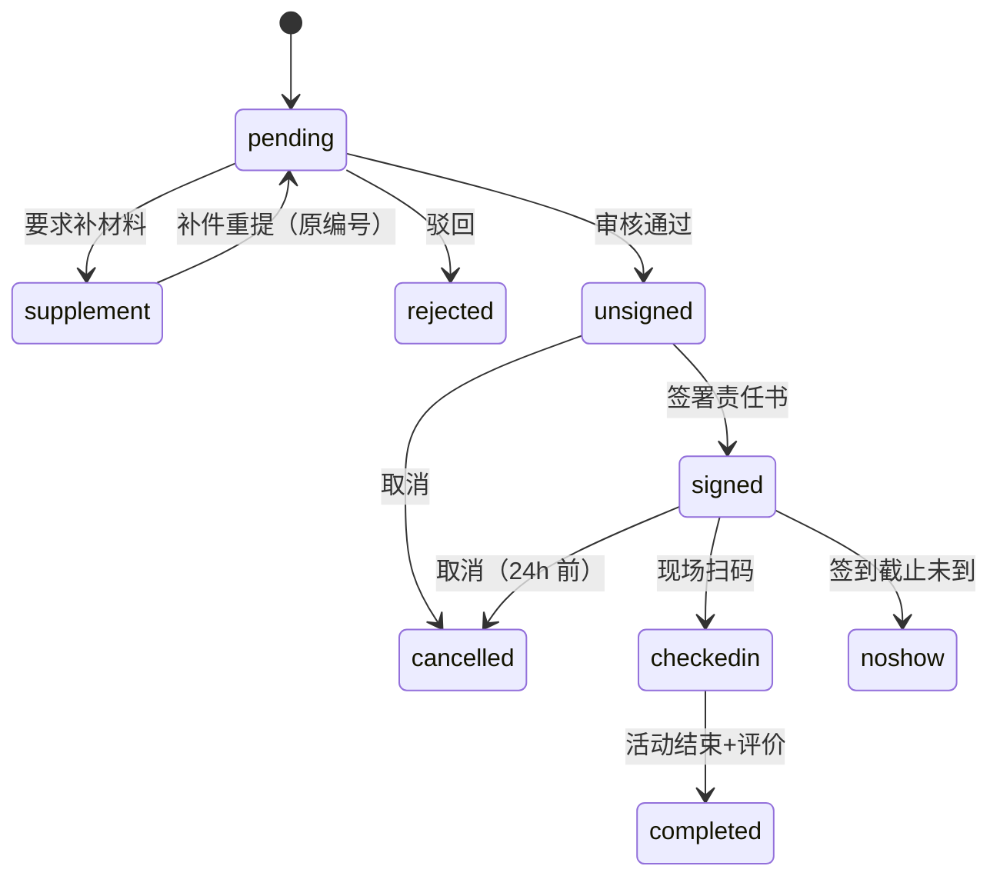

# F10 文旅研学 · 买家端页面说明（功能族）

> 端：买家端 App（`mai-APP`）　｜　功能族：**F10 文旅研学**（8 页）
> 族版本：v1.0（2026-10-23）　｜　业务分册：`开发PRD/运营管理端分册PRD/14a-研学管理.md` **v1.3**、`14b-袜博会管理.md` **v1.3**（同源数据）；买家端分册 `M07-文旅服务.md` 待撰写
> 本文件是族通用说明（§0）+ 8 个页面的**唯一源**；`_views/` 下的单页视图由 `tools/build-prd.mjs --views` 生成，勿手改。
> 页面顺序：研学 5 页（§1–§5）→ 文旅 3 页（§6–§8）。

---

## 0. 族通用说明（本族各页面共用）

### 0.1 这族解决什么问题

把大唐袜业城的**研学**（路线/场次/报名/责任书/签到）与**文旅资源**（活动日历、场馆资源）搬到手机端，让家长与学校自助完成"选路线 → 报名 → 签责任书 → 现场扫码签到"，让游客查看活动与场馆信息。

不做会怎样：报名仍靠微信群接龙、责任书靠纸质签署，出现安全事件无法追溯"谁签的、什么时候签的"，现场点名也无法沉淀数据。

### 0.2 入口矩阵（移动端一页多入口，必须列全）

| # | 入口 | 所在页面 | 目标页 | 参数 | 备注 |
|---|---|---|---|---|---|
| E1 | 首页宫格「研学申请」 | `home.html` | `study-tour.html` | — | 主入口 |
| E2 | 首页宫格「文旅活动」/「更多」 | `home.html` | `tourism.html` | — | 次入口 |
| E3 | 研学首页底部吸底按钮 | `study-tour.html` | `study-apply.html` | — | 团体申请 |
| E4 | 精选路线卡 | `study-tour.html` | `study-route.html` | `?id=1..3` | 缺 id 回退 1 |
| E5 | 我的研学卡 | `study-tour.html` | `study-my.html` | `?id=1..2` | 状态读本地 |
| E6 | 路线页场次「个人报名」 | `study-route.html` | `study-personal.html` | `?id=&date=` | 已满走候补 |
| E7 | 路线页「团体研学申请」 | `study-route.html` | `study-apply.html` | `?id=` | 文字链 |
| E8 | 团体申请结果「查看我的报名」 | `study-apply.html` | `study-my.html` | `?id=2` | 固定示例 |
| E9 | 活动卡 | `tourism.html` | `tourism-detail.html` | `?id=act1..n` | 时间轴 |
| E10 | 资源卡 | `tourism.html` | `tourism-resource.html` | `?id=1..3` | 横滑卡 |

### 0.3 角色与可见性

| 角色 | 可看 | 可做 | 未登录表现（原型） |
|---|---|---|---|
| 游客 | 路线、活动、资源、往期风采 | 浏览、打电话 | 不拦截（⚠️ 未做登录墙） |
| 家长（个人报名） | 以上 + 我的研学 | 报名、签署、签到、评价、取消 | 不拦截 |
| 学校负责人（团体） | 以上 + 团体申请 | 提交申请、补材料、查看结果 | 不拦截 |
| 运营（后台） | 全部 | 审核、排期、催签、补签 | — |

### 0.4 数据对象与唯一写入方

| 对象 | 字段要点 | 谁产生 | 谁消费 |
|---|---|---|---|
| 研学路线 | 标题/标签/时长/成团人数/亮点/行程/费用 | 运营端 14a | 买家端只读 |
| 场次 | 日期/星期/状态/余席/上限/候补开关/候补人数 | 运营端 14a | 买家端只读 |
| 研学基地 | 名称/简介/距离/开放时间 | 运营端 14a | 买家端只读 |
| 责任书模板 | 版本号/条款（个人 7 条 / 团体 5 条） | 运营端 14a | 买家端只读 |
| 报名单 | 编号/类型/路线/场次/人数/联系人/状态 | **买家端写** | 14a 审核 |
| 签署存证 | 签名图 + 时间 + IP | **买家端写一次** | 14a 只读 |
| 签到记录 | 签到时间/方式 | 现场扫码 | 14a 只读 |
| 文旅活动 | 标题/时间/地点/费用/流程/须知/状态 | 运营端 14 | 买家端只读 |
| 文旅资源 | 名称/标签/介绍/特色/交通/提示 | 运营端 14 | 买家端只读 |

### 0.5 状态机

**报名单（9 态，端上 key ↔ 后台中文）**

| 端上 key | 后台状态 | 可做的动作 |
|---|---|---|
| `pending` | 待审核 | 等待（演示：审核通过/补材料/驳回） |
| `supplement` | 待补充 | 去补充材料、重新提交 |
| `rejected` | 已驳回 | 修改后重新申请 |
| `unsigned` | 已通过（待签署） | 签署责任书、取消 |
| `signed` | 已签署（待出行） | 查看签到码、取消、模拟签到 |
| `checkedin` | 已签到 | 活动结束后评价 |
| `completed` | 已完成 | 查看评价 |
| `noshow` | 未到场 | 重新报名（签到码失效） |
| `cancelled` | 已取消 | 重新报名 |

**场次**：`可报名 / 仅剩少量 / 已满`（已满只可候补登记，暂不自动递补）。
**活动**：`报名中 / 已结束 / 待开放`（端上只读状态徽标）。

### 0.6 口径与术语

| 项 | 口径 |
|---|---|
| 余席 | 后台 `left`，展示「余 N 席 / 上限 M」；`left=0` → 「候补中」 |
| 候补 | 可登记，**不自动递补**，由运营人工通知 |
| 取消 | 出行前 **24 小时**可自助取消；24h 内联系客服 |
| 报名编号 | `YX + yyyyMMdd + 3 位序号`（团体 `YX20260910003`） |
| 年龄 | 个人报名 **6–18 岁** |
| 团体人数 | 最少 **10 人**；**≥50 人**需主管终审 |
| 责任书 | 当前模板 **v2.1（2026-09-01 启用）**；个人 7 条 / 团体 5 条 |
| 签到窗 | 出行日当天 00:00 – 活动开始后 1 小时 |
| 活动状态 | 报名中 → 已结束；非报名中不可提交报名 |

### 0.7 导航与返回栈（移动端专属）

| 场景 | 规则 |
|---|---|
| Tab 切换 | 本族页面均非 Tab 页，全部为**二级/三级页**，返回逐级回退 |
| `study-tour` 返回 | 回首页（`home.html`） |
| `study-route` 返回 | 回 `study-tour` |
| `study-personal` 返回 | 三步内返回上一步，**已填内容不丢**（DOM 不重建） |
| `study-my` 返回 | 回来源页（`study-tour` 或团体申请结果页） |
| `tourism` 返回 | 回首页 |
| `tourism-detail` / `tourism-resource` 返回 | 回 `tourism` |
| 底部面板（报名/签名） | 点遮罩或关闭按钮收起，**不触发页面返回** |

### 0.8 端间落点表

| # | 买家端页面 | 运营端页面（14a / 14b） | 商户端 | 数据方向 |
|---|---|---|---|---|
| P1 | `study-tour.html` | `study-route.html`（线路管理）、`study-base.html`（基地）、`study-promo.html`（风采） | ❌ | 后台 → 本端 |
| P2 | `study-route.html` | `study-route.html`、`study-letter.html`（模板） | ❌ | 后台 → 本端 |
| P3 | `study-personal.html` | `study-approve.html`（报名审批） | ❌ | 双向（提交 → 审核回写） |
| P4 | `study-apply.html` | `study-approve.html`、`study-group.html`（团体批次） | ❌ | 双向 |
| P5 | `study-my.html` | `study-approve.html`、`study-group.html`（签署/签到记录） | ❌ | 双向（签署/签到回传） |
| P6 | `tourism.html` | 文商旅 · 文旅活动管理 | ❌ | 后台 → 本端 |
| P7 | `tourism-detail.html` | 同上（活动编辑） | ❌ | 双向（报名回传） |
| P8 | `tourism-resource.html` | 同上（资源维护） | ❌ | 后台 → 本端 |

### 0.9 本期不做

- 在线支付 / 退款 / 发票（研学与活动均免费或线下结算）
- 团体名单 Excel 导入、批量报名
- 候补自动递补（只登记，人工通知）
- 端上评价审核（提交后进后台待审）
- 短信/推送真实通道（原型仅文案）
- 登录墙与实名认证（原型未拦截）

### 0.10 跨端字段差异（只列不一致的）

| 概念 | 本端 | 后台 14a | 目标口径 |
|---|---|---|---|
| 报名状态 | 9 个英文 key（见 §0.5） | 9 个中文状态 | 接口层做映射，端上不存中文 |
| 场次余席 | `left` | `remain`（名额配置） | 统一 `left`，后台下发 |
| 签署时间 | `signedAt`（本地） | `signTime` | 统一 `signedAt` |

---

### 0.9 出链覆盖（A 内联 / B 独立 / C 待写）

| 页面 | 出口 | 已覆盖 | B 欠账 | 说明 |
|---|---|---|---|---|
| 研学首页 | 7 | 6 | 0 | 框架出口 `mine.html` |
| 其余 7 页 | 2~4 | 全覆 | 0 | 族内互跳均已成节 |

**结论**：F10 = **✅**。

---

## 1. 研学首页 `study-tour.html`

### 1.1 页面说明

| 项 | 内容 |
|---|---|
| 页面目标 | 研学总入口：我的报名、精选路线、基地、往期风采、团体申请 |
| 使用角色 | 家长 / 学校负责人 / 游客 |
| 入口 | 首页宫格「研学申请」（E1） |
| 前置 | 无 |
| 后置 | → 路线详情 / 我的研学 / 团体申请 |

### 1.2 本页端间关系

| 项 | 内容 |
|---|---|
| 数据来源 | 运营端 14a：路线、基地、往期风采、改期通知 |
| 跨端影响 | 无写操作（纯展示 + 跳转） |
| 依赖页面 | `study-route.html` / `study-my.html` / `study-apply.html` |
| 不涉及 | 商户端 |
| 一致性 | 路线在售状态、余席与 `study-route.html` 同源 |

### 1.3 页面结构

| 区块 | 内容 |
|---|---|
| 顶部 | 渐变头图 + 标题「研学申请」 |
| 站内消息条 | 改期/审核通知，最多 1 条，可关闭 |
| 我的研学 | 报名卡（最多 2 条）+ 状态徽标 |
| 精选研学路线 | 横滑卡（3 条） |
| 研学基地 | 网格卡（4 个） |
| 往期研学风采 | 卡片流（活动内容 + 评价数 + 照片） |
| 吸底按钮 | 「团体研学申请」固定于底部 |

**页内子视图**

| 子视图 | 触发 | 规格位置 |
|---|---|---|
| 往期风采全屏详情 | 点风采卡 | §1.6 |
| 消息条关闭 | 点 × | §1.6 |

### 1.4 列表规则

| 列表 | 排序 | 条数 | 空态 |
|---|---|---|---|
| 我的研学 | 报名时间倒序 | 2（示例） | 「还没有研学报名」 |
| 精选路线 | 运营排序 | 3 | 隐藏区块 |
| 研学基地 | 距离升序 | 4 | 隐藏区块 |
| 往期风采 | 时间倒序 | 6（含 1 条 hidden） | 隐藏区块 |

### 1.5 字段规格

| 区域 | 字段 |
|---|---|
| 报名卡 | 类型（个人/团体）、路线名、日期、参与人/学校、状态 |
| 路线卡 | 封面、标题、标签、时长、成团人数、简介 |
| 基地卡 | 名称、简介、距离、开放时间 |
| 风采卡 | 封面、标题、摘要、评价数、日期 |

### 1.6 交互规则

| 元素 | 显示条件 | 可点条件 | 点击后 |
|---|---|---|---|
| 报名卡 | 有报名 | 始终 | `study-my.html?id=` |
| 路线卡 | 在售 | 始终 | `study-route.html?id=` |
| 基地卡 | — | 始终 | toast「基地详情开发中」 |
| 风采卡 | `status!=='hidden'` | 始终 | 展开全屏详情（标题/活动内容/评价/照片） |
| 团体研学申请 | 始终 | 始终 | `study-apply.html` |
| 消息条 × | 有通知 | 始终 | 收起，本次会话不再显示 |

### 1.7 业务规则与口径

| 编号 | 规则 | 触发 | 处理 | 影响端 |
|---|---|---|---|---|
| R-01 | 报名状态以本地 `studyRegState_{id}` 为准 | 渲染 | 有值覆盖、无值用示例态 | 无 |
| R-02 | 风采隐藏项不展示 | 渲染 | `status==='hidden'` 过滤 | 无 |
| R-03 | 路线下架不展示 | 渲染 | `sale==='下架'` 过滤（⚠️ 当前仅 study-route 有配置，首页未过滤） | 14a |

### 1.8 异常与边界

| 场景 | 处理 | 提示文案 |
|---|---|---|
| 无报名 | 固定 2 条示例，**未做空态** | ⬜ 待实现 |
| localStorage 不可用 | 回落示例态 | 无 |
| 图片加载失败 | 渐变底色兜底 | 无 |
| 通知超过 1 条 | 只显示最新 1 条 | 无 |

### 1.9 通知与消息

| 事件 | 来源 | 本页呈现 |
|---|---|---|
| 场次改期 | 14a 改期 | 顶部消息条（含原日期/新日期） |
| 审核结果 | 14a 审核 | 消息条 + 报名卡状态 |

### 1.10 验收标准

| # | 前置 | 操作 | 预期 | 优先级 |
|---|---|---|---|---|
| AC-01 | 有 2 条报名 | 打开首页 | 我的研学显示 2 条，状态与本地一致 | P0 |
| AC-02 | 路线 3 条 | 点第 2 条 | 进入 `study-route.html?id=2` | P0 |
| AC-03 | 有 hidden 风采 | 打开首页 | 不展示该条 | P1 |
| AC-04 | 点吸底按钮 | — | 进入团体申请页 | P0 |

---

## 2. 路线详情 `study-route.html`

### 2.1 页面说明

| 项 | 内容 |
|---|---|
| 页面目标 | 单条研学路线的完整介绍 + 场次日历 + 报名入口 + 往期风采 |
| 使用角色 | 家长 / 学校负责人 |
| 入口 | 研学首页路线卡（E4） |
| 前置 | `?id=1..3`，缺省回退 1 |
| 后置 | → 个人报名 / 团体申请 |

### 2.2 本页端间关系

| 项 | 内容 |
|---|---|
| 数据来源 | 14a 路线、场次、历史风采、责任书模板版本 |
| 跨端影响 | 无写操作 |
| 依赖页面 | `study-personal.html`、`study-apply.html` |
| 不涉及 | 商户端 |
| 一致性 | 余席/候补与 14a 场次管理实时同步 |

### 2.3 页面结构

| 区块 | 内容 |
|---|---|
| 封面 | 大图 + 返回 + 标签（工艺体验/文化课堂/工厂参观） |
| 路线信息 | 标题、时长、成团人数、简介 |
| 路线亮点 | 3–4 条 |
| 行程安排 | 时间轴 |
| 费用说明 | 含/不含项 |
| **活动日历及报名** | 场次列表（Tab：场次 / 历史风采） |
| 历史风采 | 场次统计 + 风采卡 |
| 精选留言 | 后台精选评价 |
| 吸底按钮 | 「立即报名」 |

**页内子视图**

| 子视图 | 触发 | 规格位置 |
|---|---|---|
| 场次 Tab | 默认 | §2.4.1 |
| 历史风采 Tab | 点第二个 Tab | §2.4.2 |

### 2.4 列表规则

#### 2.4.1 场次

| 项 | 规则 |
|---|---|
| 排序 | 日期升序 |
| 状态 | 可报名 / 仅剩少量 / 已满（已满置灰，按钮变「候补登记」） |
| 余席 | 「余 N 席 / 上限 M」；0 → 「候补中」 |
| 候补提示 | `waitOn` 且有候补 → 显示「已开启候补 · 当前候补 N 人（暂不自动递补）」 |

#### 2.4.2 历史风采

| 项 | 规则 |
|---|---|
| 统计 | 已开展场次、累计参与人数 |
| 卡片 | 场次日期、参与人数、照片、评价 |

### 2.5 字段规格

| 区域 | 字段 |
|---|---|
| 路线 | 标题、标签、时长、成团人数、简介、亮点、行程、费用 |
| 场次 | 日期、星期、状态、余席、上限、候补人数 |
| 风采 | 场次、人数、封面、评价摘要 |

### 2.6 交互规则

| 元素 | 显示条件 | 可点条件 | 点击后 |
|---|---|---|---|
| 个人报名 | `status!=='已满'` | 始终 | `study-personal.html?id=&date=` |
| 候补登记 | `status==='已满'` | 始终 | toast「已加入候补队列，当前第 N 位」 |
| 团体研学申请（文字链） | 始终 | 始终 | `study-apply.html` |
| 返回 | 始终 | 始终 | `study-tour.html` |
| Tab 切换 | 始终 | 始终 | 切换场次/风采，不刷新页面 |

### 2.7 业务规则与口径

| 编号 | 规则 | 触发 | 处理 | 影响端 |
|---|---|---|---|---|
| R-04 | 已满只可候补 | 渲染 | 按钮换「候补登记」，不生成报名单 | 14a |
| R-05 | 余席取后台 `left` | 渲染 | 展示「余 N 席 / 上限 M」 | 14a |
| R-06 | 候补不自动递补 | 渲染 | 文案明确「由运营人工通知」 | 14a |
| R-07 | 路线下架不可报名 | 渲染 | ⚠️ 配置有 `sale:'下架'`，页面未拦截（附录 A） | 14a |

### 2.8 异常与边界

| 场景 | 处理 | 提示文案 |
|---|---|---|
| id 不存在 | 回退路线 1 | 无 |
| 场次为空 | 场次列表为空，**未做空态文案** | ⬜ 待实现 |
| 候补已达上限 | 仍可登记 | — |
| 网络失败（接口期） | 接口期处理 | ⬜ 待实现 |

### 2.9 通知与消息

改期通知在研学首页展示，本页不重复。

### 2.10 验收标准

| # | 前置 | 操作 | 预期 | 优先级 |
|---|---|---|---|---|
| AC-05 | 场次「已满」 | 点按钮 | toast 候补提示，不跳报名 | P0 |
| AC-06 | 场次「余 6 席」 | 点个人报名 | 进入报名页且日期选中该场 | P0 |
| AC-07 | 切到历史风采 | — | 显示场次数 + 累计人数 | P1 |
| AC-08 | `?id=99` | 打开 | 回退路线 1，不白屏 | P1 |

---

## 3. 个人报名 `study-personal.html`

### 3.1 页面说明

| 项 | 内容 |
|---|---|
| 页面目标 | 家长三步完成个人报名：学生信息 → 签责任书 → 确认提交 |
| 使用角色 | 家长 / 监护人 |
| 入口 | 路线页场次「个人报名」（E6）、路线页「立即报名」 |
| 前置 | `?id=` 路线，`?date=` 场次下标 |
| 后置 | 成功页（编号 + 后续说明） |

### 3.2 本页端间关系

| 项 | 内容 |
|---|---|
| 数据来源 | 14a 路线/场次/责任书模板（个人版 7 条） |
| 跨端影响 | 提交生成报名单（待审核），回传 14a |
| 依赖页面 | `study-my.html`（查看进度） |
| 不涉及 | 商户端 |
| 一致性 | 责任书条款与 14a 模板 v2.1 一致 |

### 3.3 页面结构

| 区块 | 内容 |
|---|---|
| 步骤条 | ① 学生信息 ② 签责任书 ③ 确认 |
| Step1 | 学生姓名、年龄、性别、学校、年级、家长姓名、电话、关系 |
| Step2 | 责任书全文（7 条，可逐条勾选）+ 手写签名画布 |
| Step3 | 确认信息 + 提交 |
| Step4 | 成功页：报名编号 + 后续步骤 |

**页内子视图**

| 子视图 | 触发 | 规格位置 |
|---|---|---|
| 责任书条款勾选 | Step2 | §3.6 |
| 手写签名画布 | Step2 底部 | §3.6 |
| 成功页 | 提交后 | §3.5 |

### 3.4 列表与筛选

不适用（纯表单）。

### 3.5 字段规格

| 字段 | 必填 | 校验 | 提示 |
|---|---|---|---|
| 学生姓名 | ✅ | 非空 | 「请填写完整信息」 |
| 年龄 | ✅ | 6–18 | 同 |
| 性别 | ✅ | 选择 | 同 |
| 学校 | ✅ | 非空 | 同 |
| 年级 | ✅ | 非空 | 同 |
| 家长姓名 | ✅ | 非空 | 同 |
| 家长电话 | ✅ | 非空 | 同 |
| 与学生关系 | ✅ | 选择 | 同 |
| 条款勾选 | ✅ | 7 条全选 | 「请阅读并同意全部条款」 |
| 手写签名 | ✅ | 画布非空 | 「请手写签名」 |
| 报名编号 | 自动 | `YX+yyyyMMdd+3位` | — |

### 3.6 交互规则

| 元素 | 显示条件 | 可点条件 | 点击后 |
|---|---|---|---|
| 下一步 | Step1 | 必填齐全 | 进入 Step2；缺失则 toast + 聚焦 |
| 全选条款 | Step2 | 始终 | 勾选/取消全部 |
| 签名清空 | 有笔迹 | 始终 | 清空画布 |
| 提交报名 | Step3 | 条款全选 + 已签名 | 生成编号，进成功页 |
| 返回上一步 | Step2/3 | 始终 | 回上一步，内容保留 |

### 3.7 业务规则与口径

| 编号 | 规则 | 触发 | 处理 | 影响端 |
|---|---|---|---|---|
| R-08 | 年龄 6–18 | 提交 | 超范围拦截 | 14a |
| R-09 | 条款必须全选 | 提交 | 未全选 → 拦截 | 14a |
| R-10 | 签名必填 | 提交 | 未画 → 拦截 | 14a |
| R-11 | 编号规则 | 提交 | `YX+日期+007`（示例） | 14a |
| R-12 | 提交即占名额 | 提交 | 进入待审核，占位 | 14a |

### 3.8 异常与边界

| 场景 | 处理 | 提示文案 |
|---|---|---|
| 必填缺失 | 聚焦首个空项 | 「请填写完整信息」 |
| 条款未全选 | 阻止提交 | 「请先逐条阅读并勾选责任书条款」 |
| 未签名 | 阻止提交 | 「请家长先手写签名」 |
| 重复点击提交 | 按钮置灰 | 无 |
| 场次已满（深链进入） | 选场次时拦截 | 「该场次名额已满，请改选其他场次」 |

### 3.9 通知与消息

| 事件 | 接收人 | 渠道 |
|---|---|---|
| 提交成功 | 家长 | 短信（原型仅文案） |
| 审核通过/驳回 | 家长 | 短信 |

### 3.10 验收标准

| # | 前置 | 操作 | 预期 | 优先级 |
|---|---|---|---|---|
| AC-09 | 空表单 | 点下一步 | 停留并提示，聚焦首个空项 | P0 |
| AC-10 | 条款未全选 | 点提交 | 拦截并提示 | P0 |
| AC-11 | 全部完成 | 提交 | 生成编号，进成功页 | P0 |
| AC-12 | 年龄填 20 | 下一步 | 拦截 | P1 |

---

## 4. 团体申请 `study-apply.html`

### 4.1 页面说明

| 项 | 内容 |
|---|---|
| 页面目标 | 学校/机构提交团体研学申请，并回显"待审核 / 待补充"两种结果 |
| 使用角色 | 学校负责人 |
| 入口 | 研学首页吸底按钮（E3）、路线页文字链（E7） |
| 前置 | 无（可带 `?id=` 预选路线） |
| 后置 | → 我的报名 / 返回研学 |

### 4.2 本页端间关系

| 项 | 内容 |
|---|---|
| 数据来源 | 14a 路线、场次余席、责任书（团体版 5 条） |
| 跨端影响 | 生成团体申请单；≥50 人触发主管终审 |
| 依赖页面 | `study-my.html`、14a `study-group.html` |
| 不涉及 | 商户端 |
| 一致性 | 余席不足进候补，与 14a 名额口径一致 |

### 4.3 页面结构

| 区块 | 内容 |
|---|---|
| 表单 | 学校、联系人、电话、人数、路线、日期、备注、协议勾选 |
| 步骤卡 | Step1 填写 → Step2 审核 → Step3 签署 → Step4 出行 |
| 结果态 | ① 已提交（待审核）② 待补材料（退回原因 + 补充） |

**页内子视图**

| 子视图 | 触发 | 规格位置 |
|---|---|---|
| 已提交结果卡 | 提交成功 | §4.5 |
| 待补材料结果卡 | 演示「模拟审核退回」或后台退回 | §4.5 / §4.6 |

### 4.4 列表与筛选

不适用。

### 4.5 字段规格

| 字段 | 必填 | 校验 | 提示 |
|---|---|---|---|
| 学校名称 | ✅ | 非空 | 「请填写学校名称」 |
| 联系人 | ✅ | 非空 | 「请填写联系人」 |
| 联系电话 | ✅ | 11 位 | 「请填写正确的手机号」 |
| 参与人数 | ✅ | ≥10 | 「团体人数不少于 10 人」 |
| 研学路线 | ✅ | 选择 | 「请选择研学路线」 |
| 出行日期 | ✅ | 可报名场次 | 「请选择出行日期」 |
| 备注 | ❌ | ≤200 字 | — |
| 协议 | ✅ | 勾选 | 「请阅读并同意《团体研学协议》」 |
| 申请编号 | 自动 | `YX+日期+序号` | — |

### 4.6 交互规则

| 元素 | 显示条件 | 可点条件 | 点击后 |
|---|---|---|---|
| 提交申请 | 始终 | 必填齐全 + 协议勾选 | 生成编号 → 已提交态 |
| 补充材料 | 待补材料态 | 始终 | 滚动回表单，保留原编号 |
| 查看我的报名 | 已提交/待补 | 始终 | `study-my.html?id=2` |
| 模拟审核退回 | 已提交态（演示） | 始终 | 切到待补材料态 |
| 返回研学 | 始终 | 始终 | `study-tour.html` |

### 4.7 业务规则与口径

| 编号 | 规则 | 触发 | 处理 | 影响端 |
|---|---|---|---|---|
| R-13 | 团体最少 10 人 | 提交 | <10 拦截 | 14a |
| R-14 | 余席不足进候补 | 提交 | 结果态提示「候补队列，不自动递补」 | 14a |
| R-15 | ≥50 人主管终审 | 审核 | 审核周期可能 +1 工作日 | 14a |
| R-16 | 补件保留原编号 | 补件 | 编号不变，重新进审核 | 14a |
| R-17 | 补件 7 天未提自动取消 | 定时 | 释放名额 | 14a |

### 4.8 异常与边界

| 场景 | 处理 | 提示文案 |
|---|---|---|
| 人数 <10 | 输入框 `min=10` 限制，**无单独拦截提示** | ⬜ 待实现 |
| 场次已满 | 允许提交但进候补 | 「当前名额不足，已进入候补队列」 |
| 协议未勾 | 页面**未设协议勾选** | ⬜ 待实现 |
| 重复提交 | 按钮置灰 | 无 |
| 补件超 7 天 | 后台置取消，端上无提示 | — |

### 4.9 通知与消息

| 事件 | 接收人 | 渠道 |
|---|---|---|
| 提交成功 | 联系人 | 短信（原型仅文案） |
| 审核通过/退回/驳回 | 联系人 | 短信 |

### 4.10 验收标准

| # | 前置 | 操作 | 预期 | 优先级 |
|---|---|---|---|---|
| AC-13 | 人数填 5 | 提交 | 拦截并提示 | P0 |
| AC-14 | 信息完整 | 提交 | 显示已提交态 + 编号 | P0 |
| AC-15 | 已提交 | 点模拟退回 | 显示退回原因 + 补充按钮 | P1 |
| AC-16 | 待补材料 | 点补充材料 | 回到表单，编号不变 | P1 |

---

## 5. 报名详情 `study-my.html`

### 5.1 页面说明

| 项 | 内容 |
|---|---|
| 页面目标 | 单个报名单的第一现场：9 态进度、签署、签到码、取消、评价 |
| 使用角色 | 家长 / 学校负责人 |
| 入口 | 研学首页报名卡（E5）、团体申请结果（E8） |
| 前置 | `?id=1..2`；可选 `?status=` 直达演示态 |
| 后置 | 返回来源页 |

### 5.2 本页端间关系

| 项 | 内容 |
|---|---|
| 数据来源 | 报名单（端上）+ 审核/签署/签到状态（14a 回写） |
| 跨端影响 | 签署存证、签到记录回传 14a |
| 依赖页面 | 14a `study-approve.html`、`study-group.html` |
| 不涉及 | 商户端 |
| 一致性 | 状态与 14a 9 态一一对应 |

### 5.3 页面结构

| 区块 | 内容 |
|---|---|
| 头部 | 渐变主题（随状态变色）+ 副标题 |
| 报名信息 | 姓名/学校/电话/编号/审核状态 |
| 进度条 | 提交 → 审核 → 签署 → 研学（第 3/4 节点随状态） |
| 内容区 | 9 态分支（待审核/待补充/已驳回/待签署/已签署/已签到/已完成/未到场/已取消） |
| 底部提示 | 客服热线 / 取消入口 |

**页内子视图**

| 子视图 | 触发 | 规格位置 |
|---|---|---|
| 责任书签署（全文 + 手写签名） | 待签署态 | §5.6 |
| 签到二维码 + 模拟签到 | 已签署/已签到 | §5.6 |
| 取消确认弹窗 | 点「取消报名」 | §5.6 |
| 评价弹窗（星级 + 文字） | 已完成前 | §5.6 |
| 演示态切换（审核/补件/驳回/重提） | 待审核/待补充态 | §5.6 |

### 5.4 列表与筛选

不适用（单条详情）。

### 5.5 字段规格

| 区域 | 字段 |
|---|---|
| 报名信息 | 类型、姓名/学校、人数、联系电话、申请编号、审核状态 |
| 签署 | 模板版本 v2.1、条款（个人 7 / 团体 5）、签名、签署日期、存证编号 `CE+编号` |
| 签到码 | 二维码、说明、签到时间 |
| 评价 | 星级、文字、提交时间、审核状态 |

### 5.6 交互规则

| 元素 | 显示条件 | 可点条件 | 点击后 |
|---|---|---|---|
| 立即签署 | `unsigned` | 始终 | 滚动到责任书 |
| 提交签名 | 有笔迹 | 必填 | 状态 → `signed`，生成签到码 |
| 签到码 | `signed/checkedin/completed` | — | 展示二维码 |
| 模拟扫码签到 | `signed` | 始终 | 状态 → `checkedin`，记录时间 |
| 取消报名 | `unsigned/signed` 且距出行 >24h | 始终 | 二次确认 → `cancelled` |
| 去补充材料 | `supplement` | 始终 | 跳 `study-apply.html` |
| 重新提交 | `supplement`（演示） | 始终 | 状态 → `pending`，编号不变 |
| 演示审核通过/补件/驳回 | `pending`（演示） | 始终 | 切换对应状态 |
| 重新报名 | `rejected/noshow/cancelled` | 始终 | 跳申请页 |
| 去评价 | `checkedin` 且活动结束 | 始终 | 评价弹窗 → `completed` |

### 5.7 业务规则与口径

| 编号 | 规则 | 触发 | 处理 | 影响端 |
|---|---|---|---|---|
| R-18 | 9 态映射 | 渲染 | 主题/徽标/进度/内容同步切换 | 14a |
| R-19 | 补件保留原编号 | 重新提交 | 编号不变 | 14a |
| R-20 | 未到场码失效 | `noshow` | 不渲染二维码 | 14a |
| R-21 | 24h 内不可自助取消 | 取消 | 提示联系客服 | 14a |
| R-22 | 签到幂等 | 重复签到 | 拦截并提示已签到时间 | 现场 |
| R-23 | 评价需活动结束 | 评价 | 未结束只可「标记活动结束」（演示） | 14a |

### 5.8 异常与边界

| 场景 | 处理 | 提示文案 |
|---|---|---|
| id 无效 | 回退 1 | 无 |
| localStorage 失败 | 用默认态 | 无 |
| 重复签到 | 已签到后不再显示签到按钮（无重复入口） | — |
| 未签署点签到码 | 不展示二维码 | 无 |
| 补件超 7 天 | 后台置取消，端上无提示 | — |

### 5.9 通知与消息

| 事件 | 接收人 | 渠道 |
|---|---|---|
| 审核通过（待签署） | 家长 | 短信 |
| 出行前 3 天/1 天未签 | 家长 | 短信 |
| 改期 | 家长 | 站内 + 短信 |

### 5.10 验收标准

| # | 前置 | 操作 | 预期 | 优先级 |
|---|---|---|---|---|
| AC-17 | `?status=pending` | 打开 | 显示待审核 + 演示按钮 | P0 |
| AC-18 | 待签署 | 签名提交 | 状态变已签署，出现签到码 | P0 |
| AC-19 | `?status=noshow` | 打开 | 显示未到场且无二维码 | P0 |
| AC-20 | 距出行 12h | 点取消 | 拦截并提示联系客服 | P1 |
| AC-21 | 已签到且活动结束 | 提交评价 | 状态变已完成 | P1 |

---

## 6. 文旅活动 `tourism.html`

### 6.1 页面说明

| 项 | 内容 |
|---|---|
| 页面目标 | 文旅资源入口 + 活动日历（按月筛选） |
| 使用角色 | 游客 / 采购商 / 家长 |
| 入口 | 首页宫格「文旅活动」/「更多」（E2） |
| 前置 | 无 |
| 后置 | → 资源详情 / 活动详情 |

### 6.2 本页端间关系

| 项 | 内容 |
|---|---|
| 数据来源 | 文商旅 · 文旅资源、活动日历 |
| 跨端影响 | 无写操作（活动报名在详情页） |
| 依赖页面 | `tourism-detail.html`、`tourism-resource.html` |
| 不涉及 | 商户端 |
| 一致性 | 活动状态与报名人数与详情页同源 |

### 6.3 页面结构

| 区块 | 内容 |
|---|---|
| 顶部 | 渐变头「文旅活动」 |
| 文旅资源 | 横滑卡（教育/文化/工业旅游） |
| 月份筛选 | 全部 / 08 / 09 / 10 … |
| 活动时间轴 | 按月分组的活动卡（状态徽标 + 人数 + 去报名） |

**页内子视图**

| 子视图 | 触发 | 规格位置 |
|---|---|---|
| 月份筛选 | 点月份 pill | §6.6 |
| 横滑拖拽 | 鼠标/手指拖动 | §6.6 |

### 6.4 列表规则

| 列表 | 排序 | 筛选 | 空态 |
|---|---|---|---|
| 文旅资源 | 运营排序 | 无 | 隐藏区块 |
| 活动时间轴 | 日期升序 | 月份 | 「该月暂无活动」 |

### 6.5 字段规格

| 区域 | 字段 |
|---|---|
| 资源卡 | 封面、标题、标签、简介、地址、电话 |
| 活动卡 | 月份、状态、日期、标题、简介、地点、参与人数 |

### 6.6 交互规则

| 元素 | 显示条件 | 可点条件 | 点击后 |
|---|---|---|---|
| 资源卡 | 始终 | 始终 | `tourism-resource.html?id=` |
| 活动卡 | 始终 | 始终 | `tourism-detail.html?id=act{id}` |
| 去报名标签 | `canSignup=true` | 始终 | 同活动卡 |
| 月份 pill | 始终 | 始终 | 过滤时间轴 |
| 返回首页 | 始终 | 始终 | `home.html` |

### 6.7 业务规则与口径

| 编号 | 规则 | 触发 | 处理 | 影响端 |
|---|---|---|---|---|
| R-24 | 已结束活动置灰 | 渲染 | 不可报名，dot 变灰 | 14 |
| R-25 | 报名中显示「去报名」 | 渲染 | 详情页可提交 | 14 |
| R-26 | 月份筛选只影响时间轴 | 点击 | 资源区不变 | 无 |

### 6.8 异常与边界

| 场景 | 处理 | 提示文案 |
|---|---|---|
| 该月无活动 | 时间轴渲染为空，**未做空态文案** | ⬜ 待实现 |
| 图片加载失败 | 渐变兜底 | 无 |
| 活动数 0 | 隐藏区块 | 无 |

### 6.9 通知与消息

无（活动变更通知在详情页/首页）。

### 6.10 验收标准

| # | 前置 | 操作 | 预期 | 优先级 |
|---|---|---|---|---|
| AC-22 | 7 场活动 | 打开 | 时间轴按日期展示 | P0 |
| AC-23 | 选 08 月 | 点 pill | 只剩 8 月活动 | P1 |
| AC-24 | 点资源卡 | — | 进入资源详情且内容匹配 | P0 |

---

## 7. 活动详情 `tourism-detail.html`

### 7.1 页面说明

| 项 | 内容 |
|---|---|
| 页面目标 | 单个活动详情 + 底部报名面板 |
| 使用角色 | 游客 / 采购商 |
| 入口 | 活动卡（E9） |
| 前置 | `?id=act1..n`，缺省回退 act1 |
| 后置 | 报名成功（toast） |

### 7.2 本页端间关系

| 项 | 内容 |
|---|---|
| 数据来源 | 文旅活动（标题/时间/地点/费用/流程/须知/状态） |
| 跨端影响 | 报名单回传运营端 |
| 依赖页面 | `tourism.html` |
| 不涉及 | 商户端 |
| 一致性 | 报名人数与列表页同步 |

### 7.3 页面结构

| 区块 | 内容 |
|---|---|
| 封面 | 大图 + 状态徽标 + 标题 + 日期 |
| 信息卡 | 地点 / 时间 / 参与人数 / 费用 |
| 活动介绍 | 正文 + 2 张图 |
| 活动流程 | 时间轴 |
| 主办方 | 名称 + 电话 |
| 参与须知 | 条目 |
| 吸底操作 | 收藏 / 分享 / 立即报名 |

**页内子视图**

| 子视图 | 触发 | 规格位置 |
|---|---|---|
| 报名底部面板 | 点「立即报名」 | §7.5 / §7.6 |
| 报名成功 toast | 提交 | §7.6 |

### 7.4 列表与筛选

不适用。

### 7.5 字段规格

| 区域 | 字段 |
|---|---|
| 活动 | 标题、日期、时间、地点、参与人数、费用、介绍、流程、主办方、须知、状态 |
| 报名面板 | 姓名、手机号、票种、数量 |
| 状态按钮 | 立即报名 / 活动已结束 / 查看详情 |

### 7.6 交互规则

| 元素 | 显示条件 | 可点条件 | 点击后 |
|---|---|---|---|
| 立即报名 | `status==='报名中'` | 始终 | 打开底部面板 |
| 活动已结束 | `status==='已结束'` | 置灰 | toast「该活动已结束」 |
| 查看详情 | 其他状态 | 始终 | toast「活动即将开放报名，请关注后续通知」 |
| 数量 +/− | 面板 | ≥1 | 更新数量 |
| 提交报名 | 面板 | 姓名/手机非空 | toast 报名成功，关闭面板 |
| 收藏 / 分享 | 始终 | 始终 | toast |

### 7.7 业务规则与口径

| 编号 | 规则 | 触发 | 处理 | 影响端 |
|---|---|---|---|---|
| R-27 | 仅报名中可报名 | 渲染 | 按钮按状态切换 | 14 |
| R-28 | 免费活动不显示金额 | 渲染 | 费用显示「免费」 | 14 |
| R-29 | 数量最少 1 | 点 − | 不低于 1 | 无 |
| R-30 | 报名人数含本次 | 提交 | 回写活动人数 | 14 |

### 7.8 异常与边界

| 场景 | 处理 | 提示文案 |
|---|---|---|
| id 无效 | 回退 act1 | 无 |
| 姓名为空 | 阻止提交（手机号未校验） | 「请填写姓名」 |
| 重复提交 | 面板关闭 | 无 |
| 活动已结束（深链） | 按钮置灰 | 「该活动已结束」 |

### 7.9 通知与消息

| 事件 | 接收人 | 渠道 |
|---|---|---|
| 报名成功 | 报名人 | 短信（原型仅 toast） |
| 活动变更/取消 | 已报名人 | 短信 |

### 7.10 验收标准

| # | 前置 | 操作 | 预期 | 优先级 |
|---|---|---|---|---|
| AC-25 | act1（已结束） | 打开 | 按钮「活动已结束」且置灰 | P0 |
| AC-26 | act2（报名中） | 点报名 → 提交 | 提示成功，面板关闭 | P0 |
| AC-27 | 数量点 − | 连续点 | 最小为 1 | P2 |

---

## 8. 文旅资源详情 `tourism-resource.html`

### 8.1 页面说明

| 项 | 内容 |
|---|---|
| 页面目标 | 单个文旅资源（场馆/基地）的介绍、特色、交通、提示 |
| 使用角色 | 游客 / 家长 |
| 入口 | 文旅资源卡（E10） |
| 前置 | `?id=1..3`，缺省回退 1 |
| 后置 | 导航/收藏（toast） |

### 8.2 本页端间关系

| 项 | 内容 |
|---|---|
| 数据来源 | 文旅资源库（名称/标签/介绍/特色/交通/提示） |
| 跨端影响 | 无 |
| 依赖页面 | `tourism.html` |
| 不涉及 | 商户端 |
| 一致性 | 与列表卡同源 |

### 8.3 页面结构

| 区块 | 内容 |
|---|---|
| 封面 | 大图 + 标签 + 名称 + 副标题 |
| 资源介绍 | 正文 |
| 特色 | 图标 + 文字（3–4 条） |
| 图集 | 6 宫格 |
| 交通指引 | 自驾/公交/步行 |
| 温馨提示 | 预约/参观规则 |
| 吸底操作 | 导航 / 收藏 |

### 8.4 列表与筛选

不适用。

### 8.5 字段规格

| 区域 | 字段 |
|---|---|
| 头部 | 标签、名称、副标题、封面 |
| 正文 | 介绍、特色、图集、交通、提示 |
| 操作 | 导航、收藏 |

### 8.6 交互规则

| 元素 | 显示条件 | 可点条件 | 点击后 |
|---|---|---|---|
| 导航 | 始终 | 始终 | toast（原型模拟） |
| 收藏 | 始终 | 始终 | toast「已收藏资源」 |
| 外部链接 | 有外链 | 始终 | toast「跳转外部页面（原型模拟）」 |
| 返回 | 始终 | 始终 | `tourism.html` |

### 8.7 业务规则与口径

| 编号 | 规则 | 触发 | 处理 | 影响端 |
|---|---|---|---|---|
| R-31 | 资源只读 | 渲染 | 无写操作 | 14 |
| R-32 | 需预约资源给提示 | 渲染 | 提示「部分体验课程需提前预约」 | 14 |

### 8.8 异常与边界

| 场景 | 处理 | 提示文案 |
|---|---|---|
| id 无效 | 回退 1 | 无 |
| 图片失败 | 渐变兜底 | 无 |
| 无外链 | 隐藏运营按钮 | 无 |

### 8.9 通知与消息

无。

### 8.10 验收标准

| # | 前置 | 操作 | 预期 | 优先级 |
|---|---|---|---|---|
| AC-28 | `?id=2` | 打开 | 显示华夏金石学馆内容 | P0 |
| AC-29 | 点收藏 | — | toast 提示 | P2 |
| AC-30 | `?id=99` | 打开 | 回退资源 1 | P2 |

---

## 附录 A：与分册的对齐记录

| # | 分册要求（14a v1.3） | 原型实现 | 处置 |
|---|---|---|---|
| A-1 | 路线下架不可报名 | 配置有 `sale:'下架'`，`study-route.html` **未拦截** | ⚠️ 待修（端上待办） |
| A-2 | 登录后才可报名 | 原型无登录墙 | ⚠️ 已知缺口（接口期） |
| A-3 | 未到场由定时任务判定 | 仅 `?status=noshow` 演示 | ⚠️ 接口期 |
| A-4 | 短信通知 | 仅文案/toast | ⚠️ 接口期 |
| A-5 | 补件保留原编号 | 已实现（`supplement → pending`，编号不变） | ✅ |
| A-6 | 责任书模板版本化 | 标注 v2.1（2026-09-01 启用） | ✅（版本号待确认） |

## 附录 B：接口依赖

| 接口 | 用途 | 现状 |
|---|---|---|
| `GET /study/routes` | 路线列表/详情 | mock |
| `GET /study/sessions?routeId=` | 场次与余席 | mock |
| `POST /study/signup` | 个人/团体报名 | mock |
| `POST /study/sign` | 签署存证 | mock（本地） |
| `POST /study/checkin` | 现场签到 | mock |
| `GET /tourism/activities` | 活动列表/详情 | mock |
| `GET /tourism/resources` | 资源列表/详情 | mock |

## 附录 C：页面清单

| # | 页面 | 文件 | 节 | 入口数 | 状态 |
|---|---|---|---|---|---|
| 1 | 研学首页 | `study-tour.html` | §1 | 1 | ✅ |
| 2 | 路线详情 | `study-route.html` | §2 | 1 | ✅ |
| 3 | 个人报名 | `study-personal.html` | §3 | 2 | ✅ |
| 4 | 团体申请 | `study-apply.html` | §4 | 2 | ✅ |
| 5 | 报名详情 | `study-my.html` | §5 | 2 | ✅ |
| 6 | 文旅活动 | `tourism.html` | §6 | 1 | ✅ |
| 7 | 活动详情 | `tourism-detail.html` | §7 | 1 | ✅ |
| 8 | 文旅资源详情 | `tourism-resource.html` | §8 | 1 | ✅ |
