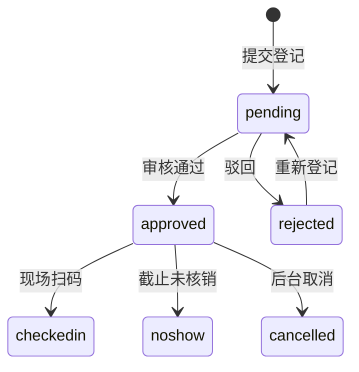

# F11 袜博会 · 买家端页面说明（功能族）

> 端：买家端 App（`mai-APP`）　｜　功能族：**F11 袜博会**（7 页）
> 族版本：v1.0（2026-10-23）　｜　业务分册：`开发PRD/运营管理端分册PRD/14b-袜博会管理.md` **v1.3**
> 本文件是族通用说明（§0）+ 7 个页面的**唯一源**；`_views/` 下的单页视图由 `tools/build-prd.mjs --views` 生成，勿手改。
> 页面顺序：展会首页 → 介绍 → 日程 → 日程详情 → 参观登记 → 资料下载 → 展位申请。

---

## 0. 族通用说明（本族各页面共用）

### 0.1 这族解决什么问题

第 18 届袜博会的移动端入口：看展会信息与日程、在线参观登记领入场码、现场扫码核销、按登记/核销状态解锁资料、展商在线自选展位并提交申请。

不做会怎样：观众靠纸质名单核对入场，资料人人可下载，展位靠邮件+手绘平面图分配，到场率无法统计。

### 0.2 入口矩阵

| # | 入口 | 所在页面 | 目标页 | 参数 | 备注 |
|---|---|---|---|---|---|
| E1 | 首页宫格「袜博会」 | `home.html` | `expo.html` | — | 主入口 |
| E2 | 快捷入口·展会介绍 | `expo.html` | `expo-info.html` | — | — |
| E3 | 快捷入口·展位申请 | `expo.html` | `expo-booth-apply.html` | — | 展商 |
| E4 | 快捷入口/顶部按钮·参观登记 | `expo.html` | `expo-visitor-apply.html` | — | 观众 |
| E5 | 快捷入口·展会日程 | `expo.html` | `expo-schedule.html` | — | — |
| E6 | 快捷入口·资料下载 | `expo.html` | `expo-materials.html` | — | 受策略控制 |
| E7 | 日程条目 / 「完整日程」 | `expo.html` | `expo-session-detail.html` / `expo-schedule.html` | `?id=S2026-x-xxx` | — |
| E8 | 日程卡片 | `expo-schedule.html` | `expo-session-detail.html` | `?id=` | — |
| E9 | 资料锁定「去登记」 | `expo-materials.html` | `expo-visitor-apply.html` | — | — |
| E10 | 登记结果「返回展会主页」 | `expo-visitor-apply.html` | `expo.html` | — | — |

### 0.3 角色与可见性

| 角色 | 可看 | 可做 | 未登录/未登记表现 |
|---|---|---|---|
| 游客 | 展会信息、日程、展商、往届 | 浏览、报名、申请展位 | 公开资料可直接下载 |
| 已登记（待审核） | 以上 | 等待审核 | 「需登记解锁」资料仍锁定，提示审核中 |
| 已登记（已通过） | 以上 + 入场证 | 到场扫码核销 | 「需登记解锁」解锁；「需核销解锁」仍锁 |
| 已核销 | 全部 | 下载全部资料 | 全解锁 |
| 展商 | 展位申请与结果 | 自选展位、提交申请、查看缴费状态 | — |

### 0.4 数据对象与唯一写入方

| 对象 | 字段要点 | 谁产生 | 谁消费 |
|---|---|---|---|
| 展会配置 | 届次/日期/场馆/规模/倒计时/平面图 | 运营端 14b | 买家端只读 |
| 展商与往届 | 展商名/展位/主营/精选；往届图 | 运营端 14b | 买家端只读 |
| 日程 | 天/时间/标题/地点/类型/嘉宾/亮点 | 运营端 14b | 买家端只读 |
| 参观登记单 | 编号 `V2026xxxx`/姓名/企业/身份/日期/品类/状态 | **买家端写** | 14b 审核 |
| 核销记录 | 核销时间/方式 | 现场扫码 | 14b 只读 |
| 展位申请单 | 编号/企业/联系人/展位号/金额/状态 | **买家端写** | 14b 审核 |
| 官方资料 | 名称/格式/大小/访问策略 | 运营端 14b | 买家端按策略下载 |
| 我的日程 | 场次 ID 列表 | **买家端写**（本地） | 本端 |

### 0.5 状态机

**参观登记（6 态）**

| 端上 key | 后台状态 | 端上表现 |
|---|---|---|
| `pending` | 待审核 | 结果页「等待审核」+ 登记编号 |
| `approved` | 已通过 | 生成入场码 `V+年+届次+4位`，可扫码 |
| `checkedin` | 已核销 | 入场证 + 资料全解锁 |
| `rejected` | 已驳回 | 驳回原因 + 重新登记 |
| `noshow` | 未到场 | 仅后台可见（端上无入口） |
| `cancelled` | 已取消 | 仅后台可见 |

**展位申请（2026-10-28 v1.1：取消在线支付后 3 态）**：`待审核` → `已通过（报名成功 · 参展商）`；异常 `已驳回` / `已取消`。**缴费状态与参展资格解耦**：`未缴费（线下转账）` / `组委会已登记到账`，逾期不取消展位。

**资料访问策略**：`public 公开` / `registered 需登记通过` / `checkedin 需现场核销`。

### 0.6 口径与术语

| 项 | 口径 |
|---|---|
| 入场码 | `V + 年份 + 届次 + 4 位流水`（示例 `V2026180001`） |
| 审核时长 | 1 个工作日 |
| 核销窗口 | 展会期间每日开馆前 1 小时 – 闭馆；重复核销幂等 |
| 资料解锁 | 需 `approved`；`checkedin` 策略需到场核销 |
| 展位号 | 多选自选，提交时**英文逗号**分隔（后台 `boothNo`） |
| 展位缴费 | **本期无在线支付**：审核通过即报名成功并锁位，费用走线下对公转账；端上只展示缴费状态与转账指引，不阻断 |
| 我的日程 | 仅存本机 `expoMySchedule`，换设备不迁移 |

### 0.7 导航与返回栈

| 场景 | 规则 |
|---|---|
| `expo` 返回 | 回首页 |
| `expo-info` / `expo-schedule` / `expo-materials` 返回 | 回 `expo` |
| `expo-session-detail` 返回 | 回 `expo-schedule`（或来源页） |
| `expo-visitor-apply` 返回 | 步骤内回上一步；结果页回 `expo` |
| `expo-booth-apply` 返回 | 回 `expo` |
| 底部弹层（展商详情/扫码） | 点遮罩关闭，不触发页面返回 |

### 0.8 端间落点表

| # | 买家端页面 | 运营端 14b | 商户端 | 数据方向 |
|---|---|---|---|---|
| P1 | `expo.html` | `expo-list.html`（展会配置）、`expo-material.html`、`expo-archive.html` | ❌ | 后台 → 本端 |
| P2 | `expo-info.html` | `expo-list.html`（展会介绍配置） | ❌ | 后台 → 本端 |
| P3 | `expo-schedule.html` | `expo-schedule-manage.html` | ❌ | 后台 → 本端 |
| P4 | `expo-session-detail.html` | `expo-schedule-manage.html` | ❌ | 后台 → 本端 |
| P5 | `expo-visitor-apply.html` | `expo-visitor.html`（审核） | ❌ | 双向 |
| P6 | `expo-materials.html` | `expo-material.html`（策略） | ❌ | 后台 → 本端 |
| P7 | `expo-booth-apply.html` | `expo-booth.html`（审核/分配） | ❌ | 双向 |

### 0.9 本期不做

- 展位在线支付、退款、发票（财务线下确认）
- 展商在端上上传企业资料（仅商户端/后台）
- 日程提醒推送（仅「加入我的日程」本地记录）
- 未到场自动判定（后台定时任务）
- 观众取消登记入口

### 0.10 跨端字段差异

| 概念 | 本端 | 后台 14b | 目标口径 |
|---|---|---|---|
| 登记状态 | `pending/approved/rejected/checkedin` | 6 个中文状态 | 接口层映射 |
| 核销标记 | `localStorage.expoCheckin='1'` | 核销记录表 | 统一由核销接口返回 |
| 展位号 | `boothNo` 逗号分隔 | `boothNo` | 一致（v1.3 已对齐） |

---

### 0.9 出链覆盖（A 内联 / B 独立 / C 待写）

| 页面 | 出口 | 已覆盖 | B 欠账 | 说明 |
|---|---|---|---|---|
| 展会首页 | 10 | 9 | 0 | 框架出口 `mine.html` |
| 其余 6 页 | 2~4 | 全覆 | 0 | 族内互跳均已成节 |

**结论**：F11 = **✅**。

---

## 1. 展会首页 `expo.html`

### 1.1 页面说明

| 项 | 内容 |
|---|---|
| 页面目标 | 展会总入口：规模数据、倒计时、登记状态、快捷入口、日程预览、平面图、精选展商、往届回顾 |
| 使用角色 | 观众 / 展商 / 游客 |
| 入口 | 首页宫格「袜博会」（E1） |
| 前置 | 无 |
| 后置 | → 介绍 / 展位申请 / 参观登记 / 日程 / 资料 / 日程详情 |

### 1.2 本页端间关系

| 项 | 内容 |
|---|---|
| 数据来源 | 14b：届次/日期/场馆/规模/平面图/展商/往届/日程 |
| 跨端影响 | 无写操作；扫码核销写本地 `expoCheckin` |
| 依赖页面 | 14b `expo-list` / `expo-checkin` |
| 不涉及 | 商户端 |
| 一致性 | 登记状态与 `expo-visitor-apply`、`expo-materials` 共用 `expoVisitorReg` |

### 1.3 页面结构

| 区块 | 内容 |
|---|---|
| 头图 | 届次、展会名、日期/场馆/面积、倒计时 |
| 规模条 | 展商 / 观众 / 展位（3 项） |
| 参观登记状态卡 | 未登记 / 待审核 / 已通过（入场码）/ 已驳回 / 已核销 |
| 我的参展状态卡 | 未申请不显示 / 待审核 / 已驳回 / **已报名参展（展位号 + 缴费状态）**，点击进参展商中心 |
| 快捷入口 | 6 宫格（介绍/展位/登记/日程/资料/展商名录） |
| 展会日程 | 3 天预览，各 3 条，点进详情 |
| 展位平面图 | 静态 SVG（后台上传图） |
| 精选展商 | 横滑卡 + 「展商名录」弹层 |
| 往届回顾 | 横滑图，点击看大图 |
| 扫码核销入口 | **仅「核销员」角色可见**（报名者看不到）；点进 `expo-checkin-scan.html` |

**页内子视图**

| 子视图 | 触发 | 规格位置 |
|---|---|---|
| 展商详情弹层 | 点展商卡 | §1.6 |
| 展商名录弹层 | 点「全部」 | §1.6 |
| 往届大图 | 点往届图 | §1.6 |
| 扫码结果弹层 | 点悬浮扫码 | §1.6 / §1.8 |

### 1.4 列表规则

| 列表 | 排序 | 条数 | 空态 |
|---|---|---|---|
| 日程预览 | 天 → 时间 | 3 天 × 3 条 | 隐藏区块 |
| 精选展商 | 运营排序 | 6 | 隐藏区块 |
| 往届回顾 | 年份倒序 | 3 | 隐藏区块 |

### 1.5 字段规格

| 区域 | 字段 |
|---|---|
| 头图 | 届次、名称、日期、场馆、面积、倒计时（天/时/分） |
| 规模 | 800+ 展商 / 5万+ 观众 / 2000+ 展位 |
| 登记卡 | 状态、登记编号、入场码、核销时间 |
| 展商卡 | 名称、展位号、主营、标签 |
| 往届 | 年份、届次、图片 |

### 1.6 交互规则

| 元素 | 显示条件 | 可点条件 | 点击后 |
|---|---|---|---|
| 立即参观登记 | 未登记/已驳回 | 始终 | `expo-visitor-apply.html` |
| 登记状态卡 | `expoVisitorReg` 有值 | 始终 | 已通过/已核销 → 入场证；待审核 → 等待页 |
| 参展状态卡 | `expoBoothApply` 有值 | 始终 | 已报名 → 参展商中心；待审核/驳回 → 展位申请页 |
| 快捷入口 | 始终 | 始终 | 对应页面 |
| 日程条目 | 始终 | 始终 | `expo-session-detail.html?id=` |
| 展商卡 | 始终 | 始终 | 展商详情弹层 |
| 展商名录 | 始终 | 始终 | 名录弹层（点击进详情） |
| 往届图 | 始终 | 始终 | 全屏大图 |
| 扫码核销入口 | 账号角色 = 核销员 | 始终 | 进扫码页；普通账号不显示（不是置灰） |

### 1.7 业务规则与口径

| 编号 | 规则 | 触发 | 处理 | 影响端 |
|---|---|---|---|---|
| R-01 | 登记状态读 `expoVisitorReg` | 渲染 | 无值→未登记；有值按 status | 14b |
| R-02 | 核销状态读 `expoCheckin` | 渲染 | `'1'` 视为已核销 | 现场 |
| R-03 | 未核销不可下载「需核销」资料 | 渲染 | 以 `getReg/isCheckedIn` 判定 | 14b |
| R-04 | 倒计时以开展时间为准 | 渲染 | 到期显示「展会进行中」 | 14b |

### 1.8 异常与边界

| 场景 | 处理 | 提示文案 |
|---|---|---|
| 未登记点扫码 | 弹层引导登记 | 「请先完成参观登记」 |
| 待审核点扫码 | 弹层提示审核中 | 「登记审核中」 |
| 已驳回点扫码 | 弹层提示未通过 | 「登记未通过」 |
| 数据缺失 | 区块隐藏 | — |

### 1.9 通知与消息

| 事件 | 来源 | 本页呈现 |
|---|---|---|
| 登记审核通过 | 14b | 状态卡变入场证（短信由后台发） |
| 日程变更 | 14b | 日程区内容更新 |

### 1.10 验收标准

| # | 前置 | 操作 | 预期 | 优先级 |
|---|---|---|---|---|
| AC-01 | 未登记 | 点扫码 | 弹「请先完成参观登记」 | P0 |
| AC-02 | 待审核 | 打开首页 | 状态卡显示待审核 + 编号 | P0 |
| AC-03 | 已通过未核销 | 点扫码模拟核销 | 状态变已核销 | P1 |
| AC-04 | 点日程条目 | — | 进入对应场次详情 | P0 |

---

## 2. 展会介绍 `expo-info.html`

### 2.1 页面说明

| 项 | 内容 |
|---|---|
| 页面目标 | 展会概况、组织机构、展品范围、亮点、交通 |
| 使用角色 | 观众 / 展商 / 游客 |
| 入口 | 首页快捷入口「展会介绍」（E2） |
| 前置 | 无 |
| 后置 | 返回首页 |

### 2.2 本页端间关系

| 项 | 内容 |
|---|---|
| 数据来源 | `EXPO_CFG.info`（后台「展会介绍配置」） |
| 跨端影响 | 无 |
| 依赖页面 | 14b `expo-list` |
| 不涉及 | 商户端 |
| 一致性 | 与首页头图日期/场馆同源 |

### 2.3 页面结构

| 区块 | 内容 |
|---|---|
| 头图 | 届次、名称、日期/场馆/面积 |
| 展会概况 | 2 段文字 |
| 组织机构 | 主办/承办/支持单位 |
| 展品范围 | 6 类（袜品/袜机/原料/设计包装/物流/跨境） |
| 展会亮点 | 4 条 |
| 交通指南 | 自驾/高铁/公交/机场 |

**页内子视图**：无（纯内容页）。

### 2.4 列表规则

不适用（静态内容，后端配置驱动）。

### 2.5 字段规格

| 区域 | 字段 |
|---|---|
| 头图 | 届次、名称、日期、场馆、面积 |
| 概况 | 段落 × 2 |
| 机构 | 角色、单位名 |
| 展品 | 类目、说明 |
| 亮点 | 标题、说明 |
| 交通 | 方式、路线说明 |

### 2.6 交互规则

| 元素 | 显示条件 | 可点条件 | 点击后 |
|---|---|---|---|
| 返回 | 始终 | 始终 | `expo.html` |
| 交通条目 | 始终 | 不可点 | — |

### 2.7 业务规则与口径

| 编号 | 规则 | 触发 | 处理 | 影响端 |
|---|---|---|---|---|
| R-05 | 全页读后台配置 | 渲染 | 各栏目独立维护，保存即同步 | 14b |
| R-06 | 缺栏目隐藏 | 渲染 | `info.xxx` 为空则不渲染区块 | 14b |

### 2.8 异常与边界

| 场景 | 处理 | 提示文案 |
|---|---|---|
| 配置缺失 | 隐藏对应区块 | — |
| 图片失败 | 渐变兜底 | — |

### 2.9 通知与消息

无。

### 2.10 验收标准

| # | 前置 | 操作 | 预期 | 优先级 |
|---|---|---|---|---|
| AC-05 | 配置完整 | 打开 | 5 个区块全部有内容 | P0 |
| AC-06 | 后台改日期 | 刷新 | 头图日期同步 | P1 |

---

## 3. 展会日程 `expo-schedule.html`

### 3.1 页面说明

| 项 | 内容 |
|---|---|
| 页面目标 | 三天完整日程 + 我的日程管理 |
| 使用角色 | 观众 / 展商 |
| 入口 | 首页快捷入口（E5）、场次详情「完整日程」 |
| 前置 | 无 |
| 后置 | → 场次详情 |

### 3.2 本页端间关系

| 项 | 内容 |
|---|---|
| 数据来源 | `EXPO_SESSIONS`（后台日程管理） |
| 跨端影响 | 「加入我的日程」写本地 `expoMySchedule` |
| 依赖页面 | `expo-session-detail.html` |
| 不涉及 | 商户端 |
| 一致性 | 与详情页共用同一份场次数据与收藏 key |

### 3.3 页面结构

| 区块 | 内容 |
|---|---|
| 顶部 | 日期切换（Day1 / Day2 / Day3） |
| 场次时间轴 | 时间 + 类型标签 + 标题 + 地点 + 收藏按钮 |
| 我的日程 | 已加入场次列表 |

**页内子视图**

| 子视图 | 触发 | 规格位置 |
|---|---|---|
| Day Tab | 默认 Day1 | §3.6 |
| 我的日程区 | 有收藏 | §3.4 |

### 3.4 列表规则

| 列表 | 排序 | 条数 | 空态 |
|---|---|---|---|
| 当日日程 | 时间升序 | Day1 8 / Day2 7 / Day3 6 | 「当日暂无日程」 |
| 我的日程 | 加入顺序 | 0–N | 「还没有加入日程」 |

### 3.5 字段规格

| 区域 | 字段 |
|---|---|
| 场次卡 | 时间、类型、标题、地点、嘉宾、收藏状态 |
| 我的日程 | 时间、标题、地点、移除 |

### 3.6 交互规则

| 元素 | 显示条件 | 可点条件 | 点击后 |
|---|---|---|---|
| Day Tab | 始终 | 始终 | 切换当日列表 |
| 场次卡 | 始终 | 始终 | `expo-session-detail.html?id=` |
| 收藏（日历图标） | 始终 | 始终 | 加入/移出我的日程 + toast |
| 我的日程项 | 有收藏 | 始终 | 进场次详情 |

### 3.7 业务规则与口径

| 编号 | 规则 | 触发 | 处理 | 影响端 |
|---|---|---|---|---|
| R-07 | 收藏存本地 `expoMySchedule` | 点击 | 数组增删，持久化 | 无 |
| R-08 | 与详情页共用 key | 渲染 | 两页状态一致 | 无 |
| R-09 | 只展示已发布场次 | 渲染 | 后台下架的不展示 | 14b |

### 3.8 异常与边界

| 场景 | 处理 | 提示文案 |
|---|---|---|
| 当日无场次 | 空态 | ⬜ 待实现 |
| localStorage 不可用 | 收藏仅本次会话 | — |

### 3.9 通知与消息

无（变更提醒在后台短信）。

### 3.10 验收标准

| # | 前置 | 操作 | 预期 | 优先级 |
|---|---|---|---|---|
| AC-07 | Day2 | 切 Tab | 显示 7 条 Day2 日程 | P0 |
| AC-08 | 点收藏 | — | toast「已加入我的日程」，我的日程出现 | P0 |
| AC-09 | 已收藏再点 | — | 移出并提示已取消 | P1 |

---

## 4. 日程详情 `expo-session-detail.html`

### 4.1 页面说明

| 项 | 内容 |
|---|---|
| 页面目标 | 单场活动的完整信息 + 加入我的日程 |
| 使用角色 | 观众 / 展商 |
| 入口 | 日程列表卡片（E8）、首页日程预览（E7） |
| 前置 | `?id=S2026-x-xxx`，缺省回退首场 |
| 后置 | 完整日程 / 我的日程 |

### 4.2 本页端间关系

| 项 | 内容 |
|---|---|
| 数据来源 | 同 `EXPO_SESSIONS` |
| 跨端影响 | 收藏写本地 |
| 依赖页面 | `expo-schedule.html` |
| 不涉及 | 商户端 |
| 一致性 | 收藏状态与列表页同步 |

### 4.3 页面结构

| 区块 | 内容 |
|---|---|
| 头图 | 类型标签、标题、日期 |
| 信息卡 | 时间、地点、嘉宾 |
| 活动介绍 | 正文 |
| 活动亮点 | 2–3 条 |
| 嘉宾 | 姓名/职务/单位 |
| 相关场次 | 3 条 |
| 吸底操作 | 加入我的日程 / 完整日程 |

**页内子视图**：无（详情页）。

### 4.4 列表规则

| 列表 | 排序 | 条数 | 空态 |
|---|---|---|---|
| 相关场次 | 后台推荐 | 3 | 隐藏区块 |

### 4.5 字段规格

| 区域 | 字段 |
|---|---|
| 头部 | 类型、标题、日期、时间、地点 |
| 正文 | 介绍、亮点、嘉宾（姓名/角色/单位） |
| 操作 | 加入状态 |

### 4.6 交互规则

| 元素 | 显示条件 | 可点条件 | 点击后 |
|---|---|---|---|
| 加入我的日程 | 始终 | 始终 | 切换收藏 + toast |
| 完整日程 | 始终 | 始终 | `expo-schedule.html` |
| 相关场次 | 有推荐 | 始终 | 同页换 id |

### 4.7 业务规则与口径

| 编号 | 规则 | 触发 | 处理 | 影响端 |
|---|---|---|---|---|
| R-10 | 收藏幂等 | 点击 | 按 id 增删 | 无 |
| R-11 | id 无效回退首场 | 渲染 | 取第一个场次 | 无 |

### 4.8 异常与边界

| 场景 | 处理 | 提示文案 |
|---|---|---|
| id 不存在 | 回退首场 | — |
| 场次已取消 | 顶部标「已取消」 | ⬜ 待实现 |

### 4.9 通知与消息

无。

### 4.10 验收标准

| # | 前置 | 操作 | 预期 | 优先级 |
|---|---|---|---|---|
| AC-10 | `?id=S2026-1-004` | 打开 | 显示论坛标题/时间/地点/嘉宾 | P0 |
| AC-11 | 点加入 | — | toast 并写入本地 | P0 |
| AC-12 | 点完整日程 | — | 返回日程页 | P1 |

---

## 5. 参观登记 `expo-visitor-apply.html`

### 5.1 页面说明

| 项 | 内容 |
|---|---|
| 页面目标 | 观众提交参观登记，回显待审核/通过（入场证）/驳回三态 |
| 使用角色 | 观众 |
| 入口 | 首页顶部按钮 / 快捷入口 / 登记状态卡（E4） |
| 前置 | 无 |
| 后置 | 生成登记编号；通过后入场证 |

### 5.2 本页端间关系

| 项 | 内容 |
|---|---|
| 数据来源 | 展会日期、身份类型字典 |
| 跨端影响 | 写 `expoVisitorReg`；审核结果由 14b 回写 |
| 依赖页面 | 14b `expo-visitor.html`（审核） |
| 不涉及 | 商户端 |
| 一致性 | 状态被首页与资料页读取 |

### 5.3 页面结构

| 区块 | 内容 |
|---|---|
| Step1 表单 | 姓名、企业、身份类型、参观日期（多选）、关注品类（多选）、手机号 |
| Step2 待审核 | 编号、状态、时间轴、登记信息回显、演示通过/驳回 |
| Step3 入场证 | 二维码、姓名/企业/身份/日期、入场须知 |
| Step4 已驳回 | 编号、驳回原因、重新登记 |

**页内子视图**

| 子视图 | 触发 | 规格位置 |
|---|---|---|
| 待审核卡 | 提交后 | §5.5 / §5.6 |
| 入场证卡 | 演示通过 / 后台通过 | §5.5 |
| 驳回卡 | 演示驳回 / 后台驳回 | §5.5 |

### 5.4 列表与筛选

不适用（表单 + 结果态）。

### 5.5 字段规格

| 字段 | 必填 | 校验 | 说明 |
|---|---|---|---|
| 姓名 | ✅ | 非空 | — |
| 企业名称 | ✅ | 非空 | — |
| 身份类型 | ✅ | 选择 | 采购商/经销商/设计师/媒体/其他 |
| 参观日期 | ✅ | 至少 1 天 | 10.18/19/20 多选 |
| 关注品类 | ❌ | 多选 | 袜品/袜机/原料/设计包装等 |
| 手机号 | ✅ | 11 位 | 接收入场码 |
| 登记编号 | 自动 | `V2026180001` | — |
| 入场码 | 通过后 | 二维码 | 核销用 |

### 5.6 交互规则

| 元素 | 显示条件 | 可点条件 | 点击后 |
|---|---|---|---|
| 提交登记申请 | Step1 | 必填齐全 | 存 `pending`，切 Step2 |
| 模拟审核通过 | Step2（演示） | 始终 | `approved`，生成入场码，切 Step3 |
| 模拟审核驳回 | Step2（演示） | 始终 | `rejected`，切 Step4 |
| 重新登记 | Step4 | 始终 | 清本地，回 Step1 |
| 返回展会主页 | Step2/3/4 | 始终 | `expo.html` |

### 5.7 业务规则与口径

| 编号 | 规则 | 触发 | 处理 | 影响端 |
|---|---|---|---|---|
| R-12 | 提交即待审核 | 提交 | `status='pending'`，不发入场码 | 14b |
| R-13 | 入场码规则 | 通过 | `V+年+届次+4位` | 14b |
| R-14 | 一次有效登记 | 提交 | 覆盖旧记录 | 14b |
| R-15 | 驳回可重提 | 重提 | 清本地后重新填 | 14b |

### 5.8 异常与边界

| 场景 | 处理 | 提示文案 |
|---|---|---|
| 必填缺失 | 阻止提交 | ⬜ 待实现 |
| 日期未选 | 阻止提交 | ⬜ 待实现 |
| 手机号格式错 | 阻止提交 | ⬜ 待实现 |
| 重复提交 | 覆盖旧登记 | — |

### 5.9 通知与消息

| 事件 | 接收人 | 渠道 |
|---|---|---|
| 登记提交成功 | 观众 | 页面提示（短信由后台发） |
| 审核通过 | 观众 | 短信 + 入场码 |
| 审核驳回 | 观众 | 短信 + 原因 |

### 5.10 验收标准

| # | 前置 | 操作 | 预期 | 优先级 |
|---|---|---|---|---|
| AC-13 | 填写完整 | 提交 | 进入待审核，显示编号 | P0 |
| AC-14 | 待审核 | 演示通过 | 进入场证，二维码 + 编号 | P0 |
| AC-15 | 待审核 | 演示驳回 | 显示原因 + 重新登记 | P1 |
| AC-16 | 已通过 | 回首页 | 状态卡显示已通过 | P0 |

---

## 6. 资料下载 `expo-materials.html`

### 6.1 页面说明

| 项 | 内容 |
|---|---|
| 页面目标 | 按访问策略分发官方资料：公开可直接下，登记/核销后解锁 |
| 使用角色 | 观众 / 展商 |
| 入口 | 首页快捷入口（E6） |
| 前置 | 无 |
| 后置 | 下载（模拟进度） |

### 6.2 本页端间关系

| 项 | 内容 |
|---|---|
| 数据来源 | 14b 官方资料（名称/格式/大小/策略） |
| 跨端影响 | 无写操作（下载量由后台统计） |
| 依赖页面 | 14b `expo-material.html` |
| 不涉及 | 商户端 |
| 一致性 | 策略与后台配置一致 |

### 6.3 页面结构

| 区块 | 内容 |
|---|---|
| 解锁状态条 | 未登记 / 待审核 / 已驳回 / 已通过未核销 / 已核销 |
| 资料列表 | 名称、简介、格式、大小、策略标签、下载/解锁按钮 |
| 说明 | 纸质版领取提示 |

**页内子视图**：下载进度条（行内）。

### 6.4 列表规则

| 项 | 规则 |
|---|---|
| 排序 | 后台排序 |
| 条数 | 6（公开 3 / 需登记 1 / 需核销 2） |
| 空态 | 「暂无资料」 |

### 6.5 字段规格

| 区域 | 字段 |
|---|---|
| 资料 | 名称、简介、格式、大小、策略 |
| 状态条 | 当前登记状态、入场编号 |
| 按钮 | 下载 / 登记解锁 / 核销解锁 |

### 6.6 交互规则

| 元素 | 显示条件 | 可点条件 | 点击后 |
|---|---|---|---|
| 下载 | 已解锁 | 始终 | 进度条 → 完成 toast |
| 登记解锁 | `policy=registered` 未解锁 | 始终 | `expo-visitor-apply.html` |
| 核销解锁 | `policy=checkedin` 未解锁 | 始终 | 提示到场核销 |
| 去登记 / 重新登记 | 状态条 | 始终 | 登记页 |

### 6.7 业务规则与口径

| 编号 | 规则 | 触发 | 处理 | 影响端 |
|---|---|---|---|---|
| R-16 | `public` 直接下载 | 渲染 | 无锁 | 14b |
| R-17 | `registered` 需 `approved` | 渲染 | 待审核/驳回均锁 | 14b |
| R-18 | `checkedin` 需已核销 | 渲染 | 通过未核销仍锁 | 现场 |
| R-19 | 解锁状态实时读本地 | 返回页面 | 重新渲染 | 无 |

### 6.8 异常与边界

| 场景 | 处理 | 提示文案 |
|---|---|---|
| 未登记下载受限资料 | 锁定 + 去登记 | 「需先完成参观登记并通过审核」 |
| 待审核 | 锁定 | 「参观登记审核中（1 个工作日内），通过后解锁」 |
| 已驳回 | 锁定 | 「参观登记未通过审核，请核对信息后重新提交」 |
| 需核销未到场 | 锁定 | 「需到场扫码核销后解锁（展会期间现场核销）」 |

### 6.9 通知与消息

无（解锁为状态驱动）。

### 6.10 验收标准

| # | 前置 | 操作 | 预期 | 优先级 |
|---|---|---|---|---|
| AC-17 | 未登记 | 点受限资料 | 显示锁定原因 + 去登记 | P0 |
| AC-18 | 已通过未核销 | 打开 | 「需登记」解锁，「需核销」仍锁 | P0 |
| AC-19 | 已核销 | 打开 | 全部解锁 | P1 |

---

## 7. 展位申请 `expo-booth-apply.html`

### 7.1 页面说明

| 项 | 内容 |
|---|---|
| 页面目标 | 展商填写企业信息、自选展位、提交申请并查看审核/缴费状态 |
| 使用角色 | 展商（入驻商户或外部企业） |
| 入口 | 首页快捷入口「展位申请」（E3） |
| 前置 | 无 |
| 后置 | 生成申请编号；审核通过即**报名成功（参展商）并锁定展位**，无缴费节点 |

### 7.2 本页端间关系

| 项 | 内容 |
|---|---|
| 数据来源 | 展位类型/价格/平面图/可选状态 |
| 跨端影响 | 写申请单；库存预占；审核由 14b 处理 |
| 依赖页面 | 14b `expo-booth.html` |
| 不涉及 | 商户端 |
| 一致性 | 展位可选状态与后台平面图一致 |

### 7.3 页面结构

| 区块 | 内容 |
|---|---|
| 企业信息 | 企业名、联系人、电话、主营产品、统一社会信用代码 |
| 展位自选 | 区域/楼层切换、展位格（可选/已售/锁定）、多选累加 |
| 金额条 | 已选展位、数量、合计金额 |
| 提交 | 申请须知勾选 + 提交 |
| 结果态 | 待审核 / 报名成功（参展商）/ 已驳回；缴费状态单列（未缴费 · 已登记到账） |

**页内子视图**

| 子视图 | 触发 | 规格位置 |
|---|---|---|
| 展位选择器 | 默认 | §7.4 / §7.6 |
| 缴费信息弹层 | 点「查看缴费指引（对公转账）」 | §7.6 |
| 演示审核/收款 | 结果态 | §7.6 |

### 7.4 列表规则

| 项 | 规则 |
|---|---|
| 展位格 | 按区域/楼层分组；状态 可选 / 已售 / 锁定 |
| 多选 | 可累加，金额按类型单价汇总 |
| 已售/锁定 | 置灰不可选 |

### 7.5 字段规格

| 字段 | 必填 | 校验 | 说明 |
|---|---|---|---|
| 企业名称 | ✅ | 非空 | — |
| 联系人 / 电话 | ✅ | 非空 / 11 位 | — |
| 主营产品 | ✅ | 非空 | — |
| 信用代码 | ✅ | 18 位 | — |
| 展位 | ✅ | 至少 1 个 | 多选逗号分隔 |
| 申请须知 | ✅ | 勾选 | — |
| 申请编号 | 自动 | `B2026xxxx` | — |
| 展位号 | 自动 | `boothNo` | 逗号分隔 |

### 7.6 交互规则

| 元素 | 显示条件 | 可点条件 | 点击后 |
|---|---|---|---|
| 展位格 | 可选 | 未售未锁 | 选中/取消，金额更新 |
| 区域切换 | 始终 | 始终 | 换区展示 |
| 提交申请 | 始终 | 必填 + 至少 1 展位 + 勾须知 | 生成申请，进结果态 |
| 缴费指引 | `报名成功` 且未登记到账 | 始终 | 弹层展示对公账户/金额/「逾期不影响展位」 |
| 演示审核通过 | `待审核`（演示） | 始终 | → 报名成功（参展商） |
| 演示登记到账 | 已报名未到账（演示） | 始终 | 缴费状态 → 已登记到账（状态不变） |
| 演示驳回 | `待审核`（演示） | 始终 | → 已驳回 |

### 7.7 业务规则与口径

| 编号 | 规则 | 触发 | 处理 | 影响端 |
|---|---|---|---|---|
| R-20 | 至少选 1 个展位 | 提交 | 拦截 | 14b |
| R-21 | 提交预占库存 | 提交 | 展位置锁定 | 14b |
| R-22 | 展位号逗号分隔 | 提交 | `c.list.join(',')` | 14b |
| R-23 | 逾期未缴自动取消 | 定时 | 释放展位 | 14b |
| R-24 | 缴费线下确认 | 结果态 | 端上仅展示对公信息 | 财务 |

### 7.8 异常与边界

| 场景 | 处理 | 提示文案 |
|---|---|---|
| 未选展位 | 阻止提交 | 「请先选择至少一个展位」 |
| 必填缺失 | 阻止提交 | ⬜ 待实现 |
| 展位被抢 | 置灰并提示重选 | ⬜ 待实现 |
| 重复提交 | 覆盖/置灰 | — |

### 7.9 通知与消息

| 事件 | 接收人 | 渠道 |
|---|---|---|
| 审核通过 | 展商 | 短信 + 端上状态 |
| 缴费提醒 | 展商 | 短信（到期前 3 天/1 天） |
| 展位确认 | 展商 | 短信 + 端上状态 |

### 7.10 验收标准

| # | 前置 | 操作 | 预期 | 优先级 |
|---|---|---|---|---|
| AC-20 | 未选展位 | 提交 | toast「请先选择至少一个展位」 | P0 |
| AC-21 | 选 2 个展位 | 提交 | 编号生成，状态待审核，金额=单价和 | P0 |
| AC-22 | 报名成功未缴费 | 点「查看缴费指引」 | 弹层显示对公账户与金额，且说明逾期不影响展位 | P1 |
| AC-23 | 演示确认收款 | — | 状态已确认，展位号展示 | P1 |

---

## 8. 参展商中心 `expo-exhibitor-center.html`

### 8.1 页面说明

| 项 | 内容 |
|---|---|
| 页面目标 | 展位申请通过后，展商的**唯一落脚点**：看展位、看缴费、维护企业资料、看布展日程 |
| 入口 | ① 袜博会首页「已报名参展」状态卡；② 展位申请页报名成功卡「进入参展商中心」 |
| 前置 | 已提交展位申请并通过审核（`localStorage.expoBoothApply.status = approved / confirmed`） |
| 解决的问题 | 此前报名成功后在申请页点「上传资料」会跳到**资料下载页**（观众侧页面），语义错位；且首页无任何已报名提示 |

### 8.2 端间关系

| 数据 | 来源 | 说明 |
|---|---|---|
| 报名编号 / 展位号 / 类型 / 区域 / 金额 / 缴费状态 | 展位申请提交与后台审核结果 | 端上只读 |
| 企业资料审核状态 | 后台「参展商管理」审核 | 通过后进入展商名录 |
| 布展与日程 | 后台「日程安排管理」 | 跳 `expo-schedule.html` |
| **参展手册** | 后台 14b「资料管理」→ 官方资料 | 取【**适用对象含展商** + 名称=参展手册 + 当前届次】的**唯一一条**，端上展示版本/大小/更新时间；未上传显示「未上传」，不跳观众侧资料下载页。⚠️ **后台当前缺该条目、也缺「适用对象」字段 → 运营端 `Y-6` 待办；未落地前本数据源视为未闭环**（登记见 `prd/data-source.json` → `expo-exhibitor-center.html::HANDBOOK`） |
| 缴费登记 | 后台财务「登记缴费」 | 与参展资格**解耦**，逾期不影响展位 |

### 8.3 页面结构

| 区块 | 内容 |
|---|---|
| 顶部 | 返回首页、标题「参展商中心」、右上「参展手册」 |
| 状态卡 | 报名成功 + 「参展商」标 + 编号/展位号 + 缴费状态 + 「缴费指引」 |
| 我的参展证 | 二维码 + 证件编号 `E2026-18-xxxx` + 展位/展期；状态 **已发码 / 已核销**；「放大出示」开全屏码 |
| 接下来要做 | 3 条待办：完善企业资料（n/4）、缴费、查看布展日程；完成态打勾 |
| 我的展位 | 展位号、类型、区域、应缴金额、缴费状态；「查看平面图」回首页 |
| 企业资料 | 4 项：企业介绍 / 商品名录 / LOGO / 展位效果图，各有状态与上传按钮 |
| 参展服务 | 参展手册下载、参展证件（现场领取说明）、联系组委会 |

### 8.4 字段规格

| 字段 | 标识 | 规则 |
|---|---|---|
| 报名编号 | `no` | 只读，`B2026xxxx` |
| 展位号 | `boothNo` | 多选时逗号分隔（与后台一致） |
| 展位类型 | `boothType` | 标准 / 豪华 / 光地，取所选展位类型 |
| 所在区域 | `zone` | 取所选展位区域 |
| 应缴金额 | `amount` | 所选展位金额合计 |
| 缴费状态 | `status` | `approved`=未缴费（线下转账）；`confirmed`=组委会已登记到账 |
| 资料状态 | `docs[k]` | `未上传 / 审核中 / 已通过 / 已驳回`，按项独立 |
| 参展证号 | `boothCode` | `E` + 年份 + 届次 + 4 位序号（如 `E2026-18-0021`），**审核通过即生成**，与参观入场证同机制 |
| 核销状态 | `expoBoothCheckin` | 未核销 / 已核销（现场扫码后置位，与缴费无关） |
| 参展手册 | `handbook` | `{edition,name,version,size,updated}`；来源后台资料管理，端上只读；为空则显示「未上传」 |

### 8.5 交互规则

| 动作 | 结果 |
|---|---|
| 点「缴费指引」 | 底部弹层：户名/开户行/账号/应缴金额 + 「本期不提供在线支付」「逾期不影响展位」 |
| 点资料「上传 / 替换」 | 提交后该项置「审核中」+ Toast「资料已提交，组委会审核中（1 个工作日）」 |
| 点待办「完善企业资料」 | 滚动到资料区并提示逐项上传 |
| 点「查看平面图」 | 回 `expo.html` 平面图区块 |
| 点「查看布展日程」 | 跳 `expo-schedule.html` |
| 点「放大出示」 | 底部弹层展示 220px 大码 + 证件编号/展位/状态，提示「现场交给核销员扫码，**对方确认后**才算核销」 |
| 现场核销 | 由核销员在 `expo-checkin-scan.html` 扫码并确认；本端核销态读 `expoBoothCheckin`，**不因未缴费而拦截** |
| 顶部「参展手册」/ 服务区「参展手册」 | **同一数据源**：直接下载后台当前届的参展手册，Toast 显示「名称 v3 · 2.4MB · 更新于 2026-10-01」；未上传则提示「组委会尚未上传」，**不跳 `expo-materials.html`** |

### 8.6 异常与边界

| 场景 | 处理 |
|---|---|
| 未提交申请 | 页面显示「还没有展位申请」+ 去申请按钮，待办/展位/资料区显示空态 |
| 申请审核中 | 状态卡显示「审核中」，不显示缴费与资料维护 |
| 申请被驳回 | 首页状态卡与申请页均提示可重提 |
| 资料被驳回 | 该项显示「已驳回」，可重新上传 |
| 无 localStorage 数据 | 按未提交处理，不报错 |

### 8.7 验收标准

| 编号 | 场景 | 预期 |
|---|---|---|
| AC-23 | 展位申请通过 | 首页出现「已报名参展 · 展位 A03」状态卡 |
| AC-24 | 点首页状态卡 | 进入参展商中心，状态卡显示报名成功与缴费状态 |
| AC-25 | 中心页上传企业介绍 | 该项变「审核中」，待办计数 +1 |
| AC-26 | 点「缴费指引」 | 弹层显示对公信息与「逾期不影响展位」 |
| AC-27 | 从未申请直接访问 | 显示「还没有展位申请」+ 去申请，不报错 |
| AC-28 | 展位申请审核通过 | 参展商中心出现「我的参展证」，含二维码与 `E2026-18-xxxx`，状态「已发码」 |
| AC-29 | 点「放大出示」 | 弹出全屏码，编号/展位/状态一致；核销后状态变「已核销」 |

### 8.8 核销机制（跨端，2026-10-28 定稿）

| 问题 | 结论 |
|---|---|
| 谁扫 | **核销员角色**的账号（同一账号体系），普通观众/展商**看不到入口** |
| 用什么扫 | **核销端内扫一扫**（买家端 `expo-checkin-scan.html`，浏览器摄像头）；不依赖扫码枪、不依赖微信扫链接 |
| 码是什么 | **证件号 + 签名串**（端上只展示二维码图形）；**不做成可外部打开的核销链接**，避免任何人扫码即可操作 |
| 为什么不能外部扫链接 | 扫码即打开核销页 = 把核销动作暴露给全网，靠登录墙挡不住「有登录态的人误点」 |
| 防伪 | 后端校验签名 + 届次 + 有效期；无效码提示「非本届证件或签名失败」 |
| 幂等 | 重复扫提示首次核销时间；后台记「扫码 / 手工补录」两种方式 |
| 兜底 | 码破损/反光 → 手动输入证件号；断网 → 本地暂存待上传 |
| 权限落点 | **复用统一用户体系与角色管理**：新增角色「袜博会核销员」（含核销点 A/B 口绑定），**不新建账号体系**；同一账号可同时是买家/商户/核销员，登录后按角色多出入口 |
| 端上判定 | 只认后台下发的角色标记；没有该角色 → 首页不显示入口、扫码页整页拦截 |

## 9. 扫码核销（核销员） `expo-checkin-scan.html`

### 9.1 页面说明

| 项 | 内容 |
|---|---|
| 页面目标 | 现场工作人员扫码 → 看到持码人信息 → **本人确认**完成核销 |
| 入口 | 袜博会首页「扫码核销」卡（仅核销员角色可见） |
| 使用前提 | 账号在**统一角色管理**中被授予「袜博会核销员」；同一账号可同时是买家/展商，不影响其本来的展会身份；无该角色打开只显示「无核销权限」 |

### 9.2 页面结构

| 区块 | 内容 |
|---|---|
| 顶栏 | 返回、标题「扫码核销」、当前核销点（A 口） |
| 取景区 | 230×230 取景框 + 扫描线动画 + 提示「对准参展证 / 入场证」 |
| 演示区 | 模拟扫参展证 / 入场证 / 无效码（仅原型） |
| 兜底 | 「手动输入证件号」 |
| 统计 | 今日我已核销 N 人 |
| 结果弹层 | 证件类型、姓名、单位、展位或身份、核销状态 → 确认核销 / 已核销提示 |
| 成功态 | 大勾 + 核销时间 + 核销点 + 「继续扫下一张」 |

### 9.3 交互规则

| 动作 | 结果 |
|---|---|
| 扫到有效码 | 弹结果卡，显示持码人信息与当前核销状态 |
| 点「确认核销」 | 调核销接口 → 成功态；计数 +1；再扫同码提示首次时间 |
| 扫到无效码 | Toast「无效码：非本届证件或签名校验失败」，不进入结果页 |
| 手动输入 | 证件号查询 → 同一结果卡；后台记「手工补录」 |
| 非核销员进入 | 整页拦截，提示联系现场负责人 |

### 9.4 异常与边界

| 场景 | 处理 |
|---|---|
| 摄像头权限被拒 | 提示开启权限，或改用手动输入 |
| 已核销证件 | 按钮置灰，显示首次核销时间 |
| 网络异常 | 本次核销本地暂存，恢复后自动补传 |
| 核销点未绑定 | 提示「请先选择核销点」 |

### 9.5 验收标准

| 编号 | 场景 | 预期 |
|---|---|---|
| AC-30 | 核销员首页 | 出现「扫码核销」卡；普通账号无此卡 |
| AC-31 | 扫参展证 E2026-18-0021 | 显示丹吉娅 / 展位 A01-A02 / 未核销 → 确认后成功态 |
| AC-32 | 重复扫同码 | 提示已核销时间，按钮不可再点 |
| AC-33 | 扫无效码 | 只提示错误，不进入结果页 |
| AC-34 | 普通账号直接访问该页 | 显示「无核销权限」+ 返回 |

---

## 附录 A：与分册的对齐记录

| # | 分册要求（14b v1.3） | 原型实现 | 处置 |
|---|---|---|---|
| A-1 | 参观登记审核流（6 态） | 已实现 4 态（待审核/通过/驳回/核销），未到场/取消仅后台 | ✅ |
| A-2 | 资料「需登记解锁」策略 | 已实现 3 类策略与拦截（E-38） | ✅ |
| A-3 | 展位号多选与后台对齐 | 已改为逗号分隔 | ✅ |
| A-4 | 展位在线支付 | 未做，财务线下确认 | ⚠️ 本期不做 |
| A-5 | 未到场自动判定 | 仅后台 | ⚠️ 接口期 |
| A-6 | 日程变更通知 | 仅后台短信 | ⚠️ 接口期 |

## 附录 B：接口依赖

| 接口 | 用途 | 现状 |
|---|---|---|
| `GET /expo/config` | 届次/规模/介绍/平面图/展商/往届 | mock |
| `GET /expo/sessions` | 日程列表与详情 | mock |
| `POST /expo/visitor` | 参观登记 | mock（本地） |
| `POST /expo/checkin` | 现场核销 | mock（本地） |
| `GET /expo/materials` | 资料与访问策略 | mock |
| `POST /expo/booth` | 展位申请 | mock（本地） |

## 附录 C：页面清单

| # | 页面 | 文件 | 节 | 入口数 | 状态 |
|---|---|---|---|---|---|
| 1 | 展会首页 | `expo.html` | §1 | 1 | ✅ |
| 2 | 展会介绍 | `expo-info.html` | §2 | 1 | ✅ |
| 3 | 展会日程 | `expo-schedule.html` | §3 | 2 | ✅ |
| 4 | 日程详情 | `expo-session-detail.html` | §4 | 2 | ✅ |
| 5 | 参观登记 | `expo-visitor-apply.html` | §5 | 3 | ✅ |
| 6 | 资料下载 | `expo-materials.html` | §6 | 1 | ✅ |
| 7 | 展位申请 | `expo-booth-apply.html` | §7 | 1 | ✅ |
| 8 | 参展商中心 | `expo-exhibitor-center.html` | §8 | 2（首页状态卡 / 申请成功卡） | ✅ |
| 9 | 扫码核销（核销员） | `expo-checkin-scan.html` | §9 | 1（首页核销卡，角色可见） | ✅ |
