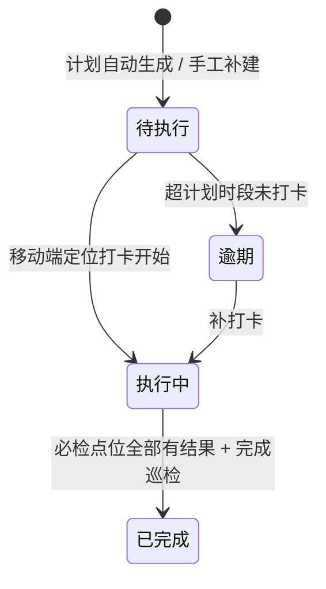
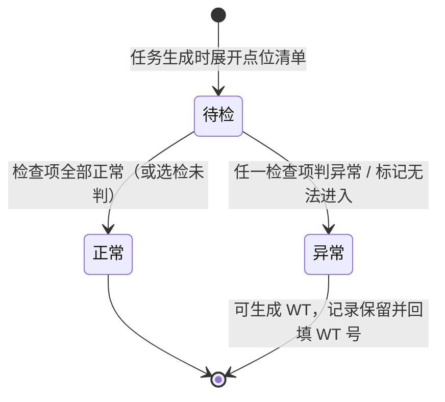

# 07 物业服务 · 04 巡检管理

> 端：运营端 PC（`yunying-PC`）　｜　模块：07 物业服务（分册 §8.5）
> 页面：`property-inspect.html`　｜　页面版本：**v1.2（2026-10-30）**
> 业务分册：`开发PRD/运营管理端分册PRD/07-物业服务.md` **v1.4**
> 前置：`01-报修工单.md`（含模块通用说明 §0）

> **v1.2 变更（2026-10-30 · 走查反馈）**：区域改为按楼栋分组且字典来自 02（只读）；时段改起止时间控件；巡检员改「在岗巡检员搜索 + 多选」；计划圈定方式由"选点位类型"改为"**直接勾选点位**"；「上报问题」由 Toast 改为跳转 P6 并带 `from`/`area`。

---

## 1. 页面定位

按计划派发巡检任务、记录执行情况，把"现场治理"变成**有频次、有打卡、有点位、有问题数**的可量化动作。

- 使用者：物业主管（配计划 / 配点位 / 配检查项）、巡检员（移动端执行）
- 下游：检查项判「异常」→ 一键生成问题单（`WT`），进 P6 问题上报按责任方分流
- **本页职责边界（v1.1 修正）**：PC 侧**只配置 + 只读监控**，**不代巡检员判定点位结果**。点位结果由巡检员在移动端 `wuye-inspect.html` 产生，回写本页任务详情与进度。

> **v1.1 变更（2026-10-30 · 第 3 次沟通 · 巡检点位与检查项必做）**
> 原 v1.0 定位为"轻量版：只配区域，不配点位与检查项"，该口径**已作废**。
> 客户 2026-10-30 确认"点位与检查项必须做"，分册升至 v1.4 §8.5。本版据此把页面由 2 个 Tab 扩为 4 个 Tab，并补任务-点位联动、必检拦截、异常转问题单。

## 2. 分区结构

**Tab 条：4**

| Tab | 名称 | 内容 |
|---|---|---|
| ① | 巡检计划 | 计划名称 / 区域（按楼栋分组多选）/ 频次 / **起止时间** / 巡检员（搜索多选）/ **勾选巡检点位** / 状态 / 今日任务 / 执行率 / 操作 |
| ② | 巡检任务 | 筛选（关键词 + 状态 + 仅看今日）+ 任务列表 **8 列**（含**点位进度 3/8**） |
| ③ | 巡检点位 | 点位清单（编号 / 名称 / 区域 / 类型 / 二维码 / 检查项数 / 状态）+ 新增 / 编辑 / 启停 |
| ④ | 检查项模板 | 按点位类型绑定的检查项（类型 / 顺序 / 名称 / 必检 / 判定方式 / 状态）+ 只看必检 + 新增 / 编辑 / 启停 |

**统计卡（4）**：今日待执行 / 执行中 / 本月已完成 / 逾期未执行

> 统计卡口径不变，**点位与检查项不进统计卡**（它们是配置数据，不是执行结果）。

## 3. 巡检计划（Tab①）

| 字段 | 必填 | 说明 |
|---|---|---|
| 计划名称 | 是 | 如「A 栋日常巡检」 |
| 巡检区域 | 是 | 楼栋 + 楼层，**可多选**，至少 1 个 |
| 频次 | 是 | 每日 1 次 / 每周 2 次 / 每周 1 次 / 每月 1 次 |
| 巡检开始 / 结束时间 | 是 | **两个时间控件**（`time`），不再手输字符串；结束必须晚于开始 |
| 巡检员 | 是 | **可多人轮值**；候选来自「07 物业人员」中**在岗且岗位含巡检员**的人，**搜索姓名/工号 + 多选**，休假/停用的人不出现 |
| 巡检点位 | 是 | **先选区域 → 勾选该区域内的启用点位**（按点位类型分组，点类型名可整类勾选）；任务只展开这里勾选的点位 |
| 状态 | 是 | 启用 / 停用 |

> **区域字典来源**：巡检区域来自「02 市场资源管理 · 楼栋楼层维护」（`resource-unit.html`），本页**只读引用**，不在巡检模块新增区域。区域选择按楼栋分组，支持「整栋」一键勾选。

**计划规则**

| 编号 | 规则 |
|---|---|
| P-01 | 启用计划每日凌晨自动生成当天任务；停用后不再生成，**已生成任务不受影响** |
| P-02 | 停用当日已生成任务的计划需二次确认，提示「已生成 N 条任务不受影响」 |
| P-03 | 立即生成任务 = 手工补建，为**每个区域各生成 1 条**任务 |
| P-04 | 任务点位清单 = 计划**勾选的点位** ∩ 该点位仍为启用状态 |
| P-05 | 某区域在勾选范围内无点位（或点位全被停用）→ 仍生成任务，但任务标「无点位」并提示主管去 Tab③ 补点位 |

> **为什么计划勾点位、而不是再选一遍"点位类型"**：点位类型只决定"这个点要查哪些检查项"，是**配置期**的概念（Tab③④）；计划是**执行期**的概念，只需回答"这一趟要跑哪几个点"。若让计划再选类型，就出现"选类型→间接决定点位"的反向推导，用户看不懂（2026-10-30 反馈）。

> **【推导】检查项模板字段**：分册 §8.5 只写"计划绑定检查项模板"，未定字段形态。本页按"多选点位类型"落（推荐方案），理由：检查项本身已按类型绑定，计划只需圈定范围，避免逐条勾选。若客户要求"逐条勾选检查项"，改为二级多选即可，任务展开逻辑不变。

## 4. 巡检点位（Tab③）

| 字段 | 必填 | 说明 |
|---|---|---|
| 点位编号 | 是 | 全局唯一，如 `A3-04`（列表展示 + 移动端定位标识） |
| 点位名称 | 是 | 如「A 栋 3F 东侧消防通道」 |
| 所属区域 | 是 | 楼栋 + 楼层（与计划区域同字典） |
| 点位类型 | 是 | 消防通道 / 灭火器 / 配电箱 / 公共卫生间 / 通道堆物 / 其他；**决定自动带出哪些检查项** |
| 二维码值 | 是 | 现场贴码内容，**全局唯一**；移动端扫码定位到该点 |
| 状态 | 是 | 启用 / 停用（**停用不影响历史记录**） |

**点位规则**

| 编号 | 规则 |
|---|---|
| PT-01 | 二维码值全局唯一，重复即阻断（移动端扫错点位的根因） |
| PT-02 | 点位编号全局唯一 |
| PT-03 | 停用点位不进入**新生成**任务的点位清单；已生成任务的点位记录保留 |
| PT-04 | 点位类型变更后，任务展开时按新类型带出检查项；**已生成任务的检查项快照不回改** |
| PT-05 | 删除不做（只能停用），保证历史巡检记录可追溯 |

## 5. 检查项模板（Tab④）

| 字段 | 必填 | 说明 |
|---|---|---|
| 点位类型 | 是 | 检查项按类型绑定，不对单个点位配置 |
| 检查项名称 | 是 | 同类型下不可重名 |
| 顺序 | 是 | 移动端展示次序，同类型内从 1 开始 |
| 判定方式 | 是 | **正常 / 异常**（固定两值）——异常时必须填照片 ≥1 + 说明 |
| 必检 | 是 | 必检项未判定 → 该点位不能提交；选检项只记录不拦截 |
| 状态 | 是 | 启用 / 停用（停用的检查项不再带出） |

**检查项规则**

| 编号 | 规则 |
|---|---|
| IT-01 | 判定方式只有「正常 / 异常」，**不引入是/否、日期核对、尺寸核对等枚举**（v1.1 修正；原 v1.0 原型自造的 4 种判定方式已删除） |
| IT-02 | 同类型下检查项不可重名 |
| IT-03 | 顺序重复不阻断，但展示按 (顺序, 创建序) 稳定排序 |
| IT-04 | 判「异常」的检查项 → 移动端可一键生成 `WT` 问题单（带入点位 / 照片 / 检查项名 / 责任方=待判定） |
| IT-05 | 停用检查项不影响历史点位记录中的判定结果 |

## 6. 巡检任务（Tab②）

**任务列表（8 列）**：任务编号 `XJ` · 区域 · 巡检员 · 计划时间 · 状态 · **点位进度（已检/应检，如 3/8）** · 发现问题数 · 操作

> 分册 §8.5 一处写"任务列 7 列"、另一处 Tab② 要求"点位完成进度（3/8）"。**本页按 8 列落**（进度列不可省，否则主管看不出巡检员跑了多少点）。该冲突已在分册 v1.4 待修，见 §11。

**状态机（4 态）**

**操作**

| 操作 | 显示条件 | 效果 |
|---|---|---|
| 开始巡检（打卡） | 待执行 / 逾期 | **原型模拟**：记录打卡时间与定位，状态转执行中（正式由移动端发起） |
| 上报问题 | 执行中 | **跳转「问题上报」页**（`property-issue.html?from=任务号&area=区域`），抽屉顶部标注来源任务、区域自动带入；问题单只在 P6 生成（动作归属唯一），返回后该任务问题数来自 P6 统计 |
| 完成巡检 | 执行中 | **前置校验**：必检点位全部有结果才可完成（R-44）；未检完 → 拦截并提示剩余点位数，不在 PC 代检 |
| 查看 | 全部 | 详情抽屉：任务信息 + 点位清单（待检/正常/异常）+ 检查项结果 + 执行留痕 |

**任务规则**

| 编号 | 规则 |
|---|---|
| XJ-1 | 逾期任务次日提醒巡检员 + 主管 |
| XJ-2 | 一条任务可上报多条问题 |
| XJ-3 | 完成任务不强制有问题（无异常也是正常结果） |
| XJ-4 | **R-44**：必检点位全部有结果才可完成巡检；点位「无法进入 / 不存在」标记并填原因，同样计为已检 |
| XJ-5 | **R-45**：检查项判异常 → 可生成 `WT`，原点位记录保留并显示 `WT` 号 |
| XJ-6 | PC 侧**不做**点位判定录入，避免与移动端产生两份真相（动作归属唯一） |

## 7. 任务与点位的联动（`XJD` 点位记录）

**记录结构**：`XJD = 任务号 + 点位编号`，每条记录 3 态。

| 概念 | 定义 |
|---|---|
| 应检点位数 | 任务点位清单长度（计划区域 ∩ 启用点位 ∩ 模板类型） |
| 已检点位数 | `XJD.state ≠ 待检` 的点位数，即「3/8」的分子 |
| 异常点位数 | `XJD.state = 异常` 的点位数 |
| 完成条件 | 全部**必检**点位 ≠ 待检（选检点位待检不阻断） |

**任务详情抽屉结构**

1. 任务信息：所属计划 / 区域 / 巡检员 / 计划时间 / 打卡时间 / 发现问题数 / 巡检总结
2. **点位置信（v1.1 新增）**：三计数条（已检 / 待检 / 异常）+ 点位分组列表
   - 每组一行：点位编号 · 名称 · 类型 · `已检项/总项` · 状态标签
   - 异常点位行：显示「已转 WT-xxx」或「未转问题单」
   - 无法进入点位：状态标「异常 · 无法进入」，并显示原因
3. 执行留痕：时间轴（生成 / 打卡 / 上报 / 完成，标注来源「移动端 · 执行人 · 定位」）

## 8. 提示语表

> `✅` 原型已实现 / `⬜` 待实现。编号 `TX-`。

| 编号 | 场景 | 提示文案 | 形式 | 阻断 | 状态 |
|---|---|---|---|---|---|
| TX-01 | 缺计划名称 | 请填写计划名称 | Toast | 是 | ✅ |
| TX-02 | 未选区域 | 请至少选择 1 个巡检区域 | Toast | 是 | ✅ |
| TX-03 | 缺起止时间 | 请选择巡检时段的开始与结束时间 | Toast | 是 | ✅ |
| TX-03b | 结束时间早于开始 | 结束时间必须晚于开始时间 | Toast | 是 | ✅ |
| TX-04 | 未指定巡检员 | 请至少指定 1 名巡检员 | Toast | 是 | ✅ |
| TX-05 | 新增计划成功 | 已新增巡检计划：{名称}（启用后次日自动生成任务） | Toast | 否 | ✅ |
| TX-06 | 保存计划 | 已保存巡检计划：{名称} | Toast | 否 | ✅ |
| TX-07 | 启停计划 | 已{启用/停用}：{名称}（次日开始生成任务 / 已生成任务不受影响） | Toast | 否 | ✅ |
| TX-08 | 计划已停用还生成任务 | 计划已停用，请先启用再生成任务 | Toast | 是 | ✅ |
| TX-09 | 生成任务成功 | 已为「{名称}」生成 {n} 条任务（{m} 个启用点位，停用点位不纳入） | Toast | 否 | ✅ |
| TX-10 | 打卡开始 | 已打卡开始巡检：{任务号}　{区域}（可多次上报问题） | Toast | 否 | ✅ |
| TX-11 | 上报问题 | 已登记 1 条问题（任务 {任务号} 累计 {n} 条）；正式上报请到「问题上报」页，区域自动带入 {区域} | Toast | 否 | ✅ |
| TX-12 | 完成巡检（有问题） | 已完成巡检：{任务号}　发现问题 {n} 条，已进入问题清单 | Toast | 否 | ✅ |
| TX-13 | 完成巡检（无问题） | 已完成巡检：{任务号}　无问题 | Toast | 否 | ✅ |
| TX-14 | 任务空态 | 暂无巡检任务 / 暂无巡检计划，点右上「新增巡检计划」创建 | 空态 | 否 | ✅ |
| TX-15 | 导出 | 已导出巡检计划与任务执行率（含逾期统计） | Toast | 否 | ✅ |
| TX-16 | 逾期自动提醒 | 建议：{任务号} 逾期未执行，已提醒巡检员与主管 | 站内 / 短信 | 否 | ⬜ 原型仅标状态，未做推送 |
| TX-17 | 定位异常 | 建议：打卡位置距巡检区域 >100m，已标记异常 | Toast | 否 | ⬜ 原型模拟打卡，未做地理围栏 |
| TX-18 | 点位必填缺失 | 请填写点位编号 / 请填写二维码值 / 请填写点位名称 | Toast | 是 | ✅ |
| TX-19 | 二维码重复 | 二维码值已被点位 {编号} 占用，请勿重复 | Toast | 是 | ✅ |
| TX-20 | 点位编号重复 | 点位编号已存在 | Toast | 是 | ✅ |
| TX-21 | 点位启停 | 已{启用/停用}点位：{编号}（新任务不再包含 / 历史记录保留） | Toast | 否 | ✅ |
| TX-22 | 检查项名称缺失 | 请填写检查项名称 | Toast | 是 | ✅ |
| TX-23 | 检查项重名 | 该点位类型下已有同名检查项，请勿重复 | Toast | 是 | ✅ |
| TX-24 | 检查项启停 | 已{启用检查项 / 停用检查项（该类点位不再带出）} | Toast | 否 | ✅ |
| TX-25 | **必检点位未检完** | **还有 {n} 个必检点位未检，完成巡检需巡检员在移动端逐点判定** | Toast（阻断） | 是 | ✅ |
| TX-26 | **未勾选巡检点位** | **请至少勾选 1 个巡检点位（先选区域，再勾点位）** | Toast | 是 | ✅ |
| TX-27 | **区域无启用点位** | **该区域在此模板范围内无启用点位，任务已生成但无可检点，请到「巡检点位」补齐** | Toast / 详情提示 | 否 | ✅ |
| TX-28 | **点位无法进入** | **已标记「无法进入」，该点位计为已检，需填写原因** | 移动端弹层 | 是 | ⬜ 移动端缺此入口，已记 `shanghu-APP/移动端原型修改待办.md` #43（PC 侧展示位已就绪） |

**自检结论**：✅ **25** / ⬜ **4** / 共 29 条。

## 9. 端间协同落点

| 数据 / 动作 | 本页（PC） | 另一端 | 可见条件 |
|---|---|---|---|
| 巡检计划 / 点位 / 检查项模板 | **维护方（唯一主权）** | 商户端 `wuye-inspect.html` 只读执行 | 物业人员档案启用 + 岗位含巡检员 |
| 点位记录 `XJD` / 检查结果 / 异常照片 | 只读展示 | **移动端写入** | 任务派给本人 |
| 任务完成 | 只读标记 | 移动端发起（R-44 拦截） | 必检点位全部有结果 |
| 检查项异常 → `WT` | P6 受理分流 | 移动端一键生成（带入点位/照片/检查项名） | 责任方=待判定 → 主管判定 |
| 定位缺失标记 | 详情显示 + 可筛 | 移动端「标记定位异常」写入 | R-42 |

> **口径同源**：点位类型字典（6 类）、判定方式（正常/异常）、`XJD` 3 态三处必须一致，PC 与移动端不得各自发明。移动端改动需求记 `商户端/shanghu-APP/移动端原型修改待办.md`，本窗口**只写待办、不改移动端代码**。

## 10. 验收要点

| 编号 | 场景 | 期望 |
|---|---|---|
| AC-07 | 新增点位填重复二维码 | 阻断并提示占用方点位编号 |
| AC-08 | 停用某点位后再生成任务 | 该点位不进新任务清单；历史任务详情仍显示该点位及结果 |
| AC-09 | 计划模板只勾「灭火器」 | 生成任务的点位清单只含灭火器类点位 |
| AC-10 | 新增检查项与同类型已有项重名 | 阻断 |
| AC-11 | 任务 8 个点位，已检 3 个 | 列表进度显示 3/8；详情三计数为 已检 3 / 待检 5 / 异常 0 |
| AC-12 | 必检点位还有 2 个待检，点「完成巡检」 | 拦截，提示还有 2 个必检点位未检，状态不变 |
| AC-13 | 全部必检点位有结果后点「完成巡检」 | 允许完成，总结选填 |
| AC-14 | 某点位标「无法进入」并填原因 | 计为已检，状态显示「异常 · 无法进入」，不阻断完成 |
| AC-15 | 移动端检查项判异常并生成 WT | 本页该点位显示「已转 WT-xxx」，任务问题数 +1 |

## 11. 待确认与推导

| # | 事项 | 当前落法 | 类型 |
|---|---|---|---|
| 1 | 计划怎么圈定要检的点位 | 落为**直接勾选点位**（P-04），不再让计划选"点位类型" | 2026-10-30 按客户反馈改：类型属配置期概念，执行期只回答"跑哪几个点" |
| 2 | 任务列表 7 列 vs 8 列 | 落 8 列（含点位进度） | 分册 §8.5 内部不一致，**已报待修分册** |
| 3 | 检查项"判定方式"是否需要更多输入型（数值/日期） | 一律「正常/异常」 | 依分册 §8.5；如后续要数值型（如灭火器压力值），需加"输入型检查项"设计 |
| 4 | 点位是否允许批量导入（Excel） | 不做，逐条新增 | 【推导】点位量大时需补，进二期 |
| 5 | PC 是否允许代巡检员补录点位结果 | **不做**（XJ-6） | 【推导】避免两份真相；如现场 PDA 不可用需另议 |
