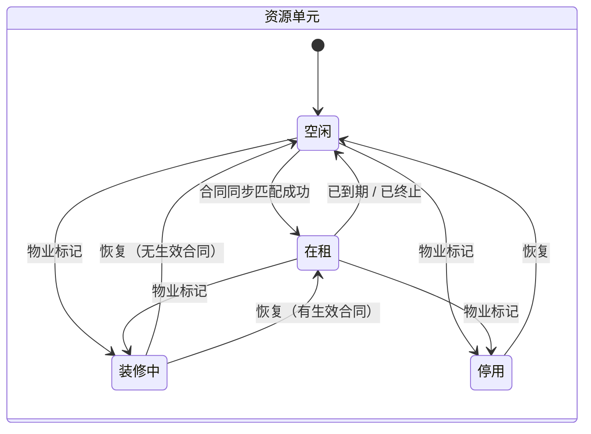

# 02 市场资源管理 · 运营端页面 PRD（首篇）

> 端：运营端 PC（`yunying-PC`）　｜　模块：02 市场资源管理
> **本文件 = 模块通用说明（§0）+ 第 1 页（§1）**，同目录其余文件只写本页
> 页面版本：v1.1（2026-10-22 按页面拆分）　｜　业务分册：`开发PRD/运营管理端分册PRD/02-市场资源管理.md` **v2.11**
> 同目录：`02-摊位商铺管理.md`、`03-平面图维护.md`、`04-资源状态看板.md`

---

## 0. 模块通用说明（本模块其他页面不再重复）

### 0.1 这个模块解决什么问题

市场里的楼栋、楼层、档口（含办公室、店面）散在 Excel 和纸质图纸里，合同躺在另一个系统，两边靠人工核对"这个档口租给了谁、租到什么时候"。
本模块把物理空间建成**唯一权威底账**，再由**合同数据实时/兜底同步匹配**自动回填"当前租户 / 租期 / 历届租户"。
不做：合同、缴费、商户识别、买家端楼层导航，每个模块都要自己维护一份空间数据，且永远对不上账。

### 0.2 角色与权限矩阵

| 操作 | 物业人员 | 合同专员 | 运营专员 | 运营主管 | 财务 | 无权限表现 |
|---|---|---|---|---|---|---|
| 楼栋 / 楼层 查看 | ✅ | ✅ | ✅ | ✅ | ✅ | 菜单不可见 |
| 楼栋 / 楼层 新增 / 编辑 / 停用 | ✅ | ❌ | ❌ | ❌ | ❌ | 按钮隐藏 |
| 档口 查看 | ✅ | ✅ | ✅ | ✅ | ✅（面积/状态） | — |
| 档口 新增 / 编辑 | ✅ | ❌ | ❌ | ❌ | ❌ | 按钮隐藏 |
| 档口 批量导入 | ✅ | ❌ | ❌ | ❌ | ❌ | 按钮隐藏（主管亦可） |
| 档口 装修 / 停用标记 | ✅ | ❌ | ✅ | ✅ | ❌ | 按钮隐藏 |
| **档口状态（在租/空闲）手工改** | ❌ | ❌ | ❌ | ❌ | ❌ | **按钮存在但点击拦截**：「由合同数据判定，不支持手工修改」 |
| 立即同步 / 异常处理 | ✅ | 只读 | ✅ | ✅ | ❌ | 按钮隐藏 |
| 平面图 上传 / 标注 | ✅ | ❌ | ❌ | ❌ | ❌ | 按钮隐藏 |
| 平面图 发布 / 下线 | ✅ | ❌ | ❌ | ✅ | ❌ | 按钮隐藏 |
| 看板 / 空置清单 查看 | ✅ | ✅ | ✅ | ✅ | ✅ | — |
| 导出 | ✅ | ❌ | ❌ | ✅ | ✅ | 按钮置灰 + tooltip「需主管授权」 |
| **承租人身份证号 完整值** | ✅ | ❌ | ❌ | ❌ | ❌ | 列表脱敏 `3306********1234`；详情仅物业可见完整值 |

> 数据权限：物业/运营/合同=全市场；财务=全市场但不含身份证号；买家端不暴露承租人姓名、证件号、空置原因。

### 0.3 菜单与端间落点表

| # | 页面 | 本端文件 | 页面 PRD | 商户端 | 买家端 | 数据方向 |
|---|---|---|---|---|---|---|
| P1 | 楼栋楼层管理 | `resource-building.html` | `01-楼栋楼层管理.md` | ❌ | ⚠️ 间接：楼层结构供 `mai-APP/market-map.html` 楼层 Tab（未接通） | 本端 → 买家端（待接通） |
| P2 | 摊位商铺管理 | `resource-unit.html` | `02-摊位商铺管理.md` | ⚠️ 间接：`shanghu-APP/property.html` / `contract.html` 应读本页（现写死） | ⚠️ 间接：`mai-APP/shop-detail.html` 编号应读本页 | 本端为写入方；两端只读 |
| P3 | 平面图维护 | `resource-floorplan.html` | `03-平面图维护.md` | ❌ | ✅ 发布后 `mai-APP/market-map.html` 楼层图 + 着色即时可见 | 本端 → 买家端 |
| P4 | 资源状态看板 | `resource-dashboard.html` | `04-资源状态看板.md` | ❌ | ❌ | 只读统计，供驾驶舱（待接通） |

**跨模块（运营端内）**：

| 关系 | 模块 | 说明 |
|---|---|---|
| 上游 | **05 合同管理** | 合同「已存档 / 已终止 / 已到期」事件实时推送 + 每日兜底同步；匹配键 = **档口编号** |
| 下游 | 06 缴费管理 | 计费基数（面积）取自本模块 |
| 下游 | 04 商户管理 | 按「姓名 + 身份证」查线下档口，判定"仅线上 / 线上兼档口" |
| 下游 | 01 运营总览 / 驾驶舱 | 出租率、空置数、匹配异常数 |

> 买家端为"间接"：页面（`mai-APP/market-map.html`）存在，但当前为**静态硬编码**，未接本模块数据。改造属买家端待办。

### 0.4 核心数据对象

| 对象 | 说明 | 关键字段 | 谁产生 | 谁消费 |
|---|---|---|---|---|
| **场所 Place** | 大唐袜业城 / 原料市场 / 行政服务中心 | 名称、编码 | 物业（P1） | P1 树、P2 筛选 |
| **楼栋 Building** | 场所下的楼 | 名称、编码、层数、状态 | 物业（P1） | P1、P2 筛选、P4 |
| **楼层 Floor** | 楼栋下的层 | 楼层号、面积、档口数 | 物业（P1） | P3 楼层 Tab |
| **资源单元 Unit** ★ | 档口 / 办公室 / 店面 / 公共设施 | 编号（**全端唯一**）、位置、类型、等级、面积、计租、状态、当前租户、租期 | 物业（P2）+ **合同同步写状态与租户** | P2、P3、P4、05/06/04/买家端 |
| **合同关联 Binding** | 合同 ↔ 档口 | 合同号、档口编号、承租人、租期、匹配状态 | **系统**（人不能建） | P2 详情、历届租户 |
| **匹配异常 MatchError** | 未匹配 / 重复 / 停用命中 | 异常类型、合同号、档口编号、承租人、处理状态 | 系统 | P2 异常 Tab、P4 看板 |
| **平面图 Floorplan** | 楼层图 + 点位 | 楼层、版本、上传人、点位（相对坐标）、状态 | 物业（P3） | 买家端导览 |
| **竞拍登记 Bid** | 线下竞拍结果 | 批次、竞得人、手机号、成交价、凭证 | 物业（P2） | 05 合同发起 |

### 0.5 状态机

| 状态 | 业务含义（等谁做什么） | 驱动方 | 计入出租率 |
|---|---|---|---|
| 空闲（待竞拍） | 无生效合同；到期后等下一轮竞拍 | 系统 | ✅ 分母 |
| 在租 | 有生效合同，等到期后重新竞拍 | **系统**（合同） | ✅ 分子 |
| 装修中 | 装修/整改期，等物业恢复 | 物业 | ✅ 算可租 |
| 停用 | 不可用 | 物业 | ❌ 分子分母都不算 |

**状态转换表**

| 当前 | 事件 | 操作者 | 前置条件 | 目标 | 伴随动作 | 禁止条件 |
|---|---|---|---|---|---|---|
| 空闲 | 同步到生效合同且编号匹配 | 系统 | 合同已签署 + 租期覆盖当日 | 在租 | 写租户、关联合同、新增历史 | 按合同号去重（幂等） |
| 空闲 | 合同编号未匹配 | 系统 | — | 空闲 | 进异常清单 | 不改变状态 |
| 在租 | 合同**已到期** / **已终止** | 系统 | 合同侧状态变化 | 空闲 | 关联转历史、记空置开始日 | — |
| 在租 | 同档口第 2 份生效合同 | 系统 | 租期重叠 | 在租 | 以最新为准 + 告警 | 不得静默覆盖 |
| 空闲/在租 | 装修 / 停用 | 物业 | 原因必填 | 装修中 / 停用 | 买家端隐藏该档口 | 原因为空 → 拦截 |

**禁止路径**

| 场景 | 系统行为 | 提示文案 | 日志 |
|---|---|---|---|
| 手工改"在租/空闲" | 拦截 | 「『在租 / 空闲』由合同数据判定，不支持手工修改」 | 否 |
| 修改已使用的档口编号 | 拦截 | 「编号一经使用不可修改（合同匹配键）」 | 是 |
| 停用档口命中合同 | 不置在租，进异常 | 异常类型「停用档口命中合同」 | 是 |
| 已发布平面图直接改点位 | 生成新草稿 | 「已发布版本不可直接修改，已在草稿中生效」 | 是 |

### 0.6 名词与口径

| 名词 | 定义 | 备注 |
|---|---|---|
| 可租档口数 | 全部资源单元 − 停用 − 公共设施 | 分母 |
| 在租数 | 状态=在租 | 分子 |
| **出租率** | 在租 ÷ 可租，四舍五入 1 位小数 | 停用与公共设施都不进分母 |
| **空置天数** | 今天 − 空置开始日（当日为第 0 天） | 自然日 |
| 平均空置天数 | Σ空置天数 ÷ 空闲数，向上取整 | 空置=0 显示 `—`，不显示 0 |
| 匹配成功率 | 匹配成功合同数 ÷ 同步到的新增合同数 | 目标 ≥ 99% |
| 匹配及时性 | 合同「已存档」→ 档口当前租户更新 | 实时（事件）；每日 02:00 兜底 |
| 点位坐标 | 相对楼层图的百分比（x%, y%） | 不同分辨率不漂移 |

### 0.6.1 跨端字段差异（只列不一致的）

| 概念 | 本模块（权威） | 商户端现状 | 买家端现状 | 目标口径 |
|---|---|---|---|---|
| **档口编号** | `1F-A08` | `contract.html`「商铺 `1F-A08 · 50㎡`」 | `shop-detail.html` 同时有 `1F-A08` 与 `A08-102` | **统一用本模块编号**，`A08-102` 废弃 |
| 档口状态 | 4 态 | — | `busy` / `idle` 两态 | 在租→busy，空闲→idle，装修中/停用→不展示 |
| 当前租户 / 面积 | `tenant` / `area` | 写死文本 | — | 两端读本模块 |

### 0.7 本期不做

- ❌ 档口拆分 / 合并（用"停用旧编号 + 新建编号"）
- ❌ 续约、退租申请（线下竞拍制，到期回空闲）
- ❌ 车位资源管理、3D 楼层图（存疑，见分册 §10）
- ❌ 招商分配 / 预留（线下政府平台竞拍）
- ❌ 真图片上传（原型用示意图占位）

---

## 1. 楼栋楼层管理 `resource-building.html`

### 1.1 页面说明

| 项 | 内容 |
|---|---|
| 页面目标 | 维护"场所 → 楼栋 → 楼层"三级骨架，并一眼看到每层出租情况 |
| 使用角色 | 物业（写）、其余（只读） |
| 入口 | 菜单 → 市场资源管理 → 楼栋楼层管理 |
| 前置 | 无（空间底账的起点） |
| 后置 | 楼层数据供 P2 筛选、P3 楼层 Tab、P4 统计下钻 |

### 1.2 本页端间关系

| 项 | 内容 |
|---|---|
| 本页数据来源 | 物业手工录入 |
| 本页操作的跨端影响 | 新增/停用楼层 → 买家端楼层 Tab 少一层（**接通后才生效，现为静态**） |
| 依赖的其他端页面 | `mai-APP/market-map.html`、`mai-APP/market-socks.html` |
| 不涉及的端 | 商户端 |
| 一致性要求 | 楼层号与档口表 `floor` 一致；停用楼层不计入出租率 |

### 1.3 页面结构

| 区块 | 内容 |
|---|---|
| 顶部 | 标题 + **「导出」**（Excel 楼栋楼层清单）+ 「新增楼栋」 |
| 统计卡（4） | 楼栋总数（开放 2 · 未开放 1）· 楼层总数（含地下 1 层）· 档口总数（1,286，不含公共设施）· 平均出租率（86.3%，在租 ÷ 可租） |
| 左侧 | **场所结构**树：**三个场所固定**（大唐袜业城 / 原料市场 / 行政服务中心）→ 楼栋；**只有树形展示与切换，没有新增/编辑/停用场所入口**（D-28：场所由初始化配置写入）；选中楼栋后右侧联动 |
| 右侧 | 楼层列表（10 列）+ 「新增楼层」「前往档口台账」 |
| 抽屉 | 新增/编辑楼栋、新增/编辑楼层 |

### 1.4 列表、筛选与排序

| 项目 | 规则 |
|---|---|
| 默认排序 | 楼层号自然序：B1 → 1F → 2F → 10F（**按数值，不是字符串**） |
| 可排序 | 楼层号、档口数、出租率 |
| 分页 | 不分页（单栋楼 ≤20 层） |
| 筛选 | 无独立筛选条；靠左侧树联动 |
| 空结果 | 「该楼栋还没有楼层」+ 新增楼层 |
| 导出 | 不提供 |

### 1.5 字段规格

#### 1.5.1 统计卡（4 个）

| 卡片 | 口径 | 副文案 |
|---|---|---|
| 楼栋总数 | 当前场所下的楼栋数 | 开放 N · 未开放 N |
| 楼层总数 | 全部楼栋的楼层合计 | 含地下 N 层 |
| 档口总数 | 全部 Unit − 公共设施 | 不含公共设施 |
| 平均出租率 | Σ在租 ÷ Σ可租，四舍五入 1 位小数 | 在租 ÷ 可租（合同判定） |

#### 1.5.2 楼层列表（10 列）

| 列 | 字段 | 类型 | 规则 | 说明 |
|---|---|---|---|---|
| 楼层号 | `floor` | 文本 | `B1`/`1F`~`5F`，同楼栋唯一 | 被档口引用后不可改 |
| 楼层名称 | `floorName` | 文本 | ≤20 字，选填 | 如「精品区」 |
| 建筑面积 | `area` | 数字 | >0，≤99999，1 位小数 | 与档口面积合计差异大时**弱提示** |
| 档口数 | 计算 | 整数 | 该层 Unit 数（不含公共设施） | 只读 |
| 在租 | 计算 | 整数 | 状态=在租 | 只读 |
| 可租 | 计算 | 整数 | 总数 − 停用 | 只读 |
| 出租率 | 计算 | 百分比 | 在租 ÷ 可租，1 位小数 | 可租=0 → `—` |
| 平面图状态 | 派生 | 枚举 | 未上传 / 草稿 / 已发布 | 点「已发布」跳 P3 |
| 状态 | `status` | 枚举 | 开放 / 未开放 / 停用 | 停用后档口不参与合同匹配 |
| 操作 | — | — | 编辑 / 查看档口 | 「查看档口」带 `building`+`floor` 跳 P2 |

**楼栋（抽屉）**

| 字段 | 必填 | 校验 | 提示 |
|---|---|---|---|
| 楼栋名称 | 是 | **非空**（原型只校验必填） | 【已实现】「楼栋编码与名称均为必填」 |
| 楼栋编码 | 是 | 全局唯一 | 【已实现】「楼栋编码已存在，请更换」 |
| 所属场所 | 是 | 下拉三选一 | — |
| 层数 | 是 | 1–10 整数 | 【待实现】原型未校验，建议「层数应在 1–10 之间」 |
| 状态 | 是 | 默认「开放」 | — |

### 1.6 交互规则

| 元素 | 显示条件 | 可点条件 | 点击后 | 禁止表现 |
|---|---|---|---|---|
| 导出 | 始终 | 物业/主管/财务 | 下载 Excel（楼栋楼层清单） | 无权限 → 按钮置灰 |
| 新增楼栋 | 始终 | 物业 | 抽屉（新增） | 非物业 → 隐藏 |
| 新增楼层 | 选中楼栋后 | 物业 | 抽屉（新增，预填楼栋） | 未选楼栋 → 置灰 |
| 左侧树节点 | 始终 | 始终 | 右表切到该楼栋 | — |
| 编辑楼层 | 始终 | 物业 | 抽屉（楼层号只读） | — |
| 查看档口 | 档口数 >0 | 始终 | 跳 P2（带筛选） | 0 → 置灰 |
| 停用楼栋 | 状态=开放 | 物业 | 二次确认 | 有在租 → 提示「仍有 12 个在租档口，停用后不再参与合同匹配」 |

### 1.7 业务规则与计算口径

| 编号 | 规则 | 触发 | 处理 | 影响端 | 例外 |
|---|---|---|---|---|---|
| R-01 | 楼层号自然序 | 渲染 | B1 < 1F < 2F < 10F（数值比较） | 无 | — |
| R-02 | 出租率只在"可租"上算 | 计算 | 在租 ÷ (总−停用−公共设施) | 无 | 可租=0 显示 `—` |
| R-03 | 楼层号被引用后不可改 | 保存 | 存在 Unit 引用 → 拦截 | 无 | 无引用可改 |
| R-04 | 停用楼栋联动 | 停用 | 该楼栋 Unit 不参与合约匹配（命中进异常） | 05 合同 | — |
| R-05 | 重复提交 | 新增/编辑 | 按钮 loading 锁 1.5s | 无 | — |

### 1.8 异常与边界

> 完整提示语规格（含未实现项）见分册 **§8.6 提示语规格表**（M-01~M-12）；本表只记录原型实际行为。

| 类型 | 场景 | 系统行为 | 提示文案 |
|---|---|---|---|
| 数据 | 无楼栋（首次） | 空态 | ➖ 不适用（场所写死，树不会为空） |
| 数据 | 楼栋无楼层 | 右表空态 | 【已实现】「该楼栋暂无楼层，点击右上角「新增楼层」创建」 |
| 权限 | 非物业点编辑 | 按钮不出现 | — |
| 并发 | 两人同时编辑同一楼层 | 后提交 409 | 【待实现】原型无并发校验，建议「楼层信息已被他人修改，请刷新」 |
| 依赖 | 楼层被引用时删楼栋 | 拦截 | 【待实现】原型未做删除拦截 |
| 边界 | 面积与档口面积合计差 >5% | 弱提示 | 【待实现】原型未做面积差异提示 |

#### 1.8.1 本页提示语清单（来源：分册 §8.6，编号可回溯）

| 编号 | 场景 | 提示文案 | 形式 | 状态 |
|---|---|---|---|---|
| M-01 | 楼栋编码 / 名称未填 | 楼栋编码与名称均为必填 | Toast | ✅ |
| M-02 | 楼栋编码重复 | 楼栋编码已存在，请更换 | Toast | ✅ |
| M-03 | 楼层号 / 名称未填 | 楼层号与名称为必填 | Toast | ✅ |
| M-04 | 楼层号重复 | 该楼层号已存在 | Toast | ✅ |
| M-05 | 新增楼栋成功 | 已新增楼栋 | Toast | ✅ |
| M-06 | 新增楼层成功 | 已新增楼层 | Toast | ✅ |
| M-07 | 保存修改成功 | 已保存修改 | Toast | ✅ |
| M-08 | 导出完成 | 已导出楼栋楼层清单（Excel） | Toast | ✅ |
| M-09 | 层数超范围 | 层数应在 1–10 之间 | 行内 | ⬜ |
| M-10 | 停用有在租的楼层 | 该层有 {n} 个在租档口，停用后将不计入出租率，请先确认 | Toast（提示即阻断） | ✅ |
| M-11 | 首次无楼栋（空态） | — | 空态 | ➖ 不适用（场所写死） |
| M-12 | 楼栋无楼层（空态） | 该楼栋暂无楼层，点击右上角「新增楼层」创建 | 空态 | ✅ |

### 1.9 通知与消息

本页无对外通知（楼层变更不触达商户/买家）。

### 1.10 验收标准

| 编号 | 前置 | 操作 | 预期 | 级别 |
|---|---|---|---|---|
| AC-01 | 某楼栋有 5 层 | 查看列表 | 顺序 B1/1F/2F/3F/4F，非字典序 | P0 |
| AC-02 | 楼层有 12 个档口 | 点「查看档口」 | 跳 P2 且已按该楼栋+楼层筛选 | P0 |
| AC-03 | 某层可租=0 | 查看出租率 | 显示 `—` 而非 0% 或 NaN | P1 |
| AC-04 | 非物业账号 | 查看页面 | 无新增/编辑按钮 | P1 |

---

## 附录 A：与分册的对齐记录（2026-10-22 已闭环）

| # | 差异 | 处理结果 |
|---|---|---|
| A-1 | 分册 §5.5 写「每日定时同步」，原型为「已存档事件 + 每日兜底」 | **已改分册**：§5.5 / §1.3 / §9.2 订正为「事件驱动 + 每日兜底 + 手动同步」 |
| A-2 | 分册 FR-03 要求台账展示「摊位等级 / 计租」，原型 9 列未含 | **已改原型**：加「等级」「计租」两列（11 列）；类型"商铺"统一为「店面」 |
| A-3 | 分册 §5.4 写「合同到期 / 退租」 | **已改分册**：订正为「已到期（自然）/ 已终止（提前）」，与 v2.10 一致 |
| **A-6** | 分册 FR-21 原要求「场所（区域）管理」：维护场所→楼栋→楼层三级骨架 | 原型场所**固定 3 个**，无新增/编辑/停用入口，只能新增楼栋 | **已裁决（D-28）**：场所由**初始化配置**写入、界面只读，**不做前端增删改查**；分册 FR-21 已按 v2.12 收窄为「读取场所 → 维护楼栋与楼层」 |

## 附录 B：接口依赖（研发用）

| 依赖 | 方向 | 说明 | 失败降级 |
|---|---|---|---|
| 05 合同「已存档/已终止/已到期」事件 | 05 → 本模块 | 实时推送触发匹配 | 每日 02:00 兜底全量补同步 |
| 05 合同列表接口 | 本模块 → 05 | 兜底时拉新增/变更/作废 | 保留上次结果，标"同步失败" |
| 姓名+身份证查档口 | 04/商户端 → 本模块 | 只返回命中档口 + `hit` 标志，不回传证件号 | 返回 `hit:false` + 提示文案 |
| 平面图发布 | 本模块 → 买家端 | 推送楼层图 + 点位 | 重试 3 次，失败记"同步中" |
