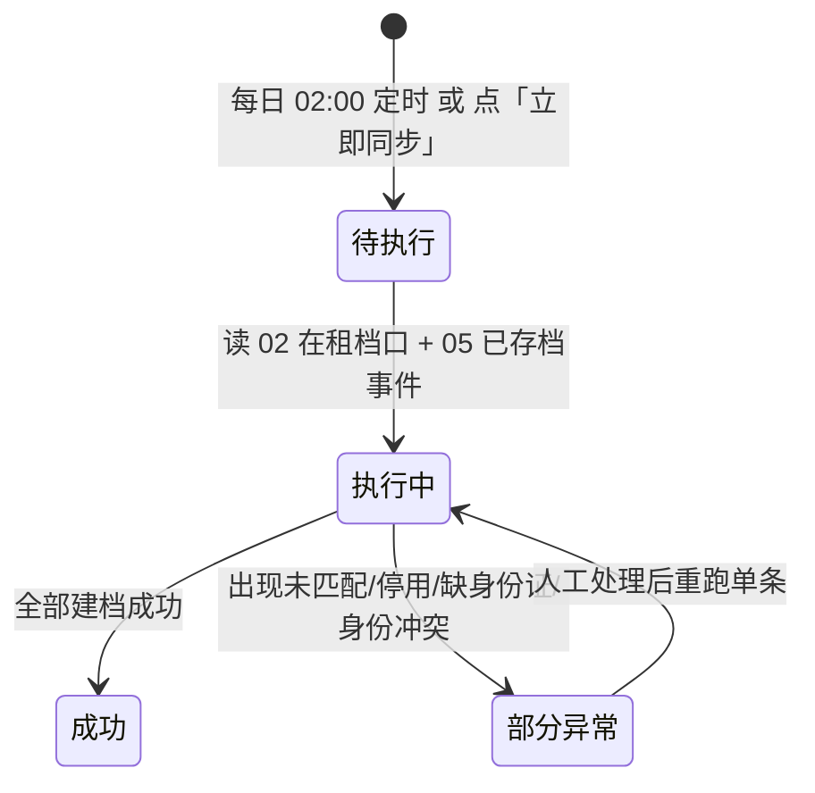

# 04 实体商户管理 · 运营端页面说明（首篇）

> 端：运营端 PC（`yunying-PC`）　｜　模块：04 实体商户管理（菜单名「商户管理」）
> **本文件 = 模块通用说明（§0）+ 第 1 页**，同目录其余文件只写本页
> 页面版本：v1.0（2026-10-22）　｜　业务分册：`开发PRD/运营管理端分册PRD/04-商户管理.md` **v2.9**
> 同目录：`02-资料变更审核.md`、`03-商户档案.md`、`04-信用评级.md`、`05-资质与到期管理.md`、`06-清退商户.md`、`07-租金催缴.md`

---

## 0. 模块通用说明（本模块其他页面不再重复）

### 0.1 这个模块解决什么问题

合同签完、档口租出去了，但**系统里没有"商户"这个东西**——谁在租、能不能用物业模块、欠不欠租、信用多少，分散在 02 档口、05 合同、06 缴费里，对不上号。
本模块把「纸质合同上的承租方」变成**可管理、可授权、可评价的商户档案**，并承接资质、变更、信用、催缴、清退。

不做：每个租户靠人工在 Excel 里维护；档口换了租户系统不知道；物业人员不知道该给谁开权限。

### 0.2 角色与权限矩阵

| 功能 | 商户管理专员 | 运营主管 | 运营专员 | 财务 | 商户本人 | 无权限表现 |
|---|---|---|---|---|---|---|
| 初审 | ✅ | ✅ | ❌ | ❌ | ❌ | 按钮隐藏 |
| 复审 / 通过 / 驳回 | ❌（初审复审分离时） | ✅ | ❌ | ❌ | ❌ | 按钮隐藏 |
| 自动建档同步 / 异常处理 | ✅ | ✅ | ❌ | ❌ | ❌ | 按钮隐藏 |
| 档案查看 | ✅ | ✅ | ✅ | ✅（财务口径） | 仅本人 | 列表不返回 |
| 档案编辑 | ✅（受限字段） | ✅ | ❌ | ❌ | ❌ | 字段置灰 |
| **查看完整身份证** | ✅（留痕） | ✅（留痕） | ❌ | ❌ | 仅本人 | 按钮隐藏 |
| 画像标签维护 | ✅ | ✅ | ✅ | ❌ | ❌ | 按钮隐藏 |
| 资料变更审核 | ✅ | ✅ | ❌ | ❌ | 提交 | — |
| 资质与到期管理 | ✅ | ✅（终审） | ❌ | ❌ | 提交 | — |
| 信用规则配置 | ✅ | ✅ | ❌ | ❌ | ❌ | 按钮隐藏 |
| **信用人工调整** | ❌ | ✅ | ❌ | ❌ | ❌ | 按钮隐藏 |
| **暂停 / 冻结** | ❌ | ✅ | ❌ | ❌ | ❌ | 按钮隐藏 |
| 清退 | 发起 | ✅ 审批 | ❌ | ❌ | ❌ | — |
| 导出 | ✅（脱敏） | ✅（可申请未脱敏） | ❌ | ✅（脱敏） | ❌ | 按钮隐藏 |

> **数据权限**：身份证默认脱敏 `3306**********1234`，查看完整需留痕；**档口关联只读**，主权在 02。

### 0.3 菜单与端间落点表

| # | 页面 | 运营端文件 | 买家端 | 商户端 | 数据方向 |
|---|---|---|---|---|---|
| P1 | 线下自动建档与同步 | `merchant-auto.html` | — | — | 后台内部（消费 05「已存档」事件 + 02 在租档口） |
| P2 | 资料变更审核 | `merchant-change.html` | ❌ | `mine.html` 商户资料入口（提交变更） | 商户端 → 本端（审批）→ 回写主档 |
| P3 | 商户档案 | `merchant-profile.html` | ⚠️ `shop-detail.html` 商位信息（编号口径待统一） | `mine.html` / `property.html` / `contract.html` / `payment.html`（**现为写死档口号**） | 本端为写入方；两端只读 |
| P4 | 信用评级 | `merchant-rating.html` | ⚠️ 店铺/商品页「实力商家」标识（❌ 未接） | 商户端等级标识（❌ 缺） | 本端 → 两端 |
| P5 | 资质与到期管理 | `merchant-qual.html` | ❌ | `shanghu-verify.html`（提交/重传） | 双向：商户提交 → 本端复核 |
| P6 | 清退商户 | `merchant-exit.html` | — | `property.html` 物业权限**自动回收** | 05 合同终止 → 本端存档；本端 → 商户端（回收权限） |
| P7 | 租金催缴 | `merchant-dunning.html` | — | `payment.html`（账单） + 站内/微信通知 | 本端 → 商户端（通知） |

> **关键口径（v2.0）**：注册**不再提交入驻申请**、**不产生档案**；**档案的唯一入口 = 05 合同「已存档」事件**（+ 每日兜底）。原「入驻申请审核」页已下线。
>
> ⚠️ **「已存档」的准确含义（2026-10-26 与 05 v1.11 对齐）**：指 **05 合同专员审核签字 → 上传线下盖章扫描件之后**的状态（`待签署审核 → 待盖章归档 → 已存档·生效中`）。**审核签字本身不产生「已存档」事件** → **盖章件未回传时本页不会建档、商户端也不会开通物业模块**。
> 商户端多处**硬编码档口号**（`mine.html:40`、`property.html:42/48`、`contract.html:74/76`、`payment.html:65`、`repair.html:62`）需改为读本模块关联，属端上待办。

**运营端内边界**：02 档口（本端只读）｜05 合同（本端只读，不新建合同表）｜10 商城（店铺归商城，本端只提供商户主体）｜10a 询价（入驻通过默认开通，资质过期冻结）｜06/07（缴费与物业回流用于信用与标签）。

### 0.4 核心数据对象

| 对象 | 说明 | 关键字段 | 谁产生 | 谁消费 |
|---|---|---|---|---|
| **商户主档 Merchant** | 一个承租主体 | 商户编号 / 名称 / 主体类型 / 商户类型 / 身份证 / 关联档口 / 授权员工 / 信用等级 / 状态 | 自动建档、手工补档 | 全模块 + 两端 |
| **建档任务 AutoProvisionJob** | 每日同步作业 | 批次 / 拉取数 / 新增 / 合并 / 异常数 | 系统（05 事件 / 定时） | P1 |
| **变更申请 ChangeRequest** | 商户提交的资料修改 | 变更编号 / 类型 / 前后值 / 状态 | 商户端 | P2 |
| **资质 Qual** | 证书与有效期 | 类型 / 编号 / 有效期 / 附件 / 状态 | 商户端提交、运营审核 | P5、10a 询价 |
| **催缴记录 Dunning** | 一合同一轮催缴 | 年度 / 应收 / 已缴 / 未缴 / 通知次数 | 系统 + 财务登记 | P7 |
| **清退存档 ExitArchive** | 提前终止的只读台账 | 清退单号 / 终止类型 / 生效日 / 原因 | 05 合同终止 | P6 |

### 0.5 状态机

**① 商户主档（5 态，类型不是状态）**

| 状态 | 含义 | 驱动 |
|---|---|---|
| 待判定 | 已自动建档，线上开通未定 | 系统 |
| 正常经营 | 线上已通过或线下在租 | 审核通过 / 合同在租 |
| 暂停 | 资质过期 / 欠费 / 违规，**保留档案限动作** | 运营（规则自动） |
| 冻结 | 严重违规，**关闭线上权限** | 主管审批 |
| 已清退 | 终态，权限全部回收 | 主管审批 |

**商户类型（属性）**：仅线上 / 线上兼档口 / 仅线下档口（未上线）
→ 自动建档先产生「仅线下档口（未上线）」；合同终止且线上仍在营 → 回退「仅线上」；类型变化一律留痕。

**② 自动建档任务（4 态）**：待执行 / 执行中 / 成功 / 部分异常

**③ 变更申请（3 态）**：待审核 → 已通过 / 已驳回（原因必填）

**禁止路径**

| 场景 | 系统行为 | 提示文案 | 日志 |
|---|---|---|---|
| 同（姓名+身份证）同档口重复建档 | 幂等跳过 | — | 是 |
| 02 租户换人 | 新户新建档，**老户档案保留不删** | — | 是 |
| 编辑身份证 | 字段只读 | 见 §0.6 说明 | — |
| 非主管做信用调整 / 暂停冻结 | 按钮隐藏 | — | 否 |
| 未脱敏导出未经审批 | 拦截 | M-47 | 是 |

### 0.6 名词与口径

| 名词 | 定义 | 备注 |
|---|---|---|
| **建档匹配键** | 姓名 + 身份证（首选）；只有姓名 + 摊位号时降级建档并标「身份待补全」 | 同名冲突进人工确认清单 |
| 摊位号 ↔ 档口编号 | 合同「资产名称」（如 `A9-10`）映射到 02 档口编号 | 映射缺失 → 异常清单 |
| **信用总分** | 交易 45% + 评价 25% + 缴费 20% + 违规扣分 | 权重可配置、版本化、**不回溯历史** |
| 数据缺失 | 该项无数据源（如缴费），**不算 0 分**，单独标记、不参与等级判定 | 当前缴费无源 |
| 自动暂停阈值 | 资质过期 / 欠费 > 30 天 / 违规 ≥ 3 / 投诉未处理 ≥ 2 | 暂停后 7 天整改期 |
| 催缴起算 | 每年 8 月 15 日起催缴第二年租金 | 规则可配 |
| 已缴判定 | 以「累计已缴名单导入」+ 人工登记为准，发送前比对 | 已缴不再收到通知 |
| 身份证脱敏 | 保留前 4 后 4，中间打码 | 查看完整需二次校验 + 留痕 |

### 0.6.1 跨端字段差异（只列不一致的）

| 概念 | 运营端 | 端上现状 | 目标口径 |
|---|---|---|---|
| 档口编号 | `merchant → units[]`（来自 02） | `mine.html` 等 5 处**写死 `1F-A08`** | 读本模块关联，仅「线上兼档口」显示档口区块 |
| 商户类型 | 三值枚举 | 无标识 | 端上展示「线上兼档口 / 仅线上」 |
| 信用等级 | 评级结果 | 无 | 端上展示等级；买家端「实力商家」由等级 + 标签驱动 |
| 报价权限 | 入驻通过默认开通、到期冻结 | 端上视为"需先认证" | 改为默认可用，过期才提示 |

### 0.7 本期不做

线上店铺管理（归 10 商城）｜保证金处理（线下必缴已收）｜06 缴费管理（缴费在本模块人工登记）｜人脸识别｜批量打标签｜短信渠道催缴（可选，独立短信服务）

---

## 1. 线下自动建档与同步 `merchant-auto.html`

### 1.1 页面说明

| 项 | 内容 |
|---|---|
| 页面目标 | 让专员看见"系统把线下租户变成商户"的过程与问题：谁被建了档、谁没建上、为什么 |
| 使用角色 | 商户管理专员（主）、运营主管 |
| 入口 | 菜单 → 商户管理 → 线下自动建档与同步 |
| 前置 | 05 有「已存档」合同（**= 盖章扫描件已回传**，审核签字未回传不算）；02 有在租档口 |
| 后置 | 生成/合并商户档案；异常进清单待处理 |

### 1.2 本页端间关系

| 项 | 内容 |
|---|---|
| 本页数据来源 | 05 合同「已存档」事件 + 02 在租档口（每日兜底） |
| 本页操作的跨端影响 | 建档成功 → 商户端获得物业模块权限（合同期内） |
| 依赖的其他端页面 | 无直接页面；影响商户端 `property.html` 可用性 |
| 不涉及的端 | 买家端 |
| 一致性要求 | 幂等：同（姓名+身份证）同档口只建一次 |

### 1.3 页面结构

| 区块 | 内容 |
|---|---|
| 顶部 | 标题「线下自动建档与同步」+ 导出 |
| 同步任务卡片 | 上次/下次同步时间、数据源（02）、拉取条数、新增建档、异常数、耗时 + **「立即同步」** |
| **统计卡** | **无**（本页以任务卡片承载指标，非指标卡） |
| 筛选区 | 同步批次日期 + 来源档口（楼栋/楼层）+ 建档结果 + 异常类型 + 查询 + 重置 |
| 建档结果表 | **9 列** |
| 异常清单表 | **5 列** |

### 1.4 列表、筛选与排序

| 项目 | 规则 |
|---|---|
| 默认排序 | 同步时间倒序 |
| 分页 | 不限（演示为单页） |
| 筛选组合 | 条件之间 **且** |
| 建档结果筛选 | 成功·新建 / 成功·合并 / 异常 |
| 异常类型 | 未匹配档口 / 停用档口 / 缺身份证 / 身份冲突 |
| 空结果 | 见 M-06 / M-07 |

### 1.5 字段规格

**建档结果表（9 列）**：租户姓名 · 身份证号（脱敏）· 档口编号 · 位置 · 租期 · 合同号 · 建档结果 · 商户编号 · 操作

**异常清单表（5 列）**：异常类型 · 原始信息 · 处理建议 · 处理状态 · 操作

| 异常类型 | 典型原因 | 处理建议 |
|---|---|---|
| 未匹配档口 | 合同「资产名称」不在 02 | 物业补录档口后重跑 |
| 停用档口 | 档口状态为停用 | 核查是否误停用 |
| 缺身份证 | 线下合同只有姓名 | 降级建档 + 标「身份待补全」，后续补全自动去重 |
| 身份冲突 | 同名多摊且均无身份证 | 人工线下核对后合并 |

### 1.6 交互规则

| 元素 | 显示条件 | 可点条件 | 点击后 | 禁止表现 |
|---|---|---|---|---|
| 立即同步 | 始终 | 专员/主管 | 消费 05 事件 + 拉取 02 → 刷新任务卡 | 执行中按钮 loading |
| 查看档案 | 建档成功 | 专员 | 跳 P3 档案详情 | — |
| 处理异常 | 异常行 | 专员 | 弹窗选处理方式 | 未选 → M-04 |
| 忽略 | 异常行 | 专员 | 必填备注后忽略 | 空备注 → M-05 |
| 重跑单条 | 异常行 | 专员 | 重新执行该条 | — |
| 转人工建档 | 异常行 | 专员 | 手工补档（走 P3 补档） | 必填原因 |

### 1.7 业务规则与计算口径

| 编号 | 规则 | 触发 | 处理 | 影响端 |
|---|---|---|---|---|
| R-01 | 幂等建档 | 同步 | 同（姓名+身份证）同档口只建一次 | — |
| R-02 | 换人不删档 | 02 租户换人 | 新户新建，老户保留 | 商户端 |
| R-03 | 降级建档 | 缺身份证 | 照建 + 标「身份待补全」 | — |
| R-04 | 首次只建在租 | 首次全量 | 历届租户不建档 | — |
| R-05 | 建档即开物业权限 | 建档成功 | 权限随合同期 | 商户端 |
| R-06 | 异常不阻塞其余条目 | 部分异常 | 成功的照常入库 | — |

### 1.8 异常与边界

| 类型 | 场景 | 系统行为 | 提示文案 |
|---|---|---|---|
| 数据 | 建档结果无记录 | 空态 | 【已实现】「暂无匹配记录」 |
| 数据 | 异常清单为空 | 空态 | 【已实现】「暂无异常，建档链路运行正常」 |
| 数据 | 未选处理方式 | 拦截 | 【已实现】「请选择处理方式」 |
| 数据 | 忽略未填备注 | 拦截 | 【已实现】「选择「忽略」时备注必填」 |
| 依赖 | 05/02 不可用 | 任务失败，保留上次结果 | **【待实现】M-47/M-48** |

#### 1.8.1 本页提示语清单（来源：分册 §8.10，编号可回溯）

| 编号 | 场景 | 提示文案 | 形式 | 状态 |
|---|---|---|---|---|
| M-01 | 导出同步日志 | 已导出本次同步日志（CSV，身份证脱敏） | Toast | ✅ |
| M-02 | 点立即同步 | 正在消费 05 合同「已存档」事件 + 拉取 02 在租档口数据… | Toast | ✅ |
| M-03 | 同步完成 | 同步完成：拉取 {n} 条，新增建档 {a}，合并 {b}，异常 {c} | Toast | ✅ |
| M-04 | 未选处理方式 | 请选择处理方式 | Toast | ✅ |
| M-05 | 忽略未填备注 | 选择「忽略」时备注必填 | Toast | ✅ |
| M-06 | 列表无数据 | 暂无匹配记录 | 空态 | ✅ |
| M-07 | 异常清单为空 | 暂无异常，建档链路运行正常 | 空态 | ✅ |
| M-47 | 无权限操作 | 无权限，请联系管理员 | Toast | ✅ |
| M-48 | 并发冲突 | 该记录已被他人修改，请刷新后重试 | Toast | ✅ |

> M-47 / M-48 由 `shared/op-guard.js` 统一实现（右上角角色切换 + `?conflict=1` 演示冲突），页面仅一行 script 引用。

### 1.9 通知与消息

| 事件 | 接收人 | 渠道 | 抑制条件 |
|---|---|---|---|
| 同步出现异常 | 商户管理专员 | 站内 + 待办 | 同批次只发一次 |
| 建档成功 | 商户（本人） | 站内 | 已有账号才发 |

### 1.10 验收标准

| 编号 | 前置 | 操作 | 预期 | 级别 |
|---|---|---|---|---|
| AC-01 | 05 合同已存档、02 档口在租 | 点立即同步 | 生成商户档案，商户类型=仅线下档口（未上线） | P0 |
| AC-02 | 同一租户重复同步 | 再点同步 | 不重复建档（幂等） | P0 |
| AC-03 | 合同只有姓名无身份证 | 同步 | 降级建档并标「身份待补全」 | P0 |
| AC-04 | 合同资产名称不在 02 | 同步 | 进异常清单，类型=未匹配档口 | P1 |
| AC-05 | 异常行点忽略 | 不填备注 | 拦截提示备注必填 | P1 |
