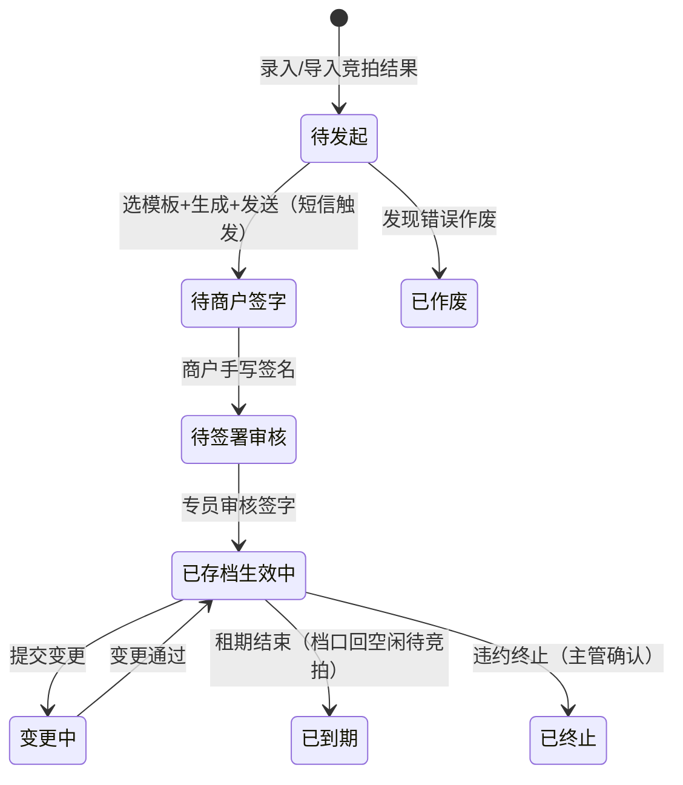

# 05 合同管理 · 运营端页面说明（首篇）

> 端：运营端 PC（`yunying-PC`）　｜　模块：05 合同管理
> **本文件 = 模块通用说明（§0）+ 第 1 页**，同目录其余文件只写本页
> 页面版本：v1.0（2026-10-22）　｜　业务分册：`开发PRD/运营管理端分册PRD/05-合同管理.md` **v2.1**
> 同目录：`02-合同台账与签署留档.md`、`03-合同变更审核.md`、`04-合同发起与签署.md`

---

## 0. 模块通用说明（本模块其他页面不再重复）

### 0.1 这个模块解决什么问题

档口竞拍出去了，合同签在纸上锁进柜子：**谁在租、租到哪天、一年多少钱、什么时候该催租**，全靠人翻纸质合同。
本模块把「竞拍 → 合同 → 签署 → 供数 → 到期/终止」搬到线上，成为 **02 档口「在租」与 04 商户档案的唯一数据源**。

不做：合同到期没人知道、档口空着还在系统里标在租、催租靠打电话翻本子。

### 0.2 角色与权限矩阵

| 功能 | 合同管理专员 | 运营主管 | 物业 | 财务 | 商户本人 | 无权限表现 |
|---|---|---|---|---|---|---|
| 合同列表 / 详情 | ✅ | ✅ | ✅（本楼栋） | 只读财务字段 | 仅本人合同 | 列表不返回 |
| 录入 / 导入合同 | ✅ | ✅ | ❌ | ❌ | ❌ | 按钮隐藏 |
| 摊位号映射维护 | ✅ | ✅ | ✅（补录档口） | ❌ | ❌ | — |
| 发起签署 / 重发短信 | ✅ | ✅ | ❌ | ❌ | ❌ | 按钮隐藏 |
| 审核商户签字 | ✅ | ✅ | ❌ | ❌ | ❌ | 按钮隐藏 |
| **上传盖章件** | ✅ | ✅ | ❌ | ❌ | ❌ | 按钮隐藏 |
| 变更发起 | ✅ | ✅ 审批 | ❌ | ❌ | 可申请 | — |
| **终止（违约）** | ✅ 发起 | ✅ 确认 | ❌ | ❌ | ❌ | 按钮隐藏 |
| 身份证 / 权证号完整值 | ✅（留痕） | ✅（留痕） | ❌ | ❌ | 仅本人 | 按钮隐藏 |
| 导出 | ✅（脱敏） | ✅（可申请未脱敏） | ✅（本楼栋） | ✅（财务口径） | ❌ | 按钮隐藏 |

> **一条龙**：合同专员负责从竞拍结果 → 发起 → 生成内容 → 发送 → 审核签字 → 盖章归档 → 变更/终止。**财务不做合同生成与签字审核**（v1.4 起）。

### 0.3 菜单与端间落点表

| # | 页面 | 运营端文件 | 商户端 | 买家端 | 数据方向 |
|---|---|---|---|---|---|
| P1 | 合同模板管理 | `contract-template.html` | — | — | 内部（供发起时选模板） |
| P2 | 合同台账与签署留档 | `contract-list.html` | `contract.html`（**写死数据，需改**） | ❌ | 本端 → 两端（供数） |
| P3 | 合同变更审核 | `contract-change.html` | 变更申请入口（**缺**） | ❌ | 商户端 → 本端（审批） |
| P4 | 合同发起与签署 | `contract-apply.html` | `contract.html` **待签合同 + 手写签名**（**缺**） | ❌ | 本端 → 商户端（短信 + 待签） |
| — | 到期预警与竞拍衔接 | **`contract-expiry.html` ❌ 未建** | 到期提醒（缺） | ❌ | 02 衔接 |
| — | 保证金台账 | **`contract-deposit.html` ❌ 未建** | 只读展示（缺） | ❌ | 04/06 衔接 |

> **买家端不承载合同签署**：买家端只做账号注册（与商户端同一账号体系），合同全流程在商户端与后台之间完成。
> **商户端 `contract.html` 现状问题**：3 个死按钮（预览合同 / 续租申请 / 退租）+ 写死数据（`HT2024-0826`、`1F-A08 · 50㎡`、`¥12,800/月`、租期至 `2026.09.01`）。按 v1.4：**删续租/退租按钮**、**加待签合同 + 手写签名**、**删「发起合同申请」入口**（合同由后台发起）。

**运营端内边界**：02 档口（本模块为**上游**，按档口编号推送，匹配失败回流异常清单）｜04 商户（合同「已存档」触发自动建档）｜06 缴费（应收计划）｜09 消息推送（催缴与短信复用）。

### 0.4 核心数据对象

| 对象 | 说明 | 关键字段 | 谁产生 | 谁消费 |
|---|---|---|---|---|
| **合同 Contract** | 一份租赁合同 | 合同号 / 摊位号 / 承租方 / 面积 / 租期 / 年租金 / 等级 / 状态 / 签署状态 | 专员录入或发起 | 全模块 + 02/04/06 |
| **模板 Template** | 按资源类型区分 | 类型 / 版本 / 变量占位 / 状态 | 专员维护 | P4 发起 |
| **应收计划 Plan** | 分期应收 | 期次 / 年度 / 金额 / 时点 | 合同生成时 | 06、04 催缴 |
| **变更单 Change** | 在途变更 | 类型 / 前后值 / 敏感标记 | 商户或专员发起 | P3 |
| **签署单 Sign** | 一次签署流程 | 状态 / 短信记录 / 签字图 / 盖章件 | 系统 | P4 |

### 0.5 状态机

**合同 9 态**

| 状态 | 含义（等谁做什么） | 驱动 |
|---|---|---|
| 待发起 | 竞拍结果已录入，等专员发起（选模板 + 生成 + 发送，**同一动作**） | 合同专员 |
| 待商户签字 | 已发送（短信已发），等竞拍人**同号注册后手写签名** | 承租商户 |
| 待签署审核 | 商户已签，等**专员审核签字** | 合同专员 |
| 已存档 · 生效中 | **专员审核通过 = 生效**；盖章件另带 `待回传/已回传` 子标记（**不影响生效**） | 专员 → 系统 |
| 已存档（存量） | 存量合同录入后直接置此态，只留档供数 | 合同专员 |
| 变更中 | 有在途变更 | 专员 / 主管 |
| 已到期 | 租期结束（终态）：档口回「空闲（待竞拍）」，进下一轮竞拍 | 系统 |
| 已终止 | **违约终止**（终态）：欠租违约，平台主动终止 | 专员发起 + 主管确认 |
| 已作废 | 起草/申请阶段发现错误作废（终态，不删档） | 专员 + 主管 |

**禁止路径**

| 场景 | 系统行为 | 提示文案 | 日志 |
|---|---|---|---|
| 未勾「已获运营主管确认」就终止 | 拦截 | K-19 | 是 |
| 手机号与竞拍登记不一致 | 拦截（提示改绑） | K-36 | 是 |
| 手机号不一致却在商户端找合同 | 端上提示"未查询到待签合同" | — | 否 |
| 主体变更未勾核验 | 拦截 | K-29 | 是 |
| 到期合同走"续约" | **不存在该能力**（业务无续约/退租） | — | — |

### 0.6 名词与口径

| 名词 | 定义 | 备注 |
|---|---|---|
| **签约年限** | 按**摊位等级**：精品摊 **5 年** / 普通摊 **3 年** | 等级属性在 02 档口台账 |
| **保证金** | 精品摊 **2 万** / 普通摊 **1 万** | 线下必缴已收，系统只登记 |
| 租金口径 | **年租金 / 总租金**（**不是月租**） | 商户端写死的 `¥12,800/月` 需改 |
| 到期 ≠ 终止 | 到期=自然结束（无审批、无原因）；终止=提前结束（需审批 + 原因） | 04 状态：到期→已到期；终止→违约终止/已终止 |
| 违约金 | **终止不计算违约金** | 无此能力 |
| 签署匹配键 | **手机号**（须与竞拍登记一致） | 不一致 → 专员改绑 |
| 盖章件 | 只影响**归档完整性**，**不影响合同生效** | — |

### 0.6.1 跨端字段差异（只列不一致的）

| 概念 | 运营端 | 商户端现状 | 目标口径 |
|---|---|---|---|
| 租金 | `annualRent`（年） | `¥12,800/月`（月） | 统一**年租金** |
| 合同号 | `HT` + 年 + 序号 | 写死 `HT2024-0826` | 后台供数 |
| 档口 | `摊位号 → 档口编号` 映射 | 写死 `1F-A08 · 50㎡` | 按档口编号取数 |
| 签署状态 | 5 态 + 盖章子标记 | 无 | 端上展示待签 / 已生效 |
| 续租 / 退租 | **不存在** | 有死按钮 | 端上删除 |

### 0.7 本期不做

在线电子签（无 CA/无实名）｜人脸识别｜续约与退租办理（业务不存在）｜违约金计算｜06 缴费管理｜保证金退还流程（只登记）

---

## 1. 合同模板管理 `contract-template.html`

### 1.1 页面说明

| 项 | 内容 |
|---|---|
| 页面目标 | 维护合同模板（按资源类型区分），供发起合同时**自动填充变量** |
| 使用角色 | 合同管理专员、运营主管 |
| 入口 | 菜单 → 合同管理 → 合同模板管理 |
| 前置 | 资源类型已知（档口 / 办公室 / 店面 / 物业） |
| 后置 | 模板被引用到合同；改模板生成新版本，**不影响已生成合同** |

### 1.2 本页端间关系

| 项 | 内容 |
|---|---|
| 本页数据来源 | 专员手工维护 |
| 本页操作的跨端影响 | 间接：合同内容 → 商户端签署页展示 |
| 依赖的其他端页面 | 无 |
| 不涉及的端 | 买家端、商户端 |
| 一致性要求 | 版本化 + 启停，回滚生成新版本 |

### 1.3 页面结构

| 区块 | 内容 |
|---|---|
| 顶部 | 标题「合同模板管理」+ 导出 + 新增 |
| **统计卡** | 模板总数 / 启用中 / 本月更新 / 使用中（引用合同数） |
| 筛选区 | 关键词 + 适用资源类型 + 状态 + 查询 + 重置 |
| 列表 | **8 列** + 分页 |
| 编辑抽屉 | 模板名 / 资源类型 / 正文（变量占位）/ 版本记录 |

### 1.4 列表、筛选与排序

| 项目 | 规则 |
|---|---|
| 默认排序 | 最近更新倒序 |
| 分页 | 页码 |
| 筛选组合 | 条件之间 **且** |
| 空结果 | 「暂无模板」 |
| 导出 | 含变量占位清单 |

### 1.5 字段规格

| 列 | 字段 | 说明 |
|---|---|---|
| 模板名称 | `name` | 必填 |
| 适用资源类型 | `resType` | 档口（精品 5 年 / 普通 3 年）/ 办公室 / 店面 / 物业 |
| 版本 | `version` | 每次改动 +1 |
| 最近更新 | `updatedAt` | — |
| 更新人 | `updatedBy` | — |
| 引用合同 | `usedBy` | 使用中数量 |
| 状态 | `state` | 启用 / 停用 |
| 操作 | — | 编辑 / 复制 / 版本 / 启停 / 导出 |

**变量占位**：承租人 / 资源编号 / 租期起止 / 年租金 / 企业类型（v1.6 **去掉保证金变量**）。

### 1.6 交互规则

| 元素 | 显示条件 | 可点条件 | 点击后 | 禁止表现 |
|---|---|---|---|---|
| 新增 / 编辑 | 始终 | 专员/主管 | 抽屉 | 名称/正文空 → K-06/K-07 |
| 插入变量 | 编辑态 | 同上 | 光标处插入 `{{变量}}` | — |
| 复制 | 始终 | 同上 | 生成副本（名称加"副本"） | — |
| 启停 | 始终 | 同上 | 切换启用状态 | 停用不影响在用合同 |
| 版本 | 有历史 | 同上 | 查看版本列表 + 回滚 | 回滚生成新版本 |
| 导出 | 始终 | 同上 | 导出模板 + 变量清单 | — |

### 1.7 业务规则与计算口径

| 编号 | 规则 | 触发 | 处理 | 影响端 |
|---|---|---|---|---|
| R-01 | 模板按资源类型唯一启用 | 启用 | 同类型只允许一个启用版本 | — |
| R-02 | 改模板不回溯 | 编辑 | 生成新版本，已生成合同不受影响 | — |
| R-03 | 回滚生成新版本 | 回滚 | 不删除中间版本 | — |
| R-04 | 停用不影响在用 | 停用 | 仅不可被新合同选择 | — |
| R-05 | 正文不含续约/退租条款 | 保存 | v1.2 口径，业务无此能力 | — |

### 1.8 异常与边界

| 类型 | 场景 | 系统行为 | 提示文案 |
|---|---|---|---|
| 数据 | 名称未填 | 拦截 | 【已实现】「模板名称必填」 |
| 数据 | 正文未填 | 拦截 | 【已实现】「模板正文必填」 |
| 数据 | 列表为空 | 空态 | — |
| 权限 | 非专员编辑 | 按钮隐藏 | — |

#### 1.8.1 本页提示语清单（来源：分册 §8.8，编号可回溯）

| 编号 | 场景 | 提示文案 | 形式 | 状态 |
|---|---|---|---|---|
| K-01 | 导出全部 | 已导出全部模板（含变量占位清单） | Toast | ✅ |
| K-02 | 启停模板 | 模板「{名}」已{启用/停用} | Toast | ✅ |
| K-03 | 复制模板 | 已复制为「{新名}」 | Toast | ✅ |
| K-04 | 导出单个 | 已导出模板「{名}」 | Toast | ✅ |
| K-05 | 插入变量 | 已插入变量占位 {变量} | Toast | ✅ |
| K-06 | 名称未填 | 模板名称必填 | 行内 | ✅ |
| K-07 | 正文未填 | 模板正文必填 | 行内 | ✅ |
| K-08 | 保存 | 已保存模板「{名}」 | Toast | ✅ |
| K-09 | 新增 | 已新增模板「{名}」 | Toast | ✅ |
| K-10 | 回滚版本 | 已回滚到 {版本} | Toast | ✅ |
| K-49 | 无权限 | 无权限，请联系管理员 | Toast | ✅ |

### 1.9 通知与消息

| 事件 | 接收人 | 渠道 | 抑制条件 |
|---|---|---|---|
| 模板被停用但仍有在途合同引用 | 合同管理专员 | 站内 | 一次 |

### 1.10 验收标准

| 编号 | 前置 | 操作 | 预期 | 级别 |
|---|---|---|---|---|
| AC-01 | 新建模板 | 名称留空保存 | 拦截提示名称必填 | P0 |
| AC-02 | 正文含变量占位 | 发起合同 | 变量被自动填充为合同实际值 | P0 |
| AC-03 | 已有生效合同引用的模板 | 修改并保存 | 生成新版本，**已生成合同内容不变** | P0 |
| AC-04 | 同一资源类型 | 启用第二个模板 | 只保留一个启用版本 | P1 |
