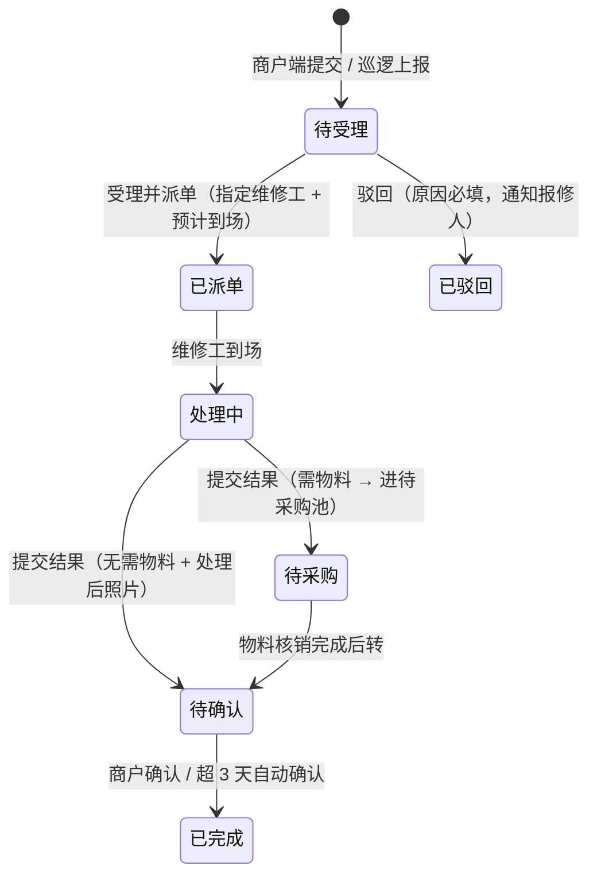

# 07 物业服务 · 页面说明（首篇）

> 端：运营端 PC（`yunying-PC`）　｜　模块：07 物业服务（分册 `07-物业服务.md`）
> 页面：`property-repair.html`　｜　配套：`property-request.html` `property-budget.html` `property-inspect.html` `property-issue.html` `property-rectify.html` `property-complaint.html`
> **本文件 = 模块通用说明（§0）+ 第 1 页**，同目录其余 6 份只写本页
> 页面版本：v1.0（2026-10-27）　｜　业务分册：`开发PRD/运营管理端分册PRD/07-物业服务.md` **v1.0**
> 同目录：`02-交办单与核销` `03-维修资金台账` `04-巡检管理` `05-问题上报` `06-整改管理` `07-投诉建议`

---

## 0. 模块通用说明（7 页共用）

### 0.1 这个模块解决什么问题

物业维修是"看不见的黑箱"：报修靠电话、采购靠口头、发票事后补。
**一年 30 万维修资金花在哪、单价是否合理、有没有重复报修、商户整改是否落地，全是糊涂账。**

本模块把四条业务线拆开、各自闭环，并让单据之间互相咬合：

| 线 | 链路 | 落到哪页 |
|---|---|---|
| ① **报修与维修资金**（主干，监管核心） | 报修 → 派单 → 处理 → 需物料则进待采购池 → 攒批建**交办单** → 审批链 → 逐行**核销** → 年度**额度**扣减 | P1 报修工单 / P2 交办单与核销 / P3 维修资金台账 |
| ② **现场治理** | 巡检计划 → 任务 → 发现问题 → 按**责任方**分流（商户→整改 / 物业→报修） | P5 巡检 / P6 问题 / P7 整改 |
| ③ **投诉建议** | 受理 → 回复 → 转单反哺（维修质量→报修、秩序问题→整改） | P8 投诉 |
| ④ 保洁管理 | 与 ② 同构，**本期只定义不做原型**（菜单占位 `dev`） | — |

> **不得混线**：报修单（`BX`）只由 P1 生成；交办单（`JB`）只由 P2 生成；整改单（`ZG`）只由 P6/P7 生成。**P6 转报修是"新建 BX + 原 WT 记录保留"，不是把 WT 改名为 BX。**

### 0.2 单据编号规则

| 前缀 | 单据 | 生成方 | 示例 |
|---|---|---|---|
| `BX` | 报修单 | P1（商户端提交 / 巡逻上报） | `BX202610-0031` |
| `JB` | 交办单 | P2（待采购池攒批） | `JB202610-0007` |
| `HX` | 核销记录 | P2（每次上传凭证） | `HX202610-0011` |
| `SQ` | 额外申请 | P3 | `SQ202610-0003` |
| `YC` | 核销异常 | P2 自动生成 | `YC202610-0005` |
| `XJ` | 巡检任务 | P5（计划自动生成 / 手工补建） | `XJ202610-0086` |
| `WT` | 现场问题 | P5 上报 / P6 直接上报 | `WT202610-0061` |
| `ZG` | 整改单 | P6 派整改 / P7 | `ZG202610-0031` |
| `TS` | 投诉 | P8 | `TS202610-0062` |

### 0.3 角色与权限矩阵

| 操作 | 物业专员 | 物业主管 | 运营主管 | 财务 | 董事长 |
|---|---|---|---|---|---|
| 报修受理 / 派单 / 提交结果 | ✅ | ✅ | ❌ | ❌ | ❌ |
| 建交办单 / 上传核销凭证 | ✅ | ✅ | ❌ | ❌ | ❌ |
| 交办单审批（<1000 元） | ❌ | ❌ | ✅ 初审 | ❌ | ❌ |
| 交办单审批（≥1000 元） | ❌ | ❌ | ✅ | ✅ 分管领导 | ✅ 终审 |
| 额度额外申请 | ❌ | ✅ 发起 | ✅ 审批 | ✅ 复核 | ❌ |
| 历史采购导入 | ❌ | ✅ | ✅ | ❌ | ❌ |
| 巡检计划配置 | ❌ | ✅ | ❌ | ❌ | ❌ |
| 巡检执行 / 问题上报 | ✅ | ✅ | ❌ | ❌ | ❌ |
| 整改派发 / 复核 | ❌ | ✅ | ❌ | ❌ | ❌ |
| 投诉受理 / 回复 | ✅ | ✅ | ❌ | ❌ | ❌ |
| 导出 | ❌ | ❌ | ✅ | ✅ | ✅ |

> **数据权限**：物业角色只看本市场数据；**核销金额对物业专员脱敏**（显示"已核销"不显示具体金额，仅主管/财务/董事长可见）。

### 0.4 审批链（金额分档，系统判定）

| 金额 | 链长 | 节点（串行） |
|---|---|---|
| **< 1,000 元** | 2 级 | 市场管理部 → 市场部负责人 |
| **≥ 1,000 元** | 4 级 | 市场管理部 → 市场部负责人 → 分管领导 → 董事长 |

> **档位由金额自动计算，提交人无法选择**。驳回后版本号 +1，重提**从第一级重新审批**。

### 0.5 硬校验 vs 标异常（本模块最容易搞错的地方）

| 类别 | 场景 | 处理 |
|---|---|---|
| **硬拦（不通过）** | 要素不全、未勾物资行、**发票号重复**、照片缺失/复用 | 直接拦截 |
| **标异常（放行但记账）** | 数量超核、单价超审批 10%、累计金额超审批、换供应商 | 核销成功，同时生成 `YC` 异常，进异常台账待处置 |
| **额度不足** | 剩余额度 < 本次核销金额 | **阻断核销**，提示跳 P3 申请追加 |

> **为什么不全拦**：采购现场存在合理偏差（涨价、多买）。全拦会让一线绕过系统；全放又失去监管。**放行 + 记账 + 必须处置**才是可执行的。

---

## 1. 页面定位

**P1 报修工单**是四条线的入口。照片是核心凭证（**上报与处理前后都要**），状态决定谁该做什么。

- 使用者：物业专员（受理/派单/处理）、物业主管（驳回/改派）
- 上游：商户端 App 报修、物业巡逻上报、（可选）巡检问题转报修
- 下游：需物料 → P2 待采购池；无需物料 → 待确认 → 商户确认/3 天自动完成

## 2. 分区结构

| 区块 | 内容 |
|---|---|
| 顶部 | 标题 + 三个规则标签（照片必传 / 需物料转交办单）+「导出」「新增报修（巡逻）」 |
| 统计卡（5） | 待受理 · 处理中 · 待采购 · 待确认 · 本月已完成（可点击切 Tab） |
| Tab（7） | 全部 / 待受理 / 处理中（含已派单）/ 待采购 / 待确认 / 已完成 / 已驳回，**带条数** |
| 筛选 | 关键词（单号/位置/报修人/描述）+ 来源 + 故障类型 + 紧急度 + 仅看超时 |
| 列表（9 列） | 报修编号（带动来源与"凭证存疑"标）· 位置 · 报修人 · 故障类型 · 紧急度 · 照片 · 状态 · **停留时长**（超时标红）· 操作 |
| 详情抽屉 | 6 段：报修信息 / 现场照片 / 处理记录（**前后照片对比**）/ 物料需求（关联交办单）/ 商户确认 / 流程时间轴 |

## 3. 统计卡口径

| 卡 | 口径 |
|---|---|
| 待受理 | `state = 待受理` |
| 处理中 | `state ∈ {已派单, 处理中}`（两态合并计一个 Tab） |
| 待采购 | `state = 待采购`（已进待采购池，等组批） |
| 待确认 | `state = 待确认`（已提交结果，等商户确认或 3 天自动确认） |
| 本月已完成 | `state = 已完成` |

> **超时基线**：待受理 > **2 小时**；待采购 > **30 天**未核销。命中即标红「超时」。

## 4. 状态机（7 态）

## 5. 表单字段与校验

### 5.1 新增报修（物业巡逻）

| 字段 | 必填 | 校验 |
|---|---|---|
| 所属场所 | 是 | 三选一（只读字典） |
| 楼栋 / 楼层 | 是 | — |
| 档口 / 位置 | 是 | — |
| 故障类型 | 是 | 照明 / 水电 / 门窗 / 地砖 / 空调 / 其他 |
| 问题描述 | 是 | **≥5 字** |
| 紧急程度 | 是 | 紧急 / 一般 |
| 现场照片 | **是** | **≥1 张**，水印含「时间 · 位置 · 单号」；EXIF 早于提交 >24h → 标「凭证存疑」 |

### 5.2 受理派单

| 字段 | 必填 |
|---|---|
| 指派维修工 | 是 |
| 预计到场时间 | 是 |

### 5.3 提交处理结果

| 字段 | 必填 | 说明 |
|---|---|---|
| 处理说明 | 是 | **≥5 字** |
| **处理后照片** | **是** | ≥1 张（与报修照片并排对比） |
| 是否消耗物料 | 是 | 选「是」→ 进待采购池，**物料核销完成前本单不关闭** |

## 6. 交互要点

| 操作 | 显示条件 | 效果 |
|---|---|---|
| 受理派单 | 待受理 | → 已派单，商户端可见维修工与到场时间 |
| 驳回 | 待受理 | → 已驳回，**原因必填**，通知报修人 |
| 提交处理结果 | 已派单 / 处理中 | 按「是否需物料」分叉到 待确认 / 待采购 |
| 改派 | 已派单 / 处理中 | 换维修工，**留痕** |
| 代确认 | 待确认 | 代商户确认完成（留痕） |
| 去建交办单 | 待采购且无 JB 号 | 跳 P2（带单号） |
| 查看交办单 | 待采购且有 JB 号 | 定位到 P2 交办单 |

## 7. 提示语表

> `✅` 原型已有 / `⬜` 待实现。**编号前缀 `WX-`**（物业报修线）。

| 编号 | 场景 | 提示文案 | 形式 | 阻断 | 状态 |
|---|---|---|---|---|---|
| WX-01 | 新增缺位置 | 请填写楼栋楼层与档口位置 | Toast | 是 | ✅ |
| WX-02 | 描述过短 | 请描述故障现象（至少 5 个字） | Toast | 是 | ✅ |
| WX-03 | 缺现场照片 | 请上传现场照片（至少 1 张） | Toast | 是 | ✅ |
| WX-04 | 新增成功 | 已提交报修：{单号}　已通知物业受理（超 2 小时未受理将提醒主管） | Toast | 否 | ✅ |
| WX-05 | 受理成功 | 已受理：{单号}　已指派 {维修工}（商户端可见进度） | Toast | 否 | ✅ |
| WX-06 | 改派成功 | 已改派：{单号}　{原} → {新}（留痕） | Toast | 否 | ✅ |
| WX-07 | 驳回未填原因 | 驳回原因必填 | Toast | 是 | ✅ |
| WX-08 | 驳回成功 | 已驳回：{单号}　已通知报修人 | Toast | 否 | ✅ |
| WX-09 | 处理说明过短 | 请填写处理说明（至少 5 个字） | Toast | 是 | ✅ |
| WX-10 | 缺处理后照片 | 请上传处理后照片（至少 1 张） | Toast | 是 | ✅ |
| WX-11 | 结果提交·无需物料 | 已提交：{单号}　转「待确认」，已通知商户（3 天未确认自动完成） | Toast | 否 | ✅ |
| WX-12 | 结果提交·需物料 | 已提交：{单号}　已进入待采购池（当前 {n} 单待组批） | Toast | 否 | ✅ |
| WX-13 | 列表空态 | 暂无符合条件的报修单 | 空态 | 否 | ✅ |
| WX-14 | 导出 | 已导出报修清单（含位置 / 类型 / 处理人 / 停留时长） | Toast | 否 | ✅ |
| WX-15 | 无权限操作 | 无权限，请联系管理员 | Toast | 是 | ✅ 由 `shared/op-guard.js` 提供 |
| WX-16 | 并发修改冲突 | 该记录已被他人修改，请刷新后重试 | Toast | 是 | ✅ 由 `shared/op-guard.js` 提供 |
| WX-17 | **超时自动提醒** | 建议：待受理超 2 小时，自动提醒物业主管 | 站内 / 短信 | 否 | ⬜ 原型只标红，未做提醒 |
| WX-18 | **照片复用检测** | 建议：该照片与 {另一单号} 相同，疑似复用 | Toast | 是 | ⬜ 原型仅表示「凭证存疑」字段，未做哈希比对 |

**自检结论**：✅ **16** / ⬜ **2** / 共 18 条。

## 8. 验收要点

| 编号 | 场景 | 期望 |
|---|---|---|
| AC-01 | 巡逻报修不传照片 | 拦截，不生成单据 |
| AC-02 | 受理后商户端 | 可见维修工姓名与预计到场时间 |
| AC-03 | 提交结果选「需物料」 | 状态转待采购，出现在 P2 待采购池，**本单不关闭** |
| AC-04 | 提交结果选「无需物料」 | 转待确认，3 天后自动完成 |
| AC-05 | 待受理超 2 小时 | 列表标红「超时」（提醒为待实现） |
| AC-06 | 详情页 | 报修照片与处理后照片**并排对比** |
