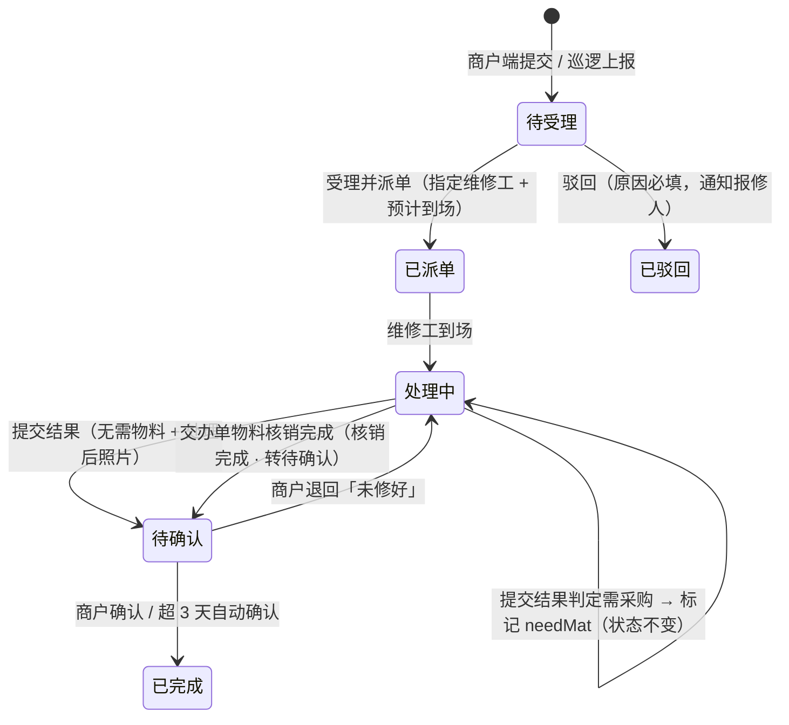

# 07 物业服务 · 页面说明（首篇）

> 端：运营端 PC（`yunying-PC`）　｜　模块：07 物业服务（分册 `07-物业服务.md`）
> 页面：`property-repair.html`　｜　配套：`property-request.html` `property-budget.html` `property-issue.html` `property-complaint.html` `property-material.html` `property-staff.html`
> **已下线（2026-11-03 · 不在招标范围内）**：巡检管理、整改管理、保洁管理、维修风控看板。原页面与说明归档于 `yunying-PC/_legacy/`。 `property-complaint.html`
> **本文件 = 模块通用说明（§0）+ 第 1 页**，同目录其余 6 份只写本页
> 页面版本：v2.0（2026-11-18 · 取消「待采购」Tab/状态 + 新增「是否需要采购」列 + 核销完成自动回写）　｜　业务分册：`开发PRD/运营管理端分册PRD/07-物业服务.md` **v2.1**
> 同目录：`02-交办单与核销` `03-维修资金台账` `04-巡检管理` `05-问题上报` `06-整改管理` `07-投诉建议`

---

## 0. 模块通用说明（7 页共用）

### 0.1 这个模块解决什么问题

物业维修是"看不见的黑箱"：报修靠电话、采购靠口头、发票事后补。
**一年 30 万维修资金花在哪、单价是否合理、有没有重复报修、商户整改是否落地，全是糊涂账。**

本模块把四条业务线拆开、各自闭环，并让单据之间互相咬合：

| 线 | 链路 | 落到哪页 |
|---|---|---|
| ① **报修与维修资金**（主干，监管核心） | 报修 → 派单 → 处理 → **判定是否需采购（标记，仍留在处理中）** → 攒批建**交办单** → 审批链 → 逐行**核销** → 回报修单转待确认 → 年度**额度**扣减 | P1 报修工单 / P2 交办单与核销 / P3 维修资金台账 |
| ② **现场治理** | 巡检计划 → 任务 → 发现问题 → 按**责任方**分流（商户→整改 / 物业→报修） | P5 巡检 / P6 问题 / P7 整改 |
| ③ **投诉建议** | 受理 → 回复 → 转单反哺（维修质量→报修、秩序问题→整改） | P8 投诉 |
| ④ 保洁管理 | 与 ② 同构，**本期只定义不做原型**（菜单占位 `dev`） | — |

> **不得混线**：报修单（`BX`）只由 P1 生成；交办单（`JB`）只由 P2 生成；整改单（`ZG`）只由 P6/P7 生成。**P6 转报修是"新建 BX + 原 WT 记录保留"，不是把 WT 改名为 BX。**

### 0.2 单据编号规则

| 前缀 | 单据 | 生成方 | 示例 |
|---|---|---|---|
| `BX` | 报修单 | P1（商户端提交 / 巡逻上报） | `BX202610-0031` |
| `JB` | 交办单 | P2（待采购池攒批） | `JB202610-0007` |
| `HX` | 核销记录 | P2（每次上传凭证） | `HX202610-0011` |
| `SQ` | 额外申请 | P3 | `SQ202610-0003` |
| `YC` | 核销异常 | P2 自动生成 | `YC202610-0005` |
| `XJ` | 巡检任务〔**已下线**，仅历史单号〕 | ~~P5~~ 归档 | `XJ202610-0086` |
| `WT` | 现场问题 | P5 上报 / P6 直接上报 | `WT202610-0061` |
| `ZG` | 整改单 | P6 派整改 / P7 | `ZG202610-0031` |
| `TS` | 投诉 | P8 | `TS202610-0062` |

### 0.3 角色与权限矩阵

| 操作 | 物业专员 | 物业主管 | 运营主管 | 财务 | 董事长 |
|---|---|---|---|---|---|
| 报修受理 / 派单 / 提交结果 | ✅ | ✅ | ❌ | ❌ | ❌ |
| 建交办单 / 上传核销凭证 | ✅ | ✅ | ❌ | ❌ | ❌ |
| 交办单审批（<1000 元） | ❌ | ❌ | ✅ 初审 | ❌ | ❌ |
| 交办单审批（≥1000 元） | ❌ | ❌ | ✅ | ✅ 分管领导 | ✅ 终审 |
| 额度额外申请 | ❌ | ✅ 发起 | ✅ 审批 | ✅ 复核 | ❌ |
| 历史采购导入 | ❌ | ✅ | ✅ | ❌ | ❌ |
| 巡检计划配置 | ❌ | ✅ | ❌ | ❌ | ❌ |
| 巡检执行 / 问题上报 | ✅ | ✅ | ❌ | ❌ | ❌ |
| 整改派发 / 复核 | ❌ | ✅ | ❌ | ❌ | ❌ |
| 投诉受理 / 回复 | ✅ | ✅ | ❌ | ❌ | ❌ |
| 导出 | ❌ | ❌ | ✅ | ✅ | ✅ |

> **数据权限**：物业角色只看本市场数据；**核销金额对物业专员脱敏**（显示"已核销"不显示具体金额，仅主管/财务/董事长可见）。

### 0.4 审批链（金额分档，系统判定）

| 金额 | 链长 | 节点（串行） |
|---|---|---|
| **< 1,000 元** | 2 级 | 市场管理部 → 市场部负责人 |
| **≥ 1,000 元** | 4 级 | 市场管理部 → 市场部负责人 → 分管领导 → 董事长 |

> **档位由金额自动计算，提交人无法选择**。驳回后版本号 +1，重提**从第一级重新审批**。

### 0.5 硬校验 vs 标异常（本模块最容易搞错的地方）

| 类别 | 场景 | 处理 |
|---|---|---|
| **硬拦（不通过）** | 要素不全、未勾物资行、**发票号重复**、照片缺失/复用 | 直接拦截 |
| **标异常（放行但记账）** | 数量超核、单价超审批 10%、累计金额超审批、换供应商 | 核销成功，同时生成 `YC` 异常，进异常台账待处置 |
| **额度不足** | 剩余额度 < 本次核销金额 | **阻断核销**，提示跳 P3 申请追加 |

> **为什么不全拦**：采购现场存在合理偏差（涨价、多买）。全拦会让一线绕过系统；全放又失去监管。**放行 + 记账 + 必须处置**才是可执行的。

---

## 1. 页面定位

**P1 报修工单**是四条线的入口。照片是核心凭证（**上报与处理前后都要**），状态决定谁该做什么。

- 使用者：物业专员（受理/派单/处理）、物业主管（驳回/改派）
- 上游：商户端 App 报修、物业巡逻上报、问题上报转报修（**巡检模块已下线，「巡检转单」来源已移除**，历史单据并入「问题上报转单」）
- 下游：**需采购（打标记，单据留在处理中）→ P2 建交办单核销 → 回本页转待确认**；无需物料 → 待确认 → 商户确认/3 天自动完成

## 2. 分区结构

| 区块 | 内容 |
|---|---|
| 顶部 | 标题 + 三个规则标签（照片必传 / 需采购 → 交办单核销）+「导出」「新增报修（巡逻）」 |
| 统计卡（5） | 待受理 · 处理中 · **需采购** · 待确认 · 本月已完成（「需采购」卡点击 = 切「处理中」并自动勾选「仅看需采购」） |
| Tab（6） | 全部 / 待受理 / 处理中（含已派单）/ 待确认 / 已完成 / 已驳回，**带条数**；**v1.9 起取消「待采购」Tab**（采购进度在 P2 交办单与核销页，避免两处重复） |
| 筛选 | 关键词（单号/位置/档口/报修人/描述）+ 来源（**由数据动态生成**）+ 故障类型 + 紧急度 + 仅看超时 + 仅看定位缺失 + **仅看需采购** |
| 列表（12 列） | 报修编号（带"凭证存疑"标）· **来源**（商户端 / 物业巡逻 / 问题上报转单）· 位置（带档口）· 报修人 · 故障类型 · 紧急度 · 照片 · 处理人 · **是否需要采购**（只有四种值：**是 · 已建单 / 是 · 未建单 / 否 / —**；未提交处置结果时为「—」，**不展示核销件数**）· 状态 · **停留时长**（超时标红）· 操作 |
| 详情抽屉 | 6 段：报修信息（含**来源**）/ 现场照片 / 处理记录（**前后照片对比**）/ 物料需求（是否需要采购 + 关联交办单）/ 商户确认 / 流程时间轴 |

## 3. 统计卡口径

| 卡 | 口径 |
|---|---|
| 待受理 | `state = 待受理` |
| 处理中 | `state ∈ {已派单, 处理中}`（两态合并计一个 Tab） |
| 需采购（v1.9） | `needMat = true` 且 `state ∈ {已派单, 处理中}`，即已判定需采购、尚未核销转待确认的单；**原独立「待采购」状态已取消** |
| 待确认 | `state = 待确认`（已提交结果，等商户确认或 3 天自动确认） |
| 本月已完成 | `state = 已完成` |

> **超时基线**：待受理 > **2 小时**；需采购未核销 > **30 天**（`needMat=true && state=处理中 && 停留时长 > 720 小时`）。命中即标红「超时」。

## 4. 状态机（6 态）

> **v1.9 变更**：原「待采购」不再是报修单状态。提交结果判「需采购」时，单据**留在「处理中」**并打 `needMat` 标记；采购由 P2 交办单与核销页承接，核销完成后回本页点「核销完成 · 转待确认」。

## 5. 表单字段与校验

### 5.1 新增报修（物业巡逻）

| 字段 | 必填 | 校验 |
|---|---|---|
| 所属场所 | 是 | 三选一（只读字典） |
| 楼栋 / 楼层 | 是 | — |
| 档口 / 位置 | 是 | — |
| 故障类型 | 是 | 照明 / 水电 / 门窗 / 地砖 / 空调 / 其他 |
| 问题描述 | 是 | **≥5 字** |
| 紧急程度 | 是 | 紧急 / 一般 |
| 现场照片 | **是** | **≥1 张**，水印含「时间 · 位置 · 单号」；EXIF 早于提交 >24h → 标「凭证存疑」 |

### 5.2 受理派单

| 字段 | 必填 |
|---|---|
| 指派维修工 | 是 |
| 预计到场时间 | 是 |

### 5.3 提交处理结果

| 字段 | 必填 | 说明 |
|---|---|---|
| 处理说明 | 是 | **≥5 字** |
| **处理后照片** | **是** | ≥1 张（与报修照片并排对比） |
| 是否消耗物料 | 是 | **本页唯一的「是否需要采购」判定来源**。选「是」→ 打 `needMat` 标记并**留在「处理中」**（不转独立状态、停留时长不清零）；选「否」→ 转待确认 |

## 6. 交互要点

| 操作 | 显示条件 | 效果 |
|---|---|---|
| 受理派单 | 待受理 | → 已派单，商户端可见维修工与到场时间 |
| 驳回 | 待受理 | → 已驳回，**原因必填**，通知报修人 |
| 提交处理结果 | 已派单 / 处理中（未判定需采购） | 按「是否消耗物料」分叉到 待确认 / 标记需采购（留在处理中） |
| 改派 | 已派单 / 处理中（未判定需采购） | 换维修工，**留痕** |
| 去建交办单 | 处理中 + `needMat=true` 且无 JB 号 | 跳 P2（带单号），提示当前待组批单数 |
| 查看交办单 | 处理中 + `needMat=true` 且有 JB 号 | 定位到 P2 交办单 |
| **强制转待确认（异常路径）** | 处理中 + `needMat=true`，仅详情抽屉内灰链（v2.2） | 必须填原因 → 待确认 + 日志留痕「【强制】跳过核销…原因」；**常规流程不用**：P2 核销完成由系统自动回写转待确认 |
| 代确认 | 待确认 | 代商户确认完成（留痕） |

### 6.1 核销完成自动回写（v2.0 · 2026-11-18）

> 原设计靠 P2「待采购 → 待确认（由交办单驱动）」，但两页数据不打通，实际变成了 P1 一个「核销完成 · 转待确认」按钮——等于让运营在看不到核销进度的情况下人工确认一次，**已废弃**。

| 项 | 口径 |
|---|---|
| 触发方 | P2「交办单与核销」页 `doEntry()`：本次核销后 `allDone = 全部物资行 done ≥ qty` |
| 前置门槛 | 该交办单**无「待处置」异常**（有异常先处置完，不自动转） |
| 动作 | 写 `localStorage.wuye_bx_confirm`（key = 报修单号，值 = `{jb, at}`）；P1 加载时 `applyBackConfirms()` 读取并把 `处理中 → 待确认`，时间轴补「交办单 JBxxx 核销完成（系统自动）」 |
| 部分核销 | **不触发**，单据留在处理中。列表**不展示核销件数进度**——核销是按交办单物资行做的，不落到某一台报修单上，展示 x/y 属于伪精度 |
| 一单多报修 | 交办单 `bx[]` 里每条逐条回写，一条不落 |
| P1 界面 | 列表操作列**不再有**「核销完成 · 转待确认」；详情「物料需求」块只展示「是否需要采购 = 是」+ 关联交办单，**不展示核销件数进度**（核销按物资行做，不落到单张报修单） |
| 异常兜底 | 交办单作废、走售后、物料由商户自备等：详情抽屉内「强制转待确认（异常路径）」灰链，**必须填原因**，日志标「【强制】」 |

## 7. 提示语表

> `✅` 原型已有 / `⬜` 待实现。**编号前缀 `WX-`**（物业报修线）。

| 编号 | 场景 | 提示文案 | 形式 | 阻断 | 状态 |
|---|---|---|---|---|---|
| WX-01 | 新增缺位置 | 请填写楼栋楼层与档口位置 | Toast | 是 | ✅ |
| WX-02 | 描述过短 | 请描述故障现象（至少 5 个字） | Toast | 是 | ✅ |
| WX-03 | 缺现场照片 | 请上传现场照片（至少 1 张） | Toast | 是 | ✅ |
| WX-04 | 新增成功 | 已提交报修：{单号}　已通知物业受理（超 2 小时未受理将提醒主管） | Toast | 否 | ✅ |
| WX-05 | 受理成功 | 已受理：{单号}　已指派 {维修工}（商户端可见进度） | Toast | 否 | ✅ |
| WX-06 | 改派成功 | 已改派：{单号}　{原} → {新}（留痕） | Toast | 否 | ✅ |
| WX-07 | 驳回未填原因 | 驳回原因必填 | Toast | 是 | ✅ |
| WX-08 | 驳回成功 | 已驳回：{单号}　已通知报修人 | Toast | 否 | ✅ |
| WX-09 | 处理说明过短 | 请填写处理说明（至少 5 个字） | Toast | 是 | ✅ |
| WX-10 | 缺处理后照片 | 请上传处理后照片（至少 1 张） | Toast | 是 | ✅ |
| WX-11 | 结果提交·无需物料 | 已提交：{单号}　转「待确认」，已通知商户（3 天未确认自动完成） | Toast | 否 | ✅ |
| WX-12 | 结果提交·需采购 | 已提交：{单号}　已标记「需采购」并留在处理中（当前 {n} 单待组批）；请到「交办单与核销」建单 | Toast | 否 | ✅ |
| WX-13 | 列表空态 | 暂无符合条件的报修单 | 空态 | 否 | ✅ |
| WX-14 | 导出 | 已导出报修清单（含位置 / 类型 / 处理人 / 停留时长） | Toast | 否 | ✅ |
| WX-15 | 无权限操作 | 无权限，请联系管理员 | Toast | 是 | ✅ 由 `shared/op-guard.js` 提供 |
| WX-16 | 并发修改冲突 | 该记录已被他人修改，请刷新后重试 | Toast | 是 | ✅ 由 `shared/op-guard.js` 提供 |
| WX-17 | **超时自动提醒** | 建议：待受理超 2 小时，自动提醒物业主管 | 站内 / 短信 | 否 | ⬜ 原型只标红，未做提醒 |
| WX-18 | **照片复用检测** | 建议：该照片与 {另一单号} 相同，疑似复用 | Toast | 是 | ⬜ 原型仅表示「凭证存疑」字段，未做哈希比对 |
| WX-19 | **核销完成自动回写**（v2.2，P2 侧提示） | 核销完成：{交办单号} 全部物资已核销，额度已扣减；已自动回写 {n} 张报修单为「待确认」 | Toast | 否 | ✅ |
| WX-20 | **需采购卡点击**（v1.9 新增） | 已筛出需采购单据（{n} 条）；采购与核销进度见「交办单与核销」页 | Toast | 否 | ✅ |
| WX-21 | **强制转未填原因**（v2.2 新增） | 请填写强制转单原因 | Toast | 是 | ✅ |

**自检结论**：✅ **19** / ⬜ **2** / 共 21 条。

## 8. 验收要点

| 编号 | 场景 | 期望 |
|---|---|---|
| AC-01 | 巡逻报修不传照片 | 拦截，不生成单据 |
| AC-02 | 受理后商户端 | 可见维修工姓名与预计到场时间 |
| AC-03 | 提交结果选「是（需采购）」 | 状态**仍为「处理中」**、不出现独立待采购状态；列表「是否需要采购」列显示「是」，需采购卡 +1 |
| AC-04 | 提交结果选「否（无需物料）」 | 转待确认，3 天后自动完成；「是否需要采购」列显示「否」 |
| AC-05 | 待受理超 2 小时 | 列表标红「超时」（提醒为待实现） |
| AC-06 | 详情页 | 报修照片与处理后照片**并排对比** |
| AC-07 | 未提交处理结果的单 | 「是否需要采购」列为「—」，不参与需采购统计 |
| AC-08 | 交办单全部物资行核销完成且无待处置异常 | 回 P1 该单**已自动**变「待确认」，时间轴有「（系统自动）」日志；列表**没有**人工转单按钮 |
| AC-11 | 交办单仅部分核销 | 报修单**不转**，仍在处理中；「是否需要采购」列仍显示「是 · 已建单」（不出现核销件数） |
| AC-12 | 交办单有「待处置」异常 | 核销完成也不回写，提示「异常处置完成后报修单才自动转待确认」 |
| AC-09 | 需采购单停留 > 30 天 | 停留时长标红「超时」（原待采购超时基线保留到需采购口径） |
| AC-10 | Tab 与统计卡 | Tab 只有 6 个、无「待采购」；统计卡「需采购」点击后切到处理中并勾上「仅看需采购」 |

---

## 附：Y-19「一人多档口」档口维度与端间接线（2026-11-05）

> 依据：商户端待办 #56、商户端主 PRD FR-S07-15/16；后台 `yunying-PC/原型修改待办.md` Y-19；业务分册 `07-物业服务.md` **v1.6**。

- **`unit` 唯一语义 = 上报档口（单据归属）**：一张单据只关联一个档口；具体位置另用 `addr` / `area`，不得把 `unit` 当位置或计量单位。
- **档口字典**：商户端 `wuye-units.js` 提供 4 处实体（1F-A08 / 2F-B12 / YLSC-S08 / XZFW-3F-06），申报时**默认首个、可下拉切换**，选择写 `sh_wuye_unit`；记录列表默认展示全部档口、逐条标注上报档口。
- **两套 mock 不强行合并**：后台 02 档口字典（A9-15 等）与商户端演示档口号按单据自带 `unit` 各自受理 / 回显，真实同步待接档口主数据后单独排期。
- **端间接线（演示闭环）**：`shared/wuye-sync.js` 消费 `sh_bx_v2` / `sh_ts` / `wuye_db_v2.wt`，页头显示「已同步商户端单据 N 条」；受理 / 派单 / 回复 / 状态推进后回写对应 key，**回写必须保留 `unit`**。
- **筛选与统计（v1.7 走查订正）**：报修工单 / 问题上报 / 投诉建议三张受理页**不设「全部档口」下拉，也不展示按档口分组的小字统计条**——档口几百个，下拉不可用，且与「位置」搜索框重复。档口编号并入现有关键词搜索框（placeholder 已含「档口」），`?unit=档口编号` 深链写入关键词框完成预筛，由 04 商户档案 ⑪ 跳入。交办单 / 资金台账的档口维度另按各自页面说明。
- **归口暂缓**：缴费 / 账单与服务预约的后台受理页归口待 PM 确认，**不建页、不接线**；巡检 / 整改已下线，不同步。
- 本页落点（v1.7 订正）：**已移除** `f-unit` 下拉与 `unitBar` 小字统计条；`f-kw` 关键词搜索匹配 `x.unit`（档口编号），`?unit=` 写入 `f-kw` 预筛；`saveNew()` 的 `n_unit` 本就是文本输入（档口 / 位置），保持档口语义；受理 / 派单 / 到场 / 处理结果 / 驳回 / 退回处理中后统一 `syncBackAll()` 回写 `sh_bx_v2`。
- **转报修承接**：问题上报页 `saveToBx()` 写跨页台账 `pc_bx_from_issue`，本页启动时消费并按原 `unit` 入列；页头提示「问题上报转单 N 条（含上报档口）」。
- 派单过滤仍按 `areaOf(x)`（楼栋 + 楼层）匹配在岗维修工；新增口径为「先由上报档口解析区域再匹配」，无匹配时兜底全部在岗维修工。

---

## 附：v1.8 筛选下拉与列表数据口径（2026-11-06）

> 依据：后台 `原型修改待办.md` **Y-20**、业务分册 `07-物业服务.md` **v1.8**。

- 本页筛选 `<select>` 的选项**不再写死**，由 `shared/select-options.js` 的 `SEL_OPTS.fill(id, rows, field, allLabel, opt)` 按**列表全量数据**去重生成；主 `render()` 开头调用 `syncFilterOptions()`，端间注入单据、跨页转单、新增记录、下线模块残留值都会自动回流到下拉。
- 排序沿用原字典顺序（`opt.order`），空值与重复值自动跳过；筛选 / 切换后保留当前选中值，值失效则回到「全部」。
- 「全部 X」项始终存在（资金台账的年度下拉例外：按 `noAll` 只列真实年度，并默认选中第一个）。
- **状态 Tab 与录入弹窗的字典类下拉不在此机制内**：Tab 有既有归并规则（报修「已派单」并入「处理中」），录入单据需要完整字典而非当前数据子集；人员编辑弹窗不提供「停用」是业务规则。
- 本页数据源：`f-src` ← `BX.src`（可自动纳入「问题上报转单」）、`f-type` ← `BX.type`、`f-urg` ← `BX.urg`。
