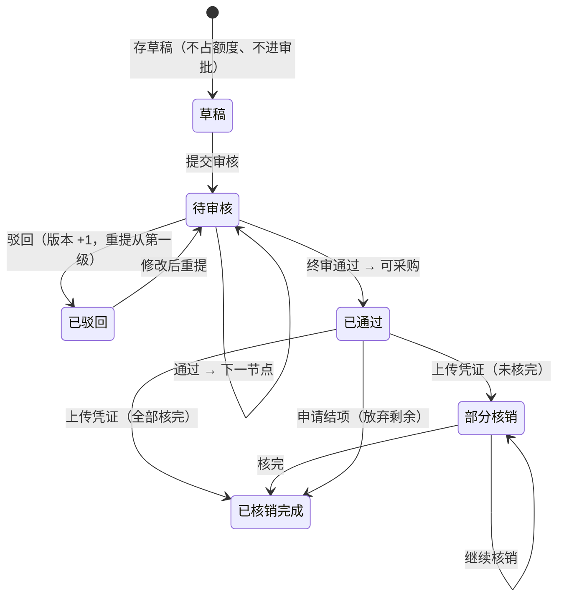

# 07 物业服务 · 02 交办单与核销

> 端：运营端 PC（`yunying-PC`）　｜　模块：07 物业服务（分册 §8.3）
> 页面：`property-request.html`　｜　页面版本：v1.0（2026-10-27）
> 前置：`01-报修工单.md`（含模块通用说明 §0，编号/权限/审批链/硬校验规则见该篇）

---

## 1. 页面定位

**本模块最核心的一页**。它把"零散报修 → 攒批采购 → 审批 → 发票核销 → 额度扣减"串成可审计的链。

- 使用者：物业专员（建单/核销）、各级审批人（审核）
- 上游：P1「需物料」的报修单汇入**待采购池**
- 下游：核销金额回流 P3 额度台账；异常进**核销异常台账**

## 2. 分区结构

| 区块 | 内容 |
|---|---|
| 顶部 | 标题 + 三个规则标签（审批链 1000 元分档 / 逐行核销）+「导出」「新建交办单」 |
| 统计卡（5） | 待采购池 · 待审核 · 在途金额 · 本月核销 · 异常待处置 |
| Tab（3） | **待采购池** / **交办单** / **核销异常台账** |

### 2.1 待采购池

| 列 | 说明 |
|---|---|
| 勾选 | 支持合并建单（一次审批覆盖多张报修） |
| 报修编号 / 位置 / 故障类型 / 处理说明 / 标记时间 / 停留 | 来自 P1「需物料」结果 |
| 操作 | 查看报修（定位 P1） |

**超期**：停留 > **7 天**标红。

### 2.2 交办单列表（10 列）

交办单号（带版本号）· 项目名称 · 关联报修（张数）· 预申请金额 · **核销进度**（数量 x/y + 百分比条）· 当前节点 · 状态 · 提交人 · 提交时间 · 操作

### 2.3 核销异常台账

异常编号 `YC` · 交办单 · 物资行 · **异常类型** · 差额 · 处置状态 · 处置人 · 操作

异常类型：`超核` / `单价偏高` / `金额超审批` / `换供应商` / `金额与发票不符`

## 3. 统计卡口径

| 卡 | 口径 |
|---|---|
| 待采购池 | `POOL` 条数（P1 转入且未建单） |
| 待审核 | 交办单 `state = 待审核` |
| 在途金额 | Σ（已通过 / 部分核销单的 `审批金额 − 已核销金额`） |
| 本月核销 | Σ 所有核销记录金额 |
| 异常待处置 | 异常台账中 `state ≠ 已处置` |

## 4. 交办单状态机（6 态）

**当前节点字段**：待审核时显示审批节点名（市场管理部 / 市场部负责人 / 分管领导 / 董事长）；已通过显示「已通过 · 可采购」；核完显示「已归档 · 核销完成」。

## 5. 新建交办单

### 5.1 表头字段

| 字段 | 必填 | 校验 |
|---|---|---|
| 关联报修单 | 是 | 来自待采购池勾选，**至少 1 张** |
| 项目名称 | 是 | — |
| 工作内容 | 是 | — |
| 实施单位或部门 | 否 | 默认「浙勤安顺物业」 |
| 预计完成时间 | 是 | — |
| **预申请金额** | 是 | **必须等于物资明细合计**（差 0.01 即拦） |
| 比价单 | **是** | **≥2 家**供应商报价 + 附件（PDF/图片/Excel/Word） |

### 5.2 物资明细（逐行）

物资名称 · 规格 · 数量 · 单价 · 小计（自动）· 供应商

> **数量与单价是核销的比对基准**：核销时逐行比对"累计数量 ≤ 审批数量"、"单价 ≤ 审批单价 ×1.1"。

## 6. 核销（本模块最核心机制）

### 6.1 三步操作

1. **勾选本次采购的物资行**（默认预勾未核完的行，可勾部分数量）
2. **填发票**：发票号 / 开票日期 / 供应商 / 发票金额 / 其他费用（运费·税费·折扣）/ 凭证附件
3. **看实时校验**，提交

### 6.2 五项校验（分级）

| # | 校验 | 级别 | 表现 |
|---|---|---|---|
| C1 | 未勾选物资行 | **硬拦** | 请至少勾选 1 行物资明细 |
| C2 | 要素不全（发票号/日期/供应商/金额/附件） | **硬拦** | 对应提示 |
| C3 | **发票号重复** | **硬拦** | 发票号 {inv} 已用于核销，不可重复提交 |
| C4 | 累计数量 > 审批数量 | **标异常** | 生成 `YC` 超核，核销照常成功 |
| C5 | 单价 > 审批单价 ×1.1 | **标异常** | 生成 `YC` 单价偏高 |
| C6 | 累计金额 > 审批金额 | **标异常** | 生成 `YC` 金额超审批 |
| C7 | 供应商与审批时不同 | **标异常** | 生成 `YC` 换供应商 |
| C8 | 额度不足 | **阻断** | 提示跳 P3 申请追加 |
| C9 | 明细+其他费用 ≠ 发票金额 | **标异常** | 实时提示差额，仍可提交 |

### 6.3 核销后状态推进

| 条件 | 结果 |
|---|---|
| 全部物资行 `已核 ≥ 审批` | `已核销完成`，节点「已归档 · 核销完成」 |
| 仍有未核完行 | `部分核销`，节点仍「已通过 · 可采购」 |

## 7. 审批（审核人视角）

抽屉分四段，**不是简单点通过**：

| 段 | 内容 |
|---|---|
| ① 报修真实性 | 显示关联报修单号，可点进看**现场照片与处理后照片** |
| ② 物资明细与价格参考 | 每行显示 **历史中位价** 与 **偏离百分比**（>30% 标红） |
| ③ 比价充分性 | 供应商列表 + 附件下载 |
| ④ 审批链 | 已走过的节点与意见 |

**通过** → 推进下一节点；**驳回** → 原因必填（≥4 字），版本 +1，重提从第一级开始。

## 8. 异常台账处置

| 动作 | 说明 |
|---|---|
| 接受说明 | 认可以偏差（如原料涨价），留原因 |
| 要求补正 | 退回要求补材料 |
| 追回差额 | 从结算中扣减 |

**处置说明必填**（≥4 字），写入台账留痕。

## 9. 提示语表

> `✅` 原型已有 / `⬜` 待实现。**编号前缀 `JB-`**。

| 编号 | 场景 | 提示文案 | 形式 | 阻断 | 状态 |
|---|---|---|---|---|---|
| JB-01 | 未勾选报修单就合并建单 | 请至少勾选 1 张报修单 | Toast | 是 | ✅ |
| JB-02 | 缺项目名称/内容 | 请填写项目名称与工作内容 | Toast | 是 | ✅ |
| JB-03 | 无物资明细 | 请至少填写 1 行物资明细 | Toast | 是 | ✅ |
| JB-04 | 金额与明细不符 | 物资明细合计 ¥{a} 与预申请金额 ¥{b} 不一致 | Toast | 是 | ✅ |
| JB-05 | 比价不足 2 家 | 比价单需至少 2 家供应商报价（当前 {n} 家） | Toast | 是 | ✅ |
| JB-06 | 缺比价附件 | 请上传比价单附件（PDF / 图片 / Excel / Word） | Toast | 是 | ✅ |
| JB-07 | 存草稿 | 已存草稿：{单号}（草稿不占额度、不进入审批） | Toast | 否 | ✅ |
| JB-08 | 提交审核 | 已提交审核：{单号}　审批链 {链}（{n} 级） | Toast | 否 | ✅ |
| JB-09 | 审批通过（中间节点） | 已通过：{单号}　转下一节点「{节点}」（超 1 个工作日未处理将提醒） | Toast | 否 | ✅ |
| JB-10 | 终审通过 | 审批通过：{单号}　已通过全部 {n} 级，可开始采购并上传凭证 | Toast | 否 | ✅ |
| JB-11 | 驳回未填原因 | 驳回原因必填（至少 4 个字） | Toast | 是 | ✅ |
| JB-12 | 驳回成功 | 已驳回：{单号}　已通知提交人修改（重提后从第一级重新审批） | Toast | 否 | ✅ |
| JB-13 | 核销未勾行 | 请至少勾选 1 行物资明细 | Toast | 是 | ✅ |
| JB-14 | 核销要素不全 | 请填写发票号、开票日期、供应商、发票金额并上传附件 | Toast | 是 | ✅ |
| JB-15 | **发票号重复** | 发票号 {inv} 已用于核销，不可重复提交 | Toast | 是 | ✅ |
| JB-16 | 核销成功（无异常） | 已核销：{单号} 第 {n} 次 ¥{金额}；进度 {x}/{y}（{z}%） | Toast | 否 | ✅ |
| JB-17 | 核销成功（有异常） | 已核销：{单号} 第 {n} 次 ¥{金额}；标记异常 {k} 项（已进异常台账） | Toast | 否 | ✅ |
| JB-18 | 全部核完 | 核销完成：{单号} 全部物资已核销，额度已扣减 | Toast | 否 | ✅ |
| JB-19 | 结项成功 | 已结项：{单号}　放弃剩余未采购部分，交办单归档 | Toast | 否 | ✅ |
| JB-20 | 异常处置未填说明 | 请填写处置说明（至少 4 个字） | Toast | 是 | ✅ |
| JB-21 | 异常处置成功 | 已处置：{异常号}　{动作}（留痕） | Toast | 否 | ✅ |
| JB-22 | 列表空态 | 待采购池为空 / 暂无交办单 / 无异常记录 | 空态 | 否 | ✅ |
| JB-23 | **额度不足阻断核销** | 建议：本年度剩余额度不足，请先申请追加 | 抽屉拦截 + 跳 P3 | 是 | ⬜ 原型未接额度校验（P2 独立数据） |
| JB-24 | 导出 | 已导出交办单台账（含审批链、物资明细、核销记录） | Toast | 否 | ✅ |

**自检结论**：✅ **23** / ⬜ **1** / 共 24 条。

## 10. 验收要点

| 编号 | 场景 | 期望 |
|---|---|---|
| AC-01 | 新建 1,120 元交办单 | 审批链自动为 **4 级**（≥1000） |
| AC-02 | 新建 784 元交办单 | 审批链自动为 **2 级**（<1000） |
| AC-03 | 逐级通过 4 次 | 第 4 次后状态转 `已通过`，节点「已通过 · 可采购」 |
| AC-04 | 用已存在发票号核销 | **硬拦**，不生成核销记录 |
| AC-05 | 核销数量超审批（剩 3 填 5） | **放行**，进度 13/8，生成超核异常 |
| AC-06 | 核销单价超审批 10% | **放行**，生成「单价偏高」异常 |
| AC-07 | 核完最后一行 | 状态转 `已核销完成`，节点「已归档 · 核销完成」 |
| AC-08 | 驳回后重提 | 版本号 +1，从第一级重新审批 |
| AC-09 | 待采购池建单 | 建单成功后该报修**从池中移除** |
