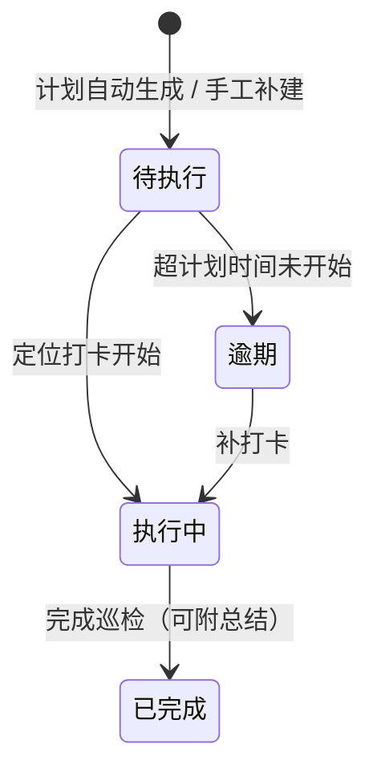

# 07 物业服务 · 04 巡检管理

> 端：运营端 PC（`yunying-PC`）　｜　模块：07 物业服务（分册 §8.5）
> 页面：`property-inspect.html`　｜　页面版本：v1.0（2026-10-27）
> 前置：`01-报修工单.md`（含模块通用说明 §0）

---

## 1. 页面定位

按计划派发巡检任务、记录执行情况，把"现场治理"变成**有频次、有打卡、有问题数**的可量化动作。

- 使用者：物业主管（配计划）、巡检员（执行）
- 下游：发现问题 → P6 问题上报（按责任方分流）
- **轻量版定位**：只配**区域 + 频次 + 巡检员**，**不配点位与检查项**（与完整巡检系统区分）

## 2. 分区结构

| Tab | 内容 |
|---|---|
| ① **巡检计划** | 计划名称 / 巡检区域（多选）/ 频次 / 巡检时段 / 巡检员（多人轮值）/ 状态 / 今日任务数 / **执行率** / 操作 |
| ② **巡检任务** | 筛选（关键词 + 状态 + 仅看今日）+ 任务列表 8 列 |

**统计卡（4）**：今日待执行 · 执行中 · 本月已完成 · 逾期未执行

## 3. 计划字段与校验

| 字段 | 必填 | 说明 |
|---|---|---|
| 计划名称 | 是 | 如「A 栋日常巡检」 |
| 巡检区域 | 是 | **可多选**（A/B/C/D 栋 × 楼层），至少 1 个 |
| 频次 | 是 | 每日 1 次 / 每周 2 次 / 每周 1 次 / 每月 1 次 |
| 巡检时段 | 是 | 如 `09:00–11:00` |
| 巡检员 | 是 | **可多人轮值**，至少 1 人 |
| 状态 | 是 | 启用 / 停用 |

**计划规则**

| 规则 | 说明 |
|---|---|
| 启用的计划**每日凌晨自动生成**当天任务 | 停用后不再生成，**已生成任务不受影响** |
| 停用当日已生成任务 | 二次确认，提示「已生成 N 条任务不受影响」 |
| 立即生成任务 | 手工补建，为每个区域各生成 1 条 |

## 4. 任务列表（8 列）

任务编号 `XJ` · 区域 · 巡检员 · 计划时间 · **状态** · **发现问题数** · 打卡时间 · 操作

### 状态机（4 态）

> **逾期判定**：超过计划时段结束仍未打卡。次日提醒巡检员 + 主管（XJ-1）。

### 操作

| 操作 | 显示条件 | 效果 |
|---|---|---|
| 开始巡检（打卡） | 待执行 / 逾期 | 记录打卡时间与定位（误差 <50m），状态转执行中 |
| 上报问题 | 执行中 | 跳 P6（**区域自动带入**），任务的问题数 +1 |
| 完成巡检 | 执行中 | 弹总结输入（**选填**），→ 已完成 |
| 查看 | 全部 | 详情抽屉（含执行留痕时间轴） |

**规则**

| 编号 | 规则 |
|---|---|
| XJ-1 | 逾期任务次日提醒巡检员 + 主管 |
| XJ-2 | **一条任务可上报多条问题** |
| XJ-3 | **完成任务不强制有问题**（无异常也是正常结果） |

## 5. 提示语表

> `✅` 原型已有 / `⬜` 待实现。**编号前缀 `XJ-`**（与规则编号区分，此处为提示语编号 `TX-`）。

| 编号 | 场景 | 提示文案 | 形式 | 阻断 | 状态 |
|---|---|---|---|---|---|
| TX-01 | 缺计划名称 | 请填写计划名称 | Toast | 是 | ✅ |
| TX-02 | 未选区域 | 请至少选择 1 个巡检区域 | Toast | 是 | ✅ |
| TX-03 | 缺时段 | 请填写巡检时段 | Toast | 是 | ✅ |
| TX-04 | 未指定巡检员 | 请至少指定 1 名巡检员 | Toast | 是 | ✅ |
| TX-05 | 新增计划成功 | 已新增巡检计划：{名称}（启用后次日自动生成任务） | Toast | 否 | ✅ |
| TX-06 | 保存计划 | 已保存巡检计划：{名称} | Toast | 否 | ✅ |
| TX-07 | 启停计划 | 已{启用/停用}：{名称}（次日开始生成任务 / 已生成任务不受影响） | Toast | 否 | ✅ |
| TX-08 | 计划已停用还生成任务 | 计划已停用，请先启用再生成任务 | Toast | 是 | ✅ |
| TX-09 | 生成任务成功 | 已为「{名称}」生成 {n} 条任务（区域 {k} 个） | Toast | 否 | ✅ |
| TX-10 | 打卡开始 | 已打卡开始巡检：{任务号}　{区域}（可多次上报问题） | Toast | 否 | ✅ |
| TX-11 | 上报问题 | 已登记 1 条问题（任务 {任务号} 累计 {n} 条）；正式上报请到「问题上报」页，区域自动带入 {区域} | Toast | 否 | ✅ |
| TX-12 | 完成巡检（有问题） | 已完成巡检：{任务号}　发现问题 {n} 条，已进入问题清单 | Toast | 否 | ✅ |
| TX-13 | 完成巡检（无问题） | 已完成巡检：{任务号}　无问题 | Toast | 否 | ✅ |
| TX-14 | 任务空态 | 暂无巡检任务 / 暂无巡检计划，点右上「新增巡检计划」创建 | 空态 | 否 | ✅ |
| TX-15 | 导出 | 已导出巡检计划与任务执行率（含逾期统计） | Toast | 否 | ✅ |
| TX-16 | **逾期自动提醒** | 建议：{任务号} 逾期未执行，已提醒巡检员与主管 | 站内 / 短信 | 否 | ⬜ 原型仅标状态，未做推送 |
| TX-17 | **定位异常** | 建议：打卡位置距巡检区域 >100m，已标记异常 | Toast | 否 | ⬜ 原型模拟打卡，未做地理围栏 |

**自检结论**：✅ **15** / ⬜ **2** / 共 17 条。

## 6. 验收要点

| 编号 | 场景 | 期望 |
|---|---|---|
| AC-01 | 新增计划选 3 个区域 | 「立即生成任务」产生 **3 条**任务 |
| AC-02 | 停用当日有计划任务 | 二次确认，提示已生成任务不受影响 |
| AC-03 | 逾期任务补打卡 | 状态从逾期转执行中，可继续上报 |
| AC-04 | 执行中完成巡检 | 总结选填，填写后写入详情 |
| AC-05 | 一条任务上报 3 条问题 | 问题数显示 3，跳 P6 时区域带入 |
| AC-06 | 完成任务无问题 | 允许，问题数显示 0（不强制） |
