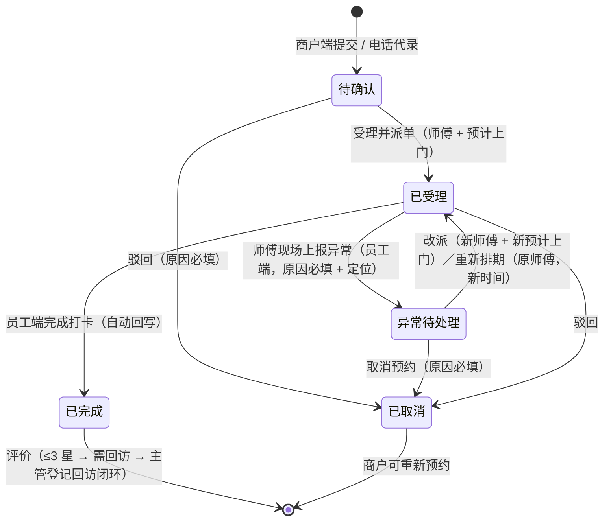

# 07-04 服务预约 · 运营端页面说明

> 端：运营端 PC　｜　模块：07 物业服务　｜　页面：`property-service.html`
> 页面版本：**v1.7（2026-11-06 · 回访闭环口径补齐）** / v1.6（2026-11-06 · 状态筛选改为下拉） / v1.5（2026-11-06 · 新增第 5 态「异常待处理」） / v1.4（2026-11-06 · 模拟数据按真实业务逻辑自洽） / v1.3（2026-11-06 · 预约时间改为日期 + 时段选择） / v1.2（2026-11-06 · 代录选中后三项锁定） / v1.1（2026-11-06 · 代录必须匹配 04 商户档案） / v1.0（2026-11-06 · Y-22 / 招标 #129 新建）　｜　业务分册：`开发PRD/运营管理端分册PRD/07-物业服务.md` **v2.0**
> **模块通用说明**见同目录 **`01-报修工单.md` §0**，本文件不重复。

> **v1.7 变更（2026-11-06 · PM 追问「登记回访 / 需回访是什么」）**：把「需回访」定义为**已完成单上的标记而非独立状态**（`已完成 + star 1~3 + 未登记回访`），补齐**回访闭环字段** `visitAt / visitBy / visitNote`：登记后转「已回访」、**统计卡「需回访」-1**、列表操作变「再次回访」、详情展示回访记录；给出明确前置条件（4–5 星不需要、未完成 / 未评价不可登记）并拦截越界操作；补一条「已回访」样例单（`YY202610-0023`，3 星）用于对比演示（R-23 / AC-37 / AC-38）。

> **v1.6 变更（2026-11-06 · PM 走查「状态不要平铺」）**：状态筛选由平铺 Tab 条改为**筛选区下拉「全部状态」**（选项带各态数量），与其他筛选控件统一；下拉选项由数据动态生成（`SEL_OPTS`），数量实时随数据变化；`switchTab` 与 `#tabs` 相关代码删除。

> **v1.5 变更（2026-11-06 · Y-23 第 5 态「异常待处理」）**：师傅到场发现无法服务时，原设计只能不提交、单据卡在「已受理」。本版新增第 5 态：员工端「上报异常」（原因 6 项 / 补充说明 / 现场照片 ≤3 / GPS 定位）→ 本页出现「异常待处理」；后台三个出口 —— **改派**（新师傅 + 新预计上门）、**重新排期**（原师傅 + 新时间）、**取消**（原因必填）；处理后回「已受理」/「已取消」，**异常信息全程保留可追溯**。同步：`STC` 红色系、Tab 与统计卡各加一项、列表「现场异常」标、详情新增「现场异常」分区、`saveAccept` 支持异常单重新受理、`back('booking')` 回写补 `exceptionWhy / exceptionNote / exceptionAt / exceptionGeo / exceptionPhotos`（R-30 / M-74~M-76 / AC-34~AC-36）。

> **v1.4 变更（2026-11-06 · PM 走查「模拟数据不能瞎编」）**：mock 与端上注入数据按真实业务逻辑自洽 —— ① **一个档口只对应一个商户**（1F-A08 诸暨××袜业 / 2F-B12 大唐××服饰 / YLSC-S08 义乌××针织 / XZFW-3F-06 晓琳袜业），修掉同档口挂不同商户；② **状态与执行链一致**：已完成必有师傅 + 到场/完成打卡，已受理必有师傅 + 预计上门，只有待确认才「未派单」，已取消清空执行信息；③ 端上注入的旧历史单（只有单号/类型/时间/状态）在注入后**按状态补全**执行链、商户名电话、时间格式，杜绝「已完成 + 未派单」「商户名显示成"商户端"」；④ 列表对异常数据兜底显示「待补录」而非「未派单」（R-29）。

> **v1.3 变更（2026-11-06 · PM 走查）**：代录「预约时间」由纯文本改为**日期选择器 + 时段选择**：日期 `type=date`（`min` 今天 / `max` +30 天，默认明天并显示「周X」）；时段预设 **09:00-11:00 / 14:00-16:00 / 16:00-18:00**，可切「自定义时段」填起止 `type=time`；填写过程实时提示「将于 X（周X）Y 上门」，同日已有同类已受理单时提示**可能排队**（不阻断）。受理派单的「预计上门时间」同步改为 `datetime-local` 选择器。服务内容补**常用项一键填充**（深度保洁 / 照明线路维修 / 货架搬运）。

> **v1.2 变更（2026-11-06 · PM 再次走查）**：选中商户后，**商户名称 / 手机号 / 上报档口三项同时锁定为只读**（避免"搜了商户又手改档口"造成两处不一致）；**唯一修改入口是「重新选择」**（清空选中、商户框恢复可搜，电话与档口在未选中前始终只读）。档口不再有独立选择器，随商户带出；多档口商户需切换档口时，**在商户框直接搜目标档口编号**，候选项会标注「带出档口 X」并精确带出该档口。

> **v1.1 变更（2026-11-06 · PM 走查）**：电话代录的**商户 / 电话 / 上报档口**由纯文本改为**可搜索选择**（商户名 / 手机号 / 档口编号任一关键词过滤 04 商户档案候选，选中自动带出电话与名下档口）；**纯文本手打商户一律拦截**（R-26、M-68/M-69、AC-26/27），避免代录单无法关联真实商户。

> **v1.0 变更（2026-11-06 · Y-22）**：新建。承接招标 **#129「服务预约：订单聚合处理、分配人员分流处置」**。三端闭环：商户端 `service-booking.html` 预约（保洁 / 维修 / 搬运，单号前缀 `YY`）、**员工端 `wuye-service.html` 师傅打卡拍照**（端上页面**未建**，两端改动见 `shanghu-APP/移动端原型修改待办.md` **#58**）、本页受理派单与跟踪。**Y-19 C-1「服务预约归口」就此落定：归 04 商户档案的本页受理，缴费仍暂缓。**

---

## 1. 服务预约 `property-service.html`

### 1.1 页面说明

| 项 | 内容 |
|---|---|
| 页面目标 | 商户预约单的**受理、派单、执行跟踪、评价与回访**；订单聚合处理、分配人员分流处置（招标 #129） |
| 使用角色 | 物业客服（受理 / 派单 / 代录 / 费用登记）、运营主管（回访）、物业人员（员工端打卡，本页只读跟踪） |
| 入口 | 菜单 → 物业服务 → 服务预约 |
| 前置 | 商户端已提交预约（`sh_booking`），或客服电话代录 |
| 后置 | 回写商户端（状态 / 师傅 / 费用 / 评价）；费用**线下结算**，不进维修资金台账、不生成账单 |

### 1.2 本页端间关系

| 项 | 内容 |
|---|---|
| 本页数据来源 | 商户端 `service-booking.html` 提交的 `sh_booking`（`shared/wuye-sync.js` 注入）；客服电话代录 |
| 本页操作的跨端影响 | 受理 → 商户端显示「已受理」+ 师傅 + 上门时间；驳回 → 商户端显示「已取消」+ 原因；完成打卡 → 商户端「已完成」；回写**保留 `unit`** |
| 依赖的其他端页面 | `shanghu-APP/service-booking.html`（预约提交 / 列表）、`shanghu-APP/wuye-service.html`（员工端打卡拍照；**端上页面未建**，待办 #58） |
| 不涉及的端 | 买家端 |
| 一致性要求 | 回写保留 `unit`（上报档口）；评价 ≤3 星自动标「需回访」并通知主管 |

### 1.3 页面结构

| 区块 | 内容 |
|---|---|
| 顶部 | 标题「服务预约」+ 电话代录预约 + 导出 |
| **统计卡（6）** | 待确认 · 已受理 · **异常待处理** · 今日预约 · 需回访（≤3 星）· 本月已完成 |
| 状态筛选 | 筛选区「**全部状态**」下拉：待确认 / 已受理 / 异常待处理 / 已完成 / 已取消，**选项带各态数量**（如「待确认（3）」），与其他筛选控件一致；**不使用平铺 Tab 条** |
| 筛选 | 关键词（编号 / 档口 / 商户 / 内容）+ 服务类型 + 来源 + 仅看需回访（**选项由数据动态生成**，见 v1.8 附节） |
| 列表（10 列） | 预约编号（带提交时间小字）· 来源 · 上报档口 · 商户（带电话）· 服务类型（带内容摘要）· 预约时间 · 师傅（带到场 / 预计）· 评价（星级 + 需回访）· 状态 · 操作 |
| 详情抽屉 | 7 段：预约信息 / 受理与派单 / 执行留痕（打卡拍照）/ **现场异常（员工端上报）** / 费用（线下结算）/ 商户评价 / 流程时间轴 |

### 1.4 字段规格

**预约单（`YY`）字段**

| 字段 | 说明 |
|---|---|
| `no` | 单号 `YY2026MM-XXXX`（商户端生成；代录同前缀） |
| `src` | 商户端 / 电话代录 |
| `unit` | **上报档口（单据归属）**，一张单只归属一个档口 |
| `type` | 保洁 / 维修 / 搬运（三类，招标口径与商户端一致） |
| `name` | 服务内容（≥4 字） |
| `time` | 预约时间 `预约 YYYY-MM-DD HH:mm-HH:mm`（商户端原样；代录由**日期选择器 + 时段**拼装，日期限今天起 30 天内） |
| `state` | **待确认 → 已受理 → 已完成**；**已受理 → 异常待处理**（师傅现场上报）→ 改派 / 重新排期回「已受理」、取消 → 「已取消」；待确认 / 已受理可 → **已取消** |
| `worker` / `planAt` | 师傅 / 预计上门（受理派单时产生，可改派） |
| `arriveAt` / `arriveGeo` | 师傅到场打卡：时间 + GPS 定位（员工端提交） |
| `finishAt` / `resultDesc` | 完成打卡：时间 + 处理说明（员工端提交） |
| `fee` / `feeNote` / `feeSettled` | 费用选填，线下结算；**不进维修资金台账、不生成账单** |
| `star` / `comment` | 商户评价：星级 1–5 + **留言必填**；≤3 星标「需回访」 |
| `visitAt` / `visitBy` / `visitNote` | 回访闭环：登记时间 / 回访人 / 回访记录；有 `visitAt` 即「已回访」，不再计入「需回访」 |
| `cancelWhy` | 驳回 / 取消原因（必填） |
| `exceptionWhy` / `exceptionNote` / `exceptionAt` / `exceptionGeo` / `exceptionPhotos` | **现场异常（第 5 态）**：原因（6 项字典，必填）/ 补充说明 / 上报时间 / 上报定位 / 现场照片，由员工端「上报异常」写入，后台只读并可据此改派 / 重新排期 / 取消 |

**「需回访 / 已回访」口径（不是独立状态，是已完成单上的标记）**

| 项 | 规则 |
|---|---|
| **需回访** | `state=已完成` + `star>0 && star<=3` + **未登记回访**（`visitAt` 为空）→ 评价列红字「需回访」，操作出现「登记回访」，统计卡「需回访（≤3 星）」计入 |
| **已回访** | 同上但 `visitAt` 有值 → 评价列绿字「已回访」，操作变「再次回访」，**不再计入统计卡** |
| 前置条件 | 只有「**已完成 + 已评价 + ≤3 星**」可登记；4–5 星不需要回访、未完成 / 未评价单不可登记（拦截提示） |
| 登记内容 | 回访人（默认运营主管）+ 回访记录**必填** → 写 `visitAt / visitBy / visitNote` + 时间轴留痕「主管回访…（「需回访」已闭环）」 |
| 再次回访 | 已回访单可追加记录，只追加留痕、**不重复计数** |
| 为什么有 | 低分评价的满意度闭环动作（与投诉建议页「≤3 星自动回访」同口径），不改变预约单状态 |

**状态机（5 态，v1.5 新增「异常待处理」）**

> **师傅执行动作在员工端**（`wuye-service.html`，端上页面**已建**，商户端待办 #59）：今日预约 → 到场打卡（时间 + GPS）→ 完成打卡（处理说明 + 照片）；**现场无法服务时「上报异常」**（原因 6 项 / 说明 / 照片 / 定位）→ 单据进入「异常待处理」，由本页改派 / 重新排期 / 取消。本页只读跟踪执行动作，不在运营端代打卡。

### 1.5 交互规则

| 操作 | 显示条件 | 可点条件 | 点击后 | 禁止表现 |
|---|---|---|---|---|
| 受理派单 | 待确认 | 客服 | 选师傅（按类型映射岗位、仅派在岗）+ 预计上门 → 已受理，商户端同步 | 该岗位无在岗 → 提示去「物业人员」排班 |
| 驳回 | 待确认 / 已受理 | 客服 | 原因必填 → 已取消，原因推送商户端 | 未选原因 → 拦截 |
| 改派 | 已受理 | 客服 | 换师傅（留痕），商户端同步 | — |
| **改派（异常）** | 异常待处理 | 客服 | 选新师傅 + **新的预计上门** → 回「已受理」，更新 `worker / planAt`，异常记录保留 | 未填新时间 → 拦截 |
| **重新排期（异常）** | 异常待处理 | 客服 | 只改 `planAt`，师傅与档口不变 → 回「已受理」 | 时间空 / 早于今天 → 拦截 |
| **取消（异常）** | 异常待处理 | 客服 | 原因必填 → 「已取消」，异常信息保留可追溯 | 未选原因 → 拦截 |
| **重新受理（异常）** | 异常待处理 | 客服 | 走「受理派单」重填师傅 + 上门时间 → 回「已受理」，异常记录保留 | — |
| 登记费用 | 已完成 | 客服 | 金额必填 + 说明 + 是否已线下结 | 金额无效 → 拦截 |
| 登记评价 | 已完成且未评价 | 商户端 / 客服代录 | 星级 + **留言必填**；≤3 星自动标「需回访」 | 留言空 → 拦截 |
| 登记回访 | 已完成且 ≤3 星 | 运营主管 | 回访记录 → 留痕，「需回访」闭环 | 空 → 拦截 |
| 电话代录 | 右上按钮 | 客服 | 商户 / 手机号 / 档口编号**任一关键词搜索 → 从候选选择**；选中后**商户名称 / 手机号 / 上报档口三项只读**（档口随商户带出，搜档口编号可精确带出该档口）；**唯一修改入口「重新选择」**；来源 = 电话代录 | **纯文本手打商户 → 拦截**；未选中商户时电话 / 档口不可手填；档口不在商户名下 → 拦截 |
| 深链 | — | — | `?unit=档口编号` 写入关键词预筛（商户档案 ⑪ 跳入） | — |

### 1.6 业务规则与计算口径

| 编号 | 规则 | 触发 | 处理 | 影响端 |
|---|---|---|---|---|
| R-20 | 商户不选人 | 提交 / 受理 | 商户端只选档口 / 类型 / 时间 / 内容；师傅由本页受理时派单，可改派 | 商户端 |
| R-21 | 打卡拍照留痕 | 执行 | 到场打卡（时间 + GPS）与完成打卡（说明 + 照片）由员工端提交，本页只读 | 员工端 |
| R-22 | 费用线下结算 | 完成 | 费用选填、登记仅留痕；**不进维修资金台账、不生成账单**，未结算保留「待线下结算」标 | — |
| R-23 | 评价含留言 | 完成 | 星级 1–5 + 留言必填；**≤3 星自动标「需回访」并通知主管**；主管登记回访（`visitAt/visitBy/visitNote`）后转「已回访」、统计卡 -1，**可再次回访但只追加记录不重复计数** | 商户端 |
| R-24 | 派单岗位映射 | 受理 | 保洁 → 保洁员、维修 → 维修工、**搬运 → 维修工兼岗**；仅派在岗（与「物业人员」档案一致） | — |
| R-25 | 端间回写保档口 | 受理 / 驳回 / 完成 | 回写 `sh_booking`（state / worker / fee / star…），**保留 `unit`** | 商户端 |
| R-26 | 代录必须匹配档案 | 电话代录 | 商户**必须从 04 商户档案候选中选择**（支持商户名 / 手机号 / 档口编号搜索），选中带出电话与名下档口；**禁止纯文本手打商户名**；**选中后三项只读**，唯一修改入口是「重新选择」（R-27）；档口不在该商户名下则拦截 | 04 商户档案 |
| R-27 | 单一修改入口 | 代录选中后 | 商户 / 手机号 / 档口**同时锁定**，不允许局部手改，避免"搜了 A 商户、档口改成 B 档口"的两处不一致；要改只能「重新选择」后重走搜索 | — |
| R-28 | 预约时间规范化 | 代录 / 受理 | 代录用**日期选择器（今天起 30 天内）+ 时段**（预设三档，可自定义起止且结束须晚于开始），拼装为 `预约 YYYY-MM-DD HH:mm-HH:mm`；受理派单的预计上门用 `datetime-local`，不得早于当天；同日同类已受理单仅**提示排队**、不阻断 | — |
| R-29 | 模拟数据必须自洽 | 全页 mock / 端上注入 | ① **一个档口只对应一个商户**（档口即租户归属）；② 状态与执行链一致：`已完成` 必有师傅 + 到场/完成打卡，`已受理` 必有师傅 + 预计上门，**只有 `待确认` 可「未派单」**，`已取消` 清空执行信息；③ 端上注入的历史单按状态补全执行链、商户名电话与时间格式，不出现「已完成 + 未派单」「商户名 = 商户端」；④ 异常数据列表兜底显示「待补录」而非「未派单」 | 商户端 |
| R-30 | 异常待处理闭环 | 员工端上报（仅 `已受理` 可报） | 师傅现场无法服务 → 员工端上报异常（原因必填 / 定位必带 / 照片可选）→ 单据置 `异常待处理`；后台三个出口：**改派**（新师傅 + 新时间）、**重新排期**（原师傅 + 新时间）、**取消**（原因必填）；处理后均回 `已受理` 或 `已取消`，**异常信息全程保留可追溯**，`unit` 不丢；异常态不显示评价入口 | 员工端、商户端 |

### 1.7 提示语清单

| 编号 | 场景 | 提示文案 | 形式 |
|---|---|---|---|
| M-61 | 受理派单 | 已受理：{编号}　已派 {师傅}，预计 {时间} 上门（商户端已同步「已受理」） | Toast |
| M-62 | 驳回 / 取消未选原因 | {驳回\|取消}原因必填，请先选择 | 行内 |
| M-63 | 无在岗师傅 | 该岗位暂无在岗人员，无法派单 | Toast |
| M-64 | 评价留言空 | 评价留言必填（评价含留言） | Toast |
| M-65 | 费用无效 | 请填写有效费用金额 | Toast |
| M-66 | ≤3 星 | 评价已登记：{N} 星（≤3 星，已标「需回访」并通知主管） | Toast |
| M-67 | 端间同步 | 已同步商户端预约 {N} 条（保留上报档口 unit） | 页头提示 |
| M-68 | 代录未选档案商户 | 请从候选列表中选择商户（可输入名称 / 手机号 / 档口搜索） | Toast |
| M-69 | 代录档口不在名下 | 上报档口须为该商户名下档口：{档口列表} | Toast |
| M-70 | 未选商户就提交 | 请先选择商户，上报档口会随商户带出 | Toast |
| M-71 | 代录日期早于今天 | 预约日期不能早于今天 | Toast |
| M-72 | 自定义时段非法 | 自定义时段结束需晚于开始 | Toast |
| M-73 | 超出可约范围 | 最多可预约 30 天内，请调整日期 | Toast |
| M-74 | 异常改派未填新时间 | 请选择新的预计上门时间 | Toast |
| M-75 | 异常处理完成（改派） | 异常已处理：改派 {师傅}，预计 {时间} 上门，单据回到「已受理」 | Toast |
| M-76 | 异常处理完成（重新排期） | 已重新排期：预计 {时间} 上门，单据回到「已受理」（商户端已同步） | Toast |

### 1.8 验收标准

| 编号 | 前置 | 操作 | 预期 | 级别 |
|---|---|---|---|---|
| AC-20 | 商户端提交预约 | 打开本页 | 台账出现该单（带档口），状态「待确认」 | P0 |
| AC-21 | 待确认单 | 受理派单 | 状态「已受理」，师傅与上门时间回写商户端 | P0 |
| AC-22 | 员工端完成打卡 | 打开详情 | 到场 / 完成打卡时间、定位、处理说明、照片自动回填 | P0 |
| AC-23 | 已完成单 | 登记费用 | 费用与结算状态留痕；资金台账金额不变 | P0 |
| AC-24 | 已完成未评价 | 登记评价 2 星 | 标「需回访」；主管登记回访后闭环 | P1 |
| AC-25 | 待确认单 | 驳回不选原因 | 拦截提示原因必填 | P0 |
| AC-26 | 代录输入「8891」或「A9-15」 | 查看候选 | 命中该商户，选中后电话与名下档口自动带出 | P0 |
| AC-27 | 代录手打商户名不选候选 | 提交 | 拦截「请从候选列表中选择商户」，不生成单据 | P0 |
| AC-28 | 代录已选中商户 | 尝试改商户 / 电话 / 档口 | 三项均只读不可编辑；点「重新选择」后仅商户恢复可搜，电话 / 档口仍只读 | P0 |
| AC-29 | 多档口商户搜「A9-16」 | 查看候选并选中 | 候选标注「带出档口 A9-16」，选中后档口为 A9-16 | P1 |
| AC-30 | 代录打开 | 查看预约时间 | 日期为 `date` 选择器（今天起 30 天内）+ 时段下拉；切自定义出现起止 `time` 输入 | P0 |
| AC-31 | 代录选日期 2026-11-01 | 提交 | 拦截「预约日期不能早于今天」；选自定义且结束早于开始 → 拦截 | P0 |
| AC-32 | 浏览列表全部数据 | 查「师傅」列 | **不存在「已完成 / 已受理 + 未派单」组合**；待确认才可未派单 | P0 |
| AC-33 | 端上只有旧历史单（仅单号/类型/时间/状态） | 打开列表 | 已完成单自动补全师傅、到场/完成打卡与商户名电话，时间格式统一为 `预约 YYYY-MM-DD HH:mm-HH:mm` | P1 |
| AC-34 | 员工端对已受理单上报异常 | 打开本页 | 出现「异常待处理」单，详情显示原因 / 补充说明 / 上报时间 / 定位 / 现场照片 | P0 |
| AC-35 | 异常单点改派并填新时间 | 确认 | 回「已受理」，师傅与上门时间更新，异常记录保留，端上同步且 `unit` 不丢 | P0 |
| AC-36 | 异常单重新排期 / 取消 | 确认 | 排期回「已受理」师傅不变；取消 →「已取消」原因必填，异常记录保留可追溯 | P0 |
| AC-37 | 已完成 + 2 星 + 未回访 | 登记回访 | 写 `visitAt/visitBy/visitNote`；评价列转「已回访」、操作变「再次回访」、统计卡「需回访」-1 | P0 |
| AC-38 | 已完成 + 4 星 / 未评价 / 未完成单 | 尝试登记回访 | 不在范围 → 拦截，且不写 `visitAt` | P1 |

---

## 附：相关口径（v1.8 / v1.9 / Y-19）

- **筛选下拉由列表全量数据动态生成**（`shared/select-options.js`，分册 v1.8）：`f-type` ← `SV.type`、`f-src` ← `SV.src`；空值 / 重复自动跳过，新增类型或来源后自动出现。
- **不设「全部档口」下拉与档口分组统计条**（分册 v1.7 走查订正）：档口编号并入关键词搜索，`?unit=` 深链写入关键词框预筛。
- **来源不含下线模块值**（分册 v1.9）：来源仅「商户端 / 电话代录」，无「巡检」相关来源。
- **档口字典**：商户端 `wuye-units.js` 4 处实体（1F-A08 / 2F-B12 / YLSC-S08 / XZFW-3F-06），后台 02 档口字典为另一套 mock，按单据自带 `unit` 各自受理 / 回显。
- **归口**：服务预约归本页（Y-19 C-1 落定）；**缴费 / 账单仍归口待 PM 确认，不建页不接线**。
