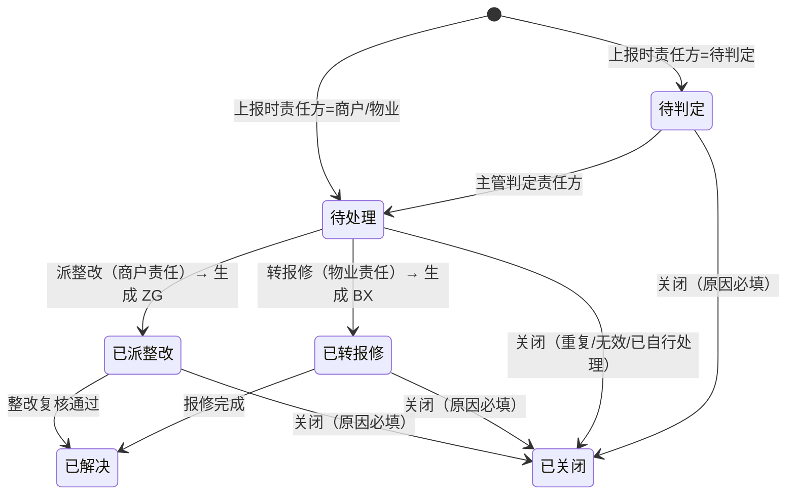

# 07 物业服务 · 05 问题上报

> 端：运营端 PC（`yunying-PC`）　｜　模块：07 物业服务（分册 §8.6）
> 页面：`property-issue.html`　｜　页面版本：v1.0（2026-10-27）
> 前置：`01-报修工单.md`（含模块通用说明 §0）

---

## 1. 页面定位

承载**巡检发现**与**外部反馈**的现场问题，按**责任方**分流：商户责任 → 整改（`ZG`），物业责任 → **转报修**（`BX`），待判定 → 主管判定。

> **核心分清**：问题（`WT`）不等于报修（`BX`）。转报修是**新建一张 BX 并回写 BX 号到 WT**，`WT` 记录**永久保留**（WT-1）。

- 使用者：巡检员（上报）、物业主管（判定责任方 + 分流）
- 上游：P5 巡检任务上报、商户端 / 买家端 / 电话反馈
- 下游：P7 整改（`ZG`）、P1 报修（`BX`）

## 2. 分区结构

| 区块 | 内容 |
|---|---|
| 统计卡（4） | 待处理 · 待判定 · 已转报修 · 本月已解决 |
| Tab（7） | 全部 / 待判定 / 待处理 / 已派整改 / 已转报修 / 已解决 / 已关闭（带条数） |
| 筛选 | 关键词 + 类型 + 责任方 + **仅看待判定超 3 天** |
| 列表（9 列） | 问题编号 `WT`（带来源）· 区域 · 类型 · 描述 · **责任方** · 严重程度 · 上报人 · 状态（带关联单号）· 操作 |
| 详情抽屉 | 问题信息（含关联 ZG/BX 号、关闭原因）/ 现场照片 / 处理留痕 |

## 3. 统计卡口径

| 卡 | 口径 |
|---|---|
| 待处理 | `state = 待处理`（已判定责任方，等分流） |
| 待判定 | `state = 待判定`（等主管判定） |
| 已转报修 | `state = 已转报修` |
| 本月已解决 | `state = 已解决` |

## 4. 状态机（6 态）

## 5. 表单字段与校验

| 字段 | 必填 | 校验 |
|---|---|---|
| 区域（楼栋/楼层 + 档口） | 是 | 楼栋楼层与具体位置均必填（02 字典） |
| 问题类型 | 是 | 消防 / 卫生 / 占道 / 设备 / 安全 |
| 问题描述 | 是 | **≥5 字** |
| **现场照片** | **是** | **≥1 张**（同 BX 规则，水印含时间·位置·编号） |
| 严重程度 | 是 | 严重 / 一般 / 轻微 |
| **责任方** | **是** | 商户责任 / 物业责任 / 待判定 |
| 限期 | **商户责任时必填** | 日期（不得早于当日） |

> 责任方选择后，页面即时提示后续路径（派整改 / 转报修 / 需判定）。

## 6. 分流操作

| 操作 | 显示条件 | 效果 |
|---|---|---|
| 判定责任方 | 待判定 | 选商户/物业责任 + 判定说明 → 待处理 |
| **派整改** | 待处理 + 商户责任 | 生成 `ZG` 单（带原照片与位置），状态「已派整改」，显示 ZG 号 |
| **转报修** | 待处理 + 物业责任 | 生成 `BX` 单（带原照片与位置），状态「已转报修」，显示 BX 号 |
| **改判** | 待处理 / 已派整改 / 已转报修 | 原因必填（≥4 字），**留痕**；已生成的 ZG/BX **不撤销** |
| 关闭 | 除已关闭外任一 | 原因必填（重复 / 无效 / 已自行处理 / 已合并 / 其他） |

**规则**

| 编号 | 规则 |
|---|---|
| WT-1 | **转报修后原记录保留**（不删除、不改类型），仅回写 BX 号 |
| WT-2 | 改判责任方**需留痕**（原值 → 新值 + 原因） |
| WT-3 | **待判定超 3 天**提醒主管（列表标红「超 N 天」） |
| WT-4 | 商户责任未设限期不能派整改 |

## 7. 提示语表

> `✅` 原型已有 / `⬜` 待实现。**编号前缀 `WT-`**（此处为提示语编号，前缀用 `WTQ-` 与规则区分）。

| 编号 | 场景 | 提示文案 | 形式 | 阻断 | 状态 |
|---|---|---|---|---|---|
| WTQ-01 | 缺位置 | 请填写楼栋楼层与具体位置 | Toast | 是 | ✅ |
| WTQ-02 | 描述过短 | 问题描述至少 5 个字（当前 {n} 字） | Toast | 是 | ✅ |
| WTQ-03 | 缺照片 | 请上传现场照片（至少 1 张） | Toast | 是 | ✅ |
| WTQ-04 | 商户责任缺限期 | 商户责任必须填写限期 | Toast | 是 | ✅ |
| WTQ-05 | 上报成功 | 已上报问题：{单号}　{待主管判定责任方 / 可直接分流（责任方）} | Toast | 否 | ✅ |
| WTQ-06 | 判定成功 | 已判定：{单号} → {责任方}　{请点「派整改」/ 请点「转报修」} | Toast | 否 | ✅ |
| WTQ-07 | 改判未填原因 | 改判原因必填（至少 4 个字） | Toast | 是 | ✅ |
| WTQ-08 | 改判成功 | 已改判：{单号}　{原} → {新}（原单不撤销） | Toast | 否 | ✅ |
| WTQ-09 | 派整改成功 | 已派整改：{单号} → {ZG 号}　已通知商户（限期 {日期}） | Toast | 否 | ✅ |
| WTQ-10 | 转报修成功 | 已转报修：{单号} → {BX 号}　原记录保留（不删除） | Toast | 否 | ✅ |
| WTQ-11 | 商户责任无期限就派整改 | 商户责任需先设置限期 | Toast | 是 | ✅ |
| WTQ-12 | 关闭成功 | 已关闭：{单号}　{原因} | Toast | 否 | ✅ |
| WTQ-13 | 列表空态 | 暂无符合条件的问题 | 空态 | 否 | ✅ |
| WTQ-14 | 导出 | 已导出问题清单（含责任方分布、超期统计） | Toast | 否 | ✅ |
| WTQ-15 | **待判定超 3 天提醒** | 建议：{单号} 待判定已超 3 天，请主管尽快判定 | 站内提醒 | 否 | ⬜ 原型只标红「超 N 天」 |
| WTQ-16 | **照片复用检测** | 建议：该照片与 {另一单号} 相同，疑似复用 | Toast | 是 | ⬜ 未做哈希比对 |

**自检结论**：✅ **14** / ⬜ **2** / 共 16 条。

## 8. 验收要点

| 编号 | 场景 | 期望 |
|---|---|---|
| AC-01 | 上报不传照片 | 拦截，不生成 WT |
| AC-02 | 责任方=商户责任但未填限期 | 提交拦截 |
| AC-03 | 待判定点「判定责任方」 | 判定后出现「派整改」或「转报修」按钮 |
| AC-04 | 转报修 | 生成 BX 号，**WT 记录仍存在**且状态为「已转报修」 |
| AC-05 | 已转报修后改判 | 允许，留痕，**BX 单不撤销** |
| AC-06 | 关闭 | 原因必填，状态转「已关闭」 |
| AC-07 | 待判定超 3 天 | 列表责任方列标红「超 N 天」 |
