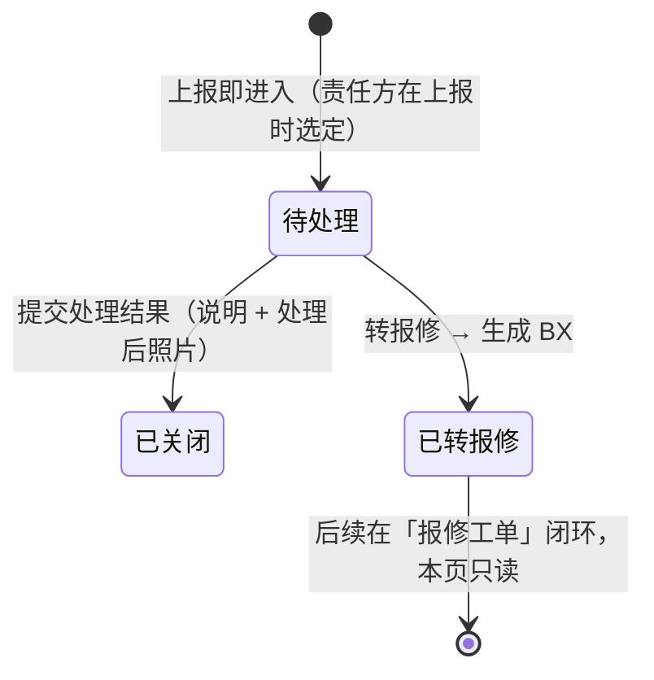

# 07 物业服务 · 05 问题上报

> 端：运营端 PC（`yunying-PC`）　｜　模块：07 物业服务（分册 §8.6）
> 页面：`property-issue.html`　｜　页面版本：**v1.3（2026-11-03）**
> 前置：`01-报修工单.md`（含模块通用说明 §0）

> **v1.3 变更（2026-11-03 · 走查反馈：责任方到底干嘛的）**
> ① **「待判定 + 判定责任方」整体删除**——整改下线后，责任方不再决定单据走向，挂"待判定"再让人点一次纯属多余动作；上报时必须直接选**商户责任 / 物业责任**（默认物业）。
> ② 责任方退化为**唯一用途：归因统计 + 决定要不要通知商户**（页面已写明）。
> ③ 状态机由 4 态收敛为 **3 态**（待处理 / 已转报修 / 已关闭）。
> ④ 统计卡第 4 张改为「商户责任问题」，点击按该责任方筛选——把责任方的唯一价值做成可看的指标。
> ⑤ 修复「转报修」点击无反应（列表调用的函数名与实现不一致）。
> ⑥ **补「修正责任方」轻量入口**（详情抽屉内）：选两值 + 填原因 → 只改归因标签并留痕，**不动状态、不生成单据**。解决"删掉改判后责任方填错无法纠正"的缺口，但**不恢复"改判"这个概念**。

> **v1.2 变更（2026-11-03 · 招标范围收敛）**
> ① **商户整改（`ZG`）整体下线**——「整改管理」与巡检管理、保洁管理、维修风控看板一并移出本模块（招标书无此范围），页面与说明归档于 `yunying-PC/_legacy/`；
> ② 问题只剩**两条出口**：**提交处理结果并关闭**（现场能解决）/ **转报修**（生成完整 `BX`）；
> ③ **改判下线**（责任方不再驱动分流，也就没有"改了责任方、旧单怎么办"的问题）；责任方退化为**归因统计 + 商户告知**；
> ④ 转报修**按「报修工单 · 新增」的字段构造工单**，字段对齐见 §6。
>
> v1.1 的"改判时撤回/并存下游单"方案随之作废（`ZG` 已不存在，`BX` 转出后本页只读跟踪）。

---

## 1. 页面定位

承接**移动端随手报 / 商户端反馈 / 电话代录**的现场问题，判断"这事能不能当场解决"：

- **能当场解决** → 填处理结果 + 处理后照片 → **关闭**（不产生任何下游单）
- **需要专业维修** → **转报修**，进入报修流程（`property-repair.html`）

> **核心分清**：问题（`WT`）≠ 报修（`BX`）。转报修是**新建一张 BX 并回写 BX 号到 WT**，`WT` 记录**永久保留**；转出后本页**只读跟踪**，工单状态由报修页决定，不回写。

- 使用者：物业主管 / 值班人员（判定与处置）
- 上游：移动端（商户端 App 物业身份）、商户端反馈、电话代录
- 下游：报修工单（`property-repair.html`）
- **不做**：商户整改单（`ZG`）已整体下线；不做改判；不做"商户端提交整改 → 复核"

## 2. 分区结构

| 区块 | 内容 |
|---|---|
| 统计卡（4） | 待处理 · 已转报修 · 本月已关闭 · **商户责任问题**（点击按该责任方筛选） |
| Tab（4） | 全部 / 待处理 / 已转报修 / 已关闭（带条数） |
| 筛选 | 关键词 + 类型 + 责任方 |
| 列表（9 列） | 问题编号 `WT`（带来源）· 区域 · 类型 · 描述 · **责任方**（仅归因）· 严重程度 · 上报人 · 状态（已转报修带 BX 号）· 操作 |
| 详情抽屉 | 问题信息（含关联 BX 号 / 处理结果 / 关闭原因）/ 现场照片 / 处理留痕 + 底部两条出口按钮 |

## 3. 统计卡口径

| 卡 | 口径 |
|---|---|
| 待处理 | `state = 待处理`（等处置，超 3 天标红「超 N 天」） |
| 已转报修 | `state = 已转报修` |
| 本月已关闭 | `state = 已关闭`（含"提交处理结果关闭"与"无效/重复关闭"） |
| 商户责任问题 | `duty = 商户责任`（跨状态计数，点击即按责任方筛选） |

## 4. 状态机（3 态）

> **责任方不参与状态流转**：它只是问题身上的一个归因标签，不会让问题"卡在等判定"。

## 5. 表单字段与校验

| 字段 | 必填 | 校验 |
|---|---|---|
| 区域（楼栋/楼层 + 档口） | 是 | 楼栋楼层与具体位置均必填（02 字典） |
| 问题类型 | 是 | 消防 / 卫生 / 占道 / 设备 / 安全 |
| 问题描述 | 是 | **≥5 字** |
| **现场照片** | **是** | **≥1 张**（同 BX 规则，水印含时间·位置·编号） |
| 严重程度 | 是 | 严重 / 一般 / 轻微 |
| **责任方** | **是** | **商户责任 / 物业责任**（默认物业）；**只做归因统计 + 决定要不要通知商户**，不驱动分流、不参与状态流转 |
| 要求处理期限 | 否 | 日期；仅用于超期提醒，不再是"派整改"的前置条件 |

> 责任方选择后，页面即时提示：商户责任 → 需通知商户并留证；物业责任 → 内部处置，必要时转报修。**两者都不影响单据走向**。

## 6. 处置操作（只有两条出口）

| 操作 | 显示条件 | 效果 |
|---|---|---|
| ~~判定责任方~~ | — | **v1.3 删除**：上报时就必须选责任方，不再有"挂起等判定" |
| **提交处理结果** | 待处理 | 处理结果说明 **≥5 字** + **处理后照片 ≥1 张** + 商户告知方式 → 状态转**已关闭**，**不生成任何下游单** |
| **转报修** | 待处理 | 打开转单抽屉，**按报修工单「新增」字段生成 BX**（见下表）→ 状态「已转报修」，回写 BX 号 |
| 关闭 | 除已关闭外任一 | 原因必填（重复 / 无效 / 已合并 / 其他），用于清理无效上报 |
| **修正责任方** | 详情抽屉内，任一状态 | 选两值 + 填原因（≥4 字）→ **只改归因标签**，不改状态、不生成单据、留痕「原值 → 新值 + 原因 + 操作人」 |
| ~~改判~~ | — | **已下线**（2026-11-03）：责任方不再驱动分流，无需改判 |

### 6.1 转报修的字段映射（对齐 `property-repair.html` 新增）

| BX 字段 | 来源 | 说明 |
|---|---|---|
| `no` | 系统生成 | `BX202610-00xx` 顺延 |
| `src` | 固定「问题上报转单」 | 与"商户端 / 物业巡逻"并列的来源 |
| `reporter` | WT.`by` | 原上报人 |
| `pl`（场所） | 抽屉选择，默认大唐袜业城 | 02 字典三场所 |
| `b` / `f`（楼栋 / 楼层） | 从 WT.`area` 拆分（如「A 栋 3F」→ A 栋 / 3F），可改 | 拆错可手工修正 |
| `unit`（档口位置） | WT.`unit`，可改 | 必填 |
| `type`（故障类型） | **抽屉选择**，默认按映射推荐 | 问题类型（消防/卫生/占道/设备/安全）与工单故障类型（照明/水电/门窗/地砖/空调/其他）**不同字典**，必须由人确认 |
| `desc` | WT.`desc`，可改 | ≥5 字 |
| `urg`（紧急程度） | 由 WT.`level` 映射（严重→紧急，其余→一般），可改 | |
| `photos` | WT.`photos` | 照片随单带入（水印保留） |
| `state` | 固定「待受理」 | 受理环节填派单人与预计到场 |
| `hours` / `doubt` / `expect` | 0 / false / 空 | 与新建一致，受理时填 `expect` |
| `createdAt` / `logs` | 当前时间 / 记录来源 WT 号 | 留痕「由问题上报 WTxxx 转入」 |

> 类型映射默认：卫生→水电；消防 / 占道 / 设备 / 安全→其他。**映射只是默认值，必须由操作人确认**——直接把"占道"写进工单故障类型会让维修工看不懂。

**规则**

| 编号 | 规则 |
|---|---|
| WT-1 | **转报修后原记录保留**（不删除、不改类型），仅回写 BX 号 |
| WT-2 | **不设改判**：责任方判断错误只影响归因统计与通知对象，可用"备注/留痕"说明，不产生单据联动 |
| WT-3 | **待处理超 3 天**列表标红「超 N 天」，每日提醒处置人 + 主管 |
| WT-4 | 提交处理结果必须同时有**说明 + 处理后照片**，否则不允许关闭 |
| WT-5 | 转报修后本页**只读**：工单状态在报修页推进，不回写 WT（避免两处状态打架） |
| WT-6 | **修正责任方 ≠ 改判**：只改归因标签，必须填原因并留痕；不改状态、不改单据、不触发通知重发（如需告诉商户，走线下沟通） |

## 7. 提示语表

> `✅` 原型已有 / `⬜` 待实现。**编号前缀 `WT-`**（此处为提示语编号，前缀用 `WTQ-` 与规则区分）。

| 编号 | 场景 | 提示文案 | 形式 | 阻断 | 状态 |
|---|---|---|---|---|---|
| WTQ-01 | 缺位置 | 请填写楼栋楼层与具体位置 | Toast | 是 | ✅ |
| WTQ-02 | 描述过短 | 问题描述至少 5 个字（当前 {n} 字） | Toast | 是 | ✅ |
| WTQ-03 | 缺照片 | 请上传现场照片（至少 1 张） | Toast | 是 | ✅ |
| WTQ-04 | 上报未选责任方 | 责任方为下拉必选（默认物业），无空值分支 | — | — | ➖ 不适用 |
| WTQ-04b | 提交处理结果说明过短 | 请填写处理结果说明（至少 5 个字） | Toast | 是 | ✅ |
| WTQ-04c | 未传处理后照片 | 请上传处理后照片（至少 1 张） | Toast | 是 | ✅ |
| WTQ-04d | 转报修缺位置 | 请填写楼栋、楼层与档口位置 | Toast | 是 | ✅ |
| WTQ-04e | 转报修描述过短 | 请描述故障现象（至少 5 个字） | Toast | 是 | ✅ |
| WTQ-05 | 上报成功 | 已上报问题：{单号}　已进入待处理（责任方 {责任方}） | Toast | 否 | ✅ |
| WTQ-07 | 提交处理结果关闭成功 | 已关闭：{单号}　处理结果已记录（不生成下游单） | Toast | 否 | ✅ |
| WTQ-08 | 转报修成功 | 已转报修：{单号} → {BX 号}　已按报修工单字段生成（待受理） | Toast | 否 | ✅ |
| WTQ-09 | 转报修后本页状态 | 已转报修 + 显示 BX 号，操作只剩「查看」「关闭」 | 列表 | 否 | ✅ |
| WTQ-10 | 已下线操作（改判 / 派整改） | 界面约定：整页不出现这两个入口（非提示语） | — | — | ➖ 不适用 |
| WTQ-11 | 关闭成功（无效/重复） | 已关闭：{单号}　{原因} | Toast | 否 | ✅ |
| WTQ-12 | 列表空态 | 暂无符合条件的问题 | 空态 | 否 | ✅ |
| WTQ-13 | 导出 | 已导出问题清单（含责任方分布、超期统计） | Toast | 否 | ✅ |
| WTQ-14 | **待处理超 3 天提醒** | 建议：{单号} 待处理已超 3 天，请尽快处置 | 站内提醒 | 否 | ⬜ 原型只标红「超 N 天」 |
| WTQ-15 | **照片复用检测** | 建议：该照片与 {另一单号} 相同，疑似复用 | Toast | 是 | ⬜ 未做哈希比对 |
| WTQ-16 | 修正责任方未填原因 | 请填写修正原因（至少 4 个字） | Toast | 是 | ✅ |
| WTQ-17 | 修正责任方但值未变 | 责任方未变化，无需修正 | Toast | 是 | ✅ |

**自检结论**：✅ **18** / ⬜ **2** / 共 20 条。

## 8. 验收要点

| 编号 | 场景 | 期望 |
|---|---|---|
| AC-01 | 上报不传照片 | 拦截，不生成 WT |
| AC-02 | 待处理点「提交处理结果」但没传处理后照片 | 拦截，状态不变 |
| AC-03 | 上报时责任方只给两个选项 | 无「待判定」；提交后直接进「待处理」，页面无「判定责任方」按钮 |
| AC-04 | 转报修 | 生成 BX 号，**WT 记录仍存在**且状态为「已转报修」；生成对象含场所/楼栋/楼层/位置/故障类型/紧急程度/照片/来源，与报修工单新增字段一致 |
| AC-05 | 问题类型=占道 转报修 | 故障类型默认「其他」但**可改**，不允许把"占道"直接写进工单故障类型 |
| AC-06 | 提交处理结果 | 说明 ≥5 字 + 处理后照片 ≥1 张 → 状态「已关闭」，**不产生任何 ZG/BX 单** |
| AC-07 | 全页面检索 | 不存在「改判」「派整改」「整改单」入口与文案 |
| AC-08 | 待处理超 3 天 | 列表责任方列标红「超 N 天」 |
| AC-09 | 已转报修后 | 本页操作只剩「查看」「关闭」，不再出现「提交处理结果」 |
| AC-10 | 修正责任方 | 填原因后责任方变化、状态不变、留痕可见「原值 → 新值」；不填原因或未改值均被拦 |
