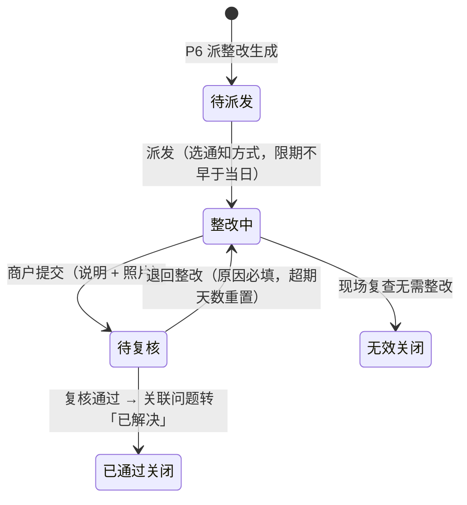

# 07 物业服务 · 06 整改管理

> 端：运营端 PC（`yunying-PC`）　｜　模块：07 物业服务（分册 §8.7）
> 页面：`property-rectify.html`　｜　页面版本：v1.0（2026-10-27）
> 前置：`01-报修工单.md`（含模块通用说明 §0）

---

## 1. 页面定位

把**商户责任**问题派给商户并跟踪到验收闭环。原「整改派发」「整改复核」两页**合并为本页**（4 个 Tab）。

- 使用者：物业主管（派发 / 复核）
- 上游：P6「派整改」、P8 投诉「转整改」
- 下游：复核通过 → P6 关联问题转「已解决」

## 2. 分区结构

| Tab | 内容 |
|---|---|
| 待派发 | 问题已上报但未派发（可改限期、选通知方式） |
| 整改中 | 已派发，等商户提交（可催办、代录提交） |
| 待复核 | 商户已提交，等验收（可勾选批量通过） |
| 已关闭 | 已通过关闭 / 无效关闭 |

**统计卡（4）**：待派发 · 整改中 · 待复核 · 本月已关闭

**列表（9 列，含勾选）**：勾选（仅待复核）· 整改编号 `ZG`（带退回次数）· 关联问题 · 整改商户 · 整改要求 · 限期 · 状态 · **超期天数** · 操作

## 3. 状态机（4 态 + 2 终态）



## 4. 整改单字段

| 字段 | 必填 | 说明 |
|---|---|---|
| 关联问题 | 是 | 自动带入（`WT` 号 + 描述 + 原照片） |
| 整改商户 | 是 | 从 04 商户档案选，或按档口带出当前租户 |
| 整改要求 | 是 | ≥5 字（派发时以此为准，复核时逐条对照） |
| 限期完成时间 | 是 | **不早于当日** |
| 通知方式 | 是 | 站内 / 短信 / 站内 + 短信（短信为独立服务，按条计费） |

### 商户提交（端上，原型用「代录提交」演示）

| 字段 | 必填 | 校验 |
|---|---|---|
| 整改说明 | 是 | ≥5 字 |
| **整改后照片** | **是** | **≥1 张**（无照片不能提交，ZG-3） |
| 提交人 | 自动 | — |

## 5. 复核（本页关键）

抽屉**必显前后照片并排对比**：

```
┌────────────────┬────────────────┐
│  原问题照片     │  整改后照片     │
│  （红框，上报时）│  （绿框，提交时）│
└────────────────┴────────────────┘
```

| 操作 | 效果 |
|---|---|
| **通过关闭** | 整改单 → `已通过关闭`，关联问题 → **已解决** |
| **退回整改** | 原因必填（≥4 字），回 `整改中`，**超期天数重置**，退回次数 +1 |
| **批量通过** | 勾选多张同批次通过，**留痕**（记录操作人与批次） |

**规则**

| 编号 | 规则 |
|---|---|
| ZG-1 | 超期未提交提醒商户 + 抄送主管 |
| ZG-2 | **退回累计 3 次自动升级主管**（并抄送运营） |
| ZG-3 | **无照片不能提交** |
| ZG-4 | 退回后**超期天数重置**（不累计，避免一次违约永久背锅） |

## 6. 提示语表

> `✅` 原型已有 / `⬜` 待实现。**编号前缀 `ZG-`**（此处用 `ZGQ-` 与规则区分）。

| 编号 | 场景 | 提示文案 | 形式 | 阻断 | 状态 |
|---|---|---|---|---|---|
| ZGQ-01 | 派发缺限期 | 请填写限期完成时间 | Toast | 是 | ✅ |
| ZGQ-02 | 限期早于当日 | 限期不得早于当日（{今日}） | Toast | 是 | ✅ |
| ZGQ-03 | 派发成功 | 已派发：{单号}　{商户}（{通知方式}，限期 {日期}） | Toast | 否 | ✅ |
| ZGQ-04 | 催办 | 已催办：{单号}　已向商户发送提醒，并抄送物业主管 | Toast | 否 | ✅ |
| ZGQ-05 | 代录提交·说明过短 | 整改说明至少 5 个字（当前 {n} 字） | Toast | 是 | ✅ |
| ZGQ-06 | 代录提交·缺照片 | 无照片不能提交：请至少上传 1 张整改后照片 | Toast | 是 | ✅ |
| ZGQ-07 | 提交成功 | 已提交整改：{单号}　待物业复核（照片对比） | Toast | 否 | ✅ |
| ZGQ-08 | 退回未填原因 | 退回原因必填（至少 4 个字） | Toast | 是 | ✅ |
| ZGQ-09 | 退回成功 | 已退回：{单号}（第 {n} 次）　超期天数重置，已通知商户重新提交 | Toast | 否 | ✅ |
| ZGQ-10 | **退回满 3 次** | 已退回：{单号}　累计退回 {n} 次 → 已自动升级至物业主管（并抄送运营） | Toast | 否 | ✅ |
| ZGQ-11 | 复核通过 | 复核通过：{单号}　已关闭，关联问题 {WT} 已转「已解决」 | Toast | 否 | ✅ |
| ZGQ-12 | 批量通过成功 | 已批量通过 {n} 张整改单（留痕：操作人 {姓名}） | Toast | 否 | ✅ |
| ZGQ-13 | 未勾选就批量通过 | 请先在「待复核」勾选要批量通过的整改单 | Toast | 是 | ✅ |
| ZGQ-14 | 列表空态 | 该分类下暂无整改单 | 空态 | 否 | ✅ |
| ZGQ-15 | 导出 | 已导出整改台账（含超期天数、退回次数、复核结论） | Toast | 否 | ✅ |
| ZGQ-16 | **超期自动提醒** | 建议：{单号} 已超期 {n} 天未提交，已提醒商户并抄送主管 | 站内 / 短信 | 否 | ⬜ 原型仅标「超 N 天」 |
| ZGQ-17 | **商户端提交入口** | 建议：商户端 App 应有「待整改」列表与拍照提交页 | — | — | ⬜ 端上待办 |

**自检结论**：✅ **15** / ⬜ **2** / 共 17 条。

## 7. 验收要点

| 编号 | 场景 | 期望 |
|---|---|---|
| AC-01 | 待派发限期填昨天 | 拦截「限期不得早于当日」 |
| AC-02 | 派发后 | 商户端可收到通知，Tab 从待派发移到整改中 |
| AC-03 | 提交不传照片 | 拦截（ZG-3） |
| AC-04 | 复核抽屉 | **必须并排显示**原照片与整改后照片 |
| AC-05 | 退回 | 超期天数归零，退回次数 +1 |
| AC-06 | 连续退回 3 次 | 提示已升级主管 |
| AC-07 | 通过关闭 | 关联问题状态变「已解决」 |
| AC-08 | 批量通过 3 张 | 3 张全关闭，留痕记录批次 |
