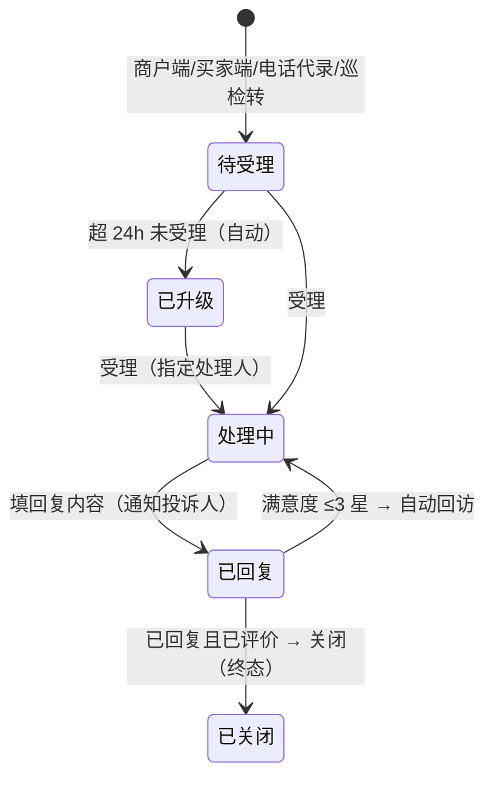

# 07 物业服务 · 07 投诉建议

> 端：运营端 PC（`yunying-PC`）　｜　模块：07 物业服务（分册 §8.8）
> 页面：`property-complaint.html`　｜　页面版本：v1.0（2026-10-27）
> 前置：`01-报修工单.md`（含模块通用说明 §0）

---

## 1. 页面定位

收敛商户与买家的不满，并通过**转单反哺**物业闭环：

- `维修质量` → **转报修**（`BX`）
- `秩序问题` → **转整改**（`ZG`）

- 使用者：客服 / 物业专员（受理 / 回复）、物业主管（升级处理）
- 上游：商户端 App、买家端 App、电话代录、巡检转
- 下游：P1 报修、P7 整改

## 2. 分区结构

| 区块 | 内容 |
|---|---|
| 统计卡（4） | 待受理 · 处理中 · 本月已关闭 · **平均满意度**（不可点击） |
| Tab（6） | 全部 / 待受理 / 处理中 / 已回复 / 已关闭 / **已升级**（带条数） |
| 筛选 | 关键词 + 来源 + 分类 + **仅看超时** |
| 列表（9 列） | 投诉编号 `TS` · 来源（电话代录带来电号）· 投诉人 · 被投诉对象 · 分类 · 内容摘要 · 状态（带星级）· 超时 · 操作 |
| 详情抽屉 | 基本信息 / 对象与分类 / 处理（含关联 BX/ZG）/ 评价（星级 + 标签 + 内容）/ 处理留痕 |

## 3. 统计卡口径

| 卡 | 口径 |
|---|---|
| 待受理 | `state ∈ {待受理, 已升级}`（升级也算未受理） |
| 处理中 | `state = 处理中` |
| 本月已关闭 | `state = 已关闭` |
| **平均满意度** | 仅统计**已评价**的投诉，`Σ星级 / 评价数`，保留 1 位小数 |

## 4. 状态机（5 态）

## 5. 字段分组

| 分组 | 字段 | 必填 |
|---|---|---|
| 基本信息 | 来源（商户端 / 买家端 / 电话代录 / 巡检转）、投诉人、联系方式、记录人 | 是 |
| 对象与分类 | 被投诉对象（商户 / 物业人员 / 公共区域 / 平台）、分类 | 是 |
| 内容 | 描述（≥5 字）、照片（选填） | 描述必填 |
| 处理 | 受理人、处理人、回复内容 | 回复时必填 |
| 评价 | 满意度 1–5 星、标签、评价内容 | 商户填（端上） |

> **TS-4**：来源 = **电话代录** 时，**联系方式（来电号码）必填**，否则无法回访。

## 6. 操作与显示条件

| 操作 | 显示条件 | 效果 |
|---|---|---|
| **受理** | 待受理 / 已升级 | 指定处理人 → 处理中 |
| **回复** | 处理中 | 回复内容 ≥5 字 → 已回复，通知投诉人 |
| **转报修** | 处理中 + 分类=维修质量 + 未转过 | 生成 BX 号并回写（原投诉保留） |
| **转整改** | 处理中 + 分类=秩序问题 + 未转过 | 生成 ZG 号并回写（原投诉保留） |
| **关闭** | **已回复 且 已评价** | 终态；未评价时按钮为灰态并提示 |
| 升级 | 超时（系统自动） | 通知运营主管 |

**规则**

| 编号 | 规则 |
|---|---|
| TS-1 | **24h 未受理**提醒并置「已升级」 |
| TS-2 | **3 工作日未回复**升级运营主管 |
| TS-3 | 满意度 **≤3 星自动回访**（退回「处理中」） |
| TS-4 | 电话代录**必填来电号码** |
| TS-5 | 转单后**原投诉保留**，可回看原内容 |

## 7. 提示语表

> `✅` 原型已有 / `⬜` 待实现。**编号前缀 `TSQ-`**（与规则 `TS-N` 区分）。

| 编号 | 场景 | 提示文案 | 形式 | 阻断 | 状态 |
|---|---|---|---|---|---|
| TSQ-01 | 缺投诉人 | 请填写投诉人 | Toast | 是 | ✅ |
| TSQ-02 | **电话代录缺来电号** | 电话代录必须填写来电号码（否则无法回访） | Toast | 是 | ✅ |
| TSQ-03 | 内容过短 | 投诉内容至少 5 个字（当前 {n} 字） | Toast | 是 | ✅ |
| TSQ-04 | 代录提交成功 | 已提交投诉：{单号}　（24h 未受理将自动升级） | Toast | 否 | ✅ |
| TSQ-05 | 受理成功 | 已受理：{单号}　指派 {处理人}（3 个工作日内需回复） | Toast | 否 | ✅ |
| TSQ-06 | 回复过短 | 回复内容至少 5 个字（当前 {n} 字） | Toast | 是 | ✅ |
| TSQ-07 | 回复成功 | 已回复：{单号}　已通知投诉人（商户可评价满意度） | Toast | 否 | ✅ |
| TSQ-08 | 转报修 | 已转报修：{BX 号}　原投诉记录保留，可回看 | Toast | 否 | ✅ |
| TSQ-09 | 转整改 | 已转整改：{ZG 号}　原投诉记录保留，可回看 | Toast | 否 | ✅ |
| TSQ-10 | **未评价就关闭** | 商户尚未评价，暂不能关闭（已回复且已评价才可关闭） | Toast | 是 | ✅ |
| TSQ-11 | 关闭成功 | 已关闭：{单号}　投诉闭环（评价 {n} 星） | Toast | 否 | ✅ |
| TSQ-12 | 列表空态 | 暂无符合条件投诉 | 空态 | 否 | ✅ |
| TSQ-13 | 导出 | 已导出投诉台账（含满意度分布、超时统计、转单关联） | Toast | 否 | ✅ |
| TSQ-14 | **≤3 星自动回访** | 已自动回访：{单号} 满意度 {n} 星（≤3 星），已退回「处理中」并通知主管 | Toast | 否 | ⬜ 原型仅在留痕里体现，无状态翻转动作 |
| TSQ-15 | **24h 未受理升级** | 建议：{单号} 超 24h 未受理，已置「已升级」并通知运营主管 | 站内提醒 | 否 | ⬜ 原型仅预置「已升级」数据 |
| TSQ-16 | **3 工作日未回复升级** | 建议：{单号} 超 3 个工作日未回复，已升级运营主管 | 站内提醒 | 否 | ⬜ 未实现 |

**自检结论**：✅ **13** / ⬜ **3** / 共 16 条。

## 8. 验收要点

| 编号 | 场景 | 期望 |
|---|---|---|
| AC-01 | 电话代录不填来电号 | 拦截（TS-4） |
| AC-02 | 待受理超 24h | 状态「已升级」，计入待受理卡 |
| AC-03 | 分类=维修质量点「转报修」 | 生成 BX 号，投诉状态不变，可回看 |
| AC-04 | 未评价点「关闭」 | 灰态 / 提示不能关闭 |
| AC-05 | 5 星评价后关闭 | 状态已关闭，平均满意度重算 |
| AC-06 | 2 星评价 | 应自动回访退回处理中（**待实现**） |
| AC-07 | 平均满意度 | 仅统计已评价，未评价不计入分母 |
