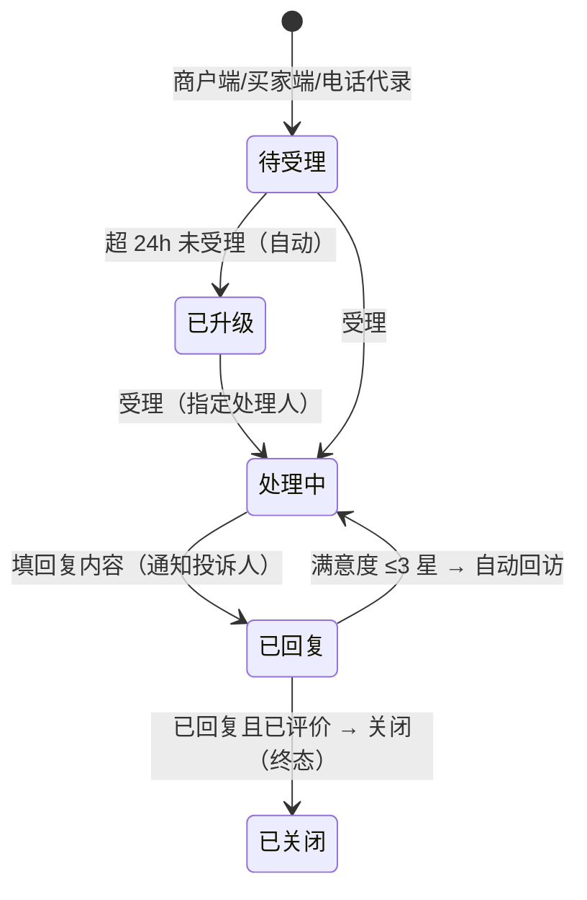

# 07 物业服务 · 07 投诉建议

> 端：运营端 PC（`yunying-PC`）　｜　模块：07 物业服务（分册 §8.8）
> 页面：`property-complaint.html`　｜　页面版本：v1.0（2026-10-27）
> 前置：`01-报修工单.md`（含模块通用说明 §0）

---

## 1. 页面定位

收敛商户与买家的不满，并通过**转单反哺**物业闭环：

- `维修质量` → **转报修**（`BX`）
- `秩序问题` → 物业上门督办（**整改单据已下线**，不生成 ZG；页面不再提供「转整改」按钮）

- 使用者：客服 / 物业专员（受理 / 回复）、物业主管（升级处理）
- 上游：商户端 App、买家端 App、电话代录（**「巡检转」已随巡检模块下线移除**，历史单据改「电话代录」）
- 下游：P1 报修（P7 整改已下线）

## 2. 分区结构

| 区块 | 内容 |
|---|---|
| 统计卡（4） | 待受理 · 处理中 · 本月已关闭 · **平均满意度**（不可点击） |
| Tab（6） | 全部 / 待受理 / 处理中 / 已回复 / 已关闭 / **已升级**（带条数） |
| 筛选 | 关键词 + 来源 + 分类 + **仅看超时** |
| 列表（10 列） | 投诉编号 `TS` · 来源（电话代录带来电号）· **上报档口** · 投诉人 · 被投诉对象 · 分类 · 内容摘要 · 状态（带星级）· 超时 · 操作 |
| 详情抽屉 | 基本信息 / 对象与分类 / 处理（含关联 BX/ZG）/ 评价（星级 + 标签 + 内容）/ 处理留痕 |

## 3. 统计卡口径

| 卡 | 口径 |
|---|---|
| 待受理 | `state ∈ {待受理, 已升级}`（升级也算未受理） |
| 处理中 | `state = 处理中` |
| 本月已关闭 | `state = 已关闭` |
| **平均满意度** | 仅统计**已评价**的投诉，`Σ星级 / 评价数`，保留 1 位小数 |

## 4. 状态机（5 态）

## 5. 字段分组

| 分组 | 字段 | 必填 |
|---|---|---|
| 基本信息 | 来源（商户端 / 买家端 / 电话代录）、上报档口（单据归属）、投诉人、联系方式、记录人 | 是 |
| 对象与分类 | 被投诉对象（商户 / 物业人员 / 公共区域 / 平台）、分类 | 是 |
| 内容 | 描述（≥5 字）、照片（选填） | 描述必填 |
| 处理 | 受理人、处理人、回复内容 | 回复时必填 |
| 评价 | 满意度 1–5 星、标签、评价内容 | 商户填（端上） |

> **TS-4**：来源 = **电话代录** 时，**联系方式（来电号码）必填**，否则无法回访。

## 6. 操作与显示条件

| 操作 | 显示条件 | 效果 |
|---|---|---|
| **受理** | 待受理 / 已升级 | 指定处理人 → 处理中 |
| **回复** | 处理中 | 回复内容 ≥5 字 → 已回复，通知投诉人 |
| **转报修** | 处理中 + 分类=维修质量 + 未转过 | 生成 BX 号并回写（原投诉保留） |

| **关闭** | **已回复 且 已评价** | 终态；未评价时按钮为灰态并提示 |
| 升级 | 超时（系统自动） | 通知运营主管 |

**规则**

| 编号 | 规则 |
|---|---|
| TS-1 | **24h 未受理**提醒并置「已升级」 |
| TS-2 | **3 工作日未回复**升级运营主管 |
| TS-3 | 满意度 **≤3 星自动回访**（退回「处理中」） |
| TS-4 | 电话代录**必填来电号码** |
| TS-5 | 转单后**原投诉保留**，可回看原内容 |

## 7. 提示语表

> `✅` 原型已有 / `⬜` 待实现。**编号前缀 `TSQ-`**（与规则 `TS-N` 区分）。

| 编号 | 场景 | 提示文案 | 形式 | 阻断 | 状态 |
|---|---|---|---|---|---|
| TSQ-01 | 缺投诉人 | 请填写投诉人 | Toast | 是 | ✅ |
| TSQ-02 | **电话代录缺来电号** | 电话代录必须填写来电号码（否则无法回访） | Toast | 是 | ✅ |
| TSQ-03 | 内容过短 | 投诉内容至少 5 个字（当前 {n} 字） | Toast | 是 | ✅ |
| TSQ-04 | 代录提交成功 | 已提交投诉：{单号}　（24h 未受理将自动升级） | Toast | 否 | ✅ |
| TSQ-05 | 受理成功 | 已受理：{单号}　指派 {处理人}（3 个工作日内需回复） | Toast | 否 | ✅ |
| TSQ-06 | 回复过短 | 回复内容至少 5 个字（当前 {n} 字） | Toast | 是 | ✅ |
| TSQ-07 | 回复成功 | 已回复：{单号}　已通知投诉人（商户可评价满意度） | Toast | 否 | ✅ |
| TSQ-08 | 转报修 | 已转报修：{BX 号}　原投诉记录保留，可回看 | Toast | 否 | ✅ |

| TSQ-10 | **未评价就关闭** | 商户尚未评价，暂不能关闭（已回复且已评价才可关闭） | Toast | 是 | ✅ |
| TSQ-11 | 关闭成功 | 已关闭：{单号}　投诉闭环（评价 {n} 星） | Toast | 否 | ✅ |
| TSQ-12 | 列表空态 | 暂无符合条件投诉 | 空态 | 否 | ✅ |
| TSQ-13 | 导出 | 已导出投诉台账（含满意度分布、超时统计、转单关联） | Toast | 否 | ✅ |
| TSQ-14 | **≤3 星自动回访** | 已自动回访：{单号} 满意度 {n} 星（≤3 星），已退回「处理中」并通知主管 | Toast | 否 | ⬜ 原型仅在留痕里体现，无状态翻转动作 |
| TSQ-15 | **24h 未受理升级** | 建议：{单号} 超 24h 未受理，已置「已升级」并通知运营主管 | 站内提醒 | 否 | ⬜ 原型仅预置「已升级」数据 |
| TSQ-16 | **3 工作日未回复升级** | 建议：{单号} 超 3 个工作日未回复，已升级运营主管 | 站内提醒 | 否 | ⬜ 未实现 |

**自检结论**：✅ **13** / ⬜ **3** / 共 16 条。

## 8. 验收要点

| 编号 | 场景 | 期望 |
|---|---|---|
| AC-01 | 电话代录不填来电号 | 拦截（TS-4） |
| AC-02 | 待受理超 24h | 状态「已升级」，计入待受理卡 |
| AC-03 | 分类=维修质量点「转报修」 | 生成 BX 号，投诉状态不变，可回看 |
| AC-04 | 未评价点「关闭」 | 灰态 / 提示不能关闭 |
| AC-05 | 5 星评价后关闭 | 状态已关闭，平均满意度重算 |
| AC-06 | 2 星评价 | 应自动回访退回处理中（**待实现**） |
| AC-07 | 平均满意度 | 仅统计已评价，未评价不计入分母 |

---

## 附：Y-19「一人多档口」档口维度与端间接线（2026-11-05）

> 依据：商户端待办 #56、商户端主 PRD FR-S07-15/16；后台 `yunying-PC/原型修改待办.md` Y-19；业务分册 `07-物业服务.md` **v1.6**。

- **`unit` 唯一语义 = 上报档口（单据归属）**：一张单据只关联一个档口；具体位置另用 `addr` / `area`，不得把 `unit` 当位置或计量单位。
- **档口字典**：商户端 `wuye-units.js` 提供 4 处实体（1F-A08 / 2F-B12 / YLSC-S08 / XZFW-3F-06），申报时**默认首个、可下拉切换**，选择写 `sh_wuye_unit`；记录列表默认展示全部档口、逐条标注上报档口。
- **两套 mock 不强行合并**：后台 02 档口字典（A9-15 等）与商户端演示档口号按单据自带 `unit` 各自受理 / 回显，真实同步待接档口主数据后单独排期。
- **端间接线（演示闭环）**：`shared/wuye-sync.js` 消费 `sh_bx_v2` / `sh_ts` / `wuye_db_v2.wt`，页头显示「已同步商户端单据 N 条」；受理 / 派单 / 回复 / 状态推进后回写对应 key，**回写必须保留 `unit`**。
- **筛选与统计（v1.7 走查订正）**：报修工单 / 问题上报 / 投诉建议三张受理页**不设「全部档口」下拉，也不展示按档口分组的小字统计条**——档口几百个，下拉不可用，且与「位置」搜索框重复。档口编号并入现有关键词搜索框（placeholder 已含「档口」），`?unit=档口编号` 深链写入关键词框完成预筛，由 04 商户档案 ⑪ 跳入。交办单 / 资金台账的档口维度另按各自页面说明。
- **归口暂缓**：缴费 / 账单与服务预约的后台受理页归口待 PM 确认，**不建页、不接线**；巡检 / 整改已下线，不同步。
- **B-1 最需要补的一页**：列表新增「**上报档口**」列（表头 10 列、空态 `colspan="10"`）、详情「基本信息」加「上报档口」行；电话代录 / 新建表单的 `n_unit` 为**文本输入框**（v1.7 由几百项下拉改回可输入，默认首个档口、可改），`saveNew()` 落 `unit`。
- **已移除** `f-unit` 档口下拉与 `unitBar` 小字统计条（v1.7 走查订正）；`f-kw` 关键词搜索支持按档口编号检索，`?unit=` 写入 `f-kw` 预筛；受理 / 回复 / 关闭 / 转报修后 `syncBackAll()` 回写 `sh_ts`，**回写不丢 `unit`**。
- 内置 mock 也按档口字典补齐归属，保证按档口号搜索时每条都能命中。

---

## 附：v1.8 筛选下拉与列表数据口径（2026-11-06）

> 依据：后台 `原型修改待办.md` **Y-20**、业务分册 `07-物业服务.md` **v1.8**。

- 本页筛选 `<select>` 的选项**不再写死**，由 `shared/select-options.js` 的 `SEL_OPTS.fill(id, rows, field, allLabel, opt)` 按**列表全量数据**去重生成；主 `render()` 开头调用 `syncFilterOptions()`，端间注入单据、跨页转单、新增记录、下线模块残留值都会自动回流到下拉。
- 排序沿用原字典顺序（`opt.order`），空值与重复值自动跳过；筛选 / 切换后保留当前选中值，值失效则回到「全部」。
- 「全部 X」项始终存在（资金台账的年度下拉例外：按 `noAll` 只列真实年度，并默认选中第一个）。
- **状态 Tab 与录入弹窗的字典类下拉不在此机制内**：Tab 有既有归并规则（报修「已派单」并入「处理中」），录入单据需要完整字典而非当前数据子集；人员编辑弹窗不提供「停用」是业务规则。
- 本页数据源：`f-src` ← `TS.src`、`f-cat` ← `TS.cat`（商户端注入的空分类自动跳过）。
