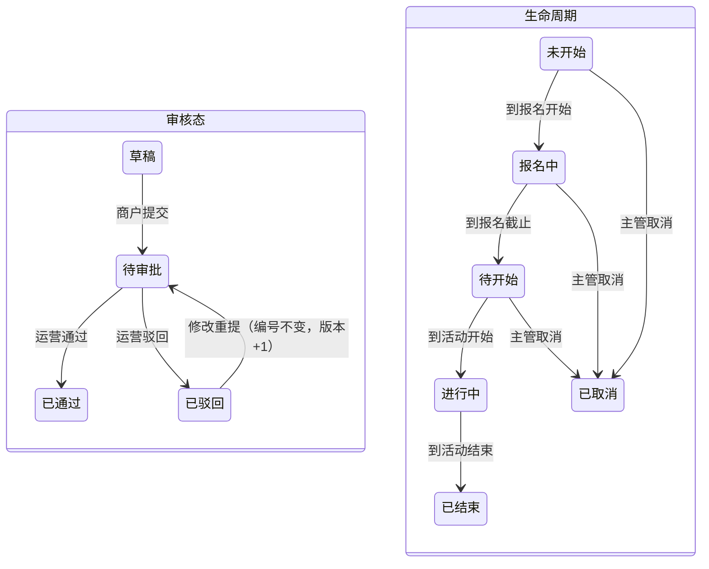

# 08 商户活动运营 · 运营端页面说明（首篇）

> 端：运营端 PC（`yunying-PC`）　｜　模块：08 商户活动运营
> **本文件 = 模块通用说明（§0）+ 第 1 页**，同目录其余文件只写本页
> 页面版本：v1.0（2026-10-22）　｜　业务分册：`开发PRD/运营管理端分册PRD/08-活动运营.md` **v1.6**
> 同目录：`02-活动创建.md`、`03-活动审批.md`、`04-报名管理.md`、`05-签到管理.md`、`06-活动详情.md`

---

## 0. 模块通用说明（本模块其他页面不再重复）

### 0.1 这个模块解决什么问题

商户培训、沙龙、消防演练这类活动靠微信群接龙 + Excel 记名字，**名额经常超**、**签到靠纸质点名**、**商户自己办的活动没人管**。
本模块把「发布 → 审批 → 报名 → 签到 → 统计」收到一个入口，名额与签到状态以系统为准。
不做：活动就只能继续用微信群，事后说不清谁到过、办了几场、商户活动该不该批。

### 0.2 角色与权限矩阵

| 功能 | 运营专员 | 运营主管 | 商户 | 无权限表现 |
|---|---|---|---|---|
| 创建平台活动 | ✅ | ✅ | ❌ | 菜单不可见 |
| 提交商户活动申请 | — | — | ✅（仅自己） | — |
| 审批商户活动 | ✅ | ✅ | ❌ | 按钮隐藏 |
| 编辑活动 | ✅（报名中限字段） | ✅ | 仅自己且待审批前 | 超出状态 → 按钮隐藏 |
| 上下架 | ✅ | ✅ | ❌ | 按钮隐藏 |
| **取消活动** | ❌ | ✅ | 仅申请 | **按钮只对主管可见** |
| 报名审核 | ✅ | ✅ | 自己活动 | — |
| 导出名单 | ✅（留痕） | ✅ | ❌ | 按钮隐藏 |
| 核销 | ✅ | ✅ | 自己活动 | — |
| 现场补录 | ✅ | ✅ | 自己活动（超名额需运营） | — |
| 删除活动 | 仅草稿 | 仅草稿 | 仅草稿 | 非草稿 → 按钮隐藏 |
| 手机号完整值 | ✅（填原因 + 留痕） | ✅ | 脱敏 `138****6688` | — |

### 0.3 菜单与端间落点表

| # | 页面 | 本端文件 | 商户端 | 买家端 | 数据方向 |
|---|---|---|---|---|---|
| P1 | 活动列表 | `activity.html` | `shanghu-APP/activity-list.html`（仅上架 + 未结束） | ❌ | 本端 → 商户端（上下架/取消/改期） |
| P2 | 活动创建 | `activity-create.html` | `shanghu-activity-apply.html`（商户申请） | ❌ | 商户 → 本端（待审） |
| P3 | 活动审批 | `activity-approve.html` | 同上 | ❌ | 商户 → 本端 |
| P4 | 报名管理 | `activity-signup.html` | `activity-signup.html`（自主报名）、`shanghu-activity-manage.html`（名单） | ❌ | 双向（≤5s） |
| P5 | 签到管理 | `activity-checkin.html` | `shanghu-activity-checkin.html`（仅自己主办） | ❌ | 双向（即时） |
| P6 | 活动详情 | `activity-detail.html` | `activity-detail.html` | ❌ | 本端 → 商户端（只读） |

> **买家端全面不涉及**：面向公众的文旅活动归 **14 文商旅管理 · 文旅活动管理**；本模块面向商户，唯一 C 端出口是**商户端「物业服务 → 活动参与」**。

**运营端内依赖**：02 市场资源（活动地点只读）｜04 商户管理（主办方信息、停用联动下架）｜09 内容管理**无交互**（v1.1 取消投放位）。

### 0.4 核心数据对象

| 对象 | 说明 | 关键字段 | 谁产生 | 谁消费 |
|---|---|---|---|---|
| **活动 ACT** | 一场活动 | id / 名称 / 类型 / 主办方 / 名额 / 报名与活动时间 / 地点 / **三层状态** | 运营创建、商户申请 | 全模块 + 商户端 |
| **报名单 SIGN** | 一条报名（占 N 个名额，N = 1 + 同行） | id / 活动 id / 姓名 / 手机 / 商户 / 岗位 / 同行 / 来源 / 审核态 / 签到态 / 签到码 | 商户端提交、现场补录、批量导入 | 名单、签到、统计 |

### 0.5 状态机

**三层分离（不要压成一个字段）**

| 层 | 字段 | 取值 |
|---|---|---|
| 审核态 | `audit` | 草稿 / 待审批 / 已通过 / 已驳回 |
| 生命周期 | `life` | 未开始 / 报名中 / 待开始 / 进行中 / 已结束 / 已取消 |
| 上下架 | `online` | 上架 / 下架 |

**展示态派生优先级**（列表只显示一个，从上到下取第一个命中）
`草稿 > 待审批 > 已驳回 > 已取消 > 已下架 > 已结束 > 进行中 > 待开始 > 报名中 > 未开始`

**状态转换表**

| 当前 | 事件 | 操作者 | 前置 | 目标 | 伴随动作 | 禁止条件 |
|---|---|---|---|---|---|---|
| 草稿 | 提交 | 商户 | 必填完整 | 待审批 | 通知运营 | 校验不过 → 行内拦截 |
| 草稿 | 发布 | 运营 | 平台活动 | 未开始/报名中 | 按时间自动定位 | — |
| 待审批 | 通过 | 运营 | 预检通过 | 未开始/报名中 | 上架 + 通知商户 | — |
| 待审批 | 驳回 | 运营 | 原因 + 说明必填 | 已驳回 | 通知商户 | 说明为空 → 拦截 |
| 已驳回 | 修改重提 | 商户 | — | 待审批 | 版本 +1，编号不变 | — |
| 未开始/报名中/待开始 | 取消 | **主管** | 原因必填 | 已取消 | 通知全部报名者 | 非主管 → 按钮不出现 |
| 任意非终态 | 下架 | 运营 | — | online=下架 | 商户端不可见 | — |
| 已结束 | 复制新建 | 运营 | — | 新草稿 | 新编号 | — |

**禁止路径**

| 场景 | 系统行为 | 提示文案 | 日志 |
|---|---|---|---|
| 报名中改时间/名额/地点 | 字段禁用 | 见 A-20 | 是 |
| 非主管点取消 | 按钮不渲染 | — | 否 |
| 已结束活动编辑 | 按钮不渲染（只给"复制新建"） | — | 否 |
| 已有报名的活动删除 | 拦截（只能取消或下架） | 见 A-04 相邻规则 | 是 |

### 0.6 名词与口径

| 名词 | 定义 | 备注 |
|---|---|---|
| **已占位** | 待审核 + 已通过（**按人数** = Σ(1 + 同行)） | 已取消 / 已驳回**不占名额** |
| 余量 | 名额 − 已占位 | 可为 0，不为负（超录需确认） |
| **签到率** | 已签到 ÷ 已通过 | **活动开始前显示 `—`，不显示 0%** |
| 爽约 | 已结束 + 未签到，结束后 24h 结算 | 可人工修正 |
| 报名单数 vs 占位人数 | 前者按条，后者按 Σ(1+同行) | 两个数不能混用 |
| 签到码 | 6 位数字，全局唯一 | 不启用签到则不生成 |

### 0.6.1 跨端字段差异（只列不一致的）

| 概念 | 运营端 | 商户端现状 | 目标口径 |
|---|---|---|---|
| 活动状态 | `audit` + `life` + `online` 三层 → 派生 `display` | `status` **单字段** | 商户端读后台下发的 `display`，不自己算 |
| 活动 `audit` | 枚举四态 | 布尔 `audit: true/false`（同名不同义） | 统一枚举；布尔改名 `needAudit` |
| 名额占用 | `hold`（按人数） | `occupied`（数字） | 统一 `hold` |
| 签到时间 | `checkinAt` | `signTime` | 统一 `checkinAt` |

### 0.7 本期不做

付费报名 / 押金 / 候补队列 / 活动评价 / 直播 / 自动排座 / 优惠券 / 买家端展示 / 分场次与分区 / 投放位选择（Banner·文旅日历）

---

## 1. 活动列表 `activity.html`

### 1.1 页面说明

| 项 | 内容 |
|---|---|
| 页面目标 | 一屏看清"有哪些活动、什么状态、报名到哪了"，并承载全部单条操作 |
| 使用角色 | 运营专员（常规操作）、运营主管（多"取消"） |
| 入口 | 菜单 → 商户活动运营 → 活动列表 |
| 前置 | 已登录且有本模块权限 |
| 后置 | 本页是操作起点；下钻进详情 / 报名 / 签到 |

### 1.2 本页端间关系

| 项 | 内容 |
|---|---|
| 本页数据来源 | 运营创建 + 商户申请（待审批） |
| 本页操作的跨端影响 | 上架 → 商户端「活动参与」出现；下架/取消 → 立即消失或标已取消；改期 → 通知已报名者 |
| 依赖的其他端页面 | `shanghu-APP/activity-list.html`、`shanghu-APP/activity-detail.html` |
| 不涉及的端 | 买家端（全面不涉及） |
| 一致性要求 | 状态/余量 ≤5s 同步商户端；取消即时生效 |

### 1.3 页面结构

| 区块 | 内容 |
|---|---|
| 顶部 | 标题「商户活动运营」+ 说明行 + **「活动审批」（带红点数字，跳 P3）** + 「创建活动」 |
| **统计卡（4）** | 进行中 / 报名中 / 待审批 / 已结束（按派生态计数，带图标与色） |
| 筛选区 | 关键词（活动编号 / 名称）+ 类型 + 状态（10 态）+ 主办方（平台 / 商户）+ 查询 + 重置 |
| 列表工具条 | 结果计数 + 「导出活动」 |
| 表格 | **9 列** |
| 行操作 | **按状态显隐**（见 §1.6） |

### 1.4 列表、筛选与排序

| 项目 | 规则 |
|---|---|
| 默认排序 | 活动开始时间倒序（最近/即将开始在前） |
| 可排序 | 无表头排序（靠筛选） |
| 分页 | 不分页（本期活动量 < 200，一次渲染） |
| 筛选组合 | 条件之间 **且** |
| 关键词 | 匹配活动编号或名称，输入即筛（`oninput`） |
| 重置 | 清空 4 个条件，恢复默认 |
| 空结果 | 「没有符合条件的活动 —— 换个筛选条件，或先创建一场」 |
| 导出 | 「导出活动」→ 按当前筛选导出 Excel |

### 1.5 字段规格

| 列 | 字段 | 类型 | 说明 |
|---|---|---|---|
| 活动编号 | `id` | 文本 | `EVT + 年月日 + 序号` |
| 活动名称 | `name` | 文本 | 超长截断；带类型图标与色条 |
| 类型 | `type` | 枚举 | 展会 / 直采节 / 培训 / 沙龙 / 会议 / 应急演练 / 其他 |
| 主办方 | `owner` | 枚举 | 平台 / 商户（商户显示简称） |
| 报名时间 | `signStart`~`signEnd` | 日期区间 | — |
| 活动时间 | `start`~`end` | 日期时间 | — |
| 报名进度 | `hold`/`quota` | 派生 | `已占位 / 名额` + 进度条；**满 100% 变红** |
| 状态 | `display` | 派生 10 态 | 彩色标签，优先级见 §0.5 |
| 操作 | — | — | 按状态显隐，见 §1.6 |

> 进行中 / 已结束的行，报名进度下方追加一行「签到 N/M」。

### 1.6 交互规则（**按状态显隐**）

| 状态 | 行操作 |
|---|---|
| 草稿 | 编辑 / 删除 |
| 待审批 | 审批（跳 P3）/ 详情 |
| 已驳回 | 详情 / **催改**（通知商户改后重提） |
| 未开始 / 报名中 / 待开始 | 详情 / 报名 / **下架** / **取消**（主管） |
| 进行中 | 详情 / 报名 / 签到 |
| 已结束 | 详情 / 名单 |
| 已下架 | 详情 / 上架 |

| 顶部元素 | 显示条件 | 可点条件 | 点击后 |
|---|---|---|---|
| 活动审批 | 始终 | 始终 | 跳 P3（红点 = 待审批数） |
| 创建活动 | 始终 | 运营 | 跳 P2 |
| 导出活动 | 始终 | 运营/主管 | 按当前筛选导出 |

### 1.7 业务规则与计算口径

| 编号 | 规则 | 触发 | 处理 | 影响端 |
|---|---|---|---|---|
| R-01 | 展示态派生 | 每次渲染 | 按 §0.5 优先级取第一个命中 | 商户端同值 |
| R-02 | 名额账 | 报名变化 | 已占位 = 待审核 + 已通过（按人数） | 商户端余量 |
| R-03 | 已占位达名额 | 渲染 | 进度条变红 + 状态"已满"（仍可进详情） | 商户端按钮置灰 |
| R-04 | 取消需主管 | 点取消 | 非主管隐藏按钮 | 商户端状态变更 |
| R-05 | 取消原因必填 | 确认取消 | 为空 → 拦截 | — |
| R-06 | 删除仅草稿 | 点删除 | 非草稿不渲染"删除" | — |
| R-07 | 重复提交 | 取消/删除 | 按钮 loading 锁 1.5s | — |

### 1.8 异常与边界

| 类型 | 场景 | 系统行为 | 提示文案 |
|---|---|---|---|
| 数据 | 筛选无结果 / 首次无活动 | 空态 | 【已实现】「没有符合条件的活动 —— 换个筛选条件，或先创建一场」 |
| 权限 | 非主管点取消 | 按钮不渲染 | — |
| 并发 | 取消时活动已被他人改 | 刷新列表 | 【待实现】原型无并发校验 |
| 依赖 | 详情页不存在 | 隐藏入口 | — |

#### 1.8.1 本页提示语清单（来源：分册 §8.6，编号可回溯）

| 编号 | 场景 | 提示文案 | 形式 | 状态 |
|---|---|---|---|---|
| A-01 | 取消未填原因 | 请填写取消说明 | 弹窗内 | ✅ |
| A-02 | 取消成功 | 活动已取消，已通知 {n} 名报名者 | Toast | ✅ |
| A-03 | 复制成功 | 已复制为新活动 | Toast | ✅ |
| A-04 | 删除成功 | 已删除 | Toast | ✅ |
| A-05 | 筛选无结果（空态） | 没有符合条件的活动 —— 换个筛选条件，或先创建一场 | 空态 | ✅ |
| A-06 | 首次无活动（空态） | — | — | ➖ 已合并进 A-05 |
| A-07 | 非主管点取消 | 取消活动需主管权限，请联系运营主管 | Toast | ⬜ |
| A-55 | 已驳回行点「催改」 | 已通知商户按驳回原因修改后重提 | Toast | ✅ |
| A-56 | 导出活动 | 已导出 {n} 场活动 | Toast | ✅ |

### 1.9 通知与消息

| 事件 | 接收人 | 渠道 | 抑制条件 |
|---|---|---|---|
| 活动被取消 | 全部已报名商户 | 站内 + 短信 | 已取消的不重复发 |
| 活动改期 | 全部已报名商户 | 站内 + 短信 | — |
| 活动上架 | 面向的商户 | 站内 | 已结束/已取消不发 |

### 1.10 验收标准

| 编号 | 前置 | 操作 | 预期 | 级别 |
|---|---|---|---|---|
| AC-01 | 存在报名中活动 | 主管点取消并填原因 | 置已取消 + 下架，全部报名者收到通知 | P0 |
| AC-02 | 活动已结束 | 查看行操作 | 无"编辑"，有"复制新建"以外的仅详情/名单 | P0 |
| AC-03 | 草稿活动 | 点删除 | 二次确认后删除，列表少一条 | P1 |
| AC-04 | 非主管账号 | 查看行操作 | 无"取消" | P1 |
| AC-05 | 名额已满 | 查看进度 | 进度条红色 + 显示"已满" | P1 |
| AC-06 | 筛选"待审批" | 查看列表 | 只返回待审批，统计卡数字一致 | P1 |
