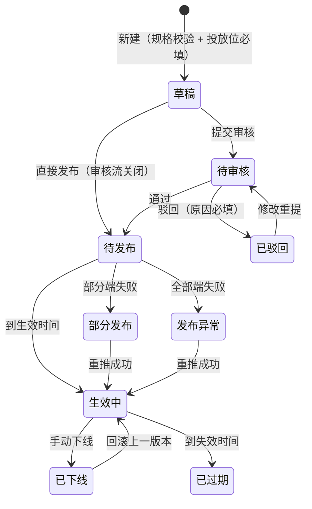

# 09 内容管理 · 运营端页面说明（首篇）

> 端：运营端 PC（`yunying-PC`）　｜　模块：09 内容管理
> **本文件 = 模块通用说明（§0）+ 第 1 页**，同目录其余文件只写本页
> 页面版本：v1.0（2026-10-22）　｜　业务分册：`开发PRD/运营管理端分册PRD/09-内容管理.md` **v2.2**
> 同目录：`02-公告通知.md`、`03-Banner管理.md`、`04-产业指数发布.md`、`05-消息推送.md`

---

## 0. 模块通用说明（本模块其他页面不再重复）

### 0.1 这个模块解决什么问题

资讯、公告、Banner、指数、推送原本散在各自后台甚至直接改代码，**发出去收不回、发错了改不了、哪个端显示了什么没人说得清**。
本模块把五类内容的**生产 → 审核 → 定时 → 多端投放 → 下线归档**收到一处，按「投放位」统一管理。

不做：内容只能靠改代码上线，出错无法回滚，多端展示不一致没人发现。

### 0.2 角色与权限矩阵

| 功能 | 内容运营专员 | 运营主管 | 物业 | 无权限表现 |
|---|---|---|---|---|
| 新建 / 编辑 / 删除草稿 | ✅ | ✅ | ✅（**仅公告类**） | 按钮隐藏 |
| 提交发布 | ✅ | ✅ | ✅（仅公告类） | 按钮隐藏 |
| **审核通过 / 驳回** | ❌ | ✅ | ❌ | 按钮隐藏 |
| 立即发布 | ✅ | ✅ | ❌ | — |
| 手动下线 | ✅（**需填原因**） | ✅ | ❌ | — |
| **强制替换位次** | ❌ | ✅（审批留痕） | ❌ | 按钮隐藏 |
| 回滚历史版本 | ✅ | ✅ | ❌ | — |
| 按位统计 / 导出 | ✅ | ✅ | ❌ | — |

> 数据权限：**草稿 / 待审核内容不下发到任何端**；物业发布范围限物业类公告。

### 0.3 菜单与端间落点表

| # | 页面 | 运营端文件 | 买家端 | 商户端 | 数据方向 |
|---|---|---|---|---|---|
| P1 | 资讯文章 | `content.html` | ❌ 缺：首页资讯瀑布流 + `news-detail.html`（需新建） | ❌ 缺（可选）：首页行业资讯位 | 本端 → 两端 |
| P2 | 公告通知 | `content-notice.html` | `messages.html` 消息中心（需加"公告/系统"类） | `notice-detail.html` + `index-app-shanghu.html` 工作台 | 本端 → 两端 |
| P3 | Banner 管理 | `content-banner.html` | `home.html` 轮播 / `market-socks.html` / `chamber.html` | ❌ 缺：`home.html` 顶部轮播（需新建） | 本端 → 两端 |
| P4 | 产业指数发布 | `content-index.html` | **无消费位（待确认）** | — | 本端 → 待定 |
| P5 | 消息推送 | `content-push.html` | `messages.html` | 商户端消息（站内推送） | 本端 → 两端 |

> **端上现状**：三处买家端位与商户端位**均为静态硬编码**，改造属端上待办；本模块只负责产出与下发。

**运营端内依赖**：08 活动（审批通过 → 生成曝光位草稿）｜10 商城（推荐位/广告位归商城，本模块只引用跳转目标）｜11 原料市场（价格指数口径）｜07 物业（公告发布方归属待确认）｜01/15 只读统计。

### 0.4 核心数据对象

| 对象 | 说明 | 关键字段 | 谁产生 | 谁消费 |
|---|---|---|---|---|
| **内容 Content** | 一条资讯/公告/Banner/指数 | id / 类型 / 标题 / 正文 / 素材 / 状态 / 生效期 / 创建人 | 内容运营、物业（公告） | 全模块 + 两端 |
| **投放位 Slot** | 端 × 页面 × 位置（如"买家端首页轮播 2 号位"） | id / 端 / 页面 / 位置 / 条数上限 / 素材规格 | 平台预置 | 内容绑定 |
| **投放记录 SlotAssignment** | 内容 ↔ 位次 ↔ 时段 | contentId / slotId / 位次 / 起止 / 状态 | 系统 | 排期视图、冲突判断 |
| **推送任务 PushTask** | 消息推送单 | 模板 / 人群 / 渠道 / 送达 / 已读 | 模板触发、人工补发 | 推送记录 |

### 0.5 状态机

**① 内容状态（9 态）**

| 状态 | 含义（等谁做什么） | 驱动方 |
|---|---|---|
| 草稿 | 已录入未提交 | 运营专员 |
| 待审核 | 已提交，等主管 | 运营专员 → 主管 |
| 已驳回 | 审核未过，等改后重提 | 主管 |
| 待发布 | 已通过，未到生效时间 | 系统（定时） |
| 生效中 | 已下发各端并展示 | 系统 |
| 部分发布 | 部分端成功、部分失败，等重推 | 系统 + 专员 |
| 已下线 | 人工下线（终态，可回滚） | 专员 / 主管 |
| 已过期 | 超过结束时间（终态） | 系统 |
| 发布异常 | 全部端下发失败，等重推 | 系统 + 专员 |

**② 投放位占用（4 态）**：待生效 / 生效中（**同位次同时段唯一**）/ 已结束 / 冲突待处理

**禁止路径**

| 场景 | 系统行为 | 提示文案 | 日志 |
|---|---|---|---|
| 同位次同时段已有内容 | 拦截保存 | 见 C-29 | 是 |
| 非主管强制替换位次 | 按钮隐藏 | — | 否 |
| 删除已发布内容 | 拦截 | 见 C-12 / C-24 | 是 |
| 发布未绑定投放位 | 拦截 | 见 C-03 | 否 |
| 任一端下发失败 | **不静默**，进异常清单可重推 | 见 C-11 | 是 |

### 0.6 名词与口径

| 名词 | 定义 | 备注 |
|---|---|---|
| **按位曝光 / 点击** | 按「投放位」维度统计，不是按内容总数 | 一条内容投 3 个位 → 3 组数据 |
| 曝光 | 端上该位次可见即计 1 次 | 端上报 |
| 点击率 | 点击 ÷ 曝光 | 位次无曝光 → `—` |
| **已读率** | 已读 ÷ 送达（推送） | 失败不计分母 |
| 置顶上限 | 默认 **3 条**，可配置 | 置顶不影响有效期判定 |
| 多端一致性 | 同一内容多处投放时**编辑即全端更新**（同一内容 ID 下发） | 避免各端内容不一致 |
| 位次 | 同一投放位内的排序号 | 同时段唯一 |

### 0.6.1 跨端字段差异（只列不一致的）

| 概念 | 运营端 | 端上现状 | 目标口径 |
|---|---|---|---|
| 内容下发 | `contentId` + `slotId` + 位次 | 端上写死文案/图片 | 端按 `slotId` 拉取，本模块为唯一来源 |
| 公告类别 | `noticeType`（公告/政策/活动） | 端上静态分类 | 端读本模块下发类别 |
| 曝光点击 | 按位统计 | 端上未上报 | 端上报 `slotId + contentId + 事件` |
| 推送渠道 | `channels[]`（站内 / 微信） | 端上仅站内 | 统一枚举；**短信暂不做** |

### 0.7 本期不做

资讯评论 / 点赞 / 收藏｜内容多语言｜A/B 测试｜自动生成图表（指数只录入）｜短信渠道（暂缓）｜买家端 3D/视频内容位

---

## 1. 资讯文章 `content.html`

### 1.1 页面说明

| 项 | 内容 |
|---|---|
| 页面目标 | 产业资讯的录入、审核、**多端投放**与定时发布 |
| 使用角色 | 内容运营专员（主）、主管（审核/强制替换） |
| 入口 | 菜单 → 内容管理 → 资讯文章 |
| 前置 | 投放位已在「投放位管理」中配置 |
| 后置 | 生效后下发到绑定的每个投放位 |

### 1.2 本页端间关系

| 项 | 内容 |
|---|---|
| 本页数据来源 | 运营手工录入 |
| 本页操作的跨端影响 | 生效 → 买家端首页资讯瀑布流 / 商户端资讯位出现；下线 → 立即撤下 |
| 依赖的其他端页面 | `mai-APP/home.html`（瀑布流，**需新建**）、`mai-APP/news-detail.html`（**需新建**） |
| 不涉及的端 | 无（商户端资讯位为可选） |
| 一致性要求 | 同一内容多端下发；任一端失败进异常清单，可单端重推 |

### 1.3 页面结构

| 区块 | 内容 |
|---|---|
| 顶部 | 标题「资讯文章」+ **「导出」**「新增资讯」 |
| **统计卡** | 生效中 / 待发布（定时未到）/ 待审核 / 本月新增 / 启用中的投放位（`id="stats"` + `renderStats()`） |
| 筛选区 | 关键词（标题/来源）+ 分类 + 状态（6 态）+ **投放端** + 生效期区间 + 创建人 + 查询 + 重置 |
| 列表 | **8 列** + 分页 |
| 投放位管理表 | **7 列**（页面下半部分，同页展示可投放的位） |
| 抽屉 | 新增/编辑：① 基本信息 ② 正文 ③ **投放位多选** ④ 定时 + 置顶 ⑤ 各端预览 |

### 1.4 列表、筛选与排序

| 项目 | 规则 |
|---|---|
| 默认排序 | 最近更新倒序 |
| 可排序 | 更新、生效期 |
| 分页 | 页码（原型演示 2 页） |
| 筛选组合 | 条件之间 **且** |
| 投放端筛选 | 买家端 / 商户端 / 全部 |
| 空结果 | 见 C-16（⬜ 未实现） |
| 导出 | 按当前筛选导出 Excel |

### 1.5 字段规格

**资讯列表（8 列）**

| 列 | 字段 | 说明 |
|---|---|---|
| 封面 / 标题 | `cover` / `title` | 缩略图 + 标题 |
| 分类 / 投放端 | `category` / `slots[]` | 分类标签 + 投放位标签组 |
| 生效期（定时） | `startAt`~`endAt` | 未设置显示"—" |
| 曝光 / 点击 | `impressions` / `clicks` | **按位汇总** |
| 状态 | `state` | 6 态彩色标签 |
| 创建人 | `creator` | — |
| 更新 | `updatedAt` | — |
| 操作 | — | 编辑 / 提交 / 审核 / 上下线 / 版本 / 删除（仅草稿） |

**投放位表（7 列）**：投放位 ID · 端 · 页面 · 位置 · 条数上限 · 素材规格 · 状态 · 操作

**编辑抽屉**

| 分组 | 字段 | 必填 | 说明 |
|---|---|---|---|
| 基本信息 | 标题 / 分类 / 来源 / 作者 / 封面 | 标题必填 | 封面规格随投放位自动校验（480×360 / 260KB / JPG） |
| 正文 | 富文本 | — | 支持图片与视频占位 |
| **投放位** | 端 × 页面 × 位次（多选） | **是** | 至少 1 个；有位次冲突时拦截 |
| 定时 | 起止时间 + 是否置顶 | — | 精度到分钟；生效时间不得早于当前 |
| 预览 | 各端效果 | — | 只读 |

### 1.6 交互规则

| 元素 | 显示条件 | 可点条件 | 点击后 | 禁止表现 |
|---|---|---|---|---|
| 新增资讯 | 始终 | 专员/主管 | 抽屉 | — |
| 提交审核 | 状态=草稿/已驳回 | 专员 | 置待审核 + 通知审核人 | 未绑投放位 → C-03 |
| 审核通过 | 状态=待审核 | **主管** | 置待发布/生效中 | 非主管 → 隐藏 |
| 驳回 | 状态=待审核 | 主管 | 弹窗（原因必填） | 空 → C-07 |
| 立即发布 | 状态=待发布 | 专员/主管 | 置生效中 | — |
| 下线 | 状态=生效中 | 专员（填原因）/主管 | 置已下线，多端撤下 | — |
| 回滚 | 状态=已下线/已过期 | 专员 | 生成新版本并生效 | — |
| 删除 | **仅草稿** | 专员 | 物理删除 | 非草稿 → C-12 |
| 强制替换位次 | 位次冲突 | **主管** | 审批留痕后替换 | 非主管 → 隐藏 |

### 1.7 业务规则与计算口径

| 编号 | 规则 | 触发 | 处理 | 影响端 |
|---|---|---|---|---|
| R-01 | 发布必须绑定投放位 | 保存/发布 | 未绑 → 拦截 | — |
| R-02 | 同位次同时段唯一 | 保存 | 冲突 → 拦截；主管可强制替换 | 两端 |
| R-03 | 条数上限 | 保存 | 超出 → C-04 | 两端 |
| R-04 | 多端一致性 | 编辑 | 同一内容 ID 下发，全端更新 | 两端 |
| R-05 | 不允许静默失败 | 下发 | 失败进异常清单，可单端重推 | 两端 |
| R-06 | 已发布不可物理删除 | 删除 | 仅草稿可删 | — |
| R-07 | 定时精度到分钟 | 保存 | 生效时间不得早于当前 | — |
| R-08 | 审核超 1 工作日提醒 | 定时 | 提醒审核人，**不自动通过** | — |

### 1.8 异常与边界

| 类型 | 场景 | 系统行为 | 提示文案 |
|---|---|---|---|
| 数据 | 未选投放位 | 拦截 | 【已实现】「请至少选择一个投放位（发布必须绑定投放位）」 |
| 数据 | 投放位已满 | 拦截 | 【已实现】「投放位已满：{位名}（上限 {n} 条），请先下线其他内容」 |
| 数据 | 位次冲突 | 拦截 | 【待实现】C-29 |
| 数据 | 列表为空（首次） | 空态 | 【待实现】C-16 |
| 依赖 | 某端下发失败 | 进异常清单 | 【已实现】「已单端重推成功：{端}」 |
| 数据 | 删除非草稿 | 拦截 | 【已实现】「仅「草稿」可删除；已发布内容请使用「下线」」 |

#### 1.8.1 本页提示语清单（来源：分册 §8.7，编号可回溯）

| 编号 | 场景 | 提示文案 | 形式 | 状态 |
|---|---|---|---|---|
| C-01 | 导出资讯清单 | 已导出资讯清单（含分类、投放端、生效期、按位曝光/点击） | Toast | ✅ |
| C-02 | 标题未填 | 请填写标题 | 行内 | ✅ |
| C-03 | 未选投放位 | 请至少选择一个投放位（发布必须绑定投放位） | 行内 | ✅ |
| C-04 | 投放位已满 | 投放位已满：{位名}（上限 {n} 条），请先下线其他内容 | Toast | ✅ |
| C-05 | 提交审核 | 已提交审核：{标题} | Toast | ✅ |
| C-06 | 审核通过 | 审核通过：{标题} | Toast | ✅ |
| C-07 | 驳回未填原因 | 驳回原因必填 | 行内 | ✅ |
| C-08 | 驳回成功 | 已驳回：{标题} | Toast | ✅ |
| C-09 | 下线成功 | 已下线　{标题} | Toast | ✅ |
| C-10 | 回滚重发 | 已回滚重发：{标题} | Toast | ✅ |
| C-11 | 单端重推 | 已单端重推成功：{端} | Toast | ✅ |
| C-12 | 删除非草稿 | 仅「草稿」可删除；已发布内容请使用「下线」 | Toast | ✅ |
| C-13 | 删除草稿成功 | 已删除草稿 | Toast | ✅ |
| C-14 | 封面规格校验 | 已选择封面；校验：480×360 / 260KB / JPG → 通过（规格随投放位自动校验） | Toast | ✅ |
| C-15 | 保存草稿 | 已保存草稿 | Toast | ✅ |
| C-16 | 首次无内容（空态） | 还没有内容，先新增一条 | 空态+按钮 | ⬜ |
| C-29 | 位次冲突 | 位次 {n} 已被「{标题}」占用（{生效期}），请调整位次或等其下线 | 行内 | ⬜ |

### 1.9 通知与消息

| 事件 | 接收人 | 渠道 | 抑制条件 |
|---|---|---|---|
| 提交审核 | 审核人（主管） | 站内 + 待办 | 同内容不重复 |
| 审核通过 / 驳回 | 提交人 | 站内 | — |
| 审核超时 1 工作日 | 审核人 | 站内 | 已处理不发 |
| 下发失败 | 内容运营 | 站内 + 异常清单 | — |

### 1.10 验收标准

| 编号 | 前置 | 操作 | 预期 | 级别 |
|---|---|---|---|---|
| AC-01 | 新建资讯不选投放位 | 点发布 | 拦截，提示至少选一个投放位 | P0 |
| AC-02 | 同一投放位同位次已有生效内容 | 保存新内容 | 拦截并提示冲突；主管可强制替换（留痕） | P0 |
| AC-03 | 内容已生效 | 点删除 | 拦截，提示用「下线」 | P0 |
| AC-04 | 生效中内容 | 点下线 | 两端立即撤下，状态已下线 | P0 |
| AC-05 | 一条内容投 2 个位 | 查看曝光/点击 | 按位分别统计，不是总数 | P1 |
| AC-06 | 某端下发失败 | 查看状态 | 显示"部分发布"，可单端重推 | P1 |
