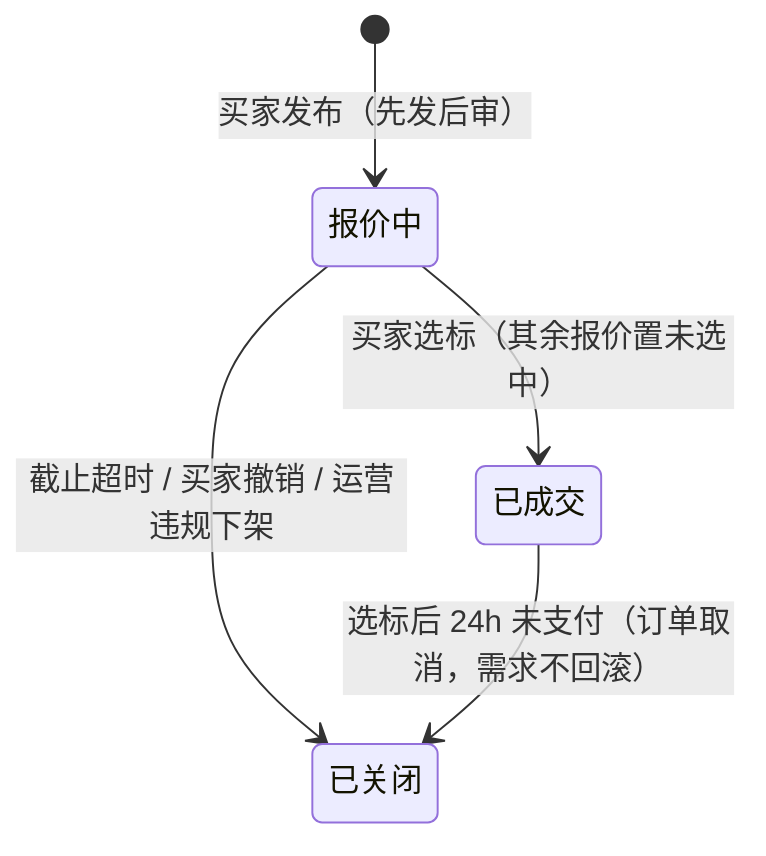

# 10a 采购询价 · 页面说明（首篇）

> 端：运营端 PC（`yunying-PC`）　｜　模块：10 商城运营 → 采购询价（分册 10a）
> **本文件 = 模块通用说明（§0）+ 第 1 页**，同目录另一份只写本页
> 页面版本：v1.0（2026-10-26）　｜　业务分册：`开发PRD/运营管理端分册PRD/10a-采购询价管理.md` **v1.2**
> 同目录：`02-采购询价订单.md`
> 姐妹篇：`10b-商城运营/`（定制需求、订单三兄弟、推荐位）

---

## 0. 模块通用说明（本页与 02 共用）

### 0.1 这个模块解决什么问题

B2B 采购要"一问多报"：买家发需求，多个卖家报价，买家比价选标。

线下做法是微信群发需求 + 私聊报价 → **谁报了多少只有买家知道，运营完全看不见，出事无法仲裁**。

本模块把询价变成可监管的池子：**先发后审**（发布即上架，运营发现违规再下架），选标后生成**询价订单**（不进外采"全部订单"）。

> **与 10b 的分界**：询价（`XQ`）= 标品比价，不改款；定制（`CP`/`CE`）= 改款打样。**企业批量定制归 10b（定制需求）**，不进本模块。

### 0.2 角色与权限矩阵

| 操作 | 运营专员 | 运营主管 | 财务 | 无权限表现 |
|---|---|---|---|---|
| 需求列表 / 详情 / 竞价详情 | ✅ | ✅ | ❌ | 菜单不可见 |
| 违规下架 / 关闭需求 | ✅ | ✅ | ❌ | 按钮隐藏 |
| 询价订单列表 / 详情 | ✅ | ✅ | ✅ **只读** | — |
| 订单备注 / 取消 | ✅ | ✅ | ❌ | 按钮隐藏 |
| **导出** | ❌ | ✅ | ❌ | 按钮隐藏 |

> **数据权限**：运营可见全部需求与竞价明细（后台是监管视角），**报价金额标注"保密数据"水印**；财务仅见订单金额与结算字段，不见竞价明细。

### 0.3 菜单与端间落点表

| # | 页面 | 运营端文件 | 买家端 | 商户端 | 数据方向 |
|---|---|---|---|---|---|
| P1 | 采购询价需求管理 | `mall-inquiry.html` | `inquiry.html`（我的发布）、`inquiry-publish.html`（发布）、`inquiry-mypublish.html`（报价汇总与选标） | — | 买家端 → 本端（监管） |
| P2 | 采购询价订单 | `mall-order-inquiry.html` | `order-detail-inquiry.html`（询价订单详情） | — | 本端 → 端（状态） |

**端上现状（分册 §9 已记录的三处缺口）**

| 缺口 | 说明 |
|---|---|
| 卖家端**需求池 + 结构化报价页** | ❌ 缺（`shanghu-inquiry.html` 是客户沟通询盘，不含报价表单）→ 端上待办 #7 |
| 买家端「我的订单」支持询价订单类型 | ❌ 缺 → 端上待办 #8 |
| 商户端 `shanghu-inquiry.html` / `shanghu-inquiry-detail.html` | ✅ 已有，但**是询盘沟通**，不是报价 → 需与"结构化报价"区分 |

### 0.4 核心数据对象

| 对象 | 说明 | 关键字段 | 谁产生 | 谁消费 |
|---|---|---|---|---|
| **询价需求 Demand** | 一次采购诉求 | 需求编号 `XQ` + 日期 + 序号 / 标题 / 发布人 / 品类 / 数量 / 期望单价 / 发布方式 / 状态 / 截止 | 买家端 | P1、卖家报价 |
| **报价 Quote** | 卖家报价 | 店铺 / 单价 / 供货量 / 交期承诺 / 样品支持 / 改价次数 ≤2 / 状态 | 卖家端 | P1 竞价详情、买家选标 |
| **询价订单 Order** | 选标后生成 | 订单号 / 关联需求号 / 需求快照 / 金额 / 支付发货状态 | 选标 | P2 |

### 0.5 状态机

**① 询价需求（3 态）**

| 状态 | 含义（等谁做什么） |
|---|---|
| 报价中 | 等卖家报价、等买家在截止前选标 |
| 已成交 | 买家已选标，等生成订单与付款 |
| 已关闭 | 终态：买家撤销 / 超时 / 违规下架 / 选标后 24h 未付 |

**② 询价订单主状态（复用外采）**：`待付款 → 待发货 → 已发货 → 已完成`，履约前可 `已取消`
> 与普通订单差异：**无"待支付前的中间态"**——选标即生成 `待付款`；商品明细是**需求快照**。

**禁止路径**

| 场景 | 系统行为 | 提示文案 | 日志 |
|---|---|---|---|
| 已成交需求二次选标 | 拦截 | — | 是 |
| 违规下架不填原因 | 拦截 | Q-02 | 是 |
| 报价改价超 2 次 | 拒绝 | — | 是 |
| 专员点导出 | 按钮隐藏（主管专属） | — | 否 |

### 0.6 名词与口径

| 名词 | 定义 | 备注 |
|---|---|---|
| 需求编号 | `XQ` + yyyyMMdd + 3 位序号 | — |
| 先发后审 | 发布即上架，运营事后监管下架 | 2026-09-17 决策 |
| 报价改价 | 截止前 ≤2 次，新版本覆盖旧价，**保留历史版本** | 卡片显示"已改价 N/2" |
| 选标时效 | 选标后 **24h 未支付 → 直接作废**（订单取消 + 需求关闭） | 不回滚（决策 1） |
| 报价保留 | 需求关闭后保留 **90 天**供仲裁 | — |
| 发布方式 | 公开广场 / 定向邀请 | 定向名单配置见分册 §10 待确认 |
| 保密水印 | 运营可见竞价金额，标"保密数据" | 不得外传 |

### 0.7 本期不做

需求审核前置（改先发后审）｜平台撮合选标（买家自主）｜多轮报价谈判（仅改价 ≤2）｜担保交易｜跨境结算

---

## 1. 采购询价需求管理 `mall-inquiry.html`

### 1.1 页面说明

| 项 | 内容 |
|---|---|
| 页面目标 | 监管全平台询价需求池、查看竞价详情与成交溯源、处置违规需求 |
| 使用角色 | 商城运营专员（处置）、运营主管（导出） |
| 入口 | 菜单 → 商城运营 → 采购询价需求管理 |
| 前置 | 买家在端上发布需求（先发后审） |
| 后置 | 选标后生成询价订单（跳 P2） |

### 1.2 本页端间关系

| 项 | 内容 |
|---|---|
| 本页数据来源 | 买家端发布（`inquiry-publish.html`）+ 卖家报价 |
| 本页操作的跨端影响 | 违规下架 → 需求状态已关闭 + 通知发布买家 + 报价作废 |
| 依赖的其他端页面 | 买家端 `inquiry.html`（我的发布）、`inquiry-mypublish.html`（报价与选标）；商户端 `shanghu-inquiry.html` |
| 不涉及的端 | — |
| 一致性要求 | 竞价金额加"保密数据"水印；导出仅主管 |

### 1.3 页面结构

| 区块 | 内容 |
|---|---|
| 顶部 | 标题 + 角色标识 |
| 状态 Tab | 全部 / 报价中 / 已成交 / 已关闭 |
| **统计卡（6）** | 今日新增需求 / 报价中 / 已成交 / 需求成交转化率 / 平均报价家数 / 24h 报价响应率 |
| 筛选区 | 关键词（需求编号/标题/发布人）+ 品类 + 状态 + 发布方式 + 时间区间 |
| 列表 | **10 列** |
| 详情抽屉 | 需求信息 / 需求描述 / 需求标签 / 参考图片 / 采购方备注 / 关闭原因 / 成交溯源 / 关联询价订单 |
| 操作 | 详情 / **违规下架**（原因必填）/ 导出（主管） |

### 1.4 列表、筛选与排序

| 项目 | 规则 |
|---|---|
| 默认排序 | 发布时间倒序 |
| 分页 | 不分页（原型单页演示） |
| 筛选组合 | 条件之间 **且** |
| 状态 Tab | 与筛选状态联动 |
| 空结果 | 「暂无符合条件的需求」 |

> **与分册的偏差**：分册 §8.2 列了 13 列（含"发布时间""期望单价""最低报价"分开），原型把 **品类/数量** 合并、**报价/最低** 合并、省去"发布时间"→ 实际 **10 列**。以原型为准。

### 1.5 字段规格

| 列 | 字段 | 说明 |
|---|---|---|
| 需求编号 | `code` | `XQ` + 日期 + 序号 |
| 需求标题 | `title` | — |
| 发布人 | `publisher` | 会员名 / 店铺 |
| 品类/数量 | `cat` / `qty` | 合并显示 |
| 可接受最高单价 | `maxPrice` | — |
| 方式 | `mode` | 公开广场 / 定向邀请 |
| 报价/最低 | `quoteCount` / `minPrice` | 无报价显示 — |
| 截止时间 | `deadline` | — |
| 状态 | `status` | 报价中 / 已成交 / 已关闭 |
| 操作 | — | 详情 |

**详情抽屉 9 段**：① 需求信息 ② 需求描述 ③ 需求标签 ④ 参考图片 ⑤ 采购方备注 ⑥ 关闭原因（仅已关闭）⑦ **成交溯源**（已成交时）⑧ **关联询价订单**（可跳 P2）⑨ 原始需求

**竞价详情（在详情内）**：卖家店铺 / 报价单价 / 供货数量 / 交期承诺 / 样品支持 / 改价次数 / 状态（待确认/已选中/未选中/已撤回），按单价升序

### 1.6 交互规则

| 元素 | 显示条件 | 可点条件 | 点击后 | 禁止表现 |
|---|---|---|---|---|
| 详情 | 始终 | 始终 | 抽屉 | — |
| **违规下架** | 状态=报价中 | 专员/主管 | 弹窗填原因 → 已关闭 + 通知买家 | 缺原因 → Q-02 |
| 跳关联订单 | 已成交 | 始终 | 跳 P2 并定位 | — |
| 导出 | 始终 | **仅主管** | Excel | 专员 → 按钮隐藏 |
| 报价排序 | 有报价 | 始终 | 按单价升序 | — |

### 1.7 业务规则与计算口径

| 编号 | 规则 | 触发 | 处理 | 影响端 |
|---|---|---|---|---|
| R-01 | 先发后审 | 发布 | 直接上架，运营事后监管 | 端上 |
| R-02 | 仅"报价中"可下架 | 下架 | 已成交/已关闭无入口 | — |
| R-03 | 下架必填原因 | 下架 | 记入 `closeReason` + 通知 | 买家端 |
| R-04 | 竞价金额加保密水印 | 渲染 | 标注"保密数据" | — |
| R-05 | 改价 ≤2 次 | 卖家改价 | 显示"已改价 N/2" | 卖家端 |
| R-06 | 导出限主管 | 导出 | 专员无入口 | — |

### 1.8 异常与边界

| 类型 | 场景 | 系统行为 | 提示文案 |
|---|---|---|---|
| 数据 | 需求无报价 | 详情提示 | 【已实现】该需求暂未收到报价 |
| 数据 | 下架未填原因 | 拦截 | 【已实现】请填写违规原因 |
| 数据 | 无匹配结果 | 空态 | 【已实现】暂无符合条件的需求 |
| 功能 | 需"应买家要求关闭" | **未实现** | 【待实现】Q-06（原型只有违规下架） |

#### 1.8.1 本页提示语清单（来源：分册 §8.4，编号可回溯）

| 编号 | 场景 | 提示文案 | 形式 | 状态 |
|---|---|---|---|---|
| Q-01 | 导出 | 已导出当前筛选结果（运营主管权限） | Toast | ✅ |
| Q-02 | 下架未填原因 | 请填写违规原因 | Toast | ✅ |
| Q-03 | 下架成功 | 已违规下架并通知发布买家：{需求号} | Toast | ✅ |
| Q-04 | 无报价 | 该需求暂未收到报价 | 空态 | ✅ |
| Q-05 | 列表空态 | 暂无符合条件的需求 | 空态 | ✅ |
| Q-06 | 「关闭」动作 | — | — | ⬜ 只有违规下架 |
| Q-12 | 无权限 | 无权限，请联系管理员 | Toast | ✅ |
| Q-13 | 并发冲突 | 该记录已被他人修改，请刷新后重试 | Toast | ✅ |

### 1.9 通知与消息

| 事件 | 接收人 | 渠道 | 抑制条件 |
|---|---|---|---|
| 需求违规下架 | 发布买家 + 全部报价方 | 站内 | 一次 |
| 需求临期（<24h 有报价） | 发布买家 | 推送 | 一次 |
| 选标后 24h 未付 | 买家 + 中标卖家 | 站内 + 短信 | 一次 |

### 1.10 验收标准

| 编号 | 前置 | 操作 | 预期 | 级别 |
|---|---|---|---|---|
| AC-01 | 报价中需求 | 点违规下架不填原因 | 拦「请填写违规原因」 | P0 |
| AC-02 | 同上 | 填原因后确认 | 状态已关闭 + 显示关闭原因 | P0 |
| AC-03 | 已成交需求 | 查看抽屉底部 | **无违规下架按钮** | P0 |
| AC-04 | 已成交需求 | 点关联询价订单 | 跳 `mall-order-inquiry.html` 并定位 | P0 |
| AC-05 | 有 3 家报价 | 打开竞价详情 | 按单价升序列出 3 家，含改价次数 | P0 |
| AC-06 | 专员账号 | 点导出 | 按钮不可见（主管专属） | P1 |
