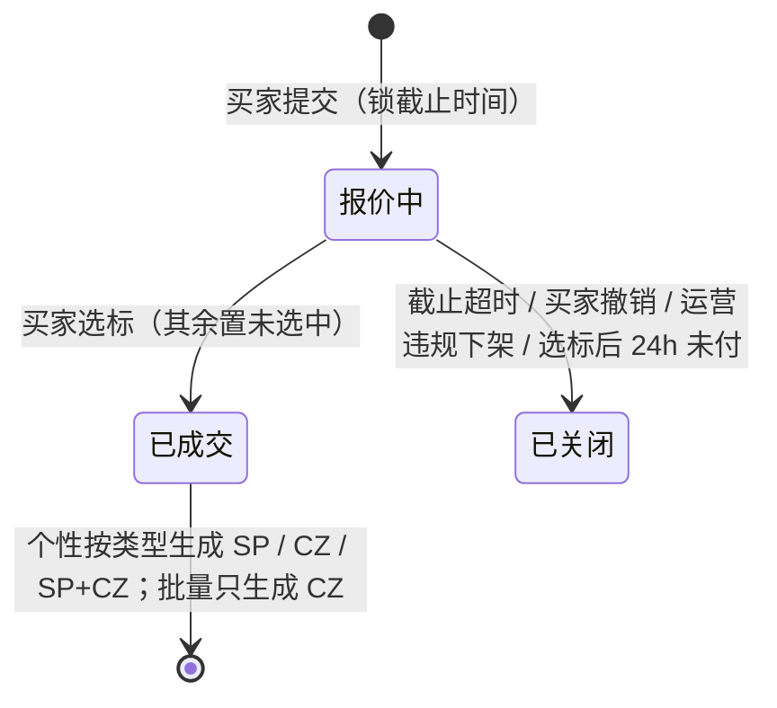

# 10b 商城运营 · 定制需求 / 订单三兄弟 / 推荐位 · 页面说明（首篇）

> 端：运营端 PC（`yunying-PC`）　｜　模块：10 商城运营（子域：定制需求 / 订单 / 推荐位）
> **本文件 = 模块通用说明（§0）+ 第 1 页**，同目录其余文件只写本页
> 页面版本：v1.1（2026-11-12）　｜　业务分册：`开发PRD/运营管理端分册PRD/10b-商城运营（定制订单与推荐位）.md` **v1.0**
> **2026-11-12 改名**：菜单与页面名「个性定制需求管理」→「**定制需求管理**」，页面文件 `mall-custom-demand.html` 不变；原因是订单侧「定制订单」本就含**个性小批量 / 企业大批量**两种，需求侧只列个性会让批量定制需求没有监管入口（变更明细见 §11 v1.1）
> 同目录：`02-拼单集采订单.md`、`03-样品打样订单.md`、`04-定制订单.md`、`05-推荐位管理.md`、`06-拼单团管理.md`
> 姐妹篇：`10a-采购询价管理`（询价链路，与本模块并行不重叠）

---

## 0. 模块通用说明（本模块其他页面不再重复）

### 0.1 这个模块解决什么问题

商城原来只做"标品买卖"，定制、拼单、推荐三件事全在线下：

- **定制**：买家想改花色只能加微信发图，报价在群里来回，**谁报了多少、打样费抵没抵，说不清**
- **拼单**：几十个小买家凑大单拿档位价，靠微信群接龙，**够不够档位全靠人盯**
- **推荐**：线下市场"实力商家"靠物业口头推荐，**谁在上面没规则**

本模块把三件事变成可追溯的系统资产：需求有编号、报价有版本、订单有溯源、推荐有位次。

**5 个菜单不是 5 个模块**，而是 2 条链条 + 1 个配置：

```
链条 A 定制：买家提需求 → 商户报价 → 买家选标
        A1 个性定制 CP（买家端 custom-design.html / 我的定制需求）
                 ├ 仅样品定制   → 打样单 SP → 结案
                 ├ 直接大货     → 定制单 CZ（个性小批量）
                 └ 先样品后大货 → 打样单 SP →（样衣确认）→ 定制单 CZ（抵扣打样费）
        A2 批量定制 CE（买家端 bulk-custom.html「批量定制」表单，企业定制）
                 └ 直接大货（不打样）→ 定制单 CZ（企业大批量）
链条 B 拼单集采：买家发起 → 参团（阶梯档位）→ 成团 → 每人生成 GB 订单 ／ 未成团 → 全额退款
配置 C 推荐位  ：线下商铺 → 绑定位次/生效期 → 买家端「线下市场 → 实力商家」橱窗
```

> **A1 / A2 同一个菜单管**：`定制需求管理` 一页装两类需求（类型 Tab 切换），与订单侧 `定制订单`（个性小批量 / 企业大批量）严格对应。

### 0.2 角色与权限矩阵

| 功能 | 商城运营专员 | 商城运营主管 | 财务 | 商户（端） | 买家（端） | 无权限表现 |
|---|---|---|---|---|---|---|
| 定制需求 列表 / 详情 | ✅ | ✅ | 只读 | 仅公开池 | 仅本人 | — |
| 定制需求 **违规下架** | ✅（原因必填） | ✅ | ❌ | ❌ | ❌ | 按钮隐藏 |
| 定制需求 **强制关闭** | ❌ | ✅ | ❌ | ❌ | ❌ | 按钮隐藏 |
| **查看全量报价** | ✅ | ✅ | ❌ | 仅自己 | 选标前仅见金额+商家 | — |
| **选标** | ❌ | ❌ | ❌ | ❌ | ✅ 本人需求（两类都是买家选标） | **运营端无此按钮** |
| 三兄弟订单 查看 | ✅ | ✅ | ✅ | 仅本人 | 仅本人 | — |
| 订单 异常标记 | ✅ | ✅ | ❌ | ❌ | ❌ | — |
| 订单 **取消** | ❌ | ✅ | ❌ | ❌ | 未付款可自行取消 | 按钮隐藏 |
| 推荐位 配置 / 排序 | ✅ | ✅ | ❌ | ❌ | ❌ | — |
| 推荐位 **上下架** | ❌ | ✅ | ❌ | ❌ | ❌ | 按钮隐藏 |
| 导出 | ✅（脱敏） | ✅ | ✅（财务口径） | ❌ | ❌ | 按钮隐藏 |

> **Q2 裁决**：运营端**不参与选标**。选标是买家自主行为（个性定制与批量定制都一样），运营只做违规处置与异常兜底。
> **Q7 裁决**：商户只见自己报价；运营见全量；买家选标前只见"金额 + 商家名"。

### 0.3 菜单与端间落点表

| # | 页面 | 运营端文件 | 买家端 | 商户端 | 数据方向 |
|---|---|---|---|---|---|
| P1 | **定制需求管理** | `mall-custom-demand.html` | `custom-design.html`（个性：AI 设计+打样）、`custom-demand.html`（我的定制需求：两类需求同列表）、`bulk-custom.html`（批量定制·企业定制） | `shanghu-custom.html`（需求池）、`shanghu-custom-detail.html`（报价） | 端 → 本端（需求/报价）；本端 → 端（下架/关闭） |
| P2 | 拼单集采订单 | `mall-order-group.html` | `group-buy.html`、`group-buy-join.html`、`group-records.html` | — | 本端 → 端（订单状态） |
| P3 | 样品打样订单 | `mall-order-sample.html` | `custom-design.html`（申请打样） | — | 双向：本端溯源 ↔ 端上订单 |
| P4 | 定制订单 | `mall-order-custom.html` | `custom-design.html`、`bulk-custom.html` | — | 双向 |
| P5 | 推荐位管理 | `mall-recommend.html` | `market-socks.html?view=offline`（**实力商家橱窗**） | — | 本端 → 买家端 |

> **端上现状**：实力商家橱窗当前是**静态写死 2 张卡**（店铺名重复），需改读推荐位 → 记入 `mai-APP/移动端原型修改待办.md`。
> **订单主数据在** `外采 igshop`；本模块三页是**延伸视图**（主状态跟随外采，只补溯源与专属字段）。

### 0.4 核心数据对象

| 对象 | 说明 | 关键字段 | 谁产生 | 谁消费 |
|---|---|---|---|---|
| **定制需求 Demand** | 一次定制诉求（两类同模型） | 需求号 `CP`/`CE` + 日期 + 序号 / **定制类型**（个性定制 / 批量定制） / 需求类型 / 数量+单位 / 期望单价（批量=面议） / 期望交期 / 报价截止 / 状态 / 设计方案快照（个性） / 企业采购信息 + 定制要求快照（批量） | 买家端 | P1、商户端 |
| **报价 Quote** | 商户对需求报价（两类同模型） | 商户 / 样品价（仅个性含样品的类型） / 大货价 / **交期（天）** / **是否含运费** / 改价次数 ≤2 / 结果 | 商户端 | P1、买家选标 |
| **拼单活动 GroupBuy** | 买家发起的集采 | 拼单号 / 档位（多档单价）/ 截止 / 已拼量 / 状态 | 买家端 | P2 |
| **订单（三兄弟共用模型）** | 一笔交易 | 订单号 / `orderType` / 溯源字段 / 金额 / 抵扣 / 主状态 | 选标或成团 | P2/P3/P4 |
| **推荐项 RecommendItem** | 商铺 ↔ 位次 | 商铺（引用 04）/ 位 ID / 位次 / 推荐语 / 生效期 / 状态 | 专员 | P5、买家端 |

**两类定制需求的字段差异（同表、分叉展示）**：

| | 个性定制 `CP` | 批量定制 `CE`（企业定制） |
|---|---|---|
| 来源表单 | `custom-design.html`（设计 → 提交需求） | `bulk-custom.html`（企业采购表单） |
| 需求类型 | 仅样品定制 / 直接大货 / 先样品后大货 | **只有直接大货**（批量定制不打样） |
| 期望单价 | 买家填「最高可接受单价」 | **无该字段 → 列表/详情显示「面议」**，由商户报价 |
| 期望交期 | 随需求类型带出（打样 / 大货） | 必填 7–60 天（买家用滑杆选） |
| 买家信息 | 买家昵称（脱敏） | **企业名称 / 联系人 / 联系电话 / 收货地址** |
| 规格信息 | 设计方案快照（风格 / 材质 / 筒高 / 工艺） | 定制要求快照（品类 / 材质 / 筒高 / 尺码范围 / 工艺要求 / 包装要求 / 备注） |
| 报价列 | 样品价 + 大货价 + 交期 + 运费 | **只有大货单价** + 交期 + 运费 |
| 成交后订单 | 打样单 SP（如含打样）/ 定制单 CZ（个性小批量） | 定制单 CZ（**企业大批量**，无 SP） |

**订单三兄弟的差异只在扩展块**：

| | GB 拼单集采 | SP 样品打样 | CZ 定制 |
|---|---|---|---|
| 溯源 | 拼单号 | 需求号 | 需求号 + **打样单号** |
| 扩展 | 参团人明细 / 档位 / 成团时间 | 设计方案 / 打样轮次 / 打样费 / 可抵扣额度 | 批量类型 / 交期承诺 / **打样费抵扣金额** |
| 兄弟关系 | — | 可下挂 1 张 CZ | 可上溯 1 张 SP |

> **Q3 补充裁决**：三兄弟详情**必须能互跳**——SP 有「查看定制单」，CZ 有「查看打样单」。

### 0.5 状态机

**① 定制需求（3 态，两类共用）**：`报价中 → 已成交 / 已关闭`



**② 订单主状态（跟随外采）**：`待付款 → 待发货 → 已发货 → 已完成`，任意履约前可 `已取消`
**③ SP 打样子状态**：`待制样 → 已寄样 → 样衣确认 / 要求改样(round+1)`
**④ 拼单活动**：`进行中 → 已成团 / 已失效`
**⑤ 推荐项**：`草稿 → 已发布 → 已下线 / 已过期`

**禁止路径**

| 场景 | 系统行为 | 提示文案 | 日志 |
|---|---|---|---|
| 批量定制需求进打样流程 | 拦截（无入口） | ML-08 | 否 |
| SP 未"样衣确认"就创建 CZ | 拦截 | ML-21 | 是 |
| 打样费额度重复抵扣 | 拦截 | ML-22 | 是 |
| 位次同时段重复 | 拦截（主管可强制替换） | ML-24 / ML-25 | 是 |
| 推荐已清退商铺 | 拦截 | ML-26 | 否 |
| 运营尝试选标 | 无入口 | — | — |
| 商户看他人报价 | 数据层过滤 | — | 否 |

### 0.6 名词与口径

| 名词 | 定义 | 备注 |
|---|---|---|
| 定制类型 | **个性定制**（`CP`）/ **批量定制**（`CE`，企业定制） | 买家端「我的定制需求」类型 chip 叫「个性定制 / 企业批量」，同一对象 |
| 需求号 | `CP`（个性）/ `CE`（批量）+ yyyyMMdd + 3 位 | 企业批量定制（端上旧前缀 `BC`）**归 CE**（F4） |
| 批量定制不打样 | 批量定制需求恒为「直接大货」，商户只报大货单价 + 交期 + 运费 | 买家端 `bulk-custom.html` 表单无打样选项（F5） |
| 期望单价 | 个性=买家填的最高可接受单价；批量=**面议**（无该字段） | 批量行不参与"期望单价"排序 |
| 报价改价 | 截止前可改 **≤2 次**，保留历史版本 | 商户端显示"已改价 N/2" |
| 交期 / 运费 | 报价必填交期（天）+ 是否含运费，两端同口径 | 商户端「提交报价」同字段 |
| **打样费抵扣** | **订单立减**，且必须在金额区**单独列示「打样费抵扣」**（F3） | 只在同一需求链路内有效；批量定制无打样费，恒不涉及 |
| 档位单价 | 拼单设多档（如 300/500/1000 双），跨档按该档单价结算 | 成团后逐人结算 |
| 未成团 | 到期未达**起拼档**（最小档）→ 活动失效 + **全额退款**（Q4） | 不做降档、不延期 |
| 位次唯一 | 同一推荐位同时段唯一 | 冲突拦截，主管可强制替换 |
| 位字典分表 | 推荐位位字典与 09 内容位**分表存放、互不引用**（Q6） | 两处不得配同一前端位 |
| AI 设计 | 端上/12 AI 平台能力，后台**只存设计稿快照**（Q8） | 后台无生成入口；批量定制无设计稿，只存表单快照 |

### 0.6.1 跨端字段差异（只列不一致的）

| 概念 | 运营端 | 端上现状 | 目标口径 |
|---|---|---|---|
| 批量定制需求 | `CE` 需求，定制类型列显示「批量定制」 | 买家端 `bulk-custom.html`（标题「批量定制」）提交后单号 `BC` + 文案"询价已提交"；「我的定制需求」类型 chip 显示「企业批量」 | 单号统一归 `CE`；文案改"定制需求已提交"；类型名统一为「批量定制（企业）」，chip 可简称「企业批量」 |
| 批量定制报价 | 大货单价 + 交期 + 运费（无样品价） | 商户端 `shanghu-custom-detail.html` 报价表单含大货价/样品价/交期/运费 | 批量需求隐藏样品价字段，只报大货价 + 交期 + 运费 |
| 批量定制「期望单价」 | 显示「面议」 | 端上表单无该字段 | 保持无字段；运营列表按「面议」展示，不做价格筛选 |
| 实力商家橱窗 | 推荐位下发（位次/推荐语/生效期） | **写死 2 张卡**（店铺名重复） | 按位次渲染；无位则整块隐藏 |
| 打样费抵扣 | `deductSampleFee` + `deductNote` | 端上仅写"满 500 双可抵扣" | 订单金额区显示「打样费抵扣 -¥N」 |
| 拼单未成团 | 已失效 + 退款 | 端上仅有"已成团" | 补"已失效（全额退款）"状态 |

### 0.7 本期不做

平台自营拼单（F1）｜拼单降档/延期（Q4）｜打样费跨需求抵扣｜AI 设计后台能力（Q8）｜推荐位付费推广｜订单售后独立流程（复用外采）｜运营端代企业下批量定制需求（批量需求只由买家端提交）

---

## 1. 定制需求管理 `mall-custom-demand.html`

### 1.1 页面说明

| 项 | 内容 |
|---|---|
| 页面目标 | 一页监督**两类定制需求**全流程：谁提了需求（个人 / 企业）、几家报价、成交了没、有没有违规；与订单侧「定制订单」（个性小批量 / 企业大批量）一一对应 |
| 使用角色 | 商城运营专员（处置）、商城运营主管（强制关闭） |
| 入口 | 菜单 → 商城运营 → **定制需求管理** |
| 前置 | 买家在端上提交需求：个性（`custom-design.html`）/ 批量（`bulk-custom.html`） |
| 后置 | 选标后：个性按类型生成 SP / CZ；批量只生成 CZ（企业大批量） |

### 1.2 本页端间关系

| 项 | 内容 |
|---|---|
| 本页数据来源 | 买家端 `custom-design.html`（个性）+ `bulk-custom.html`（批量·企业）+ 商户端报价（`shanghu-custom-detail.html`） |
| 本页操作的跨端影响 | 下架 → 商户端需求池消失 + 买家端「我的定制需求」该需求转「已关闭」 + 通知买家与报价商户 |
| 依赖的其他端页面 | `shanghu-custom.html`、`shanghu-custom-detail.html`、`custom-design.html`、`custom-demand.html`、`bulk-custom.html` |
| 不涉及的端 | — |
| 一致性要求 | 两类需求同表可查、可筛、可下架；商户端只见自己报价；运营见全量；同名口径（定制类型 / 需求类型 / 报价字段）两端一致 |

### 1.3 页面结构

| 区块 | 内容 |
|---|---|
| 顶部 | 标题「定制需求管理」+ 导出 |
| **统计卡（5）** | 报价中（副行：个性 N · 批量 N）/ 已成交 / 今日新增（副行：个性 N · 批量 N）/ 临期待成交 / 异常待处置　—　**全部由列表数据同源派生** |
| **定制类型 Tab** | 全部需求 / 个性定制 / 批量定制（企业），Tab 上带条数 |
| 筛选区 | 需求号·标题·企业名称 + 需求类型 + 状态 + ☑仅看零报价 + ☑仅看临期 |
| 列表 | **12 列**（含定制类型、期望交期） |
| 详情抽屉 | 需求信息 / **企业采购信息（仅批量）** / 设计方案快照（仅个性）· 定制要求快照（仅批量） / **报价明细（全量，列随类型变化）** / 操作日志 |
| 操作 | 详情 / 违规下架 / 强制关闭（主管）/ 查看关联订单 |

### 1.4 列表、筛选与排序

| 项目 | 规则 |
|---|---|
| 默认排序 | 截止时间升序（临期在前），两类混排 |
| 分页 | 不分页 |
| 类型 Tab | 全部 / 个性定制 / 批量定制；与筛选条件**且**组合；切换 Tab 不清空其他筛选 |
| 筛选组合 | 条件之间 **且** |
| 关键字 | 匹配 需求号 / 标题 / **企业名称**（批量行） |
| 零报价 | 勾选后只看报价数 = 0（两类都适用） |
| 临期 | 勾选后只看剩余 <24h |
| 空结果 | 「暂无匹配的定制需求」 |

### 1.5 字段规格

| 列 | 字段 | 说明 |
|---|---|---|
| 需求号 | `id` | `CP`/`CE` + 日期 + 序号 |
| 标题 | `title` | 副行：个性 = 买家（脱敏）；批量 = **企业名称 + 联系人** |
| **定制类型** | `kind` | 个性定制 / 批量定制（企业） |
| 需求类型 | `type` | 个性：仅样品定制 / 直接大货 / 先样品后大货；**批量：恒为「直接大货」** |
| 数量 | `qty` + `unit` | — |
| 期望单价 | `price` | 个性 = `¥N/单位`；**批量 = 「面议」**（灰字） |
| **期望交期** | `period` | 个性随需求类型带出（打样 7 天 / 大货 N 天）；批量 = 买家选的 7–60 天 |
| 报价数 | `quotes` | 0 标红 |
| 截止（剩余） | `left` | 临期红字；已成交/已关闭显示「已截止 / 已下架 / 已到期」 |
| 状态 | `state` | 报价中 / 已成交 / 已关闭 |
| 关联订单 | `order` | 可跳 CZ / SP |
| 操作 | — | 详情 / 违规下架 |

**详情抽屉（5 段，第 2、3 段按类型二选一）**

① **需求信息**（两类）：需求号 / 定制类型 / 需求类型（批量后附「批量定制不打样」小字）/ 数量 / 期望单价（批量=面议）/ 期望交期 / 截止 / 状态 / 关联订单

② **企业采购信息**（仅批量）：企业名称 / 联系人 / 联系电话 / 收货地址

③ **快照**：
- 个性 → **设计方案快照**（AI 生成，后台只存快照）：风格 / 材质 / 筒高 / 工艺 + 缩略图
- 批量 → **定制要求快照**（买家表单提交项）：定制品类 / 材质 / 筒高 / 尺码范围 / 工艺要求 / 包装要求 / 备注需求 + 提示条「批量定制不走打样」

④ **报价明细**（运营全量 / 商户仅见自己）：
- 个性：商户 / 样品价 / 大货价 / 交期 / 运费 / 改价次数 / 结果
- 批量：商户 / **大货单价** / 交期 / 运费 / 改价次数 / 结果（**无样品价列**）

⑤ **操作日志**

### 1.6 交互规则

| 元素 | 显示条件 | 可点条件 | 点击后 | 禁止表现 |
|---|---|---|---|---|
| 详情 | 始终 | 始终 | 抽屉（按类型渲染） | — |
| **定制类型 Tab** | 始终 | 始终 | 切换列表过滤 + Tab 高亮 | 清空其他筛选条件 → 不允许 |
| **违规下架** | 状态=报价中（两类） | 专员/主管 | 必填原因 → 已关闭 → 通知买家与报价商户；原因含「企业资质无法核验」 | 缺原因 → ML-02 |
| **强制关闭** | 状态=报价中（两类） | **主管** | 原因必填 → 已关闭 | 缺原因 → ML-04 |
| 查看关联订单 | 有 `order` | 始终 | 按单号前缀分流并定位：`CZ*` → 定制订单（`?focus=`）、`SP*` → 样品打样订单（`?focus=`）、其余 → 拼单集采订单（`?focus=`） | 批量需求出现 SP 关联 → 数据异常 |
| 导出 | 始终 | 专员/主管 | Excel（含定制类型、需求类型、报价数、成交结果；两类同表） | — |
| **反向入口（本页被跳入）** | 带 `?kw={需求号}`（或 `?focus=` / `?demand=`） | 始终 | 预填关键字并筛选；精确命中时自动打开该需求详情，顶部显示「来自订单：需求号 xxx」来源条（可一键清除筛选） | 未匹配 → 顶部提示"未匹配到该需求号，已按关键字筛选" |

### 1.7 业务规则与计算口径

| 编号 | 规则 | 触发 | 处理 | 影响端 |
|---|---|---|---|---|
| R-01 | 运营不选标 | 任何时候 | 无选标按钮（两类都由买家选标） | — |
| R-02 | 下架必填原因 | 下架 | 通知买家 + 全部报价商户 | 两端 |
| R-03 | 零报价到期自动关闭 | 定时 | 原因=超时无报价 | 买家 |
| R-04 | 选标后 24h 未付 | 定时 | 关联订单取消 + 需求关闭 | 两端 |
| R-05 | 改价 ≤2 次 | 商户改价 | 超限拒绝（商户端提示） | 商户端 |
| R-06 | 报价保留 90 天 | 关闭后 | 供仲裁查询 | — |
| R-07 | **批量定制不打样** | 批量需求 | 不出打样单、无样品价、无打样费抵扣；成交只生成 CZ（企业大批量） | 买卖两端 |
| R-08 | **批量需求单价面议** | 批量需求 | 期望单价无该字段，列表/详情显示「面议」；导出该列为空 | — |
| R-09 | **定制类型 ↔ 订单批量类型映射** | 生成订单 | 个性 → `个性小批量`；批量 → `企业大批量`（`mall-order-custom.html` 的 `batch` 列） | P4 |
| R-10 | 统计卡同源 | 渲染 | 5 张卡全部由列表数据现算，不写死 | — |

### 1.8 异常与边界

| 类型 | 场景 | 系统行为 | 提示文案 |
|---|---|---|---|
| 数据 | 零报价到期（两类） | 自动关闭 | 【已实现】零报价：到期将自动关闭（原因=超时无报价） |
| 数据 | 临期需求 | 红字 + 详情提示 | 【已实现】该需求距截止不足 24 小时，请尽快处置 |
| 数据 | 下架未填原因 | 拦截 | 【已实现】下架原因必填（将通知买家与报价商户） |
| 数据 | 批量需求进打样 | 无入口 | 【已实现】批量定制不走打样：商户直接报大货单价 + 交期 + 是否含运费 |
| 权限 | 专员点强制关闭 | 按钮可见但属主管动作 | — |

#### 1.8.1 本页提示语清单（来源：分册 §8.7，编号可回溯）

| 编号 | 场景 | 提示文案 | 形式 | 状态 |
|---|---|---|---|---|
| ML-01 | 导出 | 已导出定制需求台账（个性定制 + 批量定制，含定制类型、需求类型、报价数、成交结果） | Toast | ✅ |
| ML-02 | 下架未填原因 | 下架原因必填（将通知买家与报价商户） | 行内 | ✅ |
| ML-03 | 下架成功 | 已下架需求 {需求号}，已通知买家与 {n} 位报价商户 | Toast | ✅ |
| ML-04 | 关闭未填原因 | 关闭原因必填 | 行内 | ✅ |
| ML-05 | 关闭成功 | 已关闭需求 {需求号} | Toast | ✅ |
| ML-06 | 零报价筛选 | 已筛选「仅看零报价」，共 {n} 条 | Toast | ✅ |
| ML-07 | 临期提示 | 该需求距截止不足 24 小时，请尽快处置 | 行内提示 | ✅ |
| ML-08 | 批量需求说明（v1.1） | 批量定制不走打样：商户直接报大货单价 + 交期 + 是否含运费，选标后生成定制单（批量类型=企业大批量）；企业如需先看样，由买家改走个性定制「先样品后大货」。 | 详情提示条 | ✅ |
| ML-09 | 批量需求期望单价（v1.1） | 面议（由商户报价） | 列表/详情灰字 | ✅ |
| ML-10 | 类型 Tab 空结果（v1.1） | 暂无匹配的定制需求 | 列表空态 | ✅ |
| ML-32 | 无权限 | 无权限，请联系管理员 | Toast | ✅ |
| ML-33 | 并发冲突 | 该记录已被他人修改，请刷新后重试 | Toast | ✅ |

### 1.9 通知与消息

| 事件 | 接收人 | 渠道 | 抑制条件 |
|---|---|---|---|
| 需求下架 | 买家 + 全部报价商户 | 站内 | 一次 |
| 零报价到期 | 买家 | 站内 + 推送 | 一次 |
| 临期（<24h 且零报价） | 专员 | 站内 | 每需求一次 |
| 批量需求提交后 24h 仍零报价（v1.1） | 专员 | 站内 | 每需求一次 |

### 1.10 验收标准

| 编号 | 前置 | 操作 | 预期 | 级别 |
|---|---|---|---|---|
| AC-01 | 报价中需求 | 点违规下架不填原因 | 拦截提示必填 | P0 |
| AC-02 | 同上 | 填原因后下架 | 状态已关闭，商户端需求池不再出现 | P0 |
| AC-03 | 已成交需求 | 点关联订单 | 跳到对应 SP / CZ 并定位 | P0 |
| AC-04 | 专员账号 | 查看详情底部 | **无选标按钮**，只有下架/关闭 | P0 |
| AC-05 | 有 3 家报价 | 打开详情 | 报价明细列出 3 家（运营可见全量） | P0 |
| AC-06 | 零报价需求到期 | 系统扫描 | 自动关闭并留痕"超时无报价" | P1 |
| **AC-07** | 两类需求都有数据（v1.1） | 打开「定制需求管理」 | 同表出现 `CP` 与 `CE` 两种需求号；定制类型列分别为「个性定制 / 批量定制」；共 12 列（含期望交期） | P0 |
| **AC-08** | 默认全部（v1.1） | 点「批量定制（企业）」Tab | 只显示 `CE` 需求，Tab 条数与列表条数一致；切回「全部需求」恢复两类混排，其他筛选条件不被清空 | P0 |
| **AC-09** | 批量需求详情（v1.1） | 打开任一 `CE` 需求 | 出现「企业采购信息」（企业名称 / 联系人 / 电话 / 收货地址）与「定制要求快照」（品类 / 材质 / 筒高 / 尺码 / 工艺 / 包装 / 备注）；报价明细列为 **大货单价 / 交期 / 运费**，**无样品价列** | P0 |
| **AC-10** | 批量需求（v1.1） | 查看详情与关联订单 | 详情提示「批量定制不走打样」；关联订单只可能是 `CZ`；列表与详情均无打样相关入口 | P0 |
| **AC-11** | 批量需求（v1.1） | 关键字输入企业名称（如「诸暨农商银行」） | 命中对应 `CE` 需求（关键字覆盖企业名称） | P1 |
| **AC-12** | 批量需求期望单价（v1.1） | 查看列表 / 详情 / 导出 | 期望单价显示「面议（由商户报价）」，不出现 `¥0` 或空白的误导值 | P1 |
| **AC-13** | 统计卡（v1.1） | 对比卡片与列表数据 | 报价中 / 已成交 / 今日新增（个性·批量）/ 临期待成交 / 异常待处置 全部与列表现算一致，改 mock 数据后卡片同步变化 | P1 |
| **AC-14** | 零报价批量需求（v1.1） | 勾选「仅看零报价」 | 可筛出零报价的批量需求；到期按 R-03 自动关闭 | P1 |
| **AC-15** | 违规下架（v1.1） | 批量需求点违规下架并选「企业资质无法核验」 | 状态已关闭并留痕；买家端「我的定制需求」该需求转已关闭 | P1 |

## 11. 变更记录

| 版本 | 日期 | 内容 |
|---|---|---|
| v1.0 | 2026-10-26 | 首版：个性定制需求列表（CP）、全量报价、违规下架 / 强制关闭、关联订单分流 |
| **v1.1** | **2026-11-12** | **① 菜单与页面名「个性定制需求管理」→「定制需求管理」**（文件 `mall-custom-demand.html` 不变；`menu-data.js` 同步）；原因是订单侧「定制订单」已含**个性小批量 / 企业大批量**，需求侧只列个性会让批量定制（企业定制）需求没有监管入口。**② 两类需求同表**：批量定制 `CE`（买家端 `bulk-custom.html` 企业表单）进入本页，新增「定制类型 Tab（全部 / 个性定制 / 批量定制）」、列表增「定制类型」「期望交期」两列（12 列）。**③ 详情按类型分叉**：批量段为「企业采购信息 + 定制要求快照」，个性段仍为「设计方案快照」；报价明细按类型换列（批量无样品价，含交期与运费，与商户端报价表单同口径）。**④ 口径补齐**：批量定制不打样（R-07）、批量期望单价面议（R-08）、定制类型 ↔ 订单批量类型映射（R-09）。**⑤ 统计卡改为与列表同源派生**（删除写死的 18 / 42 / 7 / 3 / 2 与「个性 5 · 企业 2」），新增 AC-07 ~ AC-15、ML-08 ~ ML-10。 |
