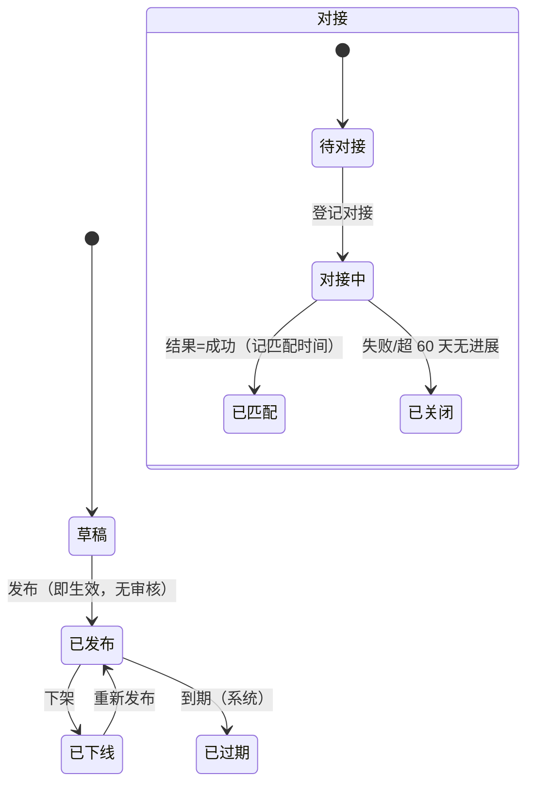

# 13 产业链服务 · 运营端页面说明（首篇）

> 端：运营端 PC（`yunying-PC`）　｜　模块：13 产业链服务（12 页 / 6 个子域）
> **本文件 = 模块通用说明（§0）+ 第 1 页**，同目录其余文件只写本页
> 页面版本：v1.0（2026-10-22）　｜　业务分册：`开发PRD/运营管理端分册PRD/13-产业链服务.md` **v1.3**
> 同目录：`02-技术需求发布管理.md`、`03-技术成果管理.md`、`04-政策发布.md`、`05-中介服务发布管理.md`、`06-金融-服务商管理.md`、`07~12-招聘-*.md`

---

## 0. 模块通用说明（本模块其他页面不再重复）

### 0.1 这个模块解决什么问题

企业要技术、要政策、要中介、要融资，全靠熟人介绍和跑窗口：**有需求的人找不到成果，有成果的人找不到需求**，补贴政策发下去没人知道怎么申报。
本模块把「知识产权 / 技术共享 / 政策兑现 / 中介服务 / 人才招聘 / 金融服务」六类服务搬到端上，并记录**撮合过程与结果**。

不做：企业仍要靠电话问、靠朋友圈转；政策申报靠线下跑；成果与需求永远对不上。

### 0.2 角色与权限矩阵

| 操作 | 产业服务专员 | 产业服务主管 | 运营主管 | 商户/买家（端上） | 无权限表现 |
|---|---|---|---|---|---|
| 查看列表 / 详情 | ✅ | ✅ | ✅ | 仅公开项 | 列表不返回 |
| 新建 / 编辑（草稿） | ✅ | ✅ | ❌ | 仅需求 / 申报（申请类） | 按钮隐藏 |
| **发布 / 下架**（发布即生效） | ✅ | ✅ | ❌ | ❌ | 按钮隐藏 |
| 置顶 / 排序 | ✅ | ✅ | ❌ | ❌ | — |
| 对接记录 / 结果登记 | ✅ | ✅ | ❌ | 可反馈 | — |
| 申报受理 / 退回补正 | ✅ | ✅ | ❌ | ❌ | — |
| **兑现登记** | ❌ | ✅ | ❌ | ❌ | 按钮隐藏 |
| 评价（代录） | ✅ | ✅ | ❌ | ✅（本企业） | — |
| 导出 | ✅ | ✅ | ✅ | ❌ | 按钮隐藏 |
| 删除 | **仅草稿** | 仅草稿 | ❌ | ❌ | 按钮隐藏 |

> **端上补充（v1.5）**：买家端**政策申报限「已绑定商户主体」**，未绑定只读并提示「需企业资质」；商户端登录账号即商户主体，未认证企业同样提示并引导 `shanghu-verify.html`。

### 0.3 菜单与端间落点表（12 页 / 6 子域）

| # | 页面 | 运营端文件 | 买家端 | 商户端 | 数据方向 |
|---|---|---|---|---|---|
| P1 | 知识产权配置管理 | `chain-ip.html` | `ip-service.html`（三 Tab 跳转目标） | `industry-service.html`（知产类） | 本端 → 两端 |
| P2 | 技术需求发布管理 | `chain-tech-demand.html` | `tech-service.html`（技术需求 Tab） | ❌ **缺提交入口** | 本端 → 两端；端上「联系对接」回流 |
| P3 | 技术成果管理（含专家 Tab） | `chain-tech-achv.html` | `tech-service.html`（成果 + 技术专家） | — | 本端 → 买家端 |
| P4 | 政策发布（含申报受理 Tab） | `chain-policy.html` | `policy-service.html`（详情 + 在线申报） | `industry-service.html`（政策申报） | 本端 → 两端；申报单回流 |
| P5 | 中介服务发布管理 | `chain-agency.html` | `agency-service.html` | `industry-service.html`（检测认证） | 本端 → 两端 |
| P6 | 金融服务 · 服务商管理 | `chain-finance.html` | 端上金融服务页 | — | 本端 → 买家端 |
| P7 | 招聘-企业管理 | `chain-recruit-company.html` | `industry-services.html` 聚合页 | — | 见 `13a-人才招聘.md` |
| P8 | 招聘-岗位管理 | `chain-recruit-job.html` | 端上岗位列表 | — | 同上 |
| P9 | 招聘-简历管理 | `chain-recruit-resume.html` | — | — | 同上 |
| P10 | 招聘-投递管理 | `chain-recruit-delivery.html` | 端上投递 | — | 同上 |
| P11 | 招聘-招聘审核 | `chain-recruit-audit.html` | — | — | 同上 |
| P12 | 招聘-招聘指南 | `chain-recruit-guide.html` | 端上招聘指南 | — | 同上 |

> **聚合入口**：买家端 `industry-services.html` 有七类服务卡片，本模块负责其中 **4 类**（金融/人才已单独立册）；卡片回填建议本期先写死，后续做「服务入口配置」。

**运营端内边界**：04 商户（主体/资质只读引用）｜09 消息推送（申报截止 / 受理结果 / 退回补正）｜12/17 AI 能力（政策图文解读）｜15 报表（撮合指标）。

### 0.4 核心数据对象

| 对象 | 说明 | 关键字段 | 谁产生 | 谁消费 |
|---|---|---|---|---|
| **发布型对象** | 政策 / 成果 / 需求 / 服务商 / 知产配置 / 服务项目 | 编号 / 标题 / 分类 / 投放端 / 生效期 / 状态 | 专员 | 端上 + 驾驶舱 |
| **对接记录 Match** | 需求或成果的一次撮合 | 单号 / 双方 / 方式 / 进展 / 结果 / 匹配时间 | 端上发起 + 运营代录 | 驾驶舱指标 |
| **申报单 Apply** | 政策兑现申报 | 单号 / 商户 / 政策 / 材料 / 状态 / 兑现额 | 商户提交 | P4 Tab2 |
| **专家 Expert** | 技术专家库 | 姓名 / 单位 / 职称 / 方向 / 参与对接 | 专员 | P3 专家 Tab |

### 0.5 状态机

**S1 发布型（政策/成果/需求/服务商/知产/服务项目）**

| 状态 | 含义 | 本期 |
|---|---|---|
| 草稿 | 等补全后发布 | ✅ |
| 已发布 | 端上可见 | ✅ |
| 已过期 | 有效期/申报期已过，端上置"已截止" | ✅ |
| 已下线 | 主动撤下，可改后重发 | ✅ |
| 待审核 / 已驳回 | 预留给审核流 | ⏸ **本期不做**（发布即生效） |

**S2 对接状态（覆盖在 S1 上）**：待对接 → 对接中 → 已匹配 / 已关闭
**S3 申报单**：已提交 → 受理中 → 已兑现 / 未通过；已提交 → 退回补正 → 重新提交

**禁止路径**

| 场景 | 系统行为 | 提示文案 | 日志 |
|---|---|---|---|
| 删除已发布对象 | 拦截 | I-08 / D-05 / A-06 / P-12 | 是 |
| 政策未完成 AI 解读就发布 | 拦截 | P-10 | 是 |
| 知产配置无跳转目标就发布 | 拦截 | I-03 | 是 |
| 已受理申报退回"已提交" | 不允许（只能未通过/退回补正） | — | — |
| 同一需求多路对接 | 允许，**以最先"成功"为准** | — | — |

### 0.6 名词与口径

| 名词 | 定义 | 备注 |
|---|---|---|
| **发布即生效** | 本期无审核流，发布后端上立即可见 | 待审核状态为预留 |
| 需求超期 | 15 天红标 / 30 天提醒 / **60 天自动关闭** | 自动关闭留痕"超期未跟进" |
| 申报受理时限 | **3 个工作日**，超时红标 | 不自动处置 |
| 申报截止提醒 | T-7 / T-3 / 当天 | 联动 09 消息推送 |
| 平均匹配时长 | Σ(匹配成功时间 − 发布时间) ÷ 成功单数 | 以**对接单**为准，非需求条数 |
| 对接成功率 | 成功单数 ÷ 已出结果单数 | 未出结果不计分母 |
| AI 图文解读 | AI 生成稿 + **人工复核终稿**，两稿都留档 | 招标 #124 硬要求 |
| 点击统计 | 按配置 ID + 端 + 时间上报 | 不含企业身份 |

### 0.6.1 跨端字段差异（只列不一致的）

| 概念 | 运营端 | 端上现状 | 目标口径 |
|---|---|---|---|
| 服务分类字典 | `category`（与端上 Tab 一致） | 端上 Tab 写死 | 新增分类须同步端上 |
| 投放端 | `mo`（买家端/商户端/双端） | 端上未过滤 | **`mo='sh'` 的政策不得出现在买家端** |
| 申报资格 | 由材料校验 | 端上无「需企业资质」提示 | 未绑定商户 → 只读 + 提示 |
| 联系方式 | 完整 | 对接前隐藏、对接后揭示 | 揭示需留痕 |

### 0.7 本期不做

发布审核流（预留）｜金融申请单 / 审批 / 放款（ND-01~05）｜政策资讯引用｜端上「已登记记录」改造（待确认）｜服务预约（与产业服务申请语义不同）

---

## 1. 知识产权配置管理 `chain-ip.html`

### 1.1 页面说明

| 项 | 内容 |
|---|---|
| 页面目标 | 维护端上「知识产权」页三个 Tab（专利查询 / 商标注册 / 版权登记）的展示内容与**跳转目标** |
| 使用角色 | 产业服务专员、产业服务主管 |
| 入口 | 菜单 → 产业链服务 → 知识产权 → 配置管理 |
| 前置 | 服务类型字典与端上 Tab 一致 |
| 后置 | 生效后按投放端在端上展示；点击上报 |

### 1.2 本页端间关系

| 项 | 内容 |
|---|---|
| 本页数据来源 | 专员手工配置 |
| 本页操作的跨端影响 | 发布 → 买家端 `ip-service.html` 对应 Tab 出现卡片，点击按跳转方式走 |
| 依赖的其他端页面 | `mai-APP/ip-service.html`、`shanghu-APP/industry-service.html` |
| 不涉及的端 | — |
| 一致性要求 | 服务类型新增需同步端上 Tab；无跳转目标不允许发布 |

### 1.3 页面结构

| 区块 | 内容 |
|---|---|
| 顶部 | 标题「知识产权配置管理」+ 导出 + 新建配置 |
| **统计卡** | 已发布配置 / 草稿·下线 / 近 30 天端上点击 / 双端生效配置 |
| 筛选区 | 服务类型 + 关键词 + 状态 + 投放端 + 查询 + 重置 |
| 列表 | **9 列** |
| 抽屉 | 展示文案（标题/副标题/图标）+ 服务类型 + 服务商 + 跳转方式 + 链接/电话 + 投放端 + 排序 + 生效期 + 状态 |

### 1.4 列表、筛选与排序

| 项目 | 规则 |
|---|---|
| 默认排序 | 排序号升序 |
| 分页 | 不分页 |
| 筛选组合 | 条件之间 **且** |
| 投放端 | 买家端 / 商户端 / 双端 |
| 空结果 | 「暂无配置」 |
| 导出 | 含类型、跳转目标、投放端、点击量 |

### 1.5 字段规格

| 列 | 字段 | 说明 |
|---|---|---|
| 配置名称 / 展示标题 | `name` / `title` | 端上卡片标题 |
| 服务类型 | `svcType` | 专利查询 / 商标注册 / 版权登记 / 其他（**与端上 Tab 一致**） |
| 服务机构 / 平台 | `provider` | — |
| 跳转方式 | `jumpType` | 外链 H5 / 小程序 / 电话 / 线下窗口 |
| 投放端 | `mo` | 买家端 / 商户端 / 双端 |
| 排序 / 生效期 | `sort` / `startAt`~`endAt` | — |
| 近 30 天点击 | 派生 | 端上报（配置 ID + 端 + 时间） |
| 状态 | `state` | 草稿 / 已发布 / 已下线 / 已过期 |
| 操作 | — | 编辑 / 提交 / 上下架 / 排序 / 预览 / 删除 |

### 1.6 交互规则

| 元素 | 显示条件 | 可点条件 | 点击后 | 禁止表现 |
|---|---|---|---|---|
| 新建配置 | 始终 | 专员/主管 | 抽屉 | 缺必填 → I-10~I-14 |
| 测试跳转 | 抽屉内 | 有跳转目标 | 外链打开 / 电话拨号 | 无链接 → I-06 |
| 发布 | 草稿/已下线 | 专员/主管 | 端上立即可见 | 无跳转目标 → I-03 |
| 下架 | 已发布 | 专员/主管 | 端上撤下，**保留点击统计** | — |
| 删除 | **仅草稿** | 专员 | 物理删除 | 非草稿 → I-08 |
| 预览 | 始终 | 始终 | 按投放端展示卡片 | — |

### 1.7 业务规则与计算口径

| 编号 | 规则 | 触发 | 处理 | 影响端 |
|---|---|---|---|---|
| R-01 | 发布即生效 | 发布 | 无审核流 | 两端 |
| R-02 | 必须有跳转目标 | 发布 | 链接或电话至少一个 | 端上可点 |
| R-03 | 链接必须 https | 保存 | 小程序可用 `/pages/...` 路径 | — |
| R-04 | 服务类型与端上 Tab 一致 | 新增类型 | 需同步端上改造 | 端上 |
| R-05 | 下架保留点击统计 | 下架 | 不删数据 | — |
| R-06 | 编辑生成新版本 | 编辑 | 已发布配置留版本 | — |

### 1.8 异常与边界

| 类型 | 场景 | 系统行为 | 提示文案 |
|---|---|---|---|
| 数据 | 无跳转目标 | 拦截发布 | 【已实现】发布前请至少配置「跳转链接」或「联系电话」（否则端上点了没反应） |
| 数据 | 链接非 https | 拦截 | 【已实现】链接需为 https:// 开头（小程序可填 /pages/... 路径） |
| 数据 | 电话方式未填号码 | 拦截 | 【已实现】跳转方式为「电话」时必须填写联系电话 |
| 数据 | 删除非草稿 | 拦截 | 【已实现】仅「草稿」可删除；已发布配置请用「下架」（保留点击统计） |
| 数据 | 无链接点测试 | 阻断 | 【已实现】未配置跳转链接：端上点击将无响应，请先补链 |

#### 1.8.1 本页提示语清单（来源：分册 §8.3，编号可回溯）

| 编号 | 场景 | 提示文案 | 形式 | 状态 |
|---|---|---|---|---|
| I-01 | 导出配置 | 已导出知产配置（含类型、跳转目标、投放端、点击量） | Toast | ✅ |
| I-02 | 下架 | 已下架「{配置名}」 | Toast | ✅ |
| I-03 | 发布无跳转目标 | 发布前请至少配置「跳转链接」或「联系电话」（否则端上点了没反应） | 行内 | ✅ |
| I-04 | 发布成功 | 已发布「{配置名}」 | Toast | ✅ |
| I-05 | 测试电话跳转 | 测试跳转（电话）：将拨打 {号码} | Toast | ✅ |
| I-06 | 无链接测试 | 未配置跳转链接：端上点击将无响应，请先补链 | Toast | ✅ |
| I-07 | 测试 H5 跳转 | 测试跳转：{链接} | Toast | ✅ |
| I-08 | 删除非草稿 | 仅「草稿」可删除；已发布配置请用「下架」（保留点击统计） | Toast | ✅ |
| I-09 | 删除草稿 | 已删除草稿配置 | Toast | ✅ |
| I-10 | 配置名未填 | 请填写配置名称 | 行内 | ✅ |
| I-11 | 卡片标题未填 | 请填写端上卡片标题 | 行内 | ✅ |
| I-12 | 机构未填 | 请填写服务机构 / 平台 | 行内 | ✅ |
| I-13 | 电话方式未填号码 | 跳转方式为「电话」时必须填写联系电话 | 行内 | ✅ |
| I-14 | 链接非 https | 链接需为 https:// 开头（小程序可填 /pages/... 路径） | 行内 | ✅ |
| I-15 | 保存成功 | 已保存「{配置名}」 | Toast | ✅ |

### 1.9 通知与消息

本页不发通知（配置类，无对外触达）。

### 1.10 验收标准

| 编号 | 前置 | 操作 | 预期 | 级别 |
|---|---|---|---|---|
| AC-01 | 新配置未填链接 | 点发布 | 拦截并提示需配链接或电话 | P0 |
| AC-02 | 跳转方式=电话但未填号码 | 保存 | 拦截提示必填 | P0 |
| AC-03 | 已发布配置 | 点下架 | 端上撤下，点击统计保留 | P0 |
| AC-04 | 已发布配置 | 点删除 | 拦截提示用下架 | P1 |
| AC-05 | 配置投放端=仅商户端 | 打开买家端 IP 页 | 不展示该配置 | P1 |
