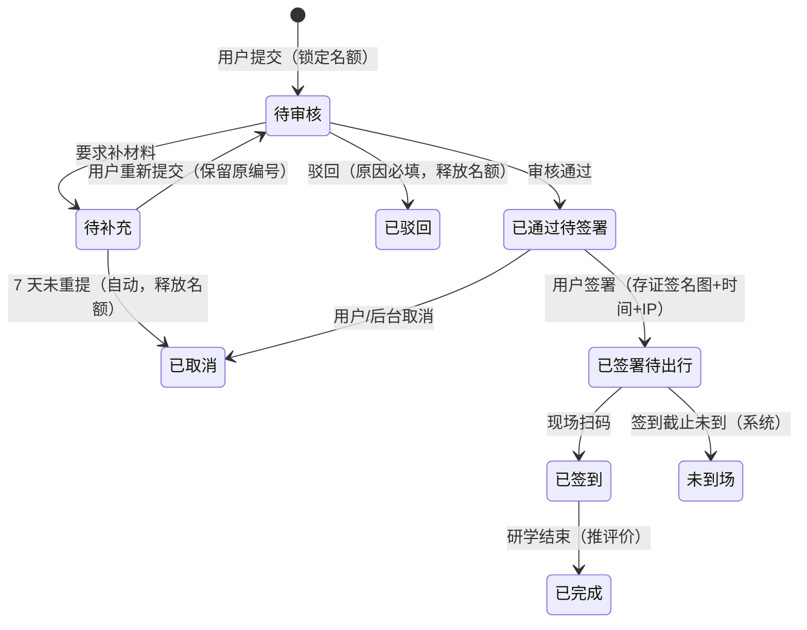

# 14a 研学管理 · 运营端页面说明（首篇）

> 端：运营端 PC（`yunying-PC`）　｜　模块：14a 研学管理（菜单「文商旅管理 → 研学」）
> **本文件 = 模块通用说明（§0）+ 第 1 页**，同目录其余文件只写本页
> 页面版本：v1.0（2026-10-22）　｜　业务分册：`开发PRD/运营管理端分册PRD/14a-研学管理.md` **v1.2**
> 同目录：`02-团体研学管理.md`、`03-研学基地管理.md`、`04-研学线路活动管理.md`、`05-责任书模板管理.md`、`06-研学往期风采.md`

---

## 0. 模块通用说明（本模块其他页面不再重复）

### 0.1 这个模块解决什么问题

研学活动靠电话报名、纸质责任书、到场点名：**名额超卖、责任书找不到、谁来了没人知道**。
本模块把「线路发布 → 报名审核 → 责任书签署 → 现场签到 → 评价」串成一条线，名额与签到以系统为准。

不做：报名靠微信群接龙；安全责任书签完锁抽屉，出事找不到；到场人数靠人工点。

### 0.2 角色与权限矩阵

| 功能 | 文商旅运营专员 | 文商旅运营主管 | 市场管理员 | 无权限表现 |
|---|---|---|---|---|
| 基地 / 路线 / 场次 查看 | ✅ | ✅ | ✅ | 菜单不可见 |
| 基地 / 路线 / 场次 新增编辑 | ✅ | ✅ | ❌ | 按钮隐藏 |
| **路线上下架** | ❌ | ✅ | ❌ | 按钮隐藏 |
| 报名 / 申请 审核（普通） | ✅ | ✅ | ❌ | — |
| **团体申请终审（≥50 人）** | ❌ | ✅ | ❌ | 按钮隐藏 |
| 批量审核 | ✅ | ✅ | ❌ | — |
| 名单导出 | ✅ | ✅ | ✅ | — |
| **责任书模板维护** | ❌ | ✅ | ❌ | 菜单隐藏 |
| 签署记录查看 / 催收 | ✅ | ✅ | ✅ | — |
| 手工补签 / 标记未到场 | ✅ | ✅ | ❌ | 按钮隐藏 |
| **评价审核** | ❌ | ✅ | ❌ | 按钮隐藏 |
| **强制取消** | ❌ | ✅ | ❌ | 按钮隐藏 |

> **数据权限**：全市场范围（不按楼栋隔离）；专员仅处理自己名下未完成的审核流转，主管可见全部。

### 0.3 菜单与端间落点表

| # | 页面 | 运营端文件 | 买家端 | 商户端 | 数据方向 |
|---|---|---|---|---|---|
| P1 | 报名审批 | `study-approve.html` | 买家端研学服务页（提交报名 / 团体申请） | — | 买家端 → 本端（审核） |
| P2 | 团体研学管理 | `study-group.html` | 买家端「我的研学」进度 | — | 本端 → 买家端 |
| P3 | 研学基地管理 | `study-base.html` | 买家端基地展示 | — | 本端 → 买家端 |
| P4 | 研学线路活动管理 | `study-route.html` | 买家端线路详情 / 场次 / 报名 | — | 本端 → 买家端 |
| P5 | 责任书模板管理 | `study-letter.html` | 买家端签署页（手写签名） | — | 本端 → 买家端 |
| P6 | 研学往期风采 | `study-promo.html` | 买家端「往期风采」展示 | — | 本端 → 买家端 |

> **端上待办**：买家端报名、签署、签到码、评价四处需按本模块口径改造（见分册 §8.1/§8.2）。
> 其中「状态映射 / 责任书签署 / 签到码」三项已记入 **`mai-APP/移动端原型修改待办.md` #24**。

### 0.4 核心数据对象

| 对象 | 说明 | 关键字段 | 谁产生 | 谁消费 |
|---|---|---|---|---|
| **报名单 Apply** | 一个人 / 一个团体的报名 | 编号 `YX+yyyyMMdd+3位` / 学生 / 路线 / 场次 / 状态 | 买家端 | P1、P2 |
| **基地 Base** | 研学基地 | 名称 / 分类 / 位置 / 评分 / 关联路线 | 专员 | P4 |
| **线路 Route** | 一条研学线路 | 名称 / 分类 / 时长 / 人数区间 / 关联基地 | 专员 | 端上 |
| **场次 Session** | 线路的一个日期 | 编号 / 日期 / 名额 / 已报名 / 余席 | 专员 | 报名 |
| **责任书模板 Letter** | 安全责任书 | 版本 / 条款 / 适用类型 / 启用状态 | 主管 | 签署页 |

### 0.5 状态机（报名单 9 态）

| 状态 | 含义（等谁做什么） | 端上展示 |
|---|---|---|
| 待审核 | 等运营审核（**承诺 1–3 工作日**） | 请等待审核 |
| 待补充 | 通知补材料，等用户重提 | — |
| 已通过（待签署） | 等家长/负责人**签署安全责任书** | 进度条第 2 节点 |
| 已驳回 | 流程终止（可重新申请） | — |
| 已签署（待出行） | 等出行日到场 | 已签署 / 待出行 |
| 已签到 | 现场扫码签到，研学进行中 | 进度条第 4 节点 |
| 已完成 | 研学结束，已产生评价 | — |
| 未到场 | 签到截止未到，计入爽约 | — |
| 已取消 | 用户或后台取消，**名额释放** | — |

**禁止路径**

| 场景 | 系统行为 | 提示文案 | 日志 |
|---|---|---|---|
| 同手机号 + 同场次重复报名 | 拦截（幂等） | — | 是 |
| 已通过直接回退到待审核 | 不允许，只能**强制取消** | — | 是 |
| 出行前 24h 内用户自助取消 | 不允许，需后台操作 | — | 是 |
| 驳回不填原因 | 拦截 | S-03（**⬜ 未实现**） | — |
| 关联了路线的基地被删除 | 拦截 | S-07 | 是 |

### 0.6 名词与口径

| 名词 | 定义 | 备注 |
|---|---|---|
| 报名编号 | `YX` + yyyyMMdd + 3 位序号 | 补件重提**保留原编号** |
| 审核时效 | 提交后 **24h 未审** → 告警升级主管 | 不自动处置 |
| 补件超时 | 待补充 **7 天未重提** → 自动取消并释放名额 | — |
| 签署提醒 | 出行前 **3 天 / 1 天**各推一次；前 1 天未签 → 电话跟进 | — |
| 签到窗口 | 出行日 **00:00 – 活动开始后 1 小时** | 超时标未到场 |
| 取消规则 | 出行前 **24h** 可自助；24h 内需后台 | — |
| 爽约 | 已签署但签到截止未到 | 计入爽约统计 |
| 团体终审线 | **≥50 人**须主管终审 | 专员不可终审 |
| 名额锁定 | 提交即锁，驳回/取消释放 | 候补在场次页 |

### 0.6.1 跨端字段差异（只列不一致的）

| 概念 | 运营端 | 端上现状 | 目标口径 |
|---|---|---|---|
| 报名状态 | 9 态枚举 | 端上进度条为静态 | 端读本模块状态映射到进度节点 |
| 签到方式 | 扫码 / 手工补签 | 端上无签到码 | 签署后生成签到码 |
| 责任书 | 模板版本化（v2.x） | 端上无签署 | 手写签名 + 存证 |
| 名额余量 | 场次 `余席` | 端上未显示 | 端上显示余席 / 满员置灰 |

### 0.7 本期不做

在线支付｜候补自动递补｜研学保险｜多语言｜评价自动审核（需主管人工审）｜团体合同签署

---

## 1. 报名审批 `study-approve.html`

### 1.1 页面说明

| 项 | 内容 |
|---|---|
| 页面目标 | 集中处理买家端提交的**个人报名**与**团体申请**，支持批量审核与名单导出 |
| 使用角色 | 文商旅运营专员（普通审核）、运营主管（≥50 人团体终审） |
| 入口 | 菜单 → 文商旅管理 → 研学 → 团体申请审批 |
| 前置 | 买家端已提交报名 |
| 后置 | 通过 → 生成待签署任务；驳回 → 释放名额并通知 |

### 1.2 本页端间关系

| 项 | 内容 |
|---|---|
| 本页数据来源 | 买家端个人报名 / 学校团体申请 |
| 本页操作的跨端影响 | 通过 → 端上进「已通过（待签署）」并可签责任书；驳回 → 端上显示驳回 |
| 依赖的其他端页面 | 买家端研学报名页、责任书签署页 |
| 不涉及的端 | 商户端 |
| 一致性要求 | 同手机号 + 同场次幂等；驳回释放名额 |

### 1.3 页面结构

| 区块 | 内容 |
|---|---|
| 顶部 | 标题「报名审批」+ 导出名单 + 批量通过 |
| **统计卡（4）** | 待审核 / 今日已审 / 待补充材料 / 本月累计报名 |
| 筛选区 | 关键词 / 路线 / 日期 / 状态 + 查询 + 重置 |
| **Tab 条（2）** | 个人报名 / 团体申请 |
| Tab 个人报名 | 个人表（**11 列**） |
| Tab 团体申请 | 团体表（**10 列**） |

### 1.4 列表、筛选与排序

| 项目 | 规则 |
|---|---|
| 默认排序 | 提交时间正序（先到先审） |
| 分页 | 页码 |
| 筛选组合 | 条件之间 **且** |
| 状态 | 待审核 / 待补充 / 已通过 / 已驳回 / 已签署 / 已签到 / 已完成 / 未到场 / 已取消 |
| 空结果 | 「暂无待审批报名」 |

### 1.5 字段规格

**个人报名（11 列）**：申请编号 · 学生 · 年龄/性别 · 学校/年级 · 家长/关系 · 联系电话 · 研学路线 · 研学日期 · 状态 · 提交时间 · 操作

**团体申请（10 列）**：申请编号 · 学校名称 · 联系人 · 联系电话 · 研学路线 · 研学日期 · 参加人数 · 状态 · 提交时间 · 操作

| 关键规则 | 说明 |
|---|---|
| 编号 | `YX+yyyyMMdd+3位序号`，补件重提**不变** |
| 团体 ≥50 人 | 需主管终审 |
| 联系电话 | 脱敏展示，查看完整需留痕 |

### 1.6 交互规则

| 元素 | 显示条件 | 可点条件 | 点击后 | 禁止表现 |
|---|---|---|---|---|
| 通过 | 待审核 | 专员（普通）/主管（≥50 人） | 已通过（待签署）+ 短信通知签署 | ≥50 人由专员操作 → 隐藏 |
| 驳回 | 待审核 | 专员 | 必填原因 → 已驳回 + 释放名额 | 缺原因 → S-03（⬜） |
| 要求补材料 | 待审核 | 专员 | 待补充 + 通知补件 | — |
| 批量通过 | 有勾选 | 专员 | 逐条校验后通过 | 含 ≥50 人团体 → 跳过并提示 |
| 导出名单 | 始终 | 专员/主管/市场管理员 | 脱敏 Excel | — |

### 1.7 业务规则与计算口径

| 编号 | 规则 | 触发 | 处理 | 影响端 |
|---|---|---|---|---|
| R-01 | 提交即锁名额 | 报名 | 名额 −N | 端上余席 |
| R-02 | 驳回 / 取消释放名额 | 驳回/取消 | 名额 +N | 端上余席 |
| R-03 | 幂等 | 提交 | 同手机号 + 同场次只一条有效 | — |
| R-04 | 24h 未审告警升级 | 定时 | 提醒专员 → 主管 | — |
| R-05 | 补件 7 天自动取消 | 定时 | 释放名额 | 端上 |
| R-06 | ≥50 人团体需主管终审 | 审核 | 专员无终审权 | — |
| R-07 | 批量通过跳过超权项 | 批量 | 提示跳过数量 | — |

### 1.8 异常与边界

| 类型 | 场景 | 系统行为 | 提示文案 |
|---|---|---|---|
| 数据 | 批量通过 0 条 | 提示先勾选 | 【待实现】 |
| 数据 | 驳回未填原因 | 拦截 + 输入框标红聚焦 | 【已实现】「驳回原因必填」 |
| 数据 | 重复报名 | 拦截 | — |
| 数据 | 团体人数 ≥50 且当前为专员 | 终审按钮隐藏 | — |

#### 1.8.1 本页提示语清单（来源：分册 §7.6，编号可回溯）

| 编号 | 场景 | 提示文案 | 形式 | 状态 |
|---|---|---|---|---|
| S-01 | 导出名单 | 导出名单 | Toast | ✅ |
| S-02 | 批量通过 | 已批量通过 {n} 条申请 | Toast | ✅ |
| S-03 | 驳回未填原因 | 驳回原因必填 | Toast + 输入框标红 | ✅ |
| S-25 | 无权限 | 无权限，请联系管理员 | Toast | ✅ |
| S-26 | 并发冲突 | 该记录已被他人修改，请刷新后重试 | Toast | ✅ |

### 1.9 通知与消息

| 事件 | 接收人 | 渠道 | 抑制条件 |
|---|---|---|---|
| 报名提交 | 运营专员 | 站内 + 短信 | 同批次合并 |
| 审核通过 | 家长 / 学校联系人 | 短信（含签署链接） | 一次 |
| 驳回 / 需补件 | 同上 | 短信（含原因） | 一次 |
| 24h 未审 | 专员 → 主管 | 站内 | 一次 |

### 1.10 验收标准

| 编号 | 前置 | 操作 | 预期 | 级别 |
|---|---|---|---|---|
| AC-01 | 待审核个人报名 | 点通过 | 状态已通过（待签署），家长收到签署短信 | P0 |
| AC-02 | 待审核 | 点驳回不填原因 | 【待实现】应拦截 | P0 |
| AC-03 | 60 人团体申请 + 专员账号 | 查看操作 | **无终审按钮** | P0 |
| AC-04 | 同手机号同场次二次报名 | 提交 | 拦截（幂等） | P0 |
| AC-05 | 驳回一条报名 | 查看场次余席 | 名额 +1 | P1 |
| AC-06 | 待补充 7 天未重提 | 系统扫描 | 自动取消并释放名额 | P1 |
