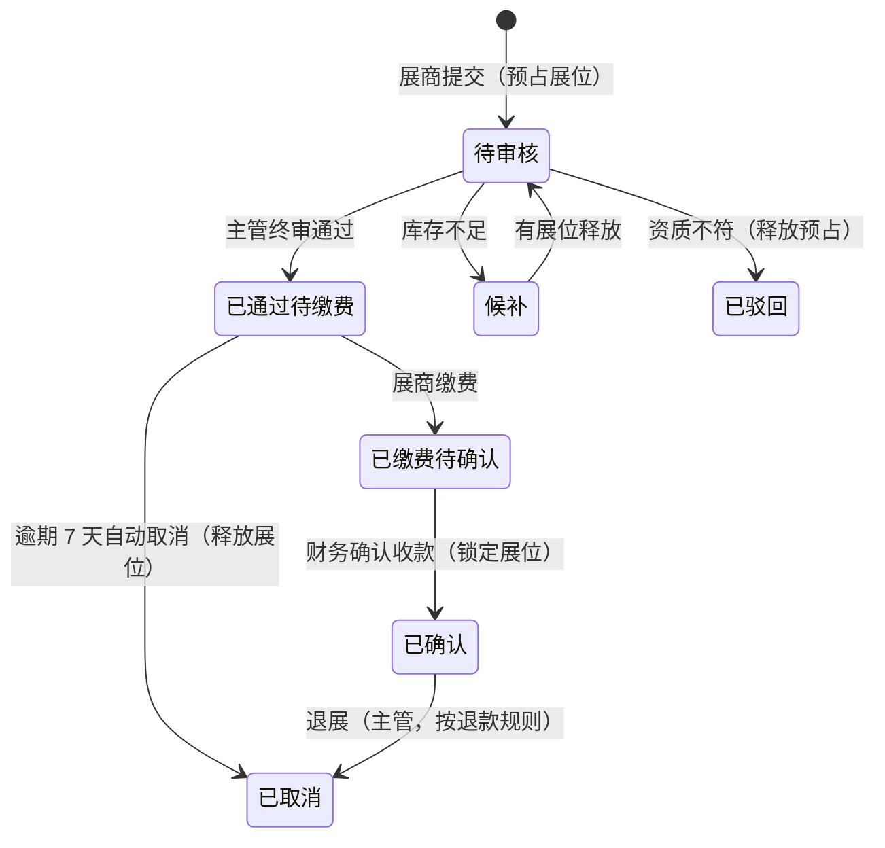

# 14b 袜博会管理 · 运营端页面说明（首篇）

> 端：运营端 PC（`yunying-PC`）　｜　模块：14b 袜博会管理（菜单「文商旅管理 → 袜博会」）
> **本文件 = 模块通用说明（§0）+ 第 1 页**，同目录其余文件只写本页
> 页面版本：v1.0（2026-10-22）　｜　业务分册：`开发PRD/运营管理端分册PRD/14b-袜博会管理.md` **v1.2**
> 同目录：`02-展位申请管理.md`、`03-参观申请管理.md`、`04-参展商管理.md`、`05-日程安排管理.md`、`06-签到管理.md`、`07-资料管理.md`、`08-往期存档回顾.md`

---

## 0. 模块通用说明（本模块其他页面不再重复）

### 0.1 这个模块解决什么问题

展会筹备靠 Excel 划展位、缴费靠财务对账、观众靠纸质登记：**展位重复卖、钱收没收到说不清、来了多少人不知道**。
本模块把「届次配置 → 展位申请 → 缴费确认 → 参观登记 → 现场核销 → 存档回顾」串成一条线，**以届次隔离数据**。

不做：展位靠白板贴纸条；观众到场靠门口点数；往届数据散落各处无法复盘。

### 0.2 角色与权限矩阵

| 功能 | 专员 | 主管 | 财务 | 现场核销 | 无权限表现 |
|---|---|---|---|---|---|
| 展会配置 查看 | ✅ | ✅ | ✅ | ✅ | 菜单不可见 |
| 展会配置 编辑 | ✅ | ✅ | ❌ | ❌ | 按钮隐藏 |
| 展位申请 **初核** | ✅ | ✅ | ❌ | ❌ | — |
| 展位申请 **终审** | ❌ | ✅ | ❌ | ❌ | 按钮隐藏 |
| **展位管理**（类型/展位维护） | ❌ | ✅ | ❌ | ❌ | 按钮隐藏 |
| **缴费状态确认** | ❌ | ❌ | ✅ | ❌ | 按钮隐藏 |
| 参观申请 审核 | ✅ | ✅ | ❌ | ❌ | — |
| 名单导出 / 统计 | ✅ | ✅ | ✅ | ❌ | — |
| 参展商管理 | ✅ | ✅ | ❌ | ❌ | — |
| 日程 编辑 / 发布 | ✅ | ✅ | ❌ | ❌ | — |
| 资料 上传 / 审核 | ✅ | ✅ | ❌ | ❌ | — |
| **核销 / 手工补录** | ❌ | ✅ | ❌ | ✅ | 按钮隐藏 |
| **往届存档 生成** | ❌ | ✅ | ❌ | ❌ | 按钮隐藏 |

> **数据权限**：按**届次隔离**；专员仅能操作被分配的届次，主管可见全部届次。

### 0.3 菜单与端间落点表

| # | 页面 | 运营端文件 | 买家端 | 商户端 | 数据方向 |
|---|---|---|---|---|---|
| P1 | 袜博会列表 | `expo-list.html` | 买家端袜博会首页（届次 / 展位图 / 报名入口） | — | 本端 → 买家端 |
| P2 | 展位申请管理 | `expo-booth.html` | 展商申请展位（**自选展位号**，随申请单携带） | ⚠️ 展商多为商户 → 现有 `industry-service.html` 不含展位申请 | 买家端 → 本端 |
| P3 | 参观申请管理 | `expo-visitor.html` | 观众登记（**提交即出证，需改为待审核**） | — | 买家端 → 本端 |
| P4 | 参展商管理 | `expo-exhibitor.html` | 展商名录 / 展商详情 | — | 本端 → 买家端 |
| P5 | 日程安排管理 | `expo-schedule-manage.html` | 展会日程 / 议程详情 | — | 本端 → 买家端 |
| P6 | 签到管理 | `expo-checkin.html` | 入场码（`V+年+届次+4位流水`） | — | 双向：本端核销 ↔ 端上出示码 |
| P7 | 资料管理 | `expo-material.html` | 资料下载（**需登记解锁**） | — | 本端 → 买家端 |
| P8 | 往期存档回顾 | `expo-archive.html` | 往届回顾页 | — | 本端 → 买家端 |

> **端上待办**：① 买家端参观登记需从「提交即出证」改为「提交 = 待审核，通过后发码」；② 展商申请需支持自选展位号并回传；③ 资料下载需校验登记状态。
> 以上三项已记入 **`mai-APP/移动端原型修改待办.md` #23**（含精确位置与改动步骤）。

### 0.4 核心数据对象

| 对象 | 说明 | 关键字段 | 谁产生 | 谁消费 |
|---|---|---|---|---|
| **届次 Edition** | 一届展会 | 届次 / 年份 / 场馆 / 起止 / 状态 | 主管 | 全模块（隔离键） |
| **展位 Booth** | 一个可售展位 | 编号 / 区域 / 楼层 / 类型 / 价格 / 状态 | 主管 | P2 申请 |
| **展位申请单** | 展商申请 | 申请编号 / 企业 / 展位号 / 金额 / 状态 | 展商 | P2、P4 |
| **参观登记单** | 观众登记 | 入场编号 `V+年+届次+4位` / 姓名 / 手机 / 状态 | 观众 | P3、P6 |
| **参展商 Exhibitor** | 已确认展商 | 展商名 / 展位号 / 缴费 / 资料状态 | P2 确认后生成 | P4、名录 |
| **日程 Agenda** | 议程场次 | 时间 / 标题 / 地点 / 嘉宾 | 专员 | P5、端上 |
| **资料 Material** | 展会资料 | 名称 / 格式 / 访问策略 | 专员 | P7 |

### 0.5 状态机

**① 展位申请单（7 态）**：待审核 → 已通过（待缴费）→ 已缴费（待确认）→ 已确认；另有 候补 / 已驳回 / 已取消

**② 参观登记单（6 态）**：待审核 → 已通过（生成入场码）→ 已核销；另有 已驳回 / 未到场 / 已取消

**③ 展位（3 态）**：可选 / 已售 / 锁定（"临时预占"为逻辑态，不落库）

**④ 届次（5 态）**：筹备中 / 报名中 / 进行中 / 已结束 / 已归档

**禁止路径**

| 场景 | 系统行为 | 提示文案 | 日志 |
|---|---|---|---|
| 已确认展位直接回退 | 不允许，走退展 | — | 是 |
| 重复核销 | 幂等，提示已核销时间 | E-34（**⬜ 未实现**） | 是 |
| 未登记就下载受限资料 | 拦截并引导登记 | E-38（**⬜ 未实现**） | 否 |
| 专员做终审 | 按钮隐藏 | — | 否 |
| 逾期未缴仍占展位 | **不取消**（2026-10-28 起缴费与参展解耦），进催缴名单 | E-16 导出清单 | 否 |

### 0.6 名词与口径

| 名词 | 定义 | 备注 |
|---|---|---|
| 缴费时限 | 审核通过后 **7 个自然日**，逾期自动取消并释放展位 | 到期前 3 天 / 1 天提醒 |
| 核销窗口 | 展会期间**每日开馆前 1 小时至闭馆** | 超窗不可核销 |
| 核销幂等 | 二次扫码提示首次核销时间 | 不产生第二条记录 |
| 到场率 | 已核销 ÷ 登记总数 | 未到场单列，不进分母的说明见 §1 |
| 展位销售率 | 已售 ÷ 总展位数 | — |
| 资料解锁 | 需「参观登记已通过」 | 未通过点击 → 引导登记 |
| 入场编号 | `V` + 年 + 届次 + 4 位流水 | 与展位申请编号规则不同 |
| 数据隔离 | 按**届次**，不是按楼栋 | 专员只看分配届次 |

### 0.6.1 跨端字段差异（只列不一致的）

| 概念 | 运营端 | 端上现状 | 目标口径 |
|---|---|---|---|
| 参观登记 | 6 态（含待审核） | **提交即出证**（无审核） | 端上改为待审核，通过后发码 |
| 展位号 | 申请单携带 `boothNo` | 端上无自选 | 端上自选并回传 |
| 核销 | 扫码 / 手工补录 | 无核销 | 入场码 + 扫码核销 |
| 资料下载 | 需登记解锁 | 直接下载 | 端上校验登记状态 |

### 0.7 本期不做

在线支付（缴费线下 + 财务确认）｜退款流程｜展位图形化排布（改静态图）｜证件打印｜多场馆并行

---

## 1. 袜博会列表 `expo-list.html`

### 1.1 页面说明

| 项 | 内容 |
|---|---|
| 页面目标 | 届次管理 + 本届配置（栏目 / 展位类型 / 展位 / 区域楼层），并复制往届配置快速开新届 |
| 使用角色 | 文商旅运营主管（展位维护）、专员（配置查看/编辑） |
| 入口 | 菜单 → 文商旅管理 → 袜博会 → 袜博会列表 |
| 前置 | 无 |
| 后置 | 配置同步买家端；展位可被 P2 申请 |

### 1.2 本页端间关系

| 项 | 内容 |
|---|---|
| 本页数据来源 | 主管配置 + 复制往届 |
| 本页操作的跨端影响 | 栏目保存 → 买家端首页即时同步；展位维护 → 端上展位图可售状态变化 |
| 依赖的其他端页面 | 买家端袜博会首页 / 展位图 |
| 不涉及的端 | 商户端 |
| 一致性要求 | 数据按届次隔离；删届次仅限草稿 |

### 1.3 页面结构

| 区块 | 内容 |
|---|---|
| 顶部 | 标题「袜博会列表」+ **创建新一届**（空白配置）；要沿用往届结构，用已归档届次行内的「复制模板」 |
| **统计卡（4）** | 历史届次 / 本届展位销售率 / 参展商 / 参观登记 |
| 筛选区 | 年份 / 状态 + 查询 |
| 届次表 | **11 列** |
| 抽屉 | 配置面板（栏目 / 展位类型 / 展位维护 / 区域楼层） |

### 1.4 列表、筛选与排序

| 项目 | 规则 |
|---|---|
| 默认排序 | 年份倒序 |
| 分页 | 不分页 |
| 筛选组合 | 条件之间 **且** |
| 状态 | 筹备中 / 报名中 / 进行中 / 已结束 / 已归档 |
| 空结果 | **无空态提示**（待补） |

### 1.5 字段规格

| 列 | 字段 | 说明 |
|---|---|---|
| 届次 | `edition` | 第 N 届 |
| 年份 | `year` | — |
| 展会名称 | `name` | — |
| 起止日期 | `start`~`end` | — |
| 场馆 | `venue` | — |
| 展览面积 | `area` | ㎡ |
| 展位/已售 | `boothTotal` / `boothSold` | 销售率来源 |
| 展商 | `exhibitorCount` | — |
| 观众登记 | `visitorCount` | — |
| 状态 | `state` | 五态 |
| 操作 | — | **配置**（唯一编辑入口，含「基本信息」Tab）/ 生成存档 / 查看存档（已归档）/ **复制模板**（已归档）/ 删除（仅筹备中且无数据） |

### 1.6 交互规则

| 元素 | 显示条件 | 可点条件 | 点击后 | 禁止表现 |
|---|---|---|---|---|
| 创建新一届 | 始终 | 主管 | 创建**空白**草稿并直接打开配置（基本信息 Tab） | — |
| 复制模板 | 已归档届次 | 主管 | 弹**复制预览**（带过来 / 不带两张清单，默认全选带过来的项）→ 确认后**直接生成新届草稿**并打开配置 | 未选任何项 → 仍可复制（仅生成空壳） |
| 配置 | 全部届次 | 专员/主管 | 打开 4 Tab 配置抽屉（基本信息 / 展会介绍 / 展位管理 / 展示管理） | 已归档届次为只读 |
| 栏目保存 | 配置面板 | 专员/主管 | 同步买家端 | — |
| 展位类型维护 | 配置面板 | **主管** | 增删类型（名称 + 价格必填） | 缺 → E-06 |
| 展位维护 | 配置面板 | **主管** | 增删展位（编号必填） | 缺 → E-09 |
| 区域楼层维护 | 配置面板 | **主管** | 增删区域（区域与楼层必填） | 缺 → E-11 |
| **候选展商搜索** | 展示管理 Tab | 专员/主管 | **输入即筛**：按 展商名 / 类目 / 展位号 模糊匹配（不区分大小写）；最多列 20 条，超出提示细化关键词 | 无匹配 → 空态 + 「清空搜索」 |
| 生成存档 | 状态=已结束 | 主管 | 生成存档报告 | 未结束 → E-42 |
| 删除 | **仅草稿** | 主管 | 物理删除 | 非草稿 → 拦截 |

### 1.7 业务规则与计算口径

| 编号 | 规则 | 触发 | 处理 | 影响端 |
|---|---|---|---|---|
| R-01 | 数据按届次隔离 | 任何时候 | 列表/操作只作用于当前届 | — |
| R-02 | 复制模板生成草稿 | 复制 | **复制**：展会介绍、展位类型（价格带但标待复核）、区域楼层编号结构、平面图、栏目开关、日程天数框架、官方资料与访问策略、须知文案；**不复制**：届次/日期、规模数据、**展位状态（全部重置为可选）**、展示管理已选展商与排序、参展商名录与申请/登记/签到记录、日程具体议程、资料审核状态与下载量、同步时间 | 端上（草稿不同步） |
| R-02a | 复制结果必须复核后同步 | 复制 | 生成的草稿 `syncState = 未同步`，需人工复核价格与展位状态后再「保存并同步」 | 端上 |
| R-03 | 展位销售率 = 已售 / 总数 | 渲染 | 实时 | 端上 |
| R-04 | 仅草稿可删 | 删除 | 已开届次不可删 | — |
| R-05 | 展位三态 | 维护 | 可选 / 已售 / 锁定（预占为逻辑态） | 端上展位图 |
| R-06 | 栏目保存即同步端上 | 保存 | 无需发布 | 端上 |

### 1.8 异常与边界

| 类型 | 场景 | 系统行为 | 提示文案 |
|---|---|---|---|
| 数据 | 展位类型缺名称/价格 | 拦截 | 【已实现】类型名称与价格为必填 |
| 数据 | 展位编号未填 | 拦截 | 【已实现】展位编号为必填 |
| 数据 | 区域楼层未填 | 拦截 | 【已实现】区域与楼层均为必填 |
| 数据 | 展会未结束就生成存档 | 拦截（提示文案在 P8 存档页：E-42） | — |

#### 1.8.1 本页提示语清单（来源：分册 §7.9，编号可回溯）

| 编号 | 场景 | 提示文案 | 形式 | 状态 |
|---|---|---|---|---|
| E-01 | **创建新一届**（空白配置） | 已创建第 {n} 届（空白配置，请先填写届次与日期） | Toast | ✅ |
| E-02 | 生成存档 | 已生成第 {n} 届存档快照（可在「往期存档回顾」查看） | Toast | ✅ |
| E-03 | 查看存档 | 已打开第 {n} 届往期存档回顾 | Toast | ✅ |
| E-04 | 删除草稿 | 已删除第 {n} 届草稿 | Toast | ✅ |
| E-05 | 栏目保存 | 该栏目已保存并同步至买家端 | Toast | ✅ |
| E-46 | **复制模板 · 打开预览** | 从第 {n} 届复制 → 生成新一届草稿（{届次名}） | 弹窗 | ✅ |
| E-47 | **复制模板 · 确认生成** | 已生成第 {m} 届草稿（带入 {k} 项；展位状态已重置为可选，价格待复核） | Toast | ✅ |
| E-48 | 删除有数据的届次 | 该届已有展位/展商数据，不可删除；如需停办请改为「已结束」 | Toast | ✅ |
| E-24 | **展示管理 · 加入首页** | 已加入首页：{展商名} | Toast | ✅ |
| E-24b | **展示管理 · 移出首页** | 已移出首页：{展商名} | Toast | ✅ |
| E-24c | 展示管理 · 精选超上限 | 首页精选最多 8 家，请先移出部分展商 | Toast | ✅ |
| E-24d | 展示管理 · 栏目开关 | 已{开启/关闭}买家端栏目（保存后生效） | Toast | ✅ |
| E-06 | 类型缺必填 | 类型名称与价格为必填 | 行内 | ✅ |
| E-07 | 新增类型 | 已新增展位类型 | Toast | ✅ |
| E-08 | 删除类型 | 已删除展位类型 | Toast | ✅ |
| E-09 | 展位编号未填 | 展位编号为必填 | 行内 | ✅ |
| E-10 | 展位维护 | 已新增展位 / 已删除展位 | Toast | ✅ |
| E-11 | 区域楼层未填 | 区域与楼层均为必填 | 行内 | ✅ |
| E-12 | 区域维护 | 已新增区域/楼层 / 已删除该区域及其展位 | Toast | ✅ |
| E-44 | 无权限 | 无权限，请联系管理员 | Toast | ✅ |
| E-45 | 并发冲突 | 该记录已被他人修改，请刷新后重试 | Toast | ✅ |

### 1.9 通知与消息

| 事件 | 接收人 | 渠道 | 抑制条件 |
|---|---|---|---|
| 新届次创建 | 文商旅运营主管 | 站内 | 一次 |
| 展会结束待存档 | 主管 | 站内 | 一次 |

### 1.10 验收标准

| 编号 | 前置 | 操作 | 预期 | 级别 |
|---|---|---|---|---|
| AC-01 | 有已归档第 17 届 | 点「复制模板」→ 确认 | 生成新草稿：展会介绍 / 展位类型（价格标待复核）/ 区域楼层编号 / 平面图 / 栏目开关 带过来；**展位状态全部为「可选」、已售=0、展商与观众=0、日期留空** | P0 |
| AC-01b | 无历史届次 | 点「创建新一届」 | 生成空白草稿并直接打开配置「基本信息」Tab | P0 |
| AC-01c | 任一配置 | 点「配置」 | 打开 4 Tab 抽屉（基本信息 / 展会介绍 / 展位管理 / 展示管理），**列表无独立「编辑」入口** | P0 |
| AC-01d | 展示管理 | 勾选展商并排序 → 保存 | 买家端首页精选展商板块按所选与顺序渲染；参展商管理页「上首页」列同步为只读状态 | P0 |
| AC-01e | 展示管理 | 在候选搜索框输入「袜机」 | 只列出类目含「袜机」的展商，计数显示「匹配 N 家」；输入框**不失焦**；清空后恢复全量 | P0 |
| AC-01f | 展示管理 | 输入无匹配词 | 显示「没有匹配「xx」的展商」+「清空搜索」按钮 | P1 |
| AC-02 | 草稿届次 | 点删除 | 删除成功 | P0 |
| AC-03 | 已结束届次 | 点删除 | 拦截（仅草稿可删） | P0 |
| AC-04 | 展位类型新增不填价格 | 保存 | 拦截提示必填 | P0 |
| AC-05 | 展会进行中 | 点生成存档 | 拦截提示展会结束后可生成 | P1 |
| AC-06 | 专栏内容修改 | 保存 | 买家端即时同步 | P1 |
